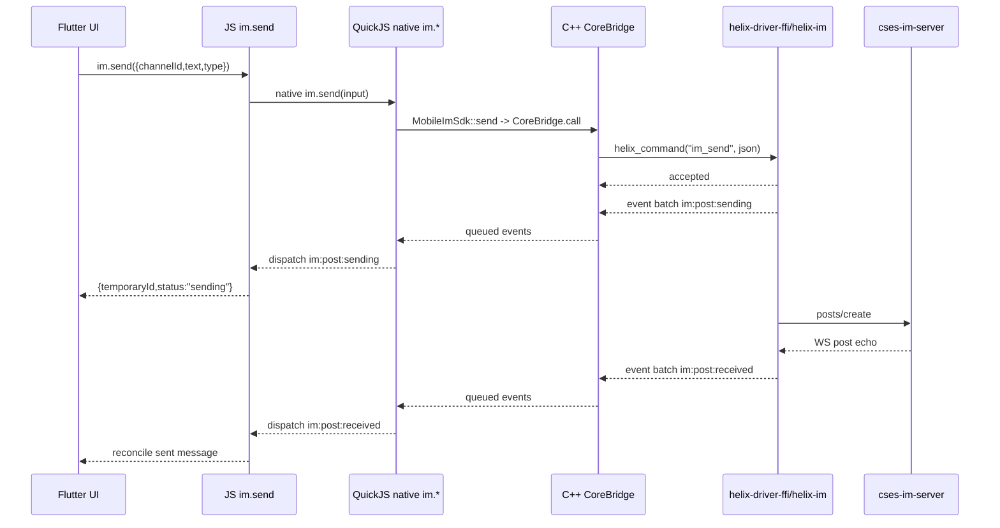

# 移动端 QuickJS 最后一公里接入 SPEC

> 目标：说明移动端集成项目如何把 helix Rust FFI 包成 C++ `CoreBridge`，再注入 QuickJS，
> 最终让 Flutter 侧调用 `im.send(...)` / `xxx.send(...)` 这类业务 API，而不需要理解
> helix 命令名、Go 线协议、字段归一、发送对账和事件批细节。
>
> 本文先保存在 helix 的 `helix-driver-ffi/docs/` 作为契约说明；移动端集成项目必须保留一份副本。

## 1. 结论

最后一公里分三层：

1. **C++ `CoreBridge`**：唯一直接持有 `HelixHandle*`，封装 `helix.h` / `helix.hpp`。
2. **C++ `MobileImSdk` / SDK hpp**：承接移动端 public API、载荷归一、事件等待与错误码映射。
3. **QuickJS native `im.*` binding**：把 SDK 方法注入 JS runtime，JS 直接调用 `im.send({ ... })`，不再用 JS facade 承载业务行为。

移动端调用方只面对 native 注入的 `im.*`：

```js
const receipt = im.send({
  channelId: "01hq0000000000000000000000",
  text: "hello",
  type: "TEXT"
});

im.waitForEvent("im:post:sending", { temporaryId: receipt.temporaryId });
```

`receipt` 只表示 Rust 已接收命令并产生乐观事件，不表示 Go Server 已经发送成功。
发送成功仍以 Rust 经 WS echo 对账后的 `im:post:received` 为准。

## 2. 仓库边界

helix 仓负责：

- Rust FFI ABI：`helix_create_with_network`、`helix_destroy`、`helix_command`、`helix_query`、`helix_query_free`。
- `helix.h` / `helix.hpp`。
- `helix_capabilities` / `helix_version`。
- command / query / event 契约与 Rust/FFI 层测试。
- 多端联调文档和本 SPEC。

移动端集成项目负责：

- C++ `CoreBridge` 类。
- QuickJS 原生类注册。
- C++ `MobileImSdk` / SDK hpp。
- QuickJS native `im.*` binding。
- Android / iOS 构建脚本和原生产物打包。
- C++ 直连真实 `helix-driver-ffi` 冒烟。
- QuickJS 冒烟。
- Flutter 端到端验证。

helix 仓不得新增：

```text
crates/helix-driver-ffi/smoke/mobile_bridge.hpp
crates/helix-driver-ffi/smoke/mobile_bridge_smoke.cpp
crates/helix-driver-ffi/smoke/mobile_core_bridge.js
crates/helix-driver-ffi/smoke/mobile_core_bridge_smoke.mjs
Android / iOS / QuickJS 编译产物
```

当前外部项目根建议：

```text
/workspace/c/mobile-qucik-c++
```

未来如果迁到新的移动端集成项目，必须把本文复制到新项目的 `docs/` 或项目现有文档目录中。

## 3. 外部项目建议结构

下面是建议结构，不要求现在一次性创建所有文件：

```text
/workspace/c/mobile-qucik-c++/
  docs/移动端QuickJS最后一公里接入SPEC.md
  cpp/
    CoreBridge.hpp
    CoreBridge.cpp
    HelixEventQueue.hpp
  quickjs/
    bind_mobile_im.cpp
  smoke/
    cpp_core_bridge_smoke.cpp
    quickjs_core_bridge_smoke.js
    quickjs_im_send_smoke.js
  platform/
    android/
    ios/
```

## 4. C++ CoreBridge 契约

C++ `CoreBridge` 是移动端集成项目的原生门面。它负责把稳定 C ABI 变成易于注册到 QuickJS 的类。

建议公开方法：

```cpp
class CoreBridge final {
public:
  explicit CoreBridge(CoreBridgeConfig config);
  ~CoreBridge();

  JsonValue version();
  JsonValue capabilities();

  Accepted call(std::string_view name, JsonValue payload);
  JsonValue query(std::string_view name, JsonValue payload);

  EventSubscription onEvents(EventListener listener);
  std::vector<BusEnvelope> drainEvents();

  void dispose();
};
```

语义：

- `call(name, payload)` 对应 `helix_command`，只表示命令已被 Rust 接收。
- `query(name, payload)` 对应 `helix_query`，返回 JSON 后必须调用 `helix_query_free` 释放。
- `capabilities()` 对应 `helix_query("helix_capabilities", "{}")` 或 header 暴露的快捷方法。
- `version()` 对应 `helix_query("helix_version", "{}")`。
- `onEvents()` 订阅 `im:__bus__` 批事件。
- `drainEvents()` 用于 QuickJS 线程主动拉取事件，避免跨线程直接调用 JS 函数。
- `dispose()` 后任何方法必须返回稳定错误，不能崩溃。

FFI 回调铁律：

- `on_domain_events_batch(ptr, len)` 中的 `ptr` 只在回调期间有效。
- C++ 必须在回调内立即拷贝到自己的 buffer。
- 不允许把 Rust 借出的指针保存到 QuickJS、Flutter 或其他线程。
- QuickJS API 只能在 QuickJS runtime 所属线程调用。

推荐事件模型：

1. Rust FFI 回调进入 C++。
2. C++ 立即 memcpy 事件批。
3. C++ 写入 `HelixEventQueue`。
4. `MobileImSdk` 通过 `drainEvents()` / `waitForEvent()` 读取事件。
5. QuickJS native `im.*` 把可渲染结果交回 JS / Flutter。

## 5. QuickJS native class 契约

QuickJS 侧必须注册等价对象：

```ts
declare const im: {
  version(): VersionInfo;
  capabilities(): CapabilitySet;
  send(input: SendInput): SendReceipt;
  waitForEvent(name: string, spec?: Record<string, unknown>): BusEnvelope;
  drainEvents(): BusEnvelope[];
  dispose(): void;
};
```

QuickJS 注册必须覆盖：

- runtime/context 生命周期。
- `im.send`。
- `capabilities`。
- `version`。
- `waitForEvent` 或 `drainEvents`。
- `dispose`。

错误必须统一成 JS 对象：

```js
{
  code: "FFI_INVALID_JSON",
  message: "invalid json payload",
  detail: {}
}
```

JS 不应通过解析错误字符串判断业务状态。

## 6. native im.* 契约

`im.send(...)` 输入：

```ts
type SendInput = {
  channelId: string;
  text: string;
  type?: "TEXT" | "FILE" | string;
  temporaryId?: string;
};
```

`im.send(...)` 行为：

1. 如果 Flutter 没传 `temporaryId`，C++ `MobileImSdk` / native `im.*` 生成一个。
2. 调用 `core.call("im_send", { channelId, temporaryId, text, type })`。
3. 等待或监听匹配 `temporaryId` 的 `im:post:sending`。
4. 返回 optimistic receipt。
5. 后续 `im:post:received` 到达时，再由事件流驱动 UI 收敛为已发送。

返回：

```ts
type SendReceipt = {
  temporaryId: string;
  status: "sending";
};
```

禁止事项：

- 不在 JS 中拼 Go `/posts/create` 请求体。
- 不在 JS 中补 cookieId / userId / companyId / token。
- 不在 JS 中声明发送成功。
- 不在 JS catch 中合成 `im:post:send-failed`。
- 不把 IM 业务规则搬到 Flutter。
- 不恢复 `js/im_api.js`、`createImApi(core)` 或同类 JS 业务 facade。

`xxx.send(...)` 可以作为未来多业务命名空间形式；P0 建议先落 `im.send(...)`。

## 7. 启动能力检查

移动端初始化时必须先调用：

```js
const caps = core.capabilities();
```

最低检查：

- `caps.abi === 1`。
- `caps.bus === "im:__bus__"`。
- `caps.commands` 包含 `im_send`。
- `caps.queries` 包含 `helix_capabilities`。
- `caps.queries` 包含 `helix_version`。
- `caps.queries` 包含 `im_query_dialog_list`。
- `caps.queries` 包含 `im_query_messages_by_channel`。
- `caps.events` 包含 `im:post:sending`。
- `caps.events` 包含 `im:post:received`。
- `caps.events` 不包含 `im:post:send-failed`。

能力检查失败时，应拒绝初始化业务 UI，并输出明确错误。

## 8. 发送链路

发送链路必须遵守 PC/Tauri 与移动端一致的状态机：



发送失败显示不靠 `im:post:send-failed`：

- 正常路径：`im:post:sending` -> `im:post:received`。
- 无 echo 超时：Rust 内核把本地状态收敛为 `send_status='unsend'`。
- UI 从后续查询、投影刷新或重载中展示未发送。
- 若未来需要失败事件，必须 PC/Tauri 与移动端共同升级契约。

## 9. 验证分层

### S0：C++ 直连真实 helix-driver-ffi

位置：移动端集成项目。

必须链接真实 helix 产物，不能用 `rust_core_mock.cpp` 代替。

验收：

- 创建 `CoreBridge` 成功。
- `version()` 返回 ABI 版本。
- `capabilities()` 覆盖 command / query / event 检查。
- `call("im_send", payload)` 触发 `im:post:sending` 事件批。
- `query("im_query_dialog_list", {})` 返回 JSON。
- `query("im_query_messages_by_channel", payload)` 返回 JSON。
- `dispose()` 后调用稳定失败，不崩溃。

### S1：QuickJS native im.* smoke

位置：移动端集成项目。

验收：

- JS runtime 能完成 native `im.*` 注入。
- JS 能调用 `im.version()`。
- JS 能调用 `im.capabilities()`。
- JS 能调用 `im.send(...)`。
- JS 能通过 `im.waitForEvent()` 或 `im.drainEvents()` 读取事件批。
- JS 能调用 `im.dispose()`。

### S2：QuickJS UserCase smoke

位置：移动端集成项目。

验收：

- `im.send({ channelId, text, type })` 不暴露 `im_send` 给 Flutter 调用方。
- `im.send(...)` 返回 `{ temporaryId, status: "sending" }`。
- 事件批中出现匹配 `temporaryId` 的 `im:post:sending`。
- `im:post:received` 到达后能通过事件流驱动对账。
- 不出现 `im:post:send-failed`。

### S3：Android / iOS 原生产物 smoke

位置：移动端集成项目。

验收：

- Android 能加载 QuickJS + C++ bridge + helix native library。
- iOS 能加载 QuickJS + C++ bridge + helix native library。
- 符号可见性、架构切片、rpath / loader path 正确。

### S4：Flutter 端到端验证

位置：移动端集成项目或正式移动端仓。

当前如果本机缺 Android / iOS / Flutter e2e 环境，先记录为环境缺口；S0-S2 仍可先完成最后一公里前置验收。

验收目标：

- Flutter 点击发送。
- 调到 JS `im.send(...)`。
- JS 调 QuickJS native `im.send`。
- C++ 调 Rust FFI。
- Rust 产生 `im:post:sending`。
- Go WS echo 后 Rust 产生 `im:post:received`。
- Flutter UI 从事件批完成乐观行对账。

## 10. 后续执行清单

- [ ] 外部实现计划已创建到 `/workspace/c/mobile-qucik-c++/docs/移动端QuickJS外部联调实现计划.md`，后续按该计划执行。
- [ ] 确认 QuickJS 使用源码嵌入、静态库还是系统库。
- [ ] 确认 Android NDK / iOS Xcode 本机环境。
- [ ] 确认 Flutter 与 QuickJS 的事件调度边界。
- [ ] 实现 C++ `CoreBridge`。
- [ ] 实现 C++ `MobileImSdk` / SDK hpp。
- [ ] 注册 QuickJS native `im.*`。
- [ ] 跑 S0 C++ 直连真实 helix 冒烟。
- [ ] 跑 S1 QuickJS native `im.*` 冒烟。
- [ ] 跑 S2 QuickJS UserCase 冒烟。
- [ ] 环境就绪后补 S3 / S4。
