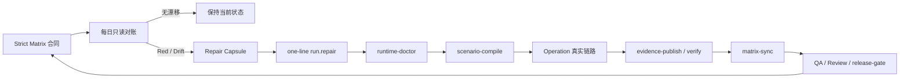

# one-line 与 Strict Matrix 每日对账闭环

## 定位

Strict Matrix 是发布合同真源，one-line Supervisor 是跨仓执行控制面，每日对账 Task 是只读巡检器。三者职责不能合并：

| 组件 | 负责什么 | 不负责什么 |
| --- | --- | --- |
| Strict Matrix | 定义每个 UC 在七个证据平面的期望 | 不运行测试、不自证 Green |
| one-line Supervisor | 按 Operation 修复 UI/Helix/Go/Native 并发布 durable evidence | 不凭 spec、代码或旧截图直接改 Green |
| 每日对账 Task | 检查合同漂移、证据过期、跨仓版本和运行环境 | 不自动修改业务代码、不占用 Native 槽跑全量回归 |

## 四端对账范围

每日对账的运行链路固定覆盖四个仓库，缺一端都不能称为“全链路无漂移”：

| 端 | 仓库 | 每日必须核对的架构边界 |
| --- | --- | --- |
| PC UI/Native | `/System/Volumes/Data/workspace/angular/cses-client` 的 `message-v4` | UI 只提交 intent、消费 Helix RenderNode；不得新增业务 command alias、同步状态机、HTTP 分批或业务投影拼装 |
| 业务内核 | `/System/Volumes/Data/workspace/rust/helix` | command、Effect、projection、storage schema、contract epoch/hash 是跨端真源；native/FFI 语义必须一致 |
| Go 后端 | `/System/Volumes/Data/workspace/golang/cses-im-server` | HTTP route、CommonRes、WS action、Pulsar fanout、Consul 和 `mattermost-imv2` 表必须与 UC 合同一致 |
| Mobile QuickJS/FFI | `/System/Volumes/Data/workspace/c/mobile-qucik-c++` | 必须消费同一 Helix FFI 合同；command/event/RenderNode ABI、pin 与 PC 一致，不得重新实现业务语义 |

`/System/Volumes/Data/workspace/pd/message` 只作为参考设计、Scenario 和 one-line Supervisor 控制面输入，不计作第五个运行端，也不能用设计 PASS 替代四端证据。

## 架构漂移检查

- **合同漂移**：四端记录的 Helix commit、contract epoch/hash、command/event/RenderNode ABI 不一致。
- **职责漂移**：PC 或 Mobile 新增 Helix 未声明的业务 alias、状态机、字段推导、HTTP/WS 策略。
- **协议漂移**：Helix endpoint/body/response/WS action 与 Go 当前路由或 handler 不一致。
- **存储漂移**：Helix 本地表、Go `mattermost-imv2` 表、cursor/read watermark 或字段语义不一致。
- **证据遗漏**：某个 Gate 只有 PC、只有 Mobile、只有 HTTP 200、只有 WS 或只有数据库事实。
- **版本串证**：旧 evidence bundle 的四仓 HEAD、contract hash、Go build 或 FFI artifact 与当前运行不一致。

## 主闭环

## 每日任务输出

每日任务应输出：

1. 当前 `contract_epoch + sha256` 与四个运行仓 HEAD、分支、dirty 状态；pd/message 另列为控制面版本。
2. Green、Red、Blocked、Unknown、Stale 的 Gate 数量及昨日变化。
3. 按 UI、Helix、HTTP、WS、Local Storage、imv2、Native、Trace 分面的缺口数量。
4. Consul 当前仍是否指向 `mattermost-imv2`，只记录脱敏地址和 KV key。
5. 每个 P0/P1 问题的 repair capsule、责任仓和 one-line 下一阶段；跨端不一致必须列出 producer 与 consumer 两端。
6. 明确区分 design-pass、mock-pass、runtime-pass、canonical-green、full-gate-green。

## 推荐节奏

- 每天北京时间 08:30（`Asia/Shanghai`）：只读对账，通常不启动服务、不跑全量 Native。
- 每次 Helix contract epoch/hash 变化后：立即额外对账一次，旧 evidence 自动 Stale。
- 发布候选前：显式启动 one-line release profile，必须达到 100% UC/执行覆盖和 `releaseEligible=true`。

每日对账报告不直接改 Strict Matrix 状态。只有 one-line 真实运行产出的 durable bundle 通过 `evidence-verify`，再由 `matrix-sync` 更新 canonical status。
