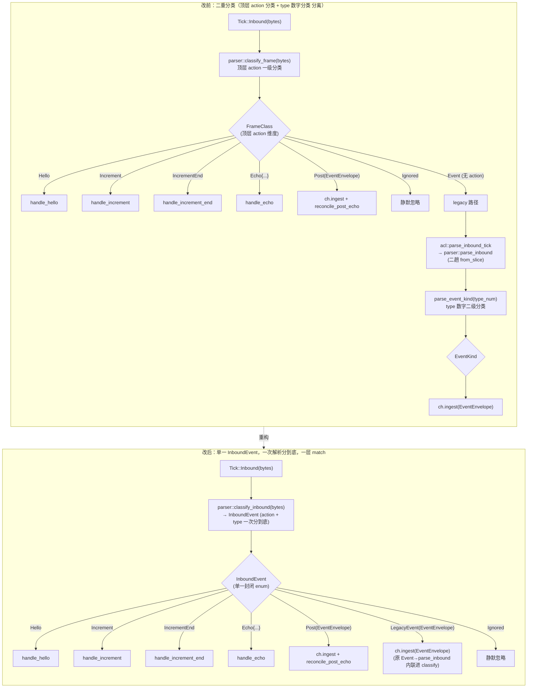

# 重构 A · 合并二重分类（FrameClass + EventKind → 单 InboundEvent enum）设计 spec

> 范围：纯 helix-im 内部重构，**零行为变更**。不改 helix-core 的 Effect/Tick 变体。
> 真源：与现网 cses-client im 行为有争议时以现网为准；回放测试保持全绿（断言不变）。

---

## 背景（现状痛点）

入站帧（`Tick::Inbound(bytes)`）当前经过**二重分类**，两个 enum、两条解析入口、两层 match：

### 第一重：顶层 `action` 分类（`parser.rs`）

`classify_frame(bytes) -> FrameClass`（`parser.rs:223`）按真 Go 信封顶层 `action` 字段分类：
`FrameClass`（`parser.rs:168`）有 8 个变体 —— `Hello / Increment / IncrementEnd / Echo{..} / Post(EventEnvelope) / Ignored / Event`。
其中 `Event` 变体是**逃逸舱**：表示「无 `action` 的 legacy `{event,data}` 数值帧」，**不携带任何解析结果**，只是一个「请走第二条解析路径」的信号。

### 第二重：`type` 数字分类（同 `parser.rs`，但走另一条入口）

当第一重落到 `FrameClass::Event` 时，`module.handle`（`module.rs:1051`）再调
`acl::from_tick::parse_inbound_tick`（`acl/from_tick.rs:10`）→ `parser::parse_inbound`（`parser.rs:102`），
内部 `parse_event_kind(type_num) -> EventKind`（`parser.rs:586`）按 `event_type` 数字（1/2/3/6/n）二次分类，
产出带 `EventKind` 的 `EventEnvelope`。

### 痛点

1. **`bytes` 解析两趟**：`classify_frame` 已 `serde_json::from_slice` 一次判 `action` 缺失（落 `Event`），
   `parse_inbound` 又 `from_slice` 一次重解析同一 `bytes`（`parser.rs:103`）。
2. **module.handle 两层 match 套娃**（`module.rs:971` 外层 `match tick` → `974` 内层 `match classify_frame` →
   `1048` `Event` 臂落出去 → `1051` 又一层 `match parse_inbound_tick`）。
3. **加一种"顶层 action 形态"的帧**要动 `FrameClass` + `classify_frame`；**加一种"type 数字语义"**要动
   `EventKind` + `parse_event_kind`。两个维度耦合在不同文件路径，新增解析点散落。
4. **`Event` 变体语义弱**：它不是"一类帧"，而是"分类失败后请走旧路"的控制流标记，破坏 enum"分到底"的封闭性。

> ⚠️ 关键澄清：**本次合并的是「顶层分发分类」这一重**——即把 `FrameClass`（含逃逸舱 `Event`）与其引出的
> 第二趟 `parse_inbound`/`parse_event_kind` 合成**一次解析、一个分发 enum**。
> `EventKind`（type1/2/3/6 的**落库 + 分桶语义**）**保留不变**：它是 `EventEnvelope.kind` 的字段类型，
> 被 `channel.rs`、`acl/to_effect.rs`（`event_to_upsert_op` / `sync_mutation_emits` 的 4 臂 match）、
> `sort_events_by_bucket` 共同消费，删它会牵动落库语义（超出本重构「零行为变更」边界）。
> 因此**新 `InboundEvent` 是「分发维度」的单一 enum，内部仍携带 `EventEnvelope`（其 `.kind: EventKind` 不动）**。

---

## 目标设计

把「顶层 action 分发 enum `FrameClass`」+「legacy `Event` 逃逸舱引出的第二趟解析」合并为：
**单一 `InboundEvent` enum + 单一 `classify_inbound(bytes) -> InboundEvent` 入口**，一次 `from_slice`、一次分到底。
`module.handle` 的 `Tick::Inbound` 分支退化为**一层 match**。

### 新 enum 定义草案（可编译，字段/变体齐全）

```rust
// crates/helix-im/src/parser.rs（取代 FrameClass）

use crate::state::{ChannelId, Seq, ServerId};
use crate::sync_session::{EventEnvelope, IncrementChannel};

/// 入站 WS 帧一次解析分到底的结果（取代 `FrameClass` + legacy `Event`→`parse_inbound` 二趟）。
///
/// 分发维度（顶层 `action` + 无 action 的 legacy 数值帧）一次性归类；每个携带数据的变体
/// 都装**已解析好的强类型载荷**，`module.handle` 不再二次解析。
/// 边界零信任（helix-im 不变量 4）：任一变体的解析失败 → `Ignored`（不 panic / 不 unwrap）。
#[derive(Debug, PartialEq, Eq)]
pub enum InboundEvent {
    /// hello 握手帧，携带 connectionId（A4 握手；真 Go 单向下发）。
    Hello(String),

    /// `increment_channel` 帧（B-rest）：per-channel 增量推送，载已解析 IncrementChannel。
    Increment(IncrementChannel),

    /// `increment_channel_end` 帧（B-rest）：本批增量收尾。
    /// `Some(channel_id)`=某 parent 子 topic 批次结束；`None`=hello/重连整批 global end。
    IncrementEnd(Option<ChannelId>),

    /// `posted` 兼容路径的 echo 回声帧（C1 §4.5 发送对账，向后兼容历史单测）。
    /// 真 wire 在线广播走 `Post`（下一臂）；`posted`+非空 temporary_id 仅作既有兼容路径。
    Echo {
        channel_id: ChannelId,
        seq: Seq,
        temporary_id: String,
        server_id: ServerId,
    },

    /// 真 Go 在线广播新消息/echo 统一帧（action==`post`，C1 sync-v2）。
    /// 载已解析 `EventEnvelope`（`kind` 恒 `EventKind::PostUpsert`），喂 channel gate（ch.ingest）。
    Post(EventEnvelope),

    /// 无 `action` 的 legacy `{event,data}` 数值帧（抽象 wire / 既有测试）。
    /// **改前**此处是空信号变体 `Event`（需 module 再调 parse_inbound 二解析）；
    /// **改后**直接携带 `parse_inbound` 解析好的 `EventEnvelope`（`kind` 由 type 数字派生），
    /// module 直接 `ch.ingest`，不再二趟解析。
    LegacyEvent(EventEnvelope),

    /// 运维/状态帧（status_change / typing / presence…）或边界解析失败——优雅忽略。
    /// 不报错、不刷日志（零信任：非法 JSON / 缺字段一律落此，不 panic）。
    Ignored,
}
```

> 注：`LegacyEvent` 内的 `EventEnvelope.kind: EventKind` 仍由 `parse_event_kind(event_type)` 派生，
> `EventKind` 枚举与 `type_num()` / `sort_events_by_bucket` / `event_to_upsert_op` 一字不动。

### 数据流对比（mermaid）



---

## 逐文件改动点（file:函数，精确）

### `crates/helix-im/src/parser.rs`

1. **新增 `enum InboundEvent`**（取代 `enum FrameClass`，`parser.rs:168`）：见上「新 enum 定义草案」。
   - 删 `FrameClass`；变体 `Hello / Increment / IncrementEnd / Echo / Post / Ignored` 原样迁入；
   - `FrameClass::Event`（空信号）→ `InboundEvent::LegacyEvent(EventEnvelope)`（携带解析好的载荷）。
2. **新增 `pub fn classify_inbound(bytes: &[u8]) -> InboundEvent`**（取代 `classify_frame`，`parser.rs:223`）：
   - 复用现有逻辑：`from_slice` 一次得 `v`；`match v.get("action")`：
     - `"hello"` → `Hello`；`"increment_channel"` → `Increment`；`"increment_channel_end"` → `IncrementEnd`；
       `"post"` → `parse_post_frame(&v).map(Post)`；`"posted"` → `classify_echo(&v)`（返回改为 `InboundEvent`）；
       `Some(_)` → `Ignored`；
     - **`None`（无 action）臂**：原 `=> FrameClass::Event` 改为 **内联调 `parse_inbound_value(&v)`**
       （见下点 4），成功 → `LegacyEvent(ev)`，失败 → `Ignored`（debug log，保留原 `module.rs:1062-1064` 的
       「parse error 静默 drop」语义）。
   - 边界零信任：`from_slice` 失败 → `Ignored`（与 `classify_frame:226` 同）。
3. **`classify_echo`（`parser.rs:275`）**：返回类型 `Option<FrameClass>` → `Option<InboundEvent>`，
   `FrameClass::Echo` → `InboundEvent::Echo`（仅改类型名，逻辑零变更）。
4. **重构 `parse_inbound`（`parser.rs:102`）拆出 `parse_inbound_value(&serde_json::Value)`**：
   - 把 `parser.rs:106-145`（取 `data` / `channel_id` / `seq` 三级 fallback / `event_type` /
     `parse_event_kind` / `extract_post_fields` / `msg_id` / 构造 `EventEnvelope`）的主体下沉为
     `fn parse_inbound_value(v: &serde_json::Value) -> Result<EventEnvelope, ImError>`；
   - `pub fn parse_inbound(bytes)` 退化为 `from_slice(bytes)? → parse_inbound_value(&v)`
     （保留 pub 签名，acl/from_tick.rs 与既有测试不破）。
   - 这样 `classify_inbound` 的 `None` 臂复用 `parse_inbound_value(&v)`，**消除第二趟 `from_slice`**（痛点 1）。
5. 保留不动：`extract_post_fields` / `parse_hello` / `parse_post_frame` / `parse_increment_channel` /
   `parse_sync_response` / `parse_channel_events` / `parse_messages_map` / `parse_event_kind` /
   `sort_events_by_bucket` / `SYNC_EVENTS_PER_ENTRY`。

### `crates/helix-im/src/module.rs`

6. **`handle` 的 `Tick::Inbound(bytes)` 分支（`module.rs:972-1073`）改为一层 match**：
   - `match crate::parser::classify_frame(...)` → `match crate::parser::classify_inbound(bytes.as_bytes())`；
   - 6 个原变量臂（Hello/Increment/IncrementEnd/Echo/Post/Ignored）类型名 `FrameClass::` → `InboundEvent::`，
     **臂体零变更**；
   - **删除 `FrameClass::Event => {}` 逃逸臂（`module.rs:1048`）及其后的 legacy fallthrough 块
     （`module.rs:1050-1072` 整段 `match acl::from_tick::parse_inbound_tick`）**；
   - 新增 `InboundEvent::LegacyEvent(ev) => { if let Some(ch) = ...channels.get_mut(&ev.channel_id) { ch.ingest(...) } }`
     臂：把原 `module.rs:1052-1059` 的 `Ok(ev)` 落库逻辑（`ch.ingest` + 未注册静默忽略）原样迁入。
   - 原 `Err(ImError::Parse)` 静默 drop（`module.rs:1062-1064`）的语义迁到 `classify_inbound` 的 `None` 臂
     内部（解析失败 → `Ignored` + `tracing::debug!`），行为等价。
7. **文档注释更新**：`module.rs:118 / 885 / 913` 提及 `classify_frame` / `FrameClass::Echo` / `FrameClass::Post`
   的注释 → 改为 `classify_inbound` / `InboundEvent::*`（仅注释，非代码）。

### `crates/helix-im/src/acl/from_tick.rs`

8. ~~**保留 `parse_inbound_tick`（`from_tick.rs:10`）不删**~~ → **已删（R4-tombstone，drift-review 收口）**：
   原 defer 理由「仍 `pub`、仍被既有测试可能引用」已证伪——重构 A 后全仓 src+tests grep `parse_inbound_tick`
   零调用方（仅剩历史注释提及），是死代码。已删除该函数（`accepts_tick` 保留），并清掉随之失活的
   `ImError` / `EventEnvelope` import。

### 测试文件（类型名跟随，断言不变；详见「回放测试影响」）

9. `tests/increment_parse_test.rs`、`tests/post_action_inbound_test.rs`、`tests/real_go_frames_test.rs`：
   `classify_frame` → `classify_inbound`，`FrameClass::` → `InboundEvent::`（import + match/assert 臂）。

---

## 不变量保持

### HX-C001（helix-core 零运行时 / 零平台依赖）
不动 Cargo.toml、不引入任何 tokio/sqlx/reqwest 依赖；纯 helix-im 内部 enum 重命名 + 解析合流。✅

### HX-C002（async port Send 边界 + 状态禁 `&'a`）
`InboundEvent` 全部变体为 owned（`String` / `ChannelId`(Copy) / `IncrementChannel`(含 `Bytes`) /
`EventEnvelope`(owned)），无 `&'a` 借用，可跨 step / 进闭包。`classify_inbound` 同步纯函数，无 async。✅

### HX-C004 / HX-C005（features additive / 热路径零分配 O(1)）
- features 不动。✅
- **热路径反而优化**：`LegacyEvent` 路径消除第二趟 `serde_json::from_slice(bytes)`（痛点 1），
  legacy 帧解析从两趟降一趟；其余路径分配不变（`extract_post_fields` 仍一次）。
  `parse_event_kind` 用 `&'static str` 语义不变。✅

### HX-C006 / HX-C007 / HX-C008（FFI 边界 / Effect 批处理 / sync-wire 契约）
- 不碰 FFI 边界、不碰 Effect 批处理、不碰 sync cursor/续拉契约（`parse_sync_response` 整族不动）。✅

### handle 同步纯函数
`classify_inbound` 与 `parse_inbound_value` 均为同步纯函数（输入 bytes/Value → 输出 enum/Result），
零 I/O、零 await、零 spawn；副作用仍只经 `module.handle` 的 `out.push(Effect::..)`。一层 match 后臂体未变。✅

### 边界零 panic / 零信任（不变量 4）
- `classify_inbound`：`from_slice` 失败 → `Ignored`；`None` 臂 `parse_inbound_value` 失败 → `Ignored`（debug log）。
- `parse_inbound`（pub）保留 `Result` 语义（`from_slice` Err → `ImError::Parse`），既有 fail-fast 调用方不破。
- 所有取字段沿用 `as_u64`/`as_str` + `.ok_or_else` / `unwrap_or_default`，**零新增 `unwrap`/`expect`**。✅

> 行为真源不变：`post`/`posted`/`increment_*`/legacy 数值帧的分类判定逻辑逐字迁移，不改与现网 cses-client
> 对齐的任何判定（action 名、temporary_id 非空、26 字符 id gate、event_seq 三级 fallback、type 分桶）。

---

## 回放测试影响

> 原则：**仅类型名跟随重命名，所有断言语义/期望值不变**。`cargo test -p helix-im` 应保持全绿。

| 测试文件 | 改动 | 断言变化 |
|---|---|---|
| `tests/increment_parse_test.rs` | import `FrameClass` → `InboundEvent`；`classify_frame` → `classify_inbound`；match/`assert_eq!` 臂 `FrameClass::Increment`/`::Ignored` → `InboundEvent::*`（`:42/:150/:164`） | 无（字段断言、Ignored 期望不变） |
| `tests/post_action_inbound_test.rs` | `classify_frame`→`classify_inbound`；`FrameClass::Post(_)` → `InboundEvent::Post(_)`（`:436`）；注释提及更新 | 无（仍断言解析成 Post + 后续 reconcile/timer 序列不变） |
| `tests/real_go_frames_test.rs` | 注释提及 `FrameClass::Ignored` → `InboundEvent::Ignored`；若有 `classify_frame` 调用同步改名 | 无（运维帧零 effect / 零 panic 期望不变） |
| `tests/echo_reconcile_test.rs` 等驱动级回放（喂 Tick → 断 Effect） | **零改动**（走 `module.handle` 黑盒，不直接引 `FrameClass`） | 无 |
| legacy 数值帧相关回放（走 `LegacyEvent` 新路径） | 黑盒不变 | **必须验证**：legacy `{event,data}` 帧经新 `LegacyEvent` 臂仍 `ch.ingest`，Effect 序列与改前 `Event`→`parse_inbound_tick` 路径逐条一致 |

**关键回归点**：legacy 数值帧路径从「`Event` 逃逸 + `parse_inbound_tick`」改为「`classify_inbound` 内联
`parse_inbound_value` + `LegacyEvent` 臂」。必须有一条回放断言「同一 legacy 帧 → 同一 Effect 序列」
（若现有 `gate_test.rs` / `replay.rs` 已覆盖数值帧 ingest，则天然回归；否则补一条锚定测试）。

`cargo test -p helix-im` 全量 + 不改热路径不必跑 stress_test。

---

## 风险与回滚

### 风险
1. **legacy 路径解析失败语义漂移**：改前 `Event` 臂的 `parse_inbound` 失败走 `module.rs:1062 Err(ImError::Parse)`
   → `tracing::debug! + 静默 drop`；改后落 `classify_inbound` 的 `None` 臂 → `Ignored` + debug log。
   两者对 module 都是「无 effect、无 panic」，但需确认**无测试断言 `parse_inbound_tick` 返回 `Err`**（grep 校验）。
   缓解：`parse_inbound`（pub）保留 Result 语义不删，只有 module 活路径改走 `Ignored`。
2. **`classify_echo` / `parse_post_frame` 返回类型改名**触及 `posted`/`post` 兼容路径——逐字迁移，
   靠 `post_action_inbound_test.rs` 回归。
3. **遗漏注释/测试中的 `FrameClass` 引用**导致编译失败（非运行时风险，编译即暴露）。

### 回滚
- 纯 helix-im 内部、单 PR、零 schema/协议变更 → 直接 `git revert` 该 commit 即恢复 `FrameClass` + 二趟解析。
- 验收门：`cargo check -p helix-im` + `cargo test -p helix-im` 全绿；
  `cargo tree -p helix-core | grep -iE 'tokio|sqlx|reqwest'` 仍空（本重构不碰 core，附带验证）。
