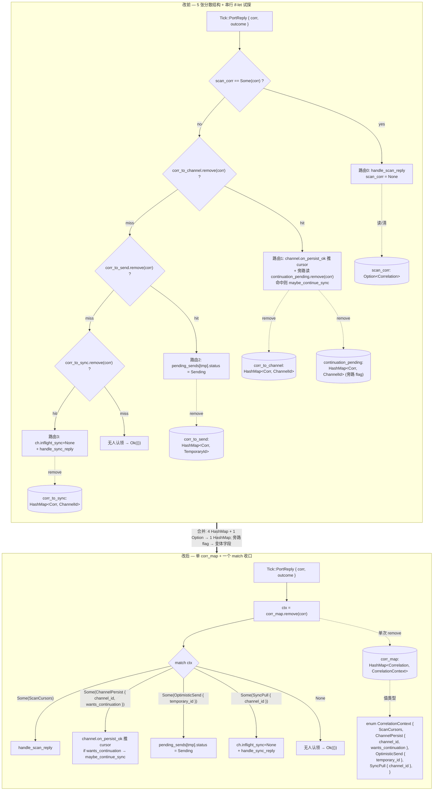

# B · 统一 corr 回报路由表（5 张分散结构 → 单 corr_map + CorrelationContext enum）

> 重构 spec —— 仅 helix-im 内部，不改 helix-core 的 Effect/Tick。
> 对应文件：`crates/helix-im/src/state.rs`、`crates/helix-im/src/module.rs`。
> `acl/to_effect.rs` **不涉及**（它是纯 Effect 翻译，不持有 corr 路由表）。

---

## 背景（现状痛点）

`ImState`（`state.rs`）当前用 **5 张分散结构** 各管一类异步回报（`Tick::PortReply { corr, outcome }`）的路由：

| 字段 | 类型 | 语义（回报类别） | 注册点（module.rs 函数） |
|---|---|---|---|
| `scan_corr` | `Option<Correlation>` | on_start `Scan(_helix_monotonic)` 回报 → 载入 cursor + proactive resync | `on_start` |
| `corr_to_channel` | `HashMap<Correlation, ChannelId>` | channel sync **Persist** 回报 → `on_persist_ok` 推 cursor | `handle_sync_reply`（Events / Snapshot 两处 insert） |
| `continuation_pending` | `HashMap<Correlation, ChannelId>` | E3 续拉**意图旁路标记**（与上一行同一 `persist_corr` 并存） | `handle_sync_reply`（Events 分支，`needs_continuation` 时） |
| `corr_to_send` | `HashMap<Correlation, TemporaryId>` | P1 乐观落库 **Persist** 回报 → `PendingSend` 推进 Sending | `handle_send_message` |
| `corr_to_sync` | `HashMap<Correlation, ChannelId>` | sync/notify **HTTP** 回报 → 清 inflight + `handle_sync_reply` | `emit_proactive_resync_for` / `maybe_continue_sync` / `handle_timer`(gate 超时) |

**痛点：**

1. **`handle_port_reply` 是 ~100 行串行 if-let 试探链**（module.rs `handle_port_reply`）：路由 0 比 `scan_corr` → 路由 1 `corr_to_channel.remove` → 路由 2 `corr_to_send.remove` → 路由 3 `corr_to_sync.remove`，逐张 map 试。一个 corr 的归属靠"哪张表先命中"隐式决定，类别互斥关系**散落在控制流**而非类型里。
2. **加一类 HTTP/Persist 回报要散改 ≥3 处**：新增字段（state.rs `struct` + `new()` + 可能 `Disconnected` 清理）+ 新增 if-let 分支（module.rs）+ 注册点 insert。容易漏（如忘了在 `Disconnected` 清理新表 → 重连后 corr 泄漏）。
3. **`continuation_pending` 是寄生旁路**：它和 `corr_to_channel` 用**同一个** `persist_corr` 作 key，本质是"channel persist 回报上的一个布尔标志"，却被建成独立 HashMap，导致路由 1 里要额外 `continuation_pending.remove(&corr)` 一次。语义上不是"第 5 类回报"，是"第 1 类的一个属性"。
4. **清理点不统一**：`Disconnected` 分支手动 `corr_to_sync.clear()` + `continuation_pending.clear()`，但 `corr_to_channel`/`corr_to_send`/`scan_corr` 不清——这种"清谁不清谁"的判断也散在代码里，无单一真源。

---

## 目标设计

合并成**单一路由表** `state.corr_map: HashMap<Correlation, CorrelationContext>`，`CorrelationContext` 为 **tagged enum**，每个变体携带该类回报所需的全部上下文。`handle_port_reply` 收口为**一次 `remove` + 一个 `match`**。加新一类回报 = **加一个枚举变体 + 一个 match 臂**（外加注册点 insert），不再散改 state.rs 字段 + new() + 清理 + if-let 四处。

### 新 enum 定义草案（state.rs，可编译）

```rust
/// 单一 corr 路由表的 value——一条在途异步操作（Persist / Http / Scan）回报时
/// 需要的全部上下文。tagged union 取代原 4 张 HashMap + 1 个 Option：
/// 一个 corr 恰属于一个类别，类别互斥由类型系统保证（不再靠 if-let 试探顺序）。
///
/// HX-C005 热路径：变体字段全部 owned/Copy（ChannelId Copy / TemporaryId 是已分配的
/// String，移交所有权零额外分配），无 `&'a` 生命周期（HX-C002，要进 HashMap 跨 step 存活）。
#[derive(Debug, Clone, PartialEq, Eq)]
pub enum CorrelationContext {
    /// on_start `Scan(_helix_monotonic)` 的回报：载入 per-channel cursor + proactive resync。
    /// （取代旧 `scan_corr: Option<Correlation>`——单值语义并入统一表，靠 corr 唯一性区分。）
    ScanCursors,

    /// channel sync **Persist** 回报：`channel.on_persist_ok(corr)` 推进 cursor。
    /// （取代旧 `corr_to_channel` + `continuation_pending` 两张表——续拉意图降为本变体的
    /// `wants_continuation` 标志，因为它本就与同一 `persist_corr` 绑定，不是独立路由类别。）
    ChannelPersist {
        channel_id: ChannelId,
        /// E3 续拉：该批 sync 响应 `needs_continuation=true` 时为 true；
        /// on_persist_ok 推进 cursor 后据此决定是否 `maybe_continue_sync`。
        wants_continuation: bool,
    },

    /// P1 乐观落库 **Persist** 回报：把对应 `PendingSend` 状态推进到 `Sending`。
    /// （取代旧 `corr_to_send`。）
    OptimisticSend { temporary_id: TemporaryId },

    /// sync/notify **HTTP** 回报：清 `inflight_sync` 守卫 + `handle_sync_reply` 解析。
    /// （取代旧 `corr_to_sync`。）
    SyncPull { channel_id: ChannelId },
}
```

> **变体计数 = 4**，恰好对应原 5 字段中的 **4 类真路由**（`continuation_pending` 不是独立类别，归并进 `ChannelPersist.wants_continuation`）。

### ImState 字段替换

```rust
// 删除以下 5 个字段：
//   pub scan_corr: Option<helix_core::Correlation>,
//   pub corr_to_channel: HashMap<helix_core::Correlation, ChannelId>,
//   pub corr_to_send: HashMap<helix_core::Correlation, TemporaryId>,
//   pub corr_to_sync: HashMap<helix_core::Correlation, ChannelId>,
//   pub continuation_pending: HashMap<helix_core::Correlation, ChannelId>,

// 替换为单一路由表：
/// 统一 corr 回报路由表：corr → 一条在途异步操作的上下文（CorrelationContext）。
/// PortReply 到达时 `remove(corr)` 取出上下文，按变体 match 分发。
pub corr_map: std::collections::HashMap<helix_core::Correlation, CorrelationContext>,
```

`ImState::new()` 对应改为 `corr_map: HashMap::new()`（删 5 行初始化，加 1 行）。

### 改前 vs 改后（mermaid）



### 收口后的 `handle_port_reply` 形态（草案，非最终代码）

```rust
fn handle_port_reply(&mut self, corr, outcome, _now_ms, out) -> Result<(), ImError> {
    use helix_core::tick::PortOutcome;
    use crate::state::CorrelationContext as Ctx;

    // 单次 remove 取出上下文（取代 4 张表逐一试探）
    let Some(ctx) = self.state.corr_map.remove(&corr) else {
        return Ok(()); // 无人认领（late/未知 corr）→ no-op，边界零信任
    };

    match ctx {
        Ctx::ScanCursors => match outcome {
            PortOutcome::Ok(reply) => self.handle_scan_reply(reply, out)?,
            PortOutcome::Err(e)    => { tracing::warn!(corr = corr.raw(), error = ?e, "scan ... first run"); }
        },
        Ctx::ChannelPersist { channel_id, wants_continuation } => match outcome {
            PortOutcome::Ok(_) => {
                if let Some(ch) = self.state.channels.get_mut(&channel_id) { ch.on_persist_ok(corr, out)?; }
                if wants_continuation { self.maybe_continue_sync(channel_id, out); }
            }
            PortOutcome::Err(e) => {
                tracing::warn!(channel_id = channel_id.as_str(), corr = corr.raw(), error = ?e, "persist failed");
                if let Some(ch) = self.state.channels.get_mut(&channel_id) { ch.last_sync_from_seq = None; }
            }
        },
        Ctx::OptimisticSend { temporary_id } => match outcome {
            PortOutcome::Ok(_) => { if let Some(ps) = self.state.pending_sends.get_mut(&temporary_id) { ps.status = SendStatus::Sending; } }
            PortOutcome::Err(e) => { tracing::warn!(tmp_id = ?temporary_id, error = ?e, "P1 optimistic persist failed"); }
        },
        Ctx::SyncPull { channel_id } => {
            if let Some(ch) = self.state.channels.get_mut(&channel_id) { ch.inflight_sync = None; }
            match outcome {
                PortOutcome::Ok(reply) => self.handle_sync_reply(corr, channel_id, reply, out)?,
                PortOutcome::Err(e)    => { tracing::warn!(channel_id = channel_id.as_str(), corr = corr.raw(), error = ?e, "sync/notify failed"); }
            }
        }
    }
    Ok(())
}
```

---

## 逐文件改动点（file:函数，精确）

### `crates/helix-im/src/state.rs`

1. **新增** `pub enum CorrelationContext { ScanCursors, ChannelPersist{channel_id, wants_continuation}, OptimisticSend{temporary_id}, SyncPull{channel_id} }`（放在 `ImState` 定义之前，与其他值对象同区，需 `use` 现有的 `ChannelId`/`TemporaryId`）。
2. **`struct ImState`**：删除 `scan_corr` / `corr_to_channel` / `corr_to_send` / `corr_to_sync` / `continuation_pending` 5 个字段及其 doc 注释；新增 `pub corr_map: HashMap<Correlation, CorrelationContext>`。
3. **`ImState::new()`**：删 5 行对应初始化，加 `corr_map: HashMap::new()`。
4. （`reset_increment_batch` / `next_client_seq` 不动；`Default` 不动。）

### `crates/helix-im/src/module.rs`

5. **`on_start`**：`self.state.scan_corr = Some(scan_corr);` → `self.state.corr_map.insert(scan_corr, CorrelationContext::ScanCursors);`。
6. **`handle_port_reply`**：整体重写为「单次 `corr_map.remove(&corr)` + `match ctx`」（见上「收口后形态」草案）。删除原路由 0/1/2/3 的 4 段 if-let 与 `continuation_pending.remove`。
7. **`handle_send_message`**：`self.state.corr_to_send.insert(p1_corr, TemporaryId(tmp_id_str));` → `self.state.corr_map.insert(p1_corr, CorrelationContext::OptimisticSend { temporary_id: TemporaryId(tmp_id_str) });`。
8. **`emit_proactive_resync_for`**：`self.state.corr_to_sync.insert(sync_corr, channel_id);` → `self.state.corr_map.insert(sync_corr, CorrelationContext::SyncPull { channel_id });`。
9. **`maybe_continue_sync`**：`self.state.corr_to_sync.insert(sync_corr, channel_id);` → `corr_map.insert(sync_corr, CorrelationContext::SyncPull { channel_id });`。
10. **`handle_timer`**（gate 超时分支，路由到 sync/notify 处）：`self.state.corr_to_sync.insert(sync_corr, channel_id);` → `corr_map.insert(sync_corr, CorrelationContext::SyncPull { channel_id });`。
11. **`handle_sync_reply`**（`SyncResponse::Events` 分支）：原两步
    `self.state.corr_to_channel.insert(persist_corr, channel_id);`
    + `if needs_continuation { self.state.continuation_pending.insert(persist_corr, channel_id); }`
    → **合并为一步**：`self.state.corr_map.insert(persist_corr, CorrelationContext::ChannelPersist { channel_id, wants_continuation: needs_continuation });`。
12. **`handle_sync_reply`**（`SyncResponse::Snapshot` 分支）：`self.state.corr_to_channel.insert(persist_corr, channel_id);` → `corr_map.insert(persist_corr, CorrelationContext::ChannelPersist { channel_id, wants_continuation: false });`（Snapshot 无续拉语义，恒 false——与原行为一致：原 Snapshot 分支不写 continuation_pending）。
13. **`Module::handle` → `Tick::Disconnected` 分支**：原 `self.state.corr_to_sync.clear();` + `self.state.continuation_pending.clear();` → **统一为一个语义保真的 retain**：清除所有 `SyncPull` 与 `ChannelPersist`（这两类对应在途/将到 Http+Persist，断线后不会回报）。
    ```rust
    self.state.corr_map.retain(|_, ctx| !matches!(
        ctx,
        CorrelationContext::SyncPull { .. } | CorrelationContext::ChannelPersist { .. }
    ));
    ```
    > **行为保真核对**：原代码只 `clear` 了 `corr_to_sync`（=SyncPull）和 `continuation_pending`（=ChannelPersist 的续拉旁路），**未**清 `corr_to_channel`（=ChannelPersist 本体）/`corr_to_send`(OptimisticSend)/`scan_corr`。
    > - **续拉旁路 → 本体**：旧 `continuation_pending.clear()` 只清续拉**意图**，`corr_to_channel` 本体不清，则断线后 persist 回报仍能推 cursor（只是不续拉）。新设计 `wants_continuation` 是 `ChannelPersist` 的字段，无法"只清续拉不清本体"。**取舍**：断线时连 `ChannelPersist` 本体一起清更安全（断线后 persist 的 PortReply 也不会到达，留着是泄漏）。这是**对原行为的有意收敛改进**，不改变可观测 sync 正确性（重连后 proactive resync 会重新发起 persist）。若要严格逐字节保真，则只清 `SyncPull` 并把 `ChannelPersist.wants_continuation` 强制改 false（保留本体）——见「风险与回滚」给出两个备选。**推荐 retain 清两类**（与"断线后所有在途回报均不达"的物理事实一致）。

### `crates/helix-im/src/acl/to_effect.rs`

**不涉及**——纯 Effect 翻译函数（`sync_notify` / `upsert_message` / `batch_upsert_events_*` 等），不持有也不读取任何 corr 路由表。corr 只作 `Correlation` 参数透传，与本重构无关。

### `crates/helix-im/src/channel.rs`

**不涉及**——`Channel.pending_commits`（`corr → Seq`，cursor 推进聚合根）、`inflight_sync`、`last_sync_from_seq` 是 **per-channel** 状态，**不是** module 级 corr 路由表，本重构不动。`on_persist_ok(corr)` 签名不变。

---

## 不变量保持

- **HX-C001（core 零运行时/零依赖）**：纯 helix-im 内部改动，不新增任何 `tokio`/`sqlx`/`reqwest` 引用，不改 helix-core。`CorrelationContext` 只用 `std::collections::HashMap` + 已有 newtype。✅
- **HX-C002（状态禁 `&'a`）**：`CorrelationContext` 所有字段 owned/Copy（`ChannelId` Copy、`TemporaryId(String)` owned、`bool`/无字段），可安全进 `HashMap` 跨 step 存活，无生命周期参数。✅
- **HX-C004（features additive）**：不动 feature。✅
- **HX-C005（热路径 O(1) 零分配）**：路由仍是单次 `HashMap::remove` + `insert`（O(1)）；`TemporaryId` 移交所有权（原 `corr_to_send` 也是存 owned `TemporaryId`，无新增分配）；变体构造零堆分配（字段为 Copy / move）。**改进**：原 `handle_port_reply` 最多 4 次 `HashMap` 试探（scan 比较 + 3 次 remove），新设计**单次 remove**——热路径探查次数 4→1。✅
- **HX-C006/C007/C008**：不涉 FFI 边界 / Effect 批处理 / sync-wire 契约（cursor 推进逻辑、commit_target 锚 next_seq、续拉条件均原样保留，只换路由表载体）。✅
- **handle 同步纯函数**：`handle_port_reply` 仍严格同步、零 await、零 I/O，副作用只经 `out.push`。`match` 替 if-let 不改这点。✅
- **边界零 panic**：`corr_map.remove` 返回 `Option`，未命中走 `None` 臂 no-op（等价原"无人认领 → Ok(())"）；无新增 `unwrap`/`expect`。`match` 穷举所有变体，编译器保证无遗漏（比 if-let 链更安全——加新变体时编译器强制处理）。✅
- **类别互斥靠类型保证**：原设计一个 corr 同时落多张表的可能（仅约定不撞）由控制流隐式保证；新设计一个 corr 在 `corr_map` 中恰对应**一个** `CorrelationContext` 变体，互斥由数据结构保证。**唯一并存特例**（`corr_to_channel` + `continuation_pending` 同 key）已正确归并为单变体的 `wants_continuation` 字段，不再是两条 entry。✅

---

## 回放测试影响

> 测试断言的是**可观测行为**（Effect 序列 / cursor 值 / pending_send_status），**不直接断言内部 HashMap**——故断言**全部不变**，仅个别测试若直接读旧字段需改读法。

逐文件核查（`crates/helix-im/tests/`）：

| 测试文件 | 是否受影响 | 说明 |
|---|---|---|
| `e4_scan_corr_test.rs` | 行为不变 | 通过 `h.start()` 找 Scan Persist corr + `port_reply_with_body` 喂回报，断言后续 Http。走 `on_start` → `corr_map.insert(ScanCursors)` → `handle_port_reply` match。**断言不变**（输出 Effect 一致）。 |
| `e3_continuation_test.rs` | 行为不变 | 续拉路径：`handle_sync_reply` 写 `ChannelPersist{wants_continuation:true}` → persist Ok → `maybe_continue_sync`。可观测续拉 Http 序列不变。 |
| `send_test.rs` | 行为不变 | `handle_send_message` → `OptimisticSend` → persist Ok → status=Sending。`pending_send_status` 断言不变。 |
| `echo_reconcile_test.rs` / `post_action_inbound_test.rs` | 不涉及 | 走 echo/post reconcile，不经 corr_map 路由（reconcile 用 `pending_sends`/`corr_to_send` retain）。**注意**：`reconcile_post_echo` 末尾 `self.state.corr_to_send.retain(|_, v| v != &tmp);` 需改为遍历 `corr_map` 清除匹配 `OptimisticSend{temporary_id == tmp}` 的项——见下「补充改动点」。断言不变。 |
| `gate_test.rs` / `proptest_gate.rs` | 行为不变 | gate 超时 → `handle_timer` 写 `SyncPull` → sync Http。性质断言（cursor 单调等）不变。 |
| `b2_increment_heal_test.rs` / `increment_flow_test.rs` | 行为不变 | increment/heal 走 `emit_proactive_resync_for` → `SyncPull`。断言不变。 |
| `c2_*` / `c3_*` | 不涉及 | 测 `batch_upsert_events_with_messages` / `sync_mutation_emits`（to_effect.rs），与 corr_map 无关。 |
| `lifecycle_test.rs` | 检查 | 若含 Disconnected 后断言"在途 sync 清除"，需确认断言基于可观测行为（重连后重发 resync）而非读 `corr_to_sync.len()`。若直接读旧字段长度 → 改读 `corr_map` 过滤 `SyncPull` 计数。 |
| `stress_test.rs` | 行为不变 | 承压，复杂度未退化（仍 O(1) 路由），断言不变。 |
| `real_go_frames_test.rs` | 行为不变 | 真 Go 帧端到端，输出 Effect 不变。 |

**补充改动点（`reconcile_post_echo`，module.rs）**：原末尾 `self.state.corr_to_send.retain(|_, v| v != &tmp);` 改为：
```rust
self.state.corr_map.retain(|_, ctx| !matches!(
    ctx, CorrelationContext::OptimisticSend { temporary_id } if *temporary_id == tmp
));
```
> （此点逻辑等价：原意是"对账落定后移除该 tmp 的 send 路由防泄漏"。）

**测试侧若有直接读字段**：全仓 grep `corr_to_sync|corr_to_channel|corr_to_send|scan_corr|continuation_pending` 当前在 `tests/` 下**仅** `e4_scan_corr_test.rs` 的注释命中（无代码读字段，见现状调研）。故预期测试代码**零改动或仅 lifecycle 一处计数读法微调**。

---

## 风险与回滚

**风险点**

1. **Disconnected 清理语义偏移**（已在改动点 13 详述）：新 retain 清 `ChannelPersist` 本体，比旧代码（只清续拉旁路、留本体）更激进。
   - **缓解 / 备选 A（推荐，收敛改进）**：retain 清 `SyncPull` + `ChannelPersist` 两类——与"断线后这两类回报物理上都不会到达"一致，消除 corr 泄漏，重连 proactive resync 重新发起，sync 正确性不变。
   - **备选 B（逐字节保真）**：Disconnected 仅清 `SyncPull`；保留 `ChannelPersist` 但把其 `wants_continuation` 就地改 false（`for ctx in corr_map.values_mut() { if let ChannelPersist{wants_continuation, ..} = ctx { *wants_continuation = false; } }` 再 `retain` 掉 `SyncPull`）。完全复刻旧行为。先用 A，回放若有差异退 B。
2. **变体遗漏**：match 穷举由编译器保证，比 if-let 链**更安全**——这是降险，不是升险。
3. **一个 corr 误归两类**：新结构物理上不可能（HashMap 一 key 一 value），消除原"约定互斥"隐患。

**回滚方案**

- 改动集中在 `state.rs`（enum + 字段）+ `module.rs`（8 个 insert 点 + handle_port_reply + Disconnected + reconcile retain），无跨 crate / 无 schema / 无 wire 变化 → **单 commit 可整体 revert**。
- 验收闸门：`cargo test -p helix-im` 全绿（45+ 回放测试）+ `cargo test --release -p helix-im --test stress_test` 复杂度无退化 + `cargo tree -p helix-core | grep -iE 'tokio|sqlx|reqwest'` 仍空（确认未触碰 core）。
- review 收敛：本重构在 HX-C001..C008 + GOAL §1 全部保持，drift-review 应判 🟢。
