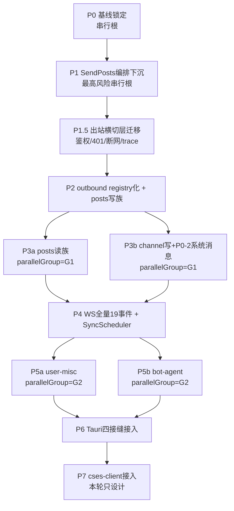

## 02 — 分阶段路线（状态机式有序推进）

### 推进图

去掉有意不迁：`posts/createMock`(#6 压测旁路)、`groups`(#7 空骨架)、bot demo #38/39/40。**post/read 不在排除列**（B1 修正：非 bitmap，保留）。`createPosts` PascalCase 待真抓包，移出 P2 挂开放决策阻塞项（C5）。`createUser`/`users/status` 升级为接管完整性前置（开放决策但建议必迁，否则前端拿不到 presence/头像无法纯渲染）。

---

### P0 — 基线锁定（无业务代码）
- **scope**：锁 sync-v2 ~90% 为 baseline；建 golden fixtures 工具链 + 覆盖率基线。
- **helix 实现**：`tests/fixtures/` 补真 Go 帧；`scripts/coverage.sh`(cargo-llvm-cov)。
- **gate**：`cargo test -p helix-im` 全绿；`cargo llvm-cov -p helix-im --summary-only` 写 `docs/review/coverage-baseline.md`。
- **可并行**：否。**依赖**：无。

### P1 — SendPosts 编排下沉（最高风险，串行根）
- **scope**：messageSend.service.ts 全套编排搬进 helix-im（usecase A 类密度最高）。
- **后端参考**：`csesapi/post_core.go`(SendPostMessage)、`真机curl真源.md`(send 逐字 body)。
- **helix 实现**：`module.rs::handle_send_message`(扩字段)、`pending_send.rs`(connectionId 维度，M1)、新 `src/outbound/send_build.rs`(buildMessageObject：viewers 空补['all']、findReplyRootId、userSnapshot 组装、snapshotToPlainText(2000)、空消息 trim 拦截)。时间经 `Clock::now_ms`、tmp_id 经 `IdSource::next_id`（C3）。
- **前端掏空**：`src/pages/message-v3/service/messageSend.service.ts`（删 buildMessageObject/createSendTimeout/processMessageFiles 编排）。文件上传留 driver 直通（M2）。
- **wire 契约**：全 camelCase；必填 `viewers/type:"TEXT"/simpleMessage/userId/teamId(=companyId)/userSnapshot/mentions/props/topicId/revoke/id`；回声 action=`post`(**非 posted**)；`createAt`(**非 createdAt**)；temporaryId 主键全程不变；self message 本地 `id`=空串。
- **gate**：`cargo test -p helix-im send_test echo_reconcile_test s5_post_echo_test` + 新 `p1_send_build_test.rs` 全绿；fail-hard 断言①喂 `action="posted"` 帧 reconcile **不**命中；②`assert!(!body.contains("createdAt") && body.contains("\"createAt\""))`；③ grep `SystemTime|Instant::now|Utc::now` in `crates/helix-im/src` 必空(C3)；`cargo llvm-cov` `send_build.rs` 行覆盖 100%；`cargo check -p helix-core -p helix-im -p helix-driver-native`；`cargo tree -p helix-core | grep -iE 'tokio|sqlx|reqwest|web-sys|tauri'` 空。
- **可并行**：否（接管串行根）。**依赖**：P0。**阻塞项**：userSnapshot 的 ucenter 跨 feature 读依赖（见开放决策）。

### P1.5 — 出站横切层迁移（rv-tauri A1 新增，必经）
- **scope**：现网 `networkInterceptor` 的鉴权头注入 / 401→logout / 断网提示 / traceparent 出站透传，全迁 helix-driver-native reqwest 侧。
- **后端参考**：现网 `src/app/core/http/app-http.service.ts`、`http-client-config.ts`(IM_HTTP token)、`message-v3` traceparent 严格一致要求。
- **helix 实现**：`helix-driver-native/src/http_manager.rs`(`Arc<RwLock<HeaderMap>>` 运行时注鉴权头 + traceparent 从 Tick 信封透传到出站头)；core 侧 `HttpRequest` 只标鉴权意图(`X-Auth-Kind: bot|session`)不拼 token(C6)；失败码回报 `Effect::Emit("im:http:unauthorized")`/`("im:net:offline")`。
- **前端掏空**：`networkInterceptor` IM 通道部分退役（保留非 IM）。
- **gate**：driver 集成测试：401 响应 → emit `im:http:unauthorized`；断网 → emit `im:net:offline`；traceparent 出站头 == 入站信封 trace（端到端断言）；`grep 'mp_\|Authorization' crates/helix-im/src` 鉴权 token 必空(C6)；覆盖 100%。
- **可并行**：否。**依赖**：P1。

### P2 — outbound registry 化 + posts 写族（C4 先重构）
- **scope**：**先**把 `commands.rs::is_outbound` 单 match 改 **linkme distributed_slice registry**（对齐 WS handler pattern）；**再**补 posts 写族 outbound：urgentPost/urgentConfirm/urgentCancel/quickReply/updatePostProps/templateReceived/revoke（每个独立语义命令，C1）。`createPosts` 移出挂决策。
- **后端参考**：`cses_post.go`(createChannelPostUrgent 推 post_update)、`真机curl真源.md`(revoke)。
- **helix 实现**：`src/outbound/registry.rs`(`#[distributed_slice] OUTBOUND_COMMANDS`)；每命令一注册文件 `src/outbound/{urgent,quick_reply,post_props,template_received,revoke}.rs`；`is_outbound` 改查 registry；`module.rs` dispatch 不变（仍 `name if is_outbound(name)`）。
- **前端掏空**：对应 7 个 HTTP 直发点 → 语义 invoke。
- **wire 契约**：加急走 `post_update` 复用 action；语义命令 args = 用户意图（target_ids/post_id/emoji），wire body 拼装在 Rust。
- **gate**：`cargo test -p helix-im post_action_inbound_test outbound_commands` + 新 `p2_posts_outbound_test.rs` 全绿（每命令 1 正常 + body casing 断言 + 加急复用 post_update 断言 + grep 前端 invoke 参数无 wire-only key, C1）；registry 注册数 == 命令数性质测试；覆盖 100%；`cargo check` 四 crate。
- **可并行**：否。**依赖**：P1.5。

### P3a — posts 读族 outbound（parallelGroup=G1）
- **scope**：纯读命令族（无 WS）：getSchedule/postContext/top20/get/getPostsAfterIndex/getReplies/getReplyBranch/queryTodoList/getUpdatedPosts/getLatestPost + bookmark(create/delete/load) + announcement 读(acceptList/list/detail) + **post/list**(已读位历史读，B1：非 bitmap)。
- **helix 实现**：新 `src/outbound/posts_read.rs`（独立注册文件，distributed_slice 注册 → **真零交集**不碰 P3b 任何文件，C4 收口）；走 `Effect::Http{corr}` 回报后 emit 投影（payload 遵 projection-schema.md, C2）。
- **前端掏空**：`src/pages/message-v3/service/chatContentShared.service.ts`(上拉锚点)、书签/公告读 service。
- **wire 契约命名陷阱**（decode 静默失败防线）：top20 → **snake_case** `channel_id`；getPostsAfterIndex → `postIds`(传单 id)；getUpdatedPosts → `timeStamp`(大写S)；时间 `createAt`。
- **gate**：新 `p3a_posts_read_test.rs` 每接口 1 用例 + 命名陷阱 casing 断言（用从 mattermost 抓的真 Go fixture 比对，非自造 fixture, C5）+ 投影 payload 字段集断言(C2)；覆盖 100%；`cargo check`。
- **可并行**：✅ G1（白名单 `src/outbound/posts_read.rs`+`tests/p3a_*` vs P3b `channel*`，distributed_slice 注册零交集）。**依赖**：P2。

### P3b — channel 写族 + P0-2 系统消息消费编排（parallelGroup=G1）
- **scope**：channel/create/createSpecifyOwner/close/member(change/leave/role/notify/nickname)/change(info/source/picture/notice/top) outbound + **makeTopic 补字段**(rootId/users[]/picture/forceCreate, 漏项) + P0-2 消费编排(`total_msg_count` 计数 / `posts_update` 批帧 / reply-chain echo / push fanout)。
- **后端参考**：`cses_channel.go`(CreateCsesPost 系统消息链)、`真机curl真源.md`(makeTopic 双帧)。
- **helix 实现**：`channel.rs`(gate)、`channel_write/{members,patch,program,post}.rs`(扩系统消息落库)、`src/outbound/channel_*.rs`(distributed_slice 注册)；channel handler 只触发不自拼 post 帧（DDD 聚合根解耦）。unread/lastPost 走字段级 `BatchUpdate WHERE PK` 禁 RMW(B5)。
- **前端掏空**：群管理 service(29/30/33/34/35 用例)。
- **wire 契约 quirk**：load/increment `IncrementChannelParam.ChannelId`(**PascalCase**，真 Go fixture 比对)；create `direct_key`(**snake_case**)；member/change/notify payload key=`id`(非 channelId)；#15 change/props 故意不广播(勿补 WS)；#19/#20 add/remove_manager 对齐注释态勿补。
- **gate**：`cargo test -p helix-im channel_write_program_test channel_member_collect_test` + 新 `p3b_channel_outbound_test.rs`(quirk casing 断言 + 系统消息 total_msg_count 计数性质 + #15 不广播断言 + unread bump 产单条 BatchUpdate 不含 SELECT/全列 upsert 的反 RMW 性质测试, B5)；覆盖 100%；`cargo check`。
- **可并行**：✅ G1。**依赖**：P2。

### P4 — WS 全量 19 事件补齐 + SyncScheduler + parser 边界
- **scope**：补 router 未注册的 handler(post_pin/channel_member_role_updated/update_channel_notice/change_channel_approval/quit_company)；parser event_seq 三级 fallback 守护；内存构造 post(bot #2/#32)不推 cursor 边界；**新增 SyncScheduler 全局并发窗口(B4)**；多端 self echo connectionId 归属(M1)；connectionId hello 回注链(M3)。
- **后端参考**：`websocket_message.go`(常量真源)、`5--backend-ws-events.md`。
- **helix 实现**：`ws/handlers/` 新增 5 文件(每个 1 个 `static XXX_REGISTRATION` distributed_slice，零改 registry/dispatch)；`parser.rs`(seq fallback 链 `data.event_seq`→`props.channel_event_seq`→顶层→`data.seq`)；新 `src/sync_scheduler.rs`(`pending_sync: VecDeque<ChannelId>` + 在途上限 K)。
- **前端掏空**：`router.rs` 对应 dispatch（前端 ipcEvent.service.ts 已订阅 24 事件，补缺的）。
- **wire 契约**：仅 `post`/`posts_update`/`post_update` 顶层带 `event_seq`；`increment_channel`/`update_channel` 的 `lastEventSeq` 是 data 内字段；`change_channel_approval` wire 值无 Status 后缀；wire action≠内部 type(post→posted、post_update→post_edited 内部归一名)；`update_channel.lastPost` 必须 JSON string(走 Emit/字段级 patch 不 RMW, B5)；**不要**实现 dead action `post_urgent`/`post_edited`/`posted`。
- **gate**：`cargo test -p helix-im s1_ws_actions_test real_go_frames_test s6_sync_internal_test` + 新 `p4_ws_events_test.rs`(19 事件逐一 + seq fallback 三路 + 内存构造 post 不推 cursor 性质 + dead action 不实现断言 + change_channel_approval 无 Status 后缀) + 新 `p4_sync_scheduler_test.rs`(构造 N>K channel 同时 needSync → 断言在途 sync ≤ K 的证伪性质测试, B4) + cursor 锚 nextSeq 性质(构造 events 末条 seq<nextSeq phantom 尾 → 断言 cursor 推到 nextSeq 非 max event.seq, B6)；覆盖 100%；`cargo check`。
- **可并行**：否（依赖 P3a/P3b merge 后状态 + SyncScheduler 跨 channel）。**依赖**：P3a+P3b。

### P5a — user-misc 域（parallelGroup=G2）
- **scope**：users/list、teams(upsert/member add/quit)、modules/getAll、notification/loadSend、health、search 四件套、personal_guard。
- **helix 实现**：`src/outbound/user_misc.rs`(distributed_slice 注册)。
- **wire 契约**：修源 4 bug(double-decode/无响应体/offset `Page*Size`/message 笔误)；`PERSONAL_USER_FORBIDDEN` verbatim；search data 以 csesapi 源裸数组为真源 + 补 `channelDetails` 第四 key + 去 `map` 套 key；health 裸 `{"status":"OK"}` 不走信封特例。
- **gate**：新 `p5a_user_misc_test.rs` 每接口 1 用例 + 源 4 bug 修复断言 + PERSONAL_USER_FORBIDDEN verbatim + health 裸信封特例 + search channelDetails 第四 key；覆盖 100%；`cargo check`。
- **可并行**：✅ G2（`src/outbound/user_misc.rs` vs P5b `bot_agent.rs` 零交集）。**依赖**：P4。

### P5b — bot-agent 域（parallelGroup=G2）
- **scope**：createBot/botCallback/bot CRUD/bot-agent config/调用(mp_ token)/agent 会话/webhook config。
- **helix 实现**：`src/outbound/bot_agent.rs`(distributed_slice 注册)；mp_ token 鉴权意图标 `X-Auth-Kind: bot`，实际 token 注入留 driver(C6)。
- **wire 契约**：mp_ token 鉴权轴；#2/#32 内存构造 post 不推 cursor(复用 P4 边界)；#35-37 响应裸 map 非 CommonRes 特例；#12 用稳定 DTO 不绑 ent；timeline/cost(#33/34)暂不接管(开放决策)。
- **gate**：新 `p5b_bot_agent_test.rs` 每接口 1 用例 + 鉴权意图标记断言(grep `mp_` in core 必空, C6) + 裸 map 信封特例 + 内存 post 不推 cursor；覆盖 100%；`cargo check`。
- **可并行**：✅ G2。**依赖**：P4。

### P6 — Tauri 四接缝接入（M2，driver-native）
- **scope**：① 真 `app.emit("im:__bus__")` ② invoke 路由(语义命令→Tick::Command) ③ `store:*`/`imDataSource:*` 投影命令(复用 `store_get_messages` 语义 + 消除 query/queryCache/reset 3 个 early-return 拦截块, A4) ④ 窗口/单实例/connectionId 注入 ⑤ driver 批量解释 `Vec<Effect>`(HX-C007)。补 `im_get_state`/`im_delete_all_dialogs`(B1)。
- **helix 实现**：`helix-driver-native/src/{event_sink.rs(真 emit),commands.rs(语义 invoke 薄壳全集 + 投影命令),engine_loop.rs(批处理 Vec<Effect>)}`。
- **wire 契约**：信封 `channel` 必须 `im:` 开头且非 `im:__`(grep 守护防自环)；数组 payload 须 `{items:[]}` 包装(全 Phase 横切约束，P3a 即遵, rv-correctness M4)；rename_all 混 snake/camel 照现网命令表。
- **gate**：`cargo check -p helix-driver-native`；driver invoke→Tick→Effect→emit 集成测试(EventSink 计数 + emit channel 名校验 + `{items:[]}` 包装断言)；host-cli e2e；`cargo test` 全绿；覆盖 ≥ 基线。
- **可并行**：否（接缝整合）。**依赖**：P5a+P5b。

### P7 — cses-client 无缝接入（本轮只设计，见 04 文档）

---

## worktree 并行性分析

| Phase | 可并行组 | 文件白名单 | 交集分析 |
|---|---|---|---|
| P0/P1/P1.5/P2 | — 串行 | module.rs/outbound/{send_build,registry}.rs/pending_send.rs/http_manager.rs | 数据依赖链（P2 registry 化是 P3 并行前置）|
| **P3a ∥ P3b** | G1 | P3a:`src/outbound/posts_read.rs`+`tests/p3a_*` ; P3b:`channel.rs`+`channel_write/*`+`src/outbound/channel_*.rs`+`tests/p3b_*` | **真零交集**（C4 收口：outbound 已 registry 化，各加独立 distributed_slice 注册文件，**不再共改 commands.rs match**）|
| P4 | — 串行 | ws/handlers/×5 + parser.rs + sync_scheduler.rs | 依赖 P3a+P3b merge + 跨 channel SyncScheduler |
| **P5a ∥ P5b** | G2 | P5a:`src/outbound/user_misc.rs`+`tests/p5a_*` ; P5b:`src/outbound/bot_agent.rs`+`tests/p5b_*` | **零交集**（两独立注册文件）|
| P6 | — 串行 | helix-driver-native/* | 接缝整合 |

**worktree 约束**（根 CLAUDE.md §6）：路径 `worktrees/<phase>/`；`.gitignore` 加 `/worktrees/`；创建前 `df -BG ~` 预检(多并行 ≥10GB)；**禁 export CARGO_TARGET_DIR**；中途禁 cargo check 循环(仅 commit 前 + phase 完成前)；commit 前 `pwd` 含 `worktrees/<phase>/` + `git rev-parse --abbrev-ref HEAD == <feat-branch>` 双自检。**黑名单**：根 CLAUDE.md/SESSION.md/README.md 禁并行改；模块级 `crates/*/CLAUDE.md`+`AGENTS.md` 成对改。**自动 merge**：`git diff --name-only main..<branch>` 取交集，**空交集才自动 merge**；顺序 `merge --no-ff P3a`→`cargo test`→`merge --no-ff P3b`→`cargo test`。
