# Helix — 运行时无关确定性核心层 完整架构设计文档

> 🗂️ **状态：2026-06-08 baseline 设计稿（已被取代，留作溯源）。** 本文是
> [`过会方案/helix-two-layer-architecture.md`](./过会方案/helix-two-layer-architecture.md) 的**前稿**；
> 当前**机制事实权威源** = [`过会方案/helix-core-im-架构设计.md`](./过会方案/helix-core-im-架构设计.md)，
> **决策权威源** = [`过会方案/helix-技术评审纪要.md`](./过会方案/helix-技术评审纪要.md)。
> ✅ 命名已对齐代码：原 `cursor_upsert`/`CursorUpsert` 已于 2026-06-14 全量替换为 `monotonic_upsert`/`MonotonicUpsert`（见 [decisions.md ADR-004](./harness/decisions.md#adr-004)）。
> 全文档地图见 [`docs/README.md`](./README.md)。

> **版本** 2026-06-08（baseline 设计稿，已被取代）  
> **事实来源**：FRESH_IM_SOURCE（2026-06-08 IM 源码实测）+ 三栖约束底座 + 各设计文档对抗综合  
> **命名约定**：`helix-core`（核心层）/ `helix-im`（IM 模块）/ `helix-driver-native|wasm|ffi`（平台驱动）  
> **工作目录**：`/workspace/rustWorkspace/helix/`

---

## 目录

- [一、Goal：产品定位与五条质量轴](#一-goal)
- [二、DDD 领域驱动设计](#二-ddd-领域驱动设计)
- [三、完整技术选型表](#三-完整技术选型表)
- [四、架构设计](#四-架构设计)
- [五、Mermaid 图集](#五-mermaid-图集)
- [六、用例图与关键用例展开](#六-用例图与关键用例展开)
- [七、补充图](#七-补充图)
- [八、五条质量轴达成对照表](#八-五条质量轴达成对照表)
- [九、与产品定位逐句对照](#九-与产品定位逐句对照)

---

## 一、Goal

### 1.1 产品定位

Helix **不是** IM 内核，**不是**某个运行时的 wrapper。它是一个**可编译到所有端的确定性业务内核基座**：

- 今天被 **Tauri** 使用（native，多线程 tokio reactor，高性能 sqlx）
- 明天被**移动端**通过 **FFI**（C ABI 稳定，uniffi Swift/Kotlin）
- 后天被**浏览器**通过 **WASM**（wasm32-unknown-unknown，OPFS，web-sys，zero-copy sandbox）

**一次实现，多端一致**：同一份业务逻辑（helix-im），在 native/ffi/wasm 三端行为逐字节一致、可回放、可单元测试。这是 **确定性（determinism）** 的含义，不是代码共享的含义。

**IM 只是第一个模块**。core layer 本身不认识 IM，不认识 channel/message/cursor/temporaryId。IM 是验证 core 契约是否正确的首个真实业务负载。第二个模块（presence、document、notify）可以不改 core 任何一行代码直接挂载。

**概念祖先类比**：Bun 是 runtime 跑 JavaScript 程序；Helix 是 runtime 跑确定性业务模块，且自身三栖寄宿。

### 1.2 三层 + 平台驱动 结构（三层不可变，命名可调）

```
┌────────────────────────────────────────────────────────────────────────────┐
│  层 3：平台驱动层（per-platform I/O，core 之外）                             │
│  Native: tokio/sqlx/tokio-tungstenite/reqwest/SystemTime                   │
│  FFI:    C ABI/uniffi + rusqlite + host回调                                 │
│  WASM:   wasm-bindgen/web-sys WebSocket/OPFS/gloo-timers/js_sys::Date       │
└────────────────────────────────────────────────────────────────────────────┘
            ▲ 实现 ports               ▲ 注入 ports
            │                          │
┌────────────────────────────────────────────────────────────────────────────┐
│  层 2：★ Runtime-agnostic Core Layer（产品本体，通用，不认识任何业务）         │
│  ports: Transport/Storage/Clock/EventSink/Id/Random/HttpRequester           │
│  module host: 注册/路由/生命周期                                              │
│  effect/event 总线：EffectSink / DomainEventBytes                            │
│  sans-IO 确定性执行壳：step(Tick) -> Vec<Effect>                             │
│  platform: MaybeSend/MaybeSync/spawn（30行cfg）                              │
└────────────────────────────────────────────────────────────────────────────┘
            ▲ 实现 Module trait         ▲ 只依赖 core
            │
┌────────────────────────────────────────────────────────────────────────────┐
│  层 1：业务模块层（deterministic business modules）                           │
│  helix-im: IM 消息/游标/对账/同步 —— 不碰 tokio/sqlx/web-sys                 │
│  （未来）helix-presence / helix-notify / helix-docs                          │
└────────────────────────────────────────────────────────────────────────────┘
```

### 1.3 核心范式：Sans-IO / 六边形（Hexagonal Ports & Adapters）

core **不做任何 I/O，不持有任何运行时**。它是一个纯状态机：

```
喂入（InboundFrame / TimerFired / PortReply / AppCommand + now_ms）
    ↓
engine.step(Tick)  ← 严格同步，零 await，零 I/O，零 spawn
    ↓
吐出（Vec<Effect>：SendFrame / Persist / Emit / HttpRequest / ScheduleTimer / CancelTimer）
    ↓
平台驱动层兑现 Effect（真实 I/O），把结果包成下一个 Tick 喂回
```

时间/随机/ID 由 host 注入（确定性来源）。并发模型**绝不 bake 进 core**（wasm 单线程，tokio multi-thread，两者同一份 core 代码，行为一致）。

**IM 实测印证**：`temporaryId` 由 UI 组件生成（不是 core/helix-im 生成），`now` 外部供给，`tokio::spawn` 在 sans-IO 下全删掉（HTTP effect 由 driver 异步兑现）。

### 1.4 五条质量轴（验收硬标准）

| 轴 | 内容 | 本文落实位置 |
|---|---|---|
| ① 性能最优 | 热路径 O(1)、零拷贝、最少分配、无多余 await 往返 | §4.2 batch_upsert / monotonic_upsert MAX guard / EffectBuffer 复用 |
| ② 复杂度最低 | 最简够用；通用性靠≥1 真实模块跑通+第二用例插得进挣，不预建框架 | §4.1 ModuleHost 只有 register/dispatch；§6 presence 第二模块证明 |
| ③ 兼容性最高 | 三栖 native/ffi/wasm 全绿；executor-agnostic；tri-target crate 选型 | §三、§四.1、§五.8 三栖编译图 |
| ④ 可扩展性强 | 加新业务模块=实现 Module+register，不改 core；加新平台=实现 ports，不改 core/模块 | §4.3 Module trait 开闭原则 |
| ⑤ 代码风格 cool | 类型驱动 make-invalid-states-unrepresentable、tagged union、newtype、零 unwrap on 外部输入 | §2.3 值对象设计 / §四.5 Effect enum |

---

## 二、DDD 领域驱动设计

### 2.1 两个限界上下文（Bounded Context）总览

Helix 内部存在**两个语言完全不同的领域**。DDD 的价值就是承认它们各说各话、用 ACL 翻译，而不是让一套 ubiquitous language 横跨两边（那正是旧版 im_core 把 IM 概念渗进 core 的根因）。

```
┌──────────────────────────────────────────────────────────────────────┐
│  BC-A  Platform Core Domain  (helix-core)                            │
│  "运行确定性业务模块的操作系统"——不认识任何业务                         │
│  语言: Module / Port / Effect / Tick / ExecutionShell / Correlation  │
│  聚合: ExecutionShell · ModuleHost · PortRegistry                    │
└──────────────────────────────────────────────────────────────────────┘
                 ▲  只通过 trait 契约 + Effect/Tick 数据对话
                 │  没有任何 IM 类型穿过这条线
                 ▼
┌──────────────────────────────────────────────────────────────────────┐
│  BC-B  IM Business Domain  (helix-im)                                │
│  "会话即时通讯的确定性内核"——不认识 tokio/sqlx/web-sys                 │
│  语言: Channel / Message / Cursor / PendingSend / Reconciliation     │
│  聚合: Channel(消息+游标) · PendingSend · SyncSession                 │
└──────────────────────────────────────────────────────────────────────┘
```

**Context Map = Customer(IM)/Supplier(core)**，但 supplier **完全不知道** customer 是谁。删掉 `helix-im`，`helix-core` 编译通过且 `grep -r "channel\|message\|cursor\|temporaryId\|im:" crates/helix-core/src/` 返回空——这是两个 BC 不渗透的**可执行验收**。

### 2.2 BC-A：Platform Core Domain（helix-core）

#### Ubiquitous Language（核心层通用词典）

| 术语 | 定义 | 绝不包含 |
|---|---|---|
| **Module** | 确定性业务单元。实现 `Module` 契约即可被装载。core 只知道它有名字、能 `accepts` 某帧、能 `handle` 产出 effect。 | core 不知道某模块是 IM 还是 presence |
| **Port** | core 与平台之间的契约 trait：Transport/Storage/Clock/EventSink/Id/Random/HttpRequester | 不含任何具体 crate |
| **Tick** | 喂给执行壳的一个确定性输入：入站帧/端口响应(带 Correlation)/计时触发/应用命令 + now_ms | 不含 IM 的 14 类 type |
| **Effect** | 模块吐出的"想做的 I/O"声明，可携带 Correlation，core 不执行 | 不含 IM 填进 variant 的内容 |
| **Correlation** | 把 Effect 与未来端口响应配对的不透明令牌 | core 不知道它锚的是 cursor 还是别的 |
| **ExecutionShell** | 纯函数 `step(Tick) -> Vec<Effect>`，与平台/时间/线程无关 | 不做 I/O、不持运行时、不读时钟 |

#### 聚合 A1：ExecutionShell（聚合根，确定性边界的守门人）

```rust
// helix-core/src/engine.rs
pub struct ExecutionShell {
    host: ModuleHost,        // 子实体
    scratch: EffectBuffer,   // 值对象：跨 step 复用，clear 而非重建（零分配轴①）
}

impl ExecutionShell {
    /// 纯函数语义：相同 Tick 序列 + 相同模块初态 ⇒ 相同 Effect 序列
    /// 零 await / 零 I/O / 零 spawn
    pub fn step(&mut self, tick: Tick<'_>, now_ms: u64) -> Result<EffectBatch<'_>, CoreError> {
        self.scratch.clear();
        let frame = InboundFrame::from_tick(tick)?;
        self.host.dispatch(frame, now_ms, &mut EffectSink::new(&mut self.scratch))?;
        Ok(self.scratch.batch())
    }
}
```

**不变量**：`step` 调用链中不得出现任何 `await` / `tokio::spawn` / `Instant::now()`。

#### 聚合 A2：ModuleHost（模块注册/路由/生命周期）

```rust
// helix-core/src/module_host.rs
pub trait Module: MaybeSend + 'static {
    fn name(&self) -> &'static str;
    fn accepts(&self, frame: &InboundFrame) -> bool;  // 路由判定，必须纯
    fn handle(&mut self, tick: &Tick, now_ms: u64, out: &mut EffectSink) -> Result<(), CoreError>;
    fn tick(&mut self, now_ms: u64, out: &mut EffectSink) -> Result<(), CoreError>;
    fn on_start(&mut self, out: &mut EffectSink) -> Result<(), CoreError> { Ok(()) }
    fn on_stop(&mut self, out: &mut EffectSink) -> Result<(), CoreError> { Ok(()) }
}

pub struct ModuleHost { modules: Vec<Box<dyn Module>> }

impl ModuleHost {
    /// 加新业务模块 = 调 register，不改此函数一行（开闭原则，轴④）
    pub fn register(&mut self, m: impl Module + 'static) { self.modules.push(Box::new(m)); }
    pub fn dispatch(&mut self, frame: InboundFrame, now_ms: u64, fx: &mut EffectSink)
        -> Result<(), CoreError>
    {
        for m in &mut self.modules {
            if m.accepts(&frame) { return m.handle(&frame.into_tick(), now_ms, fx); }
        }
        Err(CoreError::NoHandler(frame.routing_hint))
    }
}
```

#### 聚合 A3：PortRegistry（端口契约集合）

纯 trait 定义，无实现。driver 依赖 core 来实现这些 trait；core 只知道 trait，不知道任何实现类型。

#### 值对象（全部 make-invalid-states-unrepresentable）

| 值对象 | 形态 | 设计要点 |
|---|---|---|
| `Tick<'a>` | `enum { Inbound(InboundBytes<'a>), PortReply { corr: Correlation, outcome: PortOutcome }, Timer(TimerId), Command(AppCommand<'a>) }` + now_ms 作函数参数 | tagged union；非法组合不可表达 |
| `Effect` | `enum { Send{..}, Persist{corr, ops}, Emit(DomainEventBytes), Http{corr, req}, ScheduleTimer{id,after_ms}, CancelTimer(TimerId) }` | Persist/Http 强制带 Correlation（类型层逼模块走 peek/commit） |
| `Correlation` | `struct(u64)` newtype | 不透明令牌 |
| `PortOutcome` | `enum { Ok(ReplyBytes), Err(PortErrCode) }` | 端口成功/失败二态 |
| `TimerId` | `struct(u64)` newtype | — |
| `DomainEventBytes` | `bytes::Bytes` 包装 | 零拷贝搬运，core 不解析内容 |

**core 的 EventSink::emit 接受 `DomainEventBytes`（已序列化），不是 IM 的 DomainEvent enum**——这是 BC-A 不持有 BC-B 类型的关键。

### 2.3 BC-B：IM Business Domain（helix-im）

#### Ubiquitous Language（IM 业务词典）

| 术语 | 定义（FRESH_IM_SOURCE 锚点） | 对应 core 的什么 |
|---|---|---|
| **Channel** | 一个频道的消息集合 + 单调 event cursor。聚合根。 | core 看不到 Channel |
| **Message** | PK 语义特殊：`temporaryId`（UI 注入）→ server `id` 值级覆盖（ON CONFLICT id=excluded.id） | core 看到 `Persist{conflict_key}` 的一行 |
| **Cursor** | per-channel `last_event_seq`，单调推进（MAX guard），**写成功才推** | core 的 `monotonic_upsert(scope_key,value)` 单调原语 |
| **PendingSend** | 已乐观落库、等 echo/sync 对账的发送；15s 超时 → unSend（无自动补发） | core 的 ScheduleTimer/CancelTimer + Correlation |
| **Reconciliation** | echo 与 sync **同一对账点**：按 temporaryId 值级覆盖回 sent + 撤超时 | core 看到 Persist + CancelTimer + Emit |
| **Gate** | seq>cursor+1 时 buffer + 1s timer，补齐则 cancel | core 的 ScheduleTimer/CancelTimer |
| **SyncSession** | 一次 /sync/notify(from_seq) 拉取：4 kind（NoChange/Events/Snapshot/TooLong）+ ≥500 续拉 | core 看到 HttpRequest + PortReply |

#### 聚合 B1：Channel（消息 + 游标的一致性边界）

**关键 DDD 裁决**：Message 不是独立聚合根，是 Channel 内实体；Cursor 是 Channel 的值对象。理由：cursor 推进与消息落库是同一一致性边界（写消息成功才推 cursor，二者必须事务式同步），拆成两个聚合会破坏"写成功才推"不变量。

```rust
// helix-im/src/channel.rs —— 纯状态机，零 I/O
pub struct Channel {
    id: ChannelId,
    cursor: Cursor,                          // 值对象：last_event_seq + MAX guard
    gate: Option<Gate>,                      // 实体：缺口闸门
    pending_commits: HashMap<Correlation, Seq>, // corr → target_seq（写成功才推）
    buffer: BTreeMap<Seq, EventEnvelope>,    // 乱序缓冲（contiguous flush 用）
}

impl Channel {
    pub fn ingest(&mut self, ev: EventEnvelope, fx: &mut EffectSink, now_ms: u64)
        -> Result<(), ImError>
    {
        match ev.seq.cmp(&(self.cursor.value() + 1)) {
            Ordering::Equal   => self.apply_and_flush_contiguous(ev, fx, now_ms),
            Ordering::Less    => Ok(()),                       // dup drop，幂等
            Ordering::Greater => self.buffer_and_arm_gate(ev, fx), // ScheduleTimer 1s
        }
    }
}
```

**Channel 聚合不变量**（全来自源码事实）：
1. cursor 单调不减（MAX guard）
2. cursor 只在 PortReply(corr, Ok) 后推进——写成功才推
3. seq <= cursor 的入站事件一律 drop（幂等去重）
4. flush_contiguous（WS，严格+1 遇空洞停）vs flush_up_to（sync，跳空洞到权威水位）

#### 聚合 B2：PendingSend（发送对账的一致性边界）

独立聚合，因为对账状态与 channel cursor 推进**正交**（一条消息的对账不影响 channel 游标）。

```rust
pub struct PendingSend {
    temporary_id: TemporaryId,   // 聚合根标识（UI 注入）
    status: SendStatus,          // Local | Sending | Sent | UnSend（4 态 enum）
    timeout: TimerId,            // 关联的 15s 超时令牌
}

impl PendingSend {
    /// echo/sync 到达 = 对账。echo 与 sync 走完全相同 effect 序列。
    pub fn reconcile(&mut self, server_id: ServerId, fx: &mut EffectSink) {
        // 吐: Persist{ON CONFLICT(temporary_id) 覆盖回 sent}
        // 吐: CancelTimer(self.timeout)
        // 吐: Emit(DomainEvent::PostReceived)
        self.status = SendStatus::Sent;
    }
    /// 15s TimerFired → unSend，不产出任何重试 effect（无自动补发）
    pub fn on_timeout(&mut self, fx: &mut EffectSink) {
        if self.status != SendStatus::Sent {
            self.status = SendStatus::UnSend;
            // 吐: Persist{update sendStatus=unSend}
        }
        // 已对账（Sent）时 timer 迟到：幂等忽略
    }
}
```

**C006 收敛保证（两种到达次序）**：
- echo 先到 → `CancelTimer` 让 15s 永不 fire
- timer 先到 → 标 UnSend；迟到 echo 仍按 temporaryId 覆盖回 Sent
- 两种次序终态一致，纯状态机确定性保证，不依赖时序

#### 聚合 B3：SyncSession

```rust
pub enum SyncResponse {
    NoChange,
    Events(Vec<EventEnvelope>),     // ≥500 → needs_continuation 续拉
    Snapshot(ChannelSnapshot),
    TooLong { reset_to: Seq },      // cursor = reset_to-1 + Emit(SyncTooLong) 让前端清表重拉
}
```

分桶顺序铁律（源码事实）：`type1 upsert → type2 edit → type3 revoke → type6 read` 固定序产出 Persist effect。

#### IM 值对象

| 值对象 | 形态 |
|---|---|
| `ChannelId` / `ServerId` / `TemporaryId` / `Seq` | newtype，零混淆（类型层禁止 Seq 当 ChannelId） |
| `SendStatus` | 4 态 enum（Local/Sending/Sent/UnSend） |
| `Cursor` | `struct{ value: Seq }`，仅 `try_advance(MAX guard)` |
| `EventEnvelope` | 解析后强类型入站事件（IM 解析 14 类 WS type 的产物） |

#### IM 领域事件（8 族，不进 helix-core）

```rust
pub enum ImDomainEvent {
    PostReceived(..), PostUpdated(..), PostDeleted(..), PostBatchUpdated(..),
    PostRead(..), ChannelReadEcho(..), ChannelUpdateByPost(..), SyncTooLong(..),
}
```

在 ACL 边界序列化为 `im:post:received` 等 wire 名 + 包成 `DomainEventBytes` 交给 core EventSink。core 永远看不到这个 enum。

### 2.4 三道防腐层（Anti-Corruption Layer）

#### ACL-1：IM 业务域 ⇆ core 平台域（最关键，防 IM 渗进 core）

位置：`helix-im/src/acl/`（翻译器属于 customer 一侧，DDD 标准做法）。

| IM 域概念 | ACL 翻译 | core 域概念 |
|---|---|---|
| `DomainEvent::PostReceived` | 序列化 JSON + Bytes 包装 | `Effect::Emit(DomainEventBytes)` |
| `Channel.cursor.try_advance(seq)` | `scope_key = channel_id.to_string()` | `Effect::Persist{ monotonic_upsert(scope_key, value), corr }` |
| `Message{temporary_id, 23字段}` | `conflict_key = "temporary_id"` + row 列表 | `Effect::Persist{ batch_upsert(table, rows, conflict_key), corr }` |
| `/posts/create` 直发 / `/sync/notify?from_seq=` | 拼 URL + body | `Effect::Http{ req, corr }` |
| WS 出站 `im_send_message(action,data,seq)` | 序列化帧 | `Effect::Send(OutboundFrame)` |
| 入站不透明 `InboundBytes` | 解析 14 类 WS type | `EventEnvelope`（IM 强类型） |

**不渗透验收**：core trait 签名里只有 `table: &str` / `conflict_key: &str` / `scope_key: &str` / `Bytes` / `Correlation` / `after_ms: u64`，全是通用参数。`temporary_id`、`channel_event_seq`、`im:` 前缀、15000ms 全在 ACL-1 这一侧拼，作为参数值穿过去，不进类型。

#### ACL-2：core 平台域 ⇆ 平台驱动层（防具体 crate 渗进 core）

| core port | native adapter | wasm adapter | ffi adapter |
|---|---|---|---|
| `Transport` | tokio-tungstenite WebSocketStream | ws_stream_wasm / web-sys WebSocket | C ABI 回调 + futures-channel |
| `Storage` | sqlx::SqlitePool (WAL) | sqlite-wasm-rs + OPFS | host SQLite handle via C ABI |
| `Clock` | SystemTime | js_sys::Date::now() | host fn()->u64 |
| `HttpRequester` | reqwest | gloo-net/fetch | host http 回调 |
| `EventSink` | tauri AppHandle.emit | wasm-bindgen JS callback | C ABI on_event_fn |

**不渗透验收**：core 的 `Cargo.toml` 不含 tokio/sqlx/reqwest/tungstenite/web-sys。

#### ACL-3：FFI / WASM 宿主边界（防外部表示渗进域模型）

- FFI：C 侧 push 的 `*const u8` **必须在回调返回前拷贝到 Rust 堆**，再包成 `Tick::Inbound`。
- WASM：`JsValue` 是 `!Send`，只能在 `spawn_local` 里处理，绝不让 JsValue 漏进 helix-core/helix-im。

---

## 三、完整技术选型表

> 三栖兼容性以 `wasm32-unknown-unknown` 为最严格基准。✅=可用 / ⚠️=需条件 / ❌=不可用

### 3.1 Async 抽象

| 维度 | 选型 | 为什么 | 备选 | native | ffi | wasm |
|---|---|---|---|---|---|---|
| port trait async（dyn 路径） | `async-trait`，wasm 用 `(?Send)` 变体 | dyn-safe；wasm 单线程无 Send | AFIT+trait_variant（不 dyn-safe） | ✅ | ✅ | ✅ |
| core 内部静态路径 | AFIT / `impl Future`（零装箱） | 热路径零分配（轴①） | async-trait（有 Box 开销） | ✅ | ✅ | ✅ |
| Send/!Send 桥接 | 自写 `MaybeSend/MaybeSync`（30行 cfg） | 自持可控，不引第三方（轴②） | tokio-with-wasm（改并发语义，已否决） | ✅ | ✅ | ✅ |
| channel（executor 中立） | `futures-channel`（mpsc/oneshot） | 无 executor 依赖，wasm 可编 | tokio::sync（reactor 依赖 ❌ wasm） | ✅ | ✅ | ✅ |
| spawn | core `platform::spawn` cfg-gated | native→tokio::spawn / wasm→spawn_local | — | ✅ | ✅ | ✅ |

### 3.2 序列化

| 用途 | 选型 | 为什么 | native | ffi | wasm |
|---|---|---|---|---|---|
| DomainEvent → wire（ACL-1） | serde_json | IM wire 是 JSON（Mattermost 系契约） | ✅ | ✅ | ✅ |
| 跨 FFI 结构 | postcard（no_std, 紧凑二进制） | 零拷贝友好、体积小 | ✅ | ✅ | ✅ |
| WASM ⇆ JS | serde-wasm-bindgen | 直接 JsValue⇆Rust，避免 JSON 中转双解析 | n/a | n/a | ✅ |
| 内部 effect/tick | 不序列化（进程内传 Rust 值） | 进程内零序列化开销（轴①） | ✅ | ✅ | ✅ |

### 3.3 错误处理

| 层 | 选型 | 为什么 | native | ffi | wasm |
|---|---|---|---|---|---|
| helix-core | `thiserror`（`CoreError`/`PortError`） | 库层必须强类型可匹配，禁 anyhow | ✅ | ✅ | ✅ |
| helix-im | `thiserror`（`ImError`）+ `From<CoreError>` | 域错误强类型归一 | ✅ | ✅ | ✅ |
| driver 适配层 | thiserror 包裹具体 crate err 实现 PortError | ACL-2 翻译 | ✅ | ✅ | ✅ |
| FFI/WASM 边界 | `Result<T, String>` / JsError / uniffi error enum | 外部 ABI 不传 Rust enum | ✅ | ✅ | ✅ |
| anyhow | **仅**允许出现在 driver main/bootstrap 顶层 | 库层禁 anyhow（轴⑤） | ✅ | — | — |

### 3.4 存储（Storage port 三端实现）

| 端 | 选型 | 关键理由 | 备选 | 可用性 |
|---|---|---|---|---|
| native | `sqlx::SqlitePool` + WAL，写池 max=1 单写者，读池 max=4 | 编译期校验 + 热路径 batch_upsert O(1) | rusqlite+spawn_blocking | ✅ |
| ffi | host SQLite handle via C ABI | 复用宿主已有 DB，零额外引擎 | uniffi 暴露 rusqlite | ✅ |
| wasm | sqlite-wasm-rs + OPFS opfs-sahpool VFS | 唯一浏览器持久化 SQLite 路径 | IndexedDB（无 SQL，需另写 adapter） | ⚠️ 须在 Web Worker 初始化 |
| **禁入 core** | sqlx / rusqlite 进 driver | sqlx 依赖 tokio+mio+getrandom ❌；rusqlite 依赖 pthread ❌ | — | ❌ core |

### 3.5 传输（Transport port 三端实现）

| 端 | 选型 | 关键理由 | 备选 |
|---|---|---|---|
| native | tokio-tungstenite（native-tls） | 成熟 WS + tokio reactor | tungstenite（同步） |
| wasm | ws_stream_wasm（直接 Sink+Stream） | 最干净 wasm WS，省手桥 mpsc | web-sys WebSocket+futures-channel 手桥 |
| ffi | C ABI 回调 + futures-channel 包装 | host 持有 socket，回调前必须拷贝 buffer | uniffi callback interface |

### 3.6 HTTP（HttpRequester port 三端实现）

| 端 | 选型 |
|---|---|
| native | reqwest（tokio reactor backed） |
| wasm | gloo-net / web-sys fetch（reqwest wasm 后端：无流式，无自定义 TLS） |
| ffi | host http 回调 + futures-channel oneshot 包装 |

### 3.7 ID / 时间注入

| 维度 | 选型 | native | ffi | wasm |
|---|---|---|---|---|
| Clock | port 注入 `now_ms()` + MockClock | SystemTime | host fn()->u64 | js_sys::Date::now() |
| Id | uuid::Uuid::new_v4() | OS entropy | host 注入 | uuid + getrandom js feature |
| **getrandom** | workspace 级 `getrandom={features=["js"]}` | OS | — | ⚠️ 必须 workspace 级声明，否则 link 失败 |
| IM 主路径 | temporaryId 由 UI 注入，内核不生成 | — | — | — |

### 3.8 FFI 绑定

| 场景 | 选型 | 理由 |
|---|---|---|
| iOS Swift / Android Kotlin | uniffi（#[uniffi::export]） | 自动生成 Swift/Kotlin binding + error enum + async |
| 纯 C/C++ 宿主 | cbindgen（extern "C" + repr(C) + opaque ptr） | C/C++ 直接 include，无 runtime 开销 |
| 裁决 | helix-driver-ffi 默认 uniffi，保留 cbindgen opaque handle | 移动是 ffi 主战场 |

### 3.9 WASM 绑定

| 维度 | 选型 | 位置 |
|---|---|---|
| JS 互操作 | wasm-bindgen + wasm-bindgen-futures | helix-driver-wasm 专属 |
| Web API | web-sys + js-sys | 同上 |
| 定时器 | gloo-timers（futures feature） | 同上 |
| 打包 | wasm-pack + wasm-opt | CI post-process |

**全部仅进 helix-driver-wasm `[target.'cfg(wasm32)']`**，native/ffi 编译不见。

### 3.10 测试与体积优化

| 维度 | 选型 | 三栖 |
|---|---|---|
| 单元/确定性回放 | #[test] + MockClock + MockPorts，喂 Tick 序列断言 Effect 序列 | native 跑（快+确定） |
| 属性测试 | proptest：随机 Tick 序列断言不变量（cursor 单调/C006/去重幂等） | native CI |
| wasm 端到端 | wasm-bindgen-test（wasm-pack test --headless） | wasm |
| ffi 端到端 | uniffi binding + Swift/Kotlin host 测试 | ffi |
| wasm size | opt-level="z" + lto + codegen-units=1 + panic="abort" + strip + wasm-opt -Oz | wasm |
| size 分析 | twiggy dominators | wasm |

---

## 四、架构设计

### 4.1 三层架构与 Cargo Workspace 布局

```
/workspace/rustWorkspace/helix/
├── Cargo.toml                      # workspace root
├── crates/
│   ├── helix-core/                 # crate-type = ["rlib"]
│   │   ├── Cargo.toml              # 仅: serde, thiserror, bytes, async-trait, futures-channel, tracing
│   │   └── src/
│   │       ├── lib.rs
│   │       ├── platform.rs         # MaybeSend/MaybeSync/spawn
│   │       ├── engine.rs           # ExecutionShell / CoreEngine
│   │       ├── module_host.rs      # ModuleHost / Module trait
│   │       ├── effect.rs           # Effect enum / EffectSink / EffectBuffer
│   │       ├── tick.rs             # Tick enum / InboundFrame
│   │       ├── ports/
│   │       │   ├── transport.rs    # trait Transport
│   │       │   ├── storage.rs      # trait Storage + SqlValue + UpsertSpec + MonotonicUpsertSpec
│   │       │   ├── clock.rs        # trait Clock + MockClock
│   │       │   ├── event_sink.rs   # trait EventSink
│   │       │   ├── http.rs         # trait HttpRequester
│   │       │   └── id.rs           # trait Id + trait Random
│   │       └── error.rs            # CoreError
│   │
│   ├── helix-im/                   # crate-type = ["rlib"]
│   │   ├── Cargo.toml              # deps: helix-core 唯一外部依赖
│   │   └── src/
│   │       ├── lib.rs
│   │       ├── module.rs           # ImModule（实现 Module trait）
│   │       ├── state.rs            # ImModule 全量状态（纯数据，无 I/O 句柄）
│   │       ├── channel.rs          # Channel 聚合（消息+游标，ingest/flush）
│   │       ├── pending_send.rs     # PendingSend 聚合（对账/超时）
│   │       ├── sync_session.rs     # SyncSession 聚合（sync 4 kind）
│   │       ├── parser.rs           # InboundBytes → EventEnvelope（14 类 type 解析，IM 专属）
│   │       ├── acl/
│   │       │   ├── to_effect.rs    # IM 概念 → core Effect（ACL-1 翻译器）
│   │       │   └── from_tick.rs    # core Tick → IM 事件（ACL-1 翻译器）
│   │       └── error.rs            # ImError
│   │
│   ├── helix-driver-native/        # crate-type = ["rlib"]
│   │   ├── Cargo.toml
│   │   └── src/
│   │       ├── transport.rs        # NativeTransport(tokio-tungstenite)
│   │       ├── storage.rs          # NativeStorage(sqlx::SqlitePool)
│   │       ├── clock.rs            # NativeClock(SystemTime)
│   │       ├── event_sink.rs       # NativeEventSink(tokio broadcast)
│   │       ├── http.rs             # NativeHttp(reqwest)
│   │       ├── engine_loop.rs      # tokio select! 事件泵 + effect 兑现
│   │       └── timer.rs            # TimerRegistry(JoinHandle map)
│   │
│   ├── helix-driver-wasm/          # crate-type = ["cdylib"]
│   │   ├── Cargo.toml
│   │   └── src/
│   │       ├── transport.rs        # WasmTransport(ws_stream_wasm)
│   │       ├── storage.rs          # WasmStorage(sqlite-wasm-rs+OPFS worker bridge)
│   │       ├── clock.rs            # JsClock(js_sys::Date::now)
│   │       ├── event_sink.rs       # WasmEventSink(wasm-bindgen JS callback)
│   │       ├── http.rs             # WasmHttp(gloo-net fetch)
│   │       └── engine_loop.rs      # spawn_local 事件泵
│   │
│   ├── helix-driver-ffi/           # crate-type = ["cdylib", "staticlib"]
│   │   ├── Cargo.toml
│   │   └── src/
│   │       ├── api.rs              # #[no_mangle] / #[uniffi::export] 导出
│   │       ├── transport.rs        # FfiTransport(C ABI 回调)
│   │       ├── storage.rs          # FfiStorage(host SQLite C ABI)
│   │       └── callbacks.rs        # HelixCallbacks struct
│   │
│   └── helix-tauri/                # Tauri 宿主（不是 core 的一部分）
│       └── src/
│           ├── commands.rs         # #[tauri::command] 薄壳（每个 ≤5行）
│           ├── event_bus.rs        # DomainEvent → im:__bus__ 唯一出口
│           └── setup.rs            # app.manage() 注入所有 State
```

### 4.2 Ports — 完整 trait 签名

#### platform.rs（三栖 Send 管理）

```rust
// helix-core/src/platform.rs
#[cfg(not(target_arch = "wasm32"))]
pub trait MaybeSend: Send {}
#[cfg(not(target_arch = "wasm32"))]
impl<T: Send> MaybeSend for T {}
#[cfg(target_arch = "wasm32")]
pub trait MaybeSend {}
#[cfg(target_arch = "wasm32")]
impl<T> MaybeSend for T {}

#[cfg(not(target_arch = "wasm32"))]
pub trait MaybeSync: Sync {}
#[cfg(not(target_arch = "wasm32"))]
impl<T: Sync> MaybeSync for T {}
#[cfg(target_arch = "wasm32")]
pub trait MaybeSync {}
#[cfg(target_arch = "wasm32")]
impl<T> MaybeSync for T {}

pub fn spawn<F>(fut: F)
where
    F: std::future::Future<Output = ()> + 'static,
    #[cfg(not(target_arch = "wasm32"))] F: Send,
{
    #[cfg(not(target_arch = "wasm32"))] { tokio::spawn(fut); }
    #[cfg(target_arch = "wasm32")] { wasm_bindgen_futures::spawn_local(fut); }
}
```

#### Transport

```rust
#[cfg_attr(not(target_arch = "wasm32"), async_trait::async_trait)]
#[cfg_attr(target_arch = "wasm32", async_trait::async_trait(?Send))]
pub trait Transport: MaybeSend + MaybeSync + 'static {
    type Error: std::error::Error + Send + Sync + 'static;
    async fn connect(&mut self) -> Result<(), Self::Error>;
    async fn send(&mut self, frame: bytes::Bytes) -> Result<(), Self::Error>;
    async fn recv(&mut self) -> Result<Option<bytes::Bytes>, Self::Error>;
    async fn close(&mut self) -> Result<(), Self::Error>;
}
```

#### Storage（含 IM 需要的全部通用原语）

```rust
// 全部参数化：temporary_id / 表名 / 23字段 / ON CONFLICT 键由调用方传，不进 trait

#[derive(Clone, Debug)]
pub struct UpsertSpec {
    pub table: String,
    pub rows: Vec<Row>,
    pub conflict_key: Option<String>,   // IM 传 "temporary_id"，core 不知道含义
}

#[derive(Clone, Debug)]
pub struct MonotonicUpsertSpec {
    pub scope_key: String,  // IM 传 channel_id，core 不知道这是 channel
    pub value: i64,         // MAX guard：只有 value > 当前值才写入
}

#[cfg_attr(not(target_arch = "wasm32"), async_trait::async_trait)]
#[cfg_attr(target_arch = "wasm32", async_trait::async_trait(?Send))]
pub trait Storage: MaybeSend + MaybeSync + 'static {
    type Error: std::error::Error + Send + Sync + 'static;
    async fn batch_upsert(&self, spec: UpsertSpec) -> Result<(), Self::Error>;
    async fn update(&self, spec: UpdateSpec) -> Result<(), Self::Error>;
    async fn batch_update(&self, table: &str, key_col: &str, key_vals: &[SqlValue], patch: Row)
        -> Result<(), Self::Error>;
    async fn monotonic_upsert(&self, spec: MonotonicUpsertSpec) -> Result<(), Self::Error>;
    async fn get(&self, spec: GetSpec) -> Result<Option<Row>, Self::Error>;
    async fn set(&self, table: &str, key: &str, value: Row) -> Result<(), Self::Error>;
}
```

**模块不直接调 Storage**：模块通过 `Effect::Persist` 表达意图，driver 兑现后把结果包成 `Tick::PortReply` 喂回 engine。这保证 `Module::handle` 是严格同步无 I/O 的。

#### Clock

```rust
pub trait Clock: Clone + MaybeSend + 'static {
    fn now_ms(&self) -> u64;  // Unix epoch 毫秒
}
// 三端测试用 MockClock（AtomicU64，可手动 advance，确定性回放命根子）
```

#### EventSink、HttpRequester

```rust
pub trait EventSink: MaybeSend + MaybeSync + 'static {
    fn emit(&self, event: DomainEventBytes);  // 同步 push，不 async（登记意图）
}

#[cfg_attr(not(target_arch = "wasm32"), async_trait::async_trait)]
#[cfg_attr(target_arch = "wasm32", async_trait::async_trait(?Send))]
pub trait HttpRequester: MaybeSend + MaybeSync + 'static {
    type Error: std::error::Error + Send + Sync + 'static;
    async fn request(&self, req: HttpRequest) -> Result<HttpResponse, Self::Error>;
}
```

**为什么 Transport 和 HttpRequester 分开**：IM 发送主路径走 HTTP POST（/posts/create 直发），gate fire 也走 HTTP（/sync/notify），WS 是另一路。两路并存，不能合并。

### 4.3 Effect / Event 模型（含"写成功才推 cursor"）

```rust
// helix-core/src/effect.rs

#[derive(Clone, Copy, Debug, PartialEq, Eq, Hash)]
pub struct Correlation(u64);

pub enum Effect {
    Send      { transport: TransportId, frame: bytes::Bytes },
    Persist   { corr: Correlation, ops: Vec<StorageOp> },    // 带 corr = 需成功回报
    PersistFire { ops: Vec<StorageOp> },                     // fire-and-forget（monotonic_upsert 在 commit 后）
    Http      { corr: Correlation, req: HttpRequest },
    Emit      { event: DomainEventBytes },
    ScheduleTimer { id: TimerId, after_ms: u64 },
    CancelTimer   { id: TimerId },
}
```

#### "写成功才推 cursor"两段式 step 流程（peek/commit，源码 决策#2 2026-06-05）

```
Step N：收到 sync Events
  IM 纯逻辑 peek_up_to → 算出 events 分桶 + target_seq
  → 吐 Effect::Persist { corr=X, BatchUpsert(events) }    // 先写数据，不推 cursor
  → 模块内保存 pending_commits[X] = target_seq

Step N+1：收到 Tick::PortReply { corr=X, outcome=Ok }
  IM 纯逻辑 commit_up_to
  → 吐 Effect::PersistFire { monotonic_upsert { scope_key, value=target_seq } }  // 才推 cursor
  → 内存 cursor 推进

若 outcome=Err：
  丢弃 pending_commits[X]，不推 cursor
  下次 sync 从旧 cursor 重拉
```

完全在模块同步 `handle()` 内表达，无 I/O，无 async，三端一致可回放。这是 core 对**所有模块**的通用契约（不是 IM 专属）：Effect 携带 correlation，PortReply 回流同一 correlation，模块跨 step 保存 pending 状态。

### 4.4 Sans-IO 确定性执行壳（单元测试示例）

```rust
// 三端通用，不需要 tokio runtime，不需要任何 I/O

#[test]
fn c006_echo_before_timeout() {
    let clock = MockClock::new(1_000_000);
    let mut engine = build_test_engine();

    // 用户发消息（UI 注入 temporaryId）
    let fx = engine.step(Tick::Command(send_cmd("tmp-1")), clock.now_ms()).unwrap();
    assert!(fx.iter().any(|e| matches!(e, Effect::ScheduleTimer { after_ms: 15000, .. })));

    // echo 先到
    let fx2 = engine.step(Tick::Inbound(echo_frame("tmp-1", "srv-1")), clock.now_ms()).unwrap();
    // 断言：CancelTimer + Persist(覆盖 sent) + Emit(PostReceived)
    assert!(fx2.iter().any(|e| matches!(e, Effect::CancelTimer(..))));
    // 之后 timer 迟到（幂等）
    clock.advance(15001);
    let fx3 = engine.step(Tick::Timer(TimerId(1)), clock.now_ms()).unwrap();
    // 断言：不产生 unSend update（已 Sent，on_timeout 幂等忽略）
    assert!(!fx3.iter().any(|e| is_unsend_persist(e)));
}

#[test]
fn c006_timeout_before_echo() {
    // 构造 timer 先到的序列，最终 echo 迟到后覆盖回 Sent，终态一致
    // ... 验证两种次序终态相同（C006 保证）
}

#[test]
fn write_succeeds_advances_cursor() {
    // Events → Persist{corr=X} → PortReply{corr=X, Ok} → cursor 推进
}

#[test]
fn write_fails_does_not_advance_cursor() {
    // Events → Persist{corr=X} → PortReply{corr=X, Err} → cursor 不动
}
```

### 4.5 Cargo workspace Cargo.toml

```toml
# workspace Cargo.toml
[workspace]
members = [
    "crates/helix-core",
    "crates/helix-im",
    "crates/helix-driver-native",
    "crates/helix-driver-wasm",
    "crates/helix-driver-ffi",
    "crates/helix-tauri",
]
resolver = "2"

[workspace.dependencies]
serde           = { version = "1", features = ["derive"] }
serde_json      = "1"
thiserror       = "2"
bytes           = "1"
async-trait     = "0.1"
futures-channel = "0.3"
futures-core    = "0.3"
tracing         = "0.1"
# ⚠️ 必须在 workspace 级声明 js feature，否则 helix-core 传递依赖路径 wasm link 失败
getrandom       = { version = "0.2", features = ["js"] }

[profile.release]
opt-level     = "z"
lto           = true
codegen-units = 1
panic         = "abort"    # 去 unwind 表，wasm 省 ~20%；同时所有 cdylib/staticlib 跨 FFI 安全
strip         = true
```

#### helix-core/Cargo.toml（核心约束）

```toml
[package]
name    = "helix-core"
version = "0.1.0"
edition = "2021"

[dependencies]
serde       = { workspace = true }
serde_json  = { workspace = true }
thiserror   = { workspace = true }
bytes       = { workspace = true }
async-trait = { workspace = true }
futures-channel = { workspace = true }
tracing     = { workspace = true }

# platform::spawn 仅 native 需要 tokio——仅这一处，其余驱动 crate 不在 core
[target.'cfg(not(target_arch = "wasm32"))'.dependencies]
tokio = { version = "1", features = ["rt", "sync"] }

[target.'cfg(target_arch = "wasm32")'.dependencies]
wasm-bindgen-futures = "0.4"

# ⚠️ 绝对禁止：sqlx / reqwest / tokio-tungstenite / rusqlite / web-sys / tauri
```

### 4.6 依赖方向（铁律）

```
应用层（helix-tauri / mobile host / browser JS）
    │  注入 driver 实例
    ▼
helix-driver-native ─┐
helix-driver-wasm   ─┼──► helix-core ◄── helix-im ◄── helix-{presence,notify,...}
helix-driver-ffi    ─┘
```

**反向依赖禁止**：
- helix-core 不依赖任何 driver crate（无法依赖——那会形成循环）
- helix-im 不依赖任何 driver crate
- 任何 driver crate 不依赖 helix-im（driver 只知道 core port trait）

**删掉 helix-im 后**：helix-core 编译通过，driver 编译通过，只是没有 IM 业务了。

**加新平台（如 Android JNI）后**：只需新建 helix-driver-android，实现 6 个 port trait，不改 helix-core / helix-im 任何一行。

---

## 五、Mermaid 图集

### 5.1 三层架构图

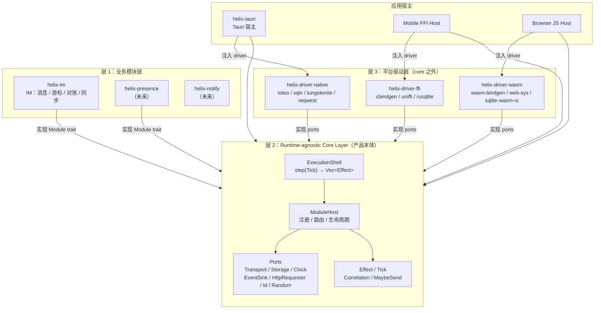

### 5.2 依赖方向 / 倒置图

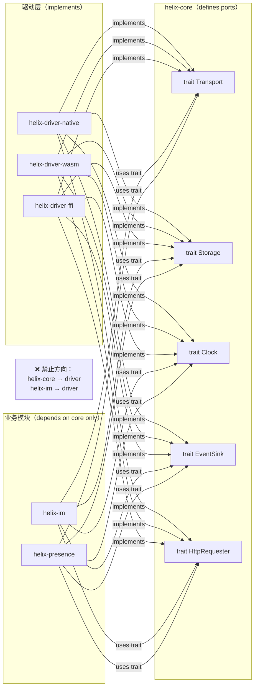

### 5.3 Sans-IO 数据流

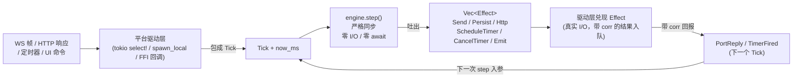

### 5.4 模块挂载时序图

```mermaid
sequenceDiagram
    participant Host as 应用宿主
    participant Driver as helix-driver-native
    participant Engine as helix-core CoreEngine
    participant IM as helix-im ImModule

    Host->>Driver: 实例化 ports (sqlx pool, tungstenite, reqwest...)
    Host->>Engine: CoreEngine::new(ports)
    Host->>Engine: register(ImModule::new(im_config))
    Engine->>Engine: modules.push(Box::new(im))
    Host->>Engine: engine.start()
    Engine->>IM: on_start(&mut EffectSink)
    IM-->>Engine: [Persist{get cursor}, Send{hello 帧}, ScheduleTimer{...}]
    Engine->>Driver: 兑现初始 Effects (sqlx 读 cursor, WS connect+send)
    Driver-->>Engine: PortReply{corr, Ok, cursor_value}
    Engine->>IM: handle(Tick::PortReply{...})
    IM-->>Engine: [] (填充 gate_states 内存)
    Note over Host,IM: 进入运行循环
    loop 事件泵（只在 Driver 内 await）
        Driver->>Driver: next_event().await
        Driver->>Engine: step(tick, now_ms)
        Engine->>IM: handle / tick
        IM-->>Engine: Vec&lt;Effect&gt;
        Engine-->>Driver: Vec&lt;Effect&gt;
        Driver->>Driver: execute(effects).await
    end
```

### 5.5 IM 发送对账时序图

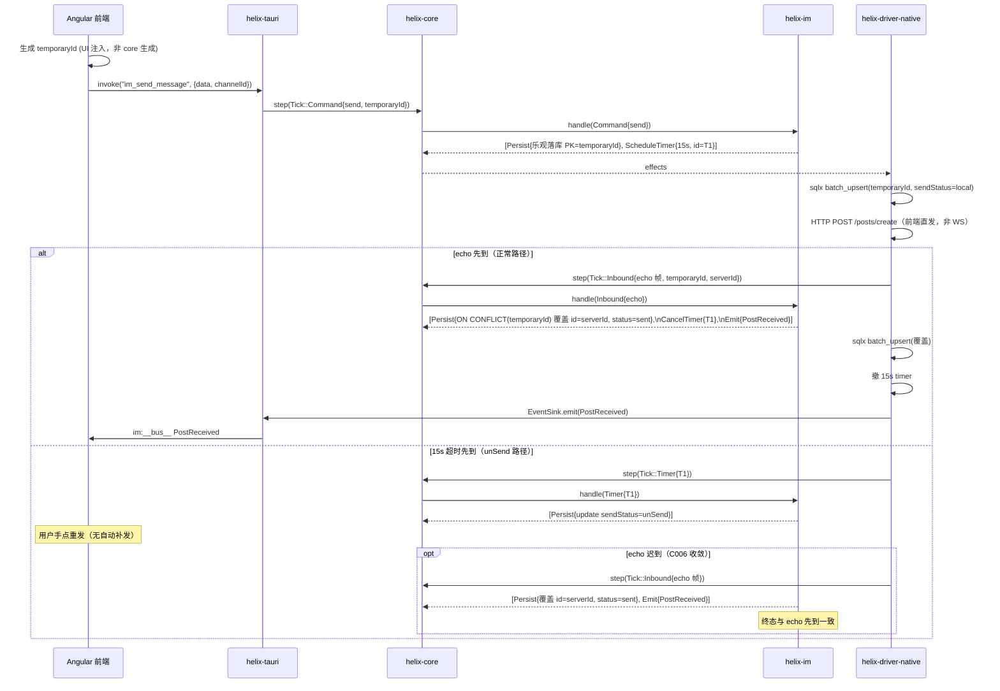

### 5.6 Gate Cursor 推进流程

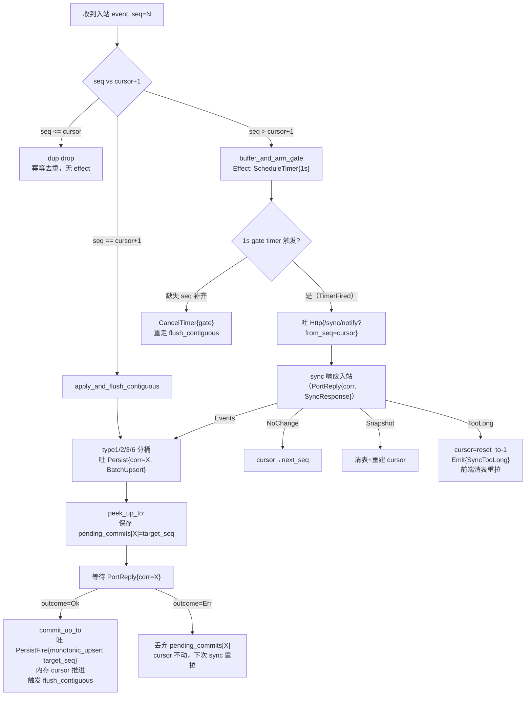

### 5.7 WS 连接状态机

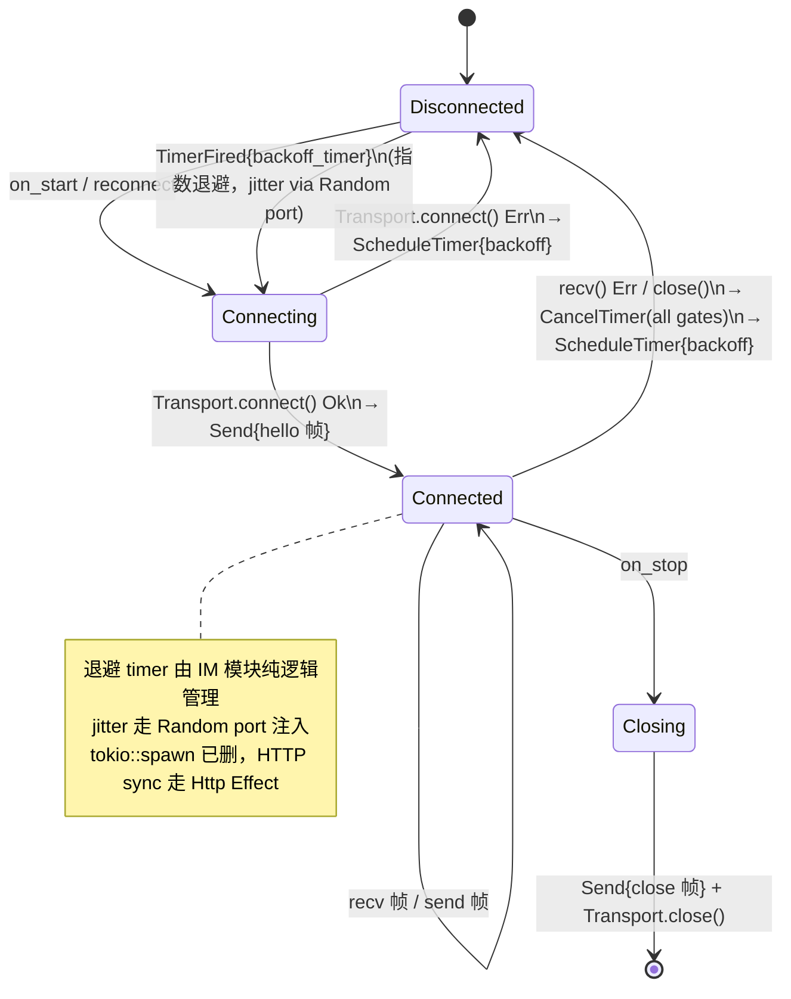

### 5.8 三栖编译/部署图

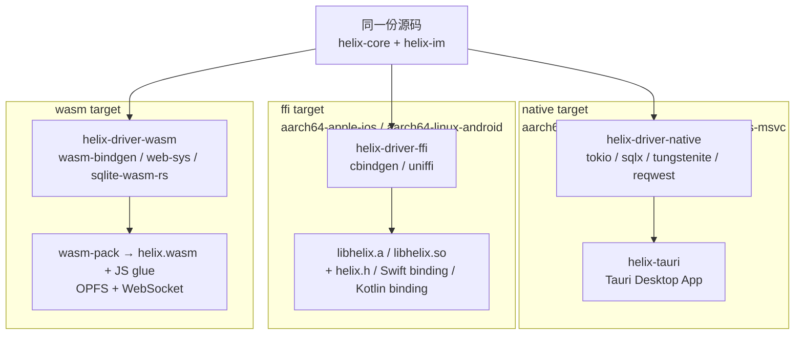

### 5.9 DDD 领域模型类图

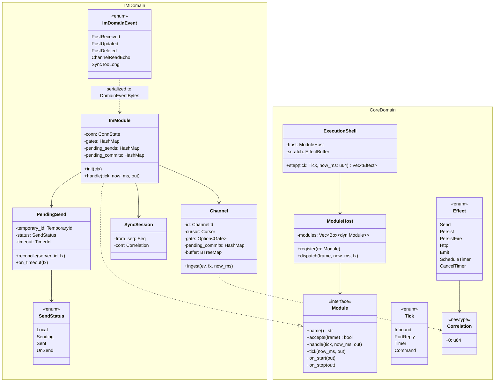

### 5.10 模块生命周期状态机

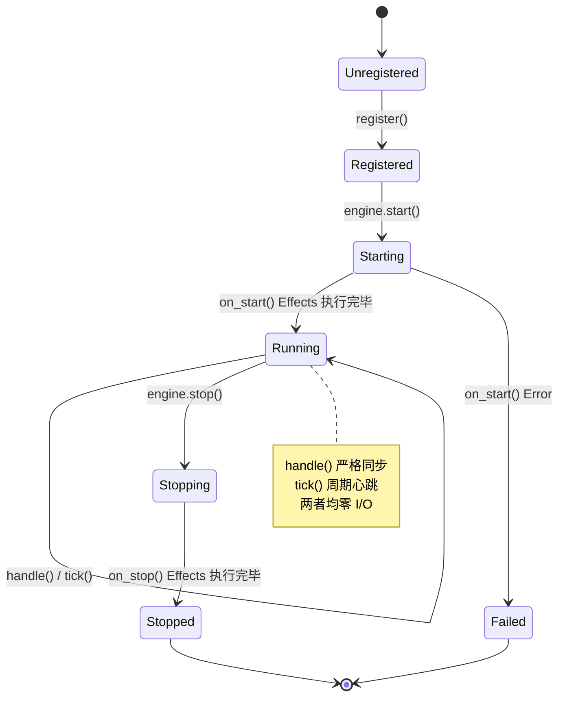

---

## 六、用例图与关键用例展开

### 6.1 完整用例图

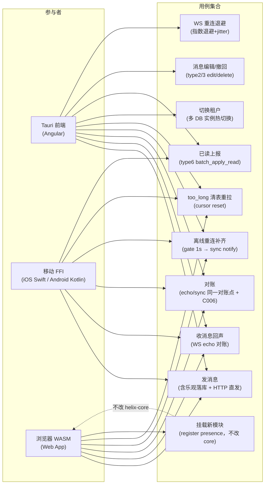

### 6.2 关键用例步骤展开

#### UC1：发消息（完整路径）

1. UI 生成 `temporaryId`（UUID，UI 注入，非 core 生成）
2. Angular `invoke("im_send_message", {data, channelId})`
3. helix-tauri `commands.rs`（≤5行）→ `Tick::Command{send, temporaryId}`
4. `engine.step()` → IM handle → 吐 `[Persist{乐观落库 PK=temporaryId, sendStatus=local}, ScheduleTimer{15s}]`
5. driver 兑现：sqlx `batch_upsert`（O(1)）+ HTTP POST `/posts/create`
6. （等 echo 或 15s）→ 见 UC2/UC3

#### UC4：离线重连补齐

1. WS 断线 → IM `on_disconnect` → 吐 `ScheduleTimer{backoff}` + `CancelTimer(all gates)`
2. backoff 到 → IM → 吐 `Send{hello}` + `Transport.connect()`
3. hello 响应 → 检查各 channel cursor
4. 发现 seq gap（`buffer_and_arm_gate`）→ 吐 `ScheduleTimer{1s}`
5. 1s TimerFired → 吐 `Http{/sync/notify?from_seq=cursor}`
6. 响应 Events → 分桶 `Persist{corr}` → `PortReply Ok` → `monotonic_upsert` → `flush_contiguous`

#### UC5：too_long 清表重拉

1. sync 响应 `TooLong { reset_to }` → IM handle
2. 吐 `PersistFire{monotonic_upsert(channel_id, reset_to - 1)}`（内存 cursor 重置）
3. 吐 `Emit{SyncTooLong}`
4. driver → EventSink → Tauri `im:sync:too_long` → 前端清本地消息表 + 重拉首屏

#### UC7：挂载新模块（presence）

```rust
// 不改 helix-core / helix-im 任何代码
engine.register(PresenceModule::new(presence_config));
// 完毕。PresenceModule 实现 Module trait，uses Transport/Storage/EventSink port，
// on_start 吐 Connect effect，tick 处理心跳，handle 处理 presence 帧
```

---

## 七、补充图

### 7.1 Effect 兑现解释器流程

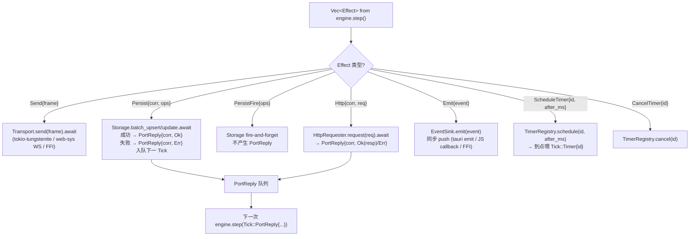

### 7.2 热路径 O(1) 落库时序（batch_upsert）

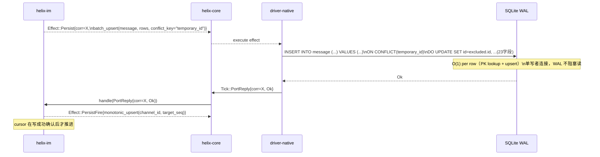

### 7.3 wasm 体积预算

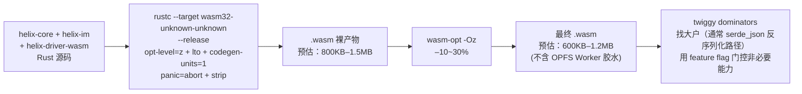

---

## 八、五条质量轴达成对照表

| 轴 | 声明 | 具体证据 |
|---|---|---|
| **① 性能最优** | 热路径 O(1)、零拷贝、最少分配、无多余 await 往返 | `batch_upsert` ON CONFLICT 单条 O(log N)≈O(1)；`monotonic_upsert` MAX guard O(1)；`EffectBuffer` 跨 step 复用（clear 不重建）；`DomainEventBytes = bytes::Bytes` 零拷贝；`engine.step()` 严格同步，不加任何 await 往返 |
| **② 复杂度最低** | 最简够用；通用性靠真实模块跑通挣，不预建框架 | ModuleHost 只有 `register` + `dispatch`（约 20行）；6 个 port trait 签名由 IM 第一性需求推导，无预测性扩展；presence 第二模块能直接 `register` 不改 core 任何代码（UC7 验证）；§四.3 两段式 step 是通用 Correlation 契约，IM 用到，presence 可不用 |
| **③ 兼容性最高** | 三栖全绿；executor-agnostic；tri-target crate | helix-core 无 tokio/sqlx/reqwest/web-sys（`Cargo.toml` 验证）；`MaybeSend/MaybeSync` 30行 cfg bridge；`platform::spawn` cfg-gate；wasm 用 `async_trait(?Send)`；getrandom workspace 级 `features=["js"]`；三栖编译图 §5.8；sqlx 禁入 wasm 是永久限制，Storage port 就是解法 |
| **④ 可扩展性强** | 加模块不改 core；加平台不改 core/模块 | 开闭原则体现在 ModuleHost.register（不改 dispatch 逻辑）；新 driver = 实现 6 个 port trait（不改 helix-core / helix-im）；presence 第二模块 UC7；`#[cfg(feature)]` 门控能力（可单独关闭 IM 只用 presence） |
| **⑤ 代码风格 cool** | 类型驱动、tagged union、newtype、零 unwrap on 外部输入 | `Tick` / `Effect` = tagged union，非法组合不可表达；`Persist` 强制带 Correlation（类型层逼模块走 peek/commit）；`ChannelId / TemporaryId / Seq / TimerId / Correlation` 全 newtype 防混淆；`SendStatus` 4 态 enum；外部输入用 `from_tick()` fail-fast（不 unwrap）；`thiserror` 全域强类型 error |

---

## 九、与产品定位逐句对照表

| 产品定位原文 | 架构落实 | 文档位置 |
|---|---|---|
| "Helix 不是 IM 内核，而是通用的 Runtime-agnostic Core Layer" | helix-core 不含任何 IM 词汇，grep 验收。IM 是 Module，core 不认识它。 | §2.1 BC-A / §4.6 依赖方向 |
| "今天被 Tauri 使用（native，性能 + 线程模型）" | helix-driver-native 用 tokio multi-thread + sqlx + tungstenite；helix-tauri 宿主封装命令和 emit | §4.1 workspace / §五.4 挂载时序 |
| "明天被移动端通过 FFI（C ABI 稳定）" | helix-driver-ffi：cbindgen opaque ptr + uniffi Swift/Kotlin；`Box::into_raw`/`from_raw` 所有权协议；buffer 回调前拷贝 | §三.8 FFI 选型 / §四.1 workspace |
| "后天被浏览器通过 WASM（zero-copy + sandbox）" | helix-driver-wasm：wasm-bindgen + sqlite-wasm-rs OPFS + ws_stream_wasm；bytes::Bytes 零拷贝；wasm sandbox 无 OS | §三.4/3.5/3.9 / §五.8 三栖图 |
| "一次实现，多端一致性（可回放、可测试 = 确定性）" | engine.step 纯函数；MockClock 手动控时；proptest C006 两次序列终态一致；单元测试不需要 tokio | §四.4 测试示例 / §三.10 |
| "IM 只是第一个业务模块，core layer 不认识 IM" | grep 红线表；ACL-1 翻译器在 helix-im 侧；presence UC7 不改 core | §2.4 ACL-1 / §六.2 UC7 |
| "概念祖先：Bun（runtime 跑 JS）→ Helix（runtime 跑确定性业务模块，且自身三栖寄宿）" | engine.step = 运行模块的调度器；模块是业务，core 是 runtime；三栖 = native/ffi/wasm | §一.1 / §五.8 |
| "core 定义 ports；thin per-target adapters 实现它们" | 6 个 port trait 在 helix-core；adapter 在各 helix-driver-* | §四.2 ports / §2.4 ACL-2 |
| "并发模型不能 bake 进 core" | engine.step 同步；spawn/tokio 在 driver；wasm 单线程喂同一份 step；4-worker hash 分片是 driver 决策 | §一.3 / §四.1 IM 分片裁决 |
| "时间/随机/ID 由 host 注入（确定性来源）" | Clock port now_ms 注入；IdSource port；temporaryId 由 UI 注入（源码印证）；MockClock 测试 | §二.1 Tick / §四.2 Clock |
| "YAGNI 边界必须在目标平台集合确定后才能画" | 三栖目标已确认，6 个 port 全部存在；上一版砍掉 Transport/Storage/Clock 三抽象是错的，本版全部保留 | §一（教训小节）|

---

## 附：教训备档（后续 agent 必读）

1. **YAGNI 边界在目标平台集合确定前不能画**。单平台假设下砍掉的 `trait Storage`/`Clock`/`Transport`，在三栖目标下是必需的。Helix 目标集合已确认（native + FFI + wasm），所有 port 必须存在。

2. **sqlx 永远不进 wasm32-unknown-unknown**。这不是 feature flag 问题，是架构问题。Storage port 就是为了解决这个分叉存在的。

3. **`std::time::Instant` 在 wasm32-unknown-unknown 上 panic**（运行时，非编译期）。Clock port 是必须注入的，不是可选优化。

4. **并发模型绝不 bake 进 core**。4-worker hash 分片是 native driver 的 IM 专属决策；wasm 单线程喂同一份 step，行为完全一致。

5. **`getrandom = { features = ["js"] }` 必须在 workspace 级声明**（不只是 helix-driver-wasm 级），否则任何经 helix-core 传递依赖 getrandom 的路径 wasm link 失败。

6. **IM 模块知识以当前源码（2026-06-08 实测）为准**。`cses-client-dev` 训练知识对 message-v3 已过时。`DomainEvent` 多族强类型 enum、`temporaryId` 对账、per-channel cursor、`flush_contiguous`/`flush_up_to`、决策#2 peek/commit 是 ground truth。

7. **`im:` 前缀 / wire 名 / `im:__bus__`** 是 helix-tauri 的 event_bus.rs 唯一出口，不出现在 helix-core / helix-im 任何位置。CI grep 守卫：`grep '\.emit("im:' crates/helix-im/src/*.rs` 期望 0 行。

8. **`tokio::spawn` 已从 IM 逻辑中删除**（HTTP sync 走 Http Effect，driver 异步兑现）。任何在 `Module::handle` 里出现的 `spawn` = 破坏 sans-IO 范式。
