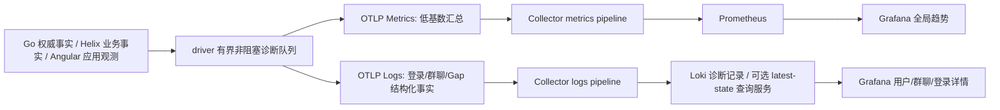

# 用户与群聊消息可靠性观测设计

> 状态：REVIEW: APPROVED（独立评审仅批准文档与看板 artifact；新增 producer 保持 Planned）。本轮交付文档与 Dashboard 产物；以下新增 producer、诊断管道与对账服务均为待实现设计，不能称已采集。
> 当前事实见[客户端实测清单](Angular客户端当前真实暴露指标-2026-09-07.md)，现有注册合同见[Prometheus 指标说明](Prometheus指标说明.md)。

## 1. 要解决的问题

| 用户问题 | 必须能看到的事实 | 不足以作为答案的信号 |
|---|---|---|
| 离线登录后没群/少群 | 每次登录的身份/租户/设备、权威应有频道集合、服务端返回、SQLite 已提交、Helix 已交付、Angular 已应用及合法隐藏原因 | HTTP 200、群数量相等、仅一张截图 |
| 当前用户所有群及单群收消息 | 可见事件义务、WS 到达、唯一需处理事件、PersistOk、read-back、Emit、Store applied 分层漏斗 | WS 帧总数、写入 socket 成功、EventSink Emit 单点 |
| 离线同步进展 | 同步轮次、分页、各群本地连续水位、服务端本轮 horizon、pending、终态、重试与未完成原因 | 单一“同步完成”日志或最大消息 seq |
| Gap 到底丢了什么 | seq 域、epoch、期望/收到、缺失区间、补拉边界与权威可见结果、恢复后连续水位 | 单个 gap 计数或 received_seq-expected_seq |

## 2. 两条观测通路与职责



- `helix-im` 决定业务结果、连续水位和持久屏障；不 import OTel SDK、不进行网络发送。
- driver 在既有完成点旁路记 MetricEvent，独立 worker 做 OTLP；Angular 只报告接收/Store/CD，不推算权威业务终态。
- Prometheus 只保留低基数计数、耗时和积压；user_id、channel_id、login_attempt_id、seq、gap_id、trace_id 放 Log/Trace 字段，不作常驻时序或 Loki 索引标签。
- OTel Metrics 本身就是聚合数据，Collector 转为 Prometheus 不是丢消息的证据。Trace spanmetrics 适合 RED，不能在采样链路上计算精确业务送达率。
- 同一业务终态分别产出 metric 与诊断记录，不把两者相加。若未来由日志转换 metrics，必须单独切换 owner 并处理重试去重；不能与 SDK 双计。
- 普通明细以有界批次或短 TTL 定向捕获为主；生命周期摘要与 Gap 异常 100% 尝试记录，但队列/网络丢弃必须显式可见，不能宣称 100% 送达。

官方依据：[Prometheus 高基数标签约束](https://prometheus.io/docs/practices/naming/)、[Loki 结构化元数据](https://grafana.com/docs/loki/latest/get-started/labels/structured-metadata/)、[Loki 日志生成查询指标](https://grafana.com/docs/loki/latest/query/metric_queries/)。

## 3. 每次登录的全生命周期

宿主在认证尝试入口创建 `login_attempt_id`，与 `device_session_id`、`tenant_id`、已认证 `user_id`、客户端版本、数据库 generation 绑定。认证前 user_id 未知时不伪填；认证后记录身份绑定。失败登录和 DB 打开前失败必须有独立于 IM runtime 的观测出口。

```text
login_started
 → auth_succeeded / auth_failed
 → tenant_store_opened / tenant_store_failed
 → ws_hello_received / ws_hello_timeout
 → channel_inventory_requested
 → channel_inventory_page_received（可多页）
 → channel_inventory_persisted（仅匹配 PersistOk）
 → channel_inventory_projected
 → channel_inventory_applied（Angular Store）
 → login_sync_terminal
```

`login_sync_terminal.result` = success / partial / failed / timeout / cancelled / interrupted / unknown。success 要求本轮全部必要阶段完成；进程直接崩溃不会产生正常终态，需要下次启动恢复日志或服务端观察 lease 到期标 interrupted/unknown，不能把未出现 success 当业务失败。

每个终态携带 expected_known、membership_revision、snapshot_token、expected_channels、returned_channels、persisted_channels、projected_channels、applied_channels、filtered_channels、missing_count、unexpected_count、reason、elapsed_seconds、telemetry_complete、dropped_records。集合对账必须同 snapshot；缺服务端权威基线时 expected_known=false，完整性为 unknown。

### 少群的定位规则

1. 权威 membership 集合本身错误：归 Go/Java 公司成员初始化、加入/退出/权限；客户端全量同步也无法修复服务端缺成员事实。
2. 权威有而响应没有：分页遗漏、增量 timestamp/cursor 误用、visibility/permission、服务端查询或快照漂移。
3. 响应有而本地没有：解析/跨租户路由错误、SQLite 失败、提交屏障或进程中断。
4. 本地有而 Helix 未交付：投影生成、订阅、EventSink 或反压问题。
5. Helix 有而 Angular Store 无：IPC、窗口生命周期、前端消费失败。
6. Store 有而列表不显示：归档、隐藏、搜索、会话列表范围、UI 过滤或渲染；“所有有权访问频道”与“UI 会话列表”不是同一分母。

计数仅用于总览，具体少了哪些群要保留集合差异的有界分页诊断记录和 hash。不能同步时额外扫描数据库全量集合；尽量复用现有 snapshot、分页和提交返回值。

## 4. 在线接收与落库率

### 身份与唯一键

区分 `delivery_id`（一次逻辑交付义务）、`attempt_id`（重试）、`event_key`（去重后的事实）。event_key 至少有 tenant/channel、seq_domain、stream_epoch、seq；用户可见性和设备 scope 另外绑定。不要只拿 postId、根 seq 或临时 ID 去重所有事件。

### 分层事件

| stage | 记录者/触发条件 | 计数单位 |
|---|---|---|
| server_committed | Go 对消息/事件/Outbox 同一事务 commit 后 | 一条权威事件 |
| audience_resolved | Go 对本轮可见接收对象形成稳定义务 | 事件×接收主体，标明用户/设备 |
| server_enqueued / socket_written | Go 目标连接入队/完成写入 | transport attempt；不能当送达 |
| ws_received | driver 真正读到 WS 业务帧 | 物理帧，心跳/控制帧另算 |
| event_accepted | Helix 解码、scope/visibility 校验、去重后接受 | 唯一且要求处理的事件 |
| persist_committed | 对应批次收到 PersistOk | 唯一事件，批次失败不能释放成功 |
| persist_verified | 有明确定义的 read-back 证据 | 验证等级独立；不为埋点新增逐消息查询 |
| projection_emitted | Helix 权威事件释放 | 应用事件；不等于用户已收到 |
| client_applied | Angular canonical upsert 完成 | renderer 观测 |
| view_updated | detectChanges 后 | UI 观测；不是像素或已读 |

### 可比较的率

- **接收后本地落库终态成功率**：同一到达 cohort、相同 device/session 的 committed unique events / matured eligible unique events。matured = committed + failed + timeout；pending 单列，未知观测单列；分母为 0 显示无数据。
- 取消/中断不能悄悄删除已接受事件的交付义务：接受前取消不进入cohort；接受后取消仍保持pending，宽限到期且证据完整才转timeout；进程中断且无法可靠续接为unknown。partial只表示cohort不完整，不是单事件终态；unknown或观测丢弃非零时 evidence_complete=false，该cohort不进入成功率计算，另显不完整cohort数。
- **业务端到端交付率**：权威 audience 的 mature eligible obligations 中，已得到符合约定的持久/应用回执的 obligations 占比。离线用户在宽限期内计 pending，不直接视为丢失。
- any_device 要服务端/诊断聚合器按用户交付义务去重；多个设备的 client_applied Counter 相加无法直接得到 any_device。
- socket_written、ws_received、persist_committed 的计数速率可以分别展示，但不同来源、不同时间窗的两个 Counter 直接相除不是严格交付率。
- `delivery_cohort_closed` 是拟新增的同 cohort 对账摘要，含 denominator/committed/failed/timeout/pending/unknown、close_reason、visibility 与 evidence_complete。诊断看板只在 evidence_complete=true、matured>0 的摘要上计算 observed persistence ratio；窗口统计按 cohort 关闭时间计，不称“此窗口内到达的所有消息”。
- ws 重复帧、乱序、redacted marker、客户端重启后的回放需单列；合法不可见正文不计入消息落库失败。

## 5. 离线同步、群检查点与 seq

每次同步有 sync_session_id、trigger（login/reconnect/notify/gap/manual）、snapshot/horizon、分页 token hash、from/next、returned/applied/deduplicated/redacted、has_more、duration、attempt、terminal 与失败阶段。空页且 has_more、token 不前进、满批不续拉、重复页、取消后迟到回包都要可诊断。

每群记录 `channel_checkpoint`：

| 字段 | 语义 |
|---|---|
| tenant_id/user_id/channel_id/device_session_id/login_attempt_id | 主体、群和这次登录设备；不可跨设备拼值 |
| seq_domain/stream_epoch | 序号空间与重置代际 |
| observed_high_seq | 已见最大值，不代表中间完整 |
| local_contiguous_seq | 已处理且持久化的连续边界，不能由 max(seq) 推导 |
| local_persisted_high_seq | 已存最大值，可大于连续边界 |
| server_horizon_seq | 同一域、可见性和快照下服务端权威边界 |
| requested_from_seq/response_next_seq | 本次分页请求与服务端返回推进值 |
| checkpoint_version/observed_at | 本地单调版本与采集时间，避免迟到覆盖 |
| pending_ranges/visibility/evidence_complete | 仍待补的区间、裁剪和证据完整性 |

**seq、timestamp 游标、ID 一律在诊断 JSON 内存为十进制字符串**。Prometheus/LogQL unwrap 是浮点数，大于 2^53 会失真，精确 seq 表不得转换为数值。差值/落后量只有在同 seq 域且规则允许时由业务代码计算为有界数值。

看板中的“各群最后观测检查点”是查询窗口内最多 1000 条记录，按时间排序后按 tenant/user/device/login/channel/domain/epoch 分组取最后观察值，不等于全量当前数据库视图。时间窗外或无心跳的群不在结果里。检查点要报告 observed_at 与 freshness，不能用 max(seq)掩盖回退。

要无遗漏地查询“该用户当前所有群最新 seq”，需要**受授权、分页的 latest-state 查询服务**：以主键与 checkpoint_version 幂等 upsert，乱序旧版本拒绝覆盖，结合 membership snapshot LEFT JOIN 生成缺数据行；返回 observed_at/stale、expected_known 与 partial。该服务本轮未实现，Loki 日志表不能替代。

## 6. Gap episode：从怀疑到证据

每次缺口建立 gap_id，一次 episode 只加一次 detected；扩大的 missing_ranges 单独记 update，不能每次重复入站都当新 Gap。

记录 `gap_opened` / `gap_updated` / `gap_repair_requested` / `gap_repair_result` / `gap_terminal`，共用：

```json
{
  "event": "gap_opened",
  "tenant_id": "<tenant>", "user_id": "<user>", "channel_id": "<channel>",
  "device_session_id": "<device>", "login_attempt_id": "<login>",
  "gap_id": "<episode>", "seq_domain": "stream_seq", "stream_epoch": "<epoch>",
  "expected_seq": "101", "received_seq": "105", "missing_ranges": [["101", "104"]],
  "local_contiguous_seq": "100", "observed_high_seq": "105",
  "server_horizon_seq": "<same-domain-visible-horizon>",
  "reason": "pending_authority_check", "evidence_complete": false
}
```

该示例是假设性边界案例，不是运行证据。根 WS seq 仅连接级 delivery metadata；channel event_seq 和 streamSeq 以现行协议逐一核对，不互减、不因为消息序号不连续就宣称丢消息。

| 结果分类 | 必要证据 |
|---|---|
| reorder_recovered | 缺失事件随后在同域到达且提交，连续水位越过区间 |
| replay_deduplicated | 事实已落库，只是重复或重连回放 |
| visibility_skipped | 服务端可见性/合法 redaction marker 解释对应区间 |
| retention_compacted | 权威返回历史裁剪/too_long，需全量或快照恢复 |
| persist_failed | 曾收到可处理事件，但提交失败且未补偿 |
| protocol_mismatch | seq 域、解析、horizon/nextSeq 或 membership snapshot 不一致 |
| confirmed_missing | 同一可见性/epoch 权威证明该事件应存在，重试与宽限到期仍未持久化，且诊断证据完整 |
| unknown | 观测丢失、缺权威查询、断线或证据不足；不计真实丢失 |

数值例：见到 105 而期望101，只能先报疑似 [101,104]；随后同步返回101–104并PersistOk则为 recovered。若区间为合法不可见 marker 则无正文丢失。只有匹配权威事实且排除诊断丢弃后仍缺失才可升级 confirmed_missing。

## 7. 拟补充的低基数 Metrics

下列为候选合同，实施时优先复用现有同语义 MetricId，不能与既有 im_sync/im_gap 族双计。canonical 前缀建议 `helix_im_diag_`，实际 Prometheus 出口以 metadata 固化。所有 metric 标签≤8，不含 ID/seq；资源维度另行预算，不自动把所有 Resource 转成 label。

| MetricId 候选 / 名称后缀 | kind / unit | owner / 触发点 | 标签（按需最小化） |
|---|---|---|---|
| DiagLoginTerminal / login_terminal_total | Counter / 1 | 宿主登录最终结算，每次一次 | platform,result,reason |
| DiagLoginDuration / login_duration_seconds | Histogram / seconds | 同次登录终态，单调时钟 | platform,result |
| DiagInventoryTerminal / channel_inventory_terminal_total | Counter / 1 | 同快照集合对账结算 | stage,result,reason |
| DiagInventoryDifference / channel_inventory_difference | Histogram / channels | missing/unexpected 的集合差数量 | stage,reason |
| DiagDeliveryTerminal / delivery_terminal_total | Counter / 1 | 同 cohort 唯一成熟事件结算 | path,result,visibility |
| DiagDeliveryPending / delivery_pending | Gauge / 1 | 有界待结算事实数 | path |
| DiagPersistLatency / persist_latency_seconds | Histogram / seconds | accepted→匹配PersistOk/Err，单调时钟 | path,result |
| DiagSyncTerminal / sync_terminal_total | Counter / 1 | 同一同步会话只结算一次 | trigger,result,reason |
| DiagSyncDuration / sync_duration_seconds | Histogram / seconds | 同一同步会话终态 | trigger,result |
| DiagSyncPages / sync_pages_total | Counter / 1 | 每个真实分页响应，重试单列 | trigger,result |
| DiagSyncEvents / sync_events_total | Counter / 1 | accepted/committed/dedup/redacted分开 | stage,visibility |
| DiagGapEpisode / gap_episode_total | Counter / 1 | 新 gap_id 建立 | seq_domain,trigger |
| DiagGapResolution / gap_resolution_total | Counter / 1 | episode 只结算一次 | seq_domain,result,reason |
| DiagGapOpen / gap_open | Gauge / 1 | 活跃 gap 数 | seq_domain |
| DiagGapRepairDuration / gap_repair_duration_seconds | Histogram / seconds | episode 创建→终态 | seq_domain,result |
| DiagCursorRegression / cursor_regression_total | Counter / 1 | 同域同代际已提交连续水位回退 | seq_domain,reason |
| DiagDiagnosticDropped / diagnostic_dropped_total | Counter / 1 | 独立观测队列拒绝/关闭/导出失败 | stage,reason |

白名单：platform={native,ffi,web,host}；path={live_ws,sync_replay,offline_recovery}；trigger={login,reconnect,notify,gap,manual}；seq_domain={event_seq,stream_seq,ws_delivery_seq}；visibility={visible,redacted,filtered,unknown}；stage={auth,store,hello,inventory,ws,accepted,persist,projection,renderer,export}；result={success,partial,failed,timeout,cancelled,interrupted,unknown}；reason={none,auth_failed,tenant_mismatch,store_open_failed,hello_timeout,membership_missing,page_missing,page_stalled,persist_failed,projection_failed,renderer_failed,visibility_skipped,retention_compacted,reorder_recovered,replay_deduplicated,protocol_mismatch,confirmed_missing,capacity_limit,export_failed,shutdown,deadline,unknown,other}；任意异常文本映射other并放诊断详情，禁止原文直接作label。

这些是未来Planned schema：当前LabelKey尚未包含seq_domain/trigger/visibility，本轮不会添加这些生产标签。看板的诊断字段来自拟新增日志schema，不声称现有MetricEvent已支持。

## 8. 还必须覆盖的业务场景

- membership 增量更新与同步竞态、加群/退群/踢人/解散/频道归档；私有频道、定向可见、账号封禁导致的合法差集。
- token 刷新、tenant 切换、旧连接迟到帧与错误账号落库；auth epoch 必须在 correlation 中保持一致。
- 多设备同时登录、桌面多窗口、设备休眠/唤醒、后台切前台；any_device 与 all_devices 不共用分母。
- SQLite LOCK/BUSY、磁盘满、只读、schema migration失败、DB损坏/重建、断电；收到消息与持久完成不能混淆。
- WS half-open、hello超时、心跳有而业务停滞、重连风暴、订阅缺失、慢消费者与队列丢弃。
- server horizon 持续增长、分页循环、空页不终止、cursor回退、too_long、历史裁剪、重启断点恢复。
- Persist成功但 EventSink无监听/IPC失败/Store失败/视图隐藏；UI没有新消息不必然是网络问题。
- unread、最后消息、排序与权限绝对态对账；只核对正文数量会漏掉这些错误。
- 观测自身禁用、采样、队列满、传输失败、重复导出、时钟偏差、版本混跑；必须先判断 evidence_complete。

## 9. 性能、权限与保留策略

- 热路径只做已有事件字段读取和 O(1)有界try_record；批量输出O(batch)，不逐事件网络发送、不额外同步查询数据库、不构造无界集合。
- membership完整对账O(channels)，gap索引用有界有序区间集合，插入/合并O(log gaps + overlaps)；大缺口保存区间，不把每个seq展开；达到容量上限标partial并交给已有恢复流程。
- 全局metrics直接记摘要；明细捕获由租户授权的短TTL任务控制，必须设并发用户/群/记录数/字节预算和到期停止，不以hash(ID)降低基数。
- 建议起始保留：登录/终态摘要7天、Gap与检查点7天、普通逐事件明细24小时；容量与合规负责人确认后配置。TTL不是已部署事实。
- Grafana变量不是授权。数据源/代理负责tenant与角色校验，普通用户不能把user_id留空查询别人的记录；“全局”指当前授权范围。禁止token、正文、cookie进入诊断记录。
- 精确计数需要retry去重与可靠诊断归档/对账服务。仅best-effort日志缺记录只能unknown，不能反推消息丢失。

## 10. Dashboard 交付合同与环境前置

- 一个独立Dashboard，默认全局；用户/群/登录/设备变量可输入、也可从表格字段的数据链接选择。Loki默认原始字段过滤，不能依赖label_values列出未索引user_id。
- 登录记录、同步结果、WS与持久终态、Gap区间、群检查点分别展示。无用户标签的技术指标在选择身份后显示“无身份维度”，不回退全局。
- 现网 Grafana health=12.2.1；Loki buildinfo=2.9.3，现有labels只有K8s日志维度，无专用诊断service_name证据。原生OTLP Logs接入建议独立/升级Loki 3.x并明确structured metadata配置；本轮不修改其版本或配置。
- 新诊断记录建议 resource service.name=`helix-im-diagnostics`，环境与platform保持原始生产资源；诊断body保留 producer_service 与 source_revision。同时保留原业务Trace服务身份。
- Dashboard按该目标service_name查询；Loki 2.9.3可以校验LogQL语法，但无目标日志就保持无数据。可用兼容适配器把相同JSON写入Loki时，必须另行证明投递与字段保真。
- 所有seq表保留字符串；“最新”限定在查询窗口、设备与epoch；不把缺少日志的群伪填0。

## 11. 分阶段实施与验收

| 阶段 | 交付 | 验收 |
|---|---|---|
| 本轮产物 | 实测71族清单、设计、独立Dashboard/生成器/校验器 | 静态/生成一致性、全局与用户查询解析；无生产接入承诺 |
| A 先接登录 | login/session诊断、权威membership与五层集合差 | 空库登录、离线重登、服务端少成员、分页漏群、PersistErr、UI过滤逐一可区分 |
| B 接收落库 | cohort与唯一事件终态、pending/unknown、观察丢弃 | 双用户在线+重试+重复+磁盘失败；相同scope的分子分母可证伪 |
| C Sync/Gap | episode区间、per-channel检查点、权威horizon | 乱序、重复、redacted、断连、too_long、回退、崩溃恢复，精确区间可对账 |
| D 查询服务 | 授权用户/群目录、latest-state/分页、版本拒绝旧覆盖 | 所有应有群含缺数据行；多设备/租户隔离、TTL和观测缺失可见 |

每个新增producer先focused红绿与失败生命周期，再worker/export、Collector、metadata/query，最后真实Go/SQLite/EventSink/Angular同轮证据。日志解析成功、健康检查或看板能打开都不证明业务采集成功。失败时按 disabled/no_producer/export_failed/missing_metadata/no_sample/stale/incomplete_evidence 归类。

回滚边界：本轮可独立撤销文档与新看板文件；未变更生产数据或既有看板。未来producer失败应关闭诊断旁路、不改变业务结果；TTL/队列熔断独立于主链。


## 12. 本轮 artifact 机器约束

独立文件 `client-channel-dashboard.contract.json`、`generate-client-channel-dashboard.mjs`、`client-channel-observability.json`、`client-channel-dashboard-check.mjs`；UID 固定 `helix-client-channel-v1`，不复用现有看板UID。生成器从独立contract读取71族快照引用和有限枚举；checker逐项核对snapshot、变量、精确过滤、链接URL编码、布局、生成一致性。

禁止rate面板通过or vector(0/1)、absent、clamp_min填补缺失业务事实。禁止seq数值unwrap、max(seq)、跨设备求和。Loki面板只查目标诊断service_name，不把普通K8s日志当该schema。ID字段的数据链接必须分别设置user/channel/login/device并保留其余范围、用Grafanapercentencode格式化；textbox空值才表示全局，非空精确匹配。Prometheus没有身份标签，技术面板选中身份后必须为空。

验证记录固定snapshot路径、API端点、selector、观察时间、源码revision；分别报告静态artifact通过、查询API接受、非空样本、真实业务未触发。当前注册表分母不进入本轮实测71族分母。


## 13. 当前代码接缝与优先缺口（静态核对）

| 当前入口 | 已有事实 / 不能替代的内容 |
|---|---|
| [WS帧解析](../../crates/helix-im/src/ws/frame.rs:98) | event_seq()不接收根seq；连接投递序号不得写业务cursor |
| [increment频道](../../crates/helix-im/src/ws/handlers/increment_channel.rs:65) | lastEventSeq只作远端increment_target，不直接推进本地水位 |
| [同步session](../../crates/helix-im/src/sync/session.rs:502) | viewer-filtered同步存在合法序号洞，不能收到跳号即报丢失 |
| [pong补偿解析](../../crates/helix-im/src/send/pong_compensate.rs:30) | 当前只保留channelId，fromSeq/maxSeq区间在此丢失；具体Gap诊断需在解析前保留 |
| [同步批次](../../crates/helix-im/src/sync/flow.rs:299) | 已有from/next/event_count等日志；398行排序前才有原始响应乱序证据 |
| [Gate flow](../../crates/helix-im/src/channel/gate/flow.rs:158) | 已有apply/dup-drop/buffer-gap日志，但没有持久化episode诊断模型 |
| [seq观测producer](../../crates/helix-driver-host/src/engine/perf_metrics.rs:218) | 成功Persist且包含last_event_seq时记一次，不代表消息数/每条事件数 |
| [business分类器](../../crates/helix-driver-host/src/metrics/business.rs:177) | recovery/gap-repaired/too_long有聚合分类；record_gap_duration无实际调用，不能靠注册宣称接入 |
| [channel-sync-ready](../../crates/helix-im/src/event/channel_sync.rs:6) | 只有session/generation/pageSize，不提供权威应有群全集 |
| [Go同步摘要](/System/Volumes/Data/workspace/golang/cses-im-server/internal/api/sync/handlers_log.go:23) | callerUserId/callerCompanyId/trackId与最多32条频道seq摘要已存在，但没有本轮Loki采集证据 |

Go源码引用正确仓根为 `/System/Volumes/Data/workspace/golang/cses-im-server`。Go WS [Trace](</System/Volumes/Data/workspace/golang/cses-im-server/internal/ws/trace.go:53>) 已有user.id/channel.id；[推送日志](</System/Volumes/Data/workspace/golang/cses-im-server/internal/ws/push_log.go:13>)带user/channel/device但缺业务event_seq/stream_seq。可优先复用这些完成点，避免平行造一套业务状态。

客户端 [本地readback](../../../cses-client/src-tauri/src/features/helix_im/storage_readback.rs:184) 能查询cursor/ledger，但不是Grafana数据源；debug im_trace.db可按channel/message查，不是按用户集中诊断API。现有Grafana user_ref/channel_ref仅textbox，没有绑定查询，不具备本次要求的按人/群下钻。

落地优先级：先补登录身份关联与权威membership分母，再保留pong区间与排序前证据；最后把真实PersistOk及renderer终态集中关联。缺权威可见性原因时，Gap结论保持unknown，不能直接输出confirmed_missing。


## 14. 诊断 JSON 最低字段合同（Planned）

所有事件共有 schema_version=1、event、observed_at（RFC3339）、producer_service、source_revision、tenant_id、user_id（认证前可空）、login_attempt_id、device_session_id、event_id（重试保留）、evidence_complete、dropped_records。channel级另有channel_id。身份从认证宿主上下文取，不能信任任意renderer传入的user_id。

- login_sync_terminal：result/reason、expected_known、membership_revision、expected/returned/persisted/projected/applied/filtered_channels（计数）、missing_count、elapsed_seconds。
- sync_terminal：sync_session_id、trigger、result、pages、events_received、events_committed、deduplicated、redacted、elapsed_seconds、from_seq/next_seq/horizon_seq（字符串）。
- delivery_stage：stage、path、result、event_key、seq_domain、stream_epoch、event_seq（字符串）、attempt_id；这些是明细记录数，不天然等于去重业务数量。
- delivery_cohort_closed：cohort_id（跨重试稳定）、path、matured、committed、failed、timeout、pending、unknown（非负计数），且matured=committed+failed+timeout；partial/unknown/dropped存在时evidence_complete=false。summary不可在关闭后变更；重试发送相同event_id和内容。看板按cohort唯一键取最后记录避免重复投递双计。
- gap_opened/gap_updated/gap_terminal：§6字段、result/reason/elapsed_seconds；gap_id稳定，missing_ranges作为精确字符串数组；次数面板标“诊断记录数”，需要episode去重才能称缺口数。
- channel_checkpoint：§5字段，至少各seq字符串、checkpoint_version、observed_at；local_horizon未知用null而非0。

数据源适配：JSON字段作为日志body或结构化元数据保留；本看板使用JSON body解析，不能仅把字段放metadata却遗漏body。stream索引仅service_name/deployment_environment/platform等有限资源维度。若实际OTLP exporter把body包成嵌套对象，必须在接入验收中对齐，不悄悄让所有面板为空。
