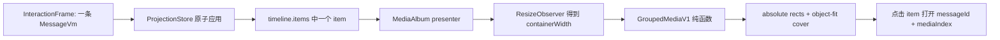

# Telegram Grouped Media 排版算法与 Helix / cses-client 落地方案

> 状态：设计与算法真源文档，不代表当前代码已经完成改造。
> 取证日期：2026-07-23。
> Telegram Web A 基线：`58d8e948efe4ff1212b21d97b45b23b4db65a513`。
> 目标语义：用户一次选择多张图片并发送，CSES 只产生一条消息；选择、
> 转发、撤回、失败和重试都以这条消息为聚合根。

## 1. 先回答最关键的问题：算法拿什么来排版

是的，Telegram 的算法首先拿到每一张媒体的**原始展示尺寸**
`pixelWidth × pixelHeight`，再计算宽高比：

```text
ratio[i] = pixelWidth[i] / pixelHeight[i]
```

它不是根据图片文件大小、缩略图下载后的 DOM 高度或图片数量直接套模板。
图片数量只决定进入哪个算法分支；最终格子形状由每张图的宽高比共同决定。

例如，同样是 4 张图片：

- 第一张是横图，可能得到“上方一张大图 + 下方三张小图”；
- 第一张不是横图，可能得到“左侧一张高图 + 右侧三张纵向排列”；
- 只改变任意一张图片的宽高比，也可能改变各格子的具体宽高。

因此，“1 到 9 张分别长什么样”不是九套固定 CSS。真正的输入是：

```text
LayoutInput = {
  containerWidth,
  maxHeight,
  minCellWidth,
  gap,
  orderedRatios[]
}
```

输出是每个媒体在相册坐标系里的整数矩形：

```text
LayoutOutput = {
  containerWidth,
  containerHeight,
  rects: [{ x, y, width, height, sides }]
}
```

`sides` 是外边标记，用来判断哪个格子接触相册的上、右、下、左边缘。

## 2. 我们复用什么，不复用什么

Telegram 普通相册在协议上可以由多条带相同 `grouped_id` 的消息组成，Web A
的 `IAlbum` 因此持有 `messages[]`。CSES 已经确定采用不同的业务语义：

```text
一次多选发送 = 一个 CSES Post / Message + props.images[]
```

所以我们只复用 Telegram 的**几何算法**，不移植它的多消息聚合模型：

| 项目 | Telegram Web A | CSES 目标 |
|---|---|---|
| 聚合根 | 多条消息组成 `IAlbum`，付费媒体也可是一条消息里的数组 | 一条消息 |
| 媒体列表 | `album.messages` 或 `extendedMedia` | `props.images[]` / `MediaAlbumVm.items[]` |
| 消息选择 | Telegram 可按成员消息处理 | 选择整条消息即选择全部图片 |
| 转发、撤回 | 受 Telegram message/group 语义约束 | 对一个 message id 操作 |
| 可复用部分 | `ratios[] -> rects[]` | 原样复现几何结果 |

这就是本文所说的**方案 C**：

> Helix 负责“一条消息里有哪些媒体、顺序、原始尺寸、上传状态和可用操作”；
> cses-client 负责用相同版本的纯函数把尺寸计算成像素矩形并渲染。

Helix 的 InteractionFrame 不携带 DOM、CSS、容器像素宽度或 `x/y/width/height`。
同一个 Frame 在 PC、移动端和不同窗口宽度下可以得到不同尺寸，但在相同算法版本、
相同输入尺寸和相同容器约束下，必须得到完全相同的整数矩形。

## 3. 原始尺寸从哪里来

### 3.1 发送端

用户在文件选择器一次选择多张图片后，cses-client 在发命令前完成：

1. 保留用户选择顺序，生成稳定的 `clientMediaId` 或数组索引。
2. 读取图片像素尺寸；视频读取编码后的展示宽高。
3. 应用 EXIF orientation 后再记录展示尺寸，不能把旋转前宽高写入合同。
4. 校验 `width > 0 && height > 0`，并设置合理上限，防止异常元数据。
5. 把 `width`、`height` 与每个 `mediaInput` 一起交给 Helix。

推荐命令形状：

```json
{
  "type": "rich",
  "text": "可选说明文字",
  "props": {
    "textPosition": "bottom",
    "images": [
      {
        "clientMediaId": "m-0",
        "width": 4032,
        "height": 3024,
        "mediaInput": {
          "localPath": "/opaque/source/a.jpg",
          "fileName": "a.jpg",
          "contentType": "image/jpeg",
          "size": 1234567,
          "sha256": "..."
        }
      }
    ]
  }
}
```

当前 Helix 上传计划已经把 `props.images[]` 视为一个 rich message 的媒体列表，
并且会保留 `mediaInput` 外层的 `width`、`height`。现有合同测试也验证了这些字段
会进入最终 `posts/create` body。真正缺口不是上传链完全不存在，而是：

- `width`、`height` 还没有成为严格、成对、必填的媒体尺寸合同；
- timeline projector 还没有把 `props.images[]` 投影成一个媒体数组 VM；
- InteractionFrame 和 Angular 类型目前仍只有单媒体 `content.kind = media`；
- message-v4 目前只渲染媒体类型和文件名占位块。

### 3.2 接收端与离线恢复

远端消息、重连增量和离线窗口不能依赖 `` 才知道高度。Go 持久化的
post props 必须保留每项的原始展示宽高；Helix 从本地 SQLite/WS/HTTP 同一事实投影：

```text
props.images[i].width + props.images[i].height
    -> MediaItemVm.pixelWidth + MediaItemVm.pixelHeight
```

若历史数据缺尺寸，必须显式走兼容降级：

1. 优先使用服务端已存尺寸；
2. 其次使用可信缩略图尺寸；
3. 再否则使用固定的未知媒体比例，例如 `1:1`；
4. 图片真实加载后允许重测当前消息高度，但不得更改媒体顺序或消息身份。

正常新消息不应走第 3、4 步。尺寸元数据越早确定，timeline 越稳定。

## 4. Telegram Web A 的完整算法

### 4.1 固定参数与边界位

Telegram Web A 当前参数：

```text
gap = 2
maxWidth = 当前消息媒体可用宽度
maxHeight = maxWidth
minWidth = 100

Top    = 1
Right  = 2
Bottom = 4
Left   = 8
```

一个格子可以同时拥有多个边界位，例如左上角是 `Top | Left`，四边都接触外框是
`Top | Right | Bottom | Left`。

CSES 不应把 `maxWidth=480` 写死。`480` 只是这次 Telegram Web 浏览器取证时的
消息媒体可用宽度。cses-client 应根据消息列、头像占位、左右 padding 和窗口断点
得到 `containerWidth`，再传给纯布局函数。

### 4.2 比例分类

对每个原始比例 `r`：

```text
r > 1.2  => "w"  // wide，横图
r < 0.8  => "n"  // narrow，竖图
otherwise => "q" // quasi-square，近方图
```

所有字符连接成 `proportions`，例如 `wwqnn`。

Web A 当前的平均比例不是普通平均值，而是：

```text
averageRatio = (1 + sum(ratios)) / count
```

这里初值确实是 `1`。为得到与当前 Web A 完全相同的结果，V1 必须保留这个兼容
行为，不能“顺手修正”为 `sum / count`。另一个兼容细节是：

```text
forceComplex = any(ratio > 2)
```

即使只有 2、3、4 张图，只要存在超宽图，也跳过对应特例，进入复杂布局器。

### 4.3 分支路由

```text
count == 1                -> single
count >= 5                -> complex
any ratio > 2             -> complex
count == 2                -> two
count == 3                -> three
otherwise (count == 4)    -> four
```

空数组返回 `0 × 0` 容器和空 rect 列表。

### 4.4 一张图

```text
height = round(min(maxWidth / ratio[0], maxHeight))
rect = (0, 0, maxWidth, height)
sides = Top | Right | Bottom | Left
```

它保持原比例，宽度占满；如果自然高度超过 `maxHeight`，显示区域会裁切。

### 4.5 两张图

#### 分支 A：上下等宽

满足全部条件：

```text
proportions == "ww"
averageRatio > 1.4
ratios[1] - ratios[0] < 0.2
```

注意最后一项不是绝对值，这是 Web A 当前实现的非对称兼容行为。

```text
h = round(min(
  maxWidth / r0,
  maxWidth / r1,
  (maxHeight - gap) / 2
))

item0 = (0, 0,              maxWidth, h)
item1 = (0, h + gap,        maxWidth, h)
```

#### 分支 B：左右等宽

当 `proportions == "ww"` 或 `proportions == "qq"`，且未命中分支 A：

```text
w = (maxWidth - gap) / 2
h = round(min(w / r0, w / r1, maxHeight))

item0 = (0,       0, w, h)
item1 = (w + gap, 0, w, h)
```

Web A 保留 `w` 的半像素可能性；浏览器可渲染小数像素。若我们要求跨语言整数
金丝雀，应在 GroupedMediaV1 合同里明确采用 Web A 的数值语义，最终写 style 前
再统一像素格式，不能让 Rust 和 TypeScript 各自猜取整策略。

#### 分支 C：左右不等宽

```text
minimalWidth = round(1.5 * minWidth)

secondWidth = min(
  round(max(
    0.4 * (maxWidth - gap),
    (maxWidth - gap) / r0 / (1 / r0 + 1 / r1)
  )),
  maxWidth - gap - minimalWidth
)

firstWidth = maxWidth - secondWidth - gap
height = min(
  maxHeight,
  round(min(firstWidth / r0, secondWidth / r1))
)
```

第一张放左侧，第二张放右侧。

### 4.6 三张图

#### 第一张是竖图：左一右二

当 `proportions[0] == "n"`：

```text
firstHeight = maxHeight

thirdHeight = round(min(
  (maxHeight - gap) / 2,
  r1 * (maxWidth - gap) / (r2 + r1)
))

secondHeight = firstHeight - thirdHeight - gap

rightWidth = max(
  minWidth,
  round(min(
    (maxWidth - gap) / 2,
    thirdHeight * r2,
    secondHeight * r1
  ))
)

leftWidth = min(
  round(firstHeight * r0),
  maxWidth - gap - rightWidth
)
```

矩形：

```text
item0 = (0,               0,                    leftWidth,  firstHeight)
item1 = (leftWidth + gap, 0,                    rightWidth, secondHeight)
item2 = (leftWidth + gap, secondHeight + gap,   rightWidth, thirdHeight)
```

#### 其他情况：上一下二

```text
firstWidth = maxWidth
firstHeight = round(min(
  firstWidth / r0,
  0.66 * (maxHeight - gap)
))

secondWidth = (maxWidth - gap) / 2
secondHeight = min(
  maxHeight - firstHeight - gap,
  round(min(secondWidth / r1, secondWidth / r2))
)
thirdWidth = firstWidth - secondWidth - gap
```

第一张横跨顶部，第二、三张平分底部。

### 4.7 四张图

#### 第一张是横图：上一下三

当 `proportions[0] == "w"`：

```text
w = maxWidth
h0 = round(min(w / r0, 0.66 * (maxHeight - gap)))
h = round((maxWidth - 2 * gap) / (r1 + r2 + r3))

w0 = max(
  minWidth,
  round(min(0.4 * (maxWidth - 2 * gap), h * r1))
)

w2 = round(max(
  minWidth,
  0.33 * (maxWidth - 2 * gap),
  h * r3
))

w1 = w - w0 - w2 - 2 * gap
h1 = min(maxHeight - h0 - gap, h)
```

第一张占顶部，后三张按 `w0/w1/w2` 排在底部。

#### 其他情况：左一右三

```text
h = maxHeight
w0 = round(min(h * r0, 0.6 * (maxWidth - gap)))

w = round(
  (maxHeight - 2 * gap) /
  (1 / r1 + 1 / r2 + 1 / r3)
)

h0 = round(w / r1)
h1 = round(w / r2)
h2 = h - h0 - h1 - 2 * gap
w1 = max(minWidth, min(maxWidth - w0 - gap, w))
```

第一张占左侧整高，后三张在右侧纵向排列。

### 4.8 五张及以上，或含超宽图：复杂布局器

复杂布局不是瀑布流，也不是 CSS Grid 自动填充。它会枚举行数分配候选，计算每个
候选的行高，然后选总高度最接近正方形约束、且没有明显坏形状的方案。

#### 第一步：裁剪参与布局的比例

只裁剪布局比例，不修改原始媒体元数据：

```text
if averageRatio > 1.1:
  croppedRatio[i] = clamp(originalRatio[i], 1, 2.75)
else:
  croppedRatio[i] = clamp(originalRatio[i], 0.6667, 1)
```

这样极端长图或极端宽图不会把整行压成不可用高度。真实图片最终通过
`object-fit: cover` 填满计算格子。

#### 第二步：生成基础候选

按以下三类“每行最大元素数”生成所有合法正整数拆分：

```text
[3, 3]
[3, averageRatio < 0.85 ? 4 : 3, 3]
[3, 3, 3, 4]
```

例如 `[3, 3]` 表示两行，每行至少一张、最多三张，总数必须刚好等于媒体数量。
递归枚举时，对当前行使用：

```text
minCurrent = max(1, remaining - sum(restMax))
maxCurrent = min(currentMax, remaining - restRowCount)
```

然后枚举 `[minCurrent, maxCurrent]`，直到数量正好耗尽。

#### 第三步：超大列表的扩展候选

如果基础候选一个都没有：

```text
minRowCount = max(
  5,
  ceil((count - 4) / 3) + 1
)

maxRowCount = min(count, minRowCount + 2)
```

对每个候选行数：

1. 每行先分一张；
2. 普通行最多三张，最后一行最多四张；
3. 从最后一行向第一行回填剩余图片；
4. 最多只尝试三个相邻行数。

#### 第四步：计算每个候选的行高

某行从 `offset` 开始，共 `k` 张：

```text
lineHeight =
  (maxWidth - (k - 1) * gap) /
  sum(croppedRatios[offset .. offset+k])
```

因为 `cellWidth = croppedRatio * lineHeight`，所以该行各格宽度加 gap 后恰好填满
`maxWidth`。

#### 第五步：候选评分

```text
totalHeight =
  sum(lineHeights) + gap * (rowCount - 1)

bad1 = min(lineHeights) < minWidth ? 1.5 : 1

bad2 = 存在 previousRowCount > nextRowCount ? 1.5 : 1

score =
  abs(totalHeight - maxHeight) * bad1 * bad2
```

选择分数最小的候选；分数相等时保留先生成的候选。两个 `1.5` 是惩罚因子：

- 避免出现高度小于最小格宽阈值的薄行；
- 避免上行图片比下行更多形成倒金字塔。

#### 第六步：把最佳候选物化成矩形

逐行：

```text
height = round(lineHeight)
x = 0

for each cell in row:
  if cell is last:
    width = maxWidth - x
  else:
    width = round(croppedRatio * lineHeight)

  rect = (x, y, width, height)
  x += width + gap

y += height + gap
```

最后一个格子不独立取整，而是吃掉本行剩余宽度。这一步非常重要，它消除了前面
格子取整产生的累计误差，保证每一行精确贴住右边界。

`sides` 同时在这里计算：

```text
row == 0             -> Top
row == lastRow       -> Bottom
column == 0          -> Left
column == lastColumn -> Right
```

容器尺寸取接触 `Right` 的格子 `x + width` 和接触 `Bottom` 的格子
`y + height`。

### 4.9 复杂度

输出本身需要遍历 `n` 张媒体。基础候选最多四行、每行上限固定为 3/4；超出基础
容量后只生成至多三个扩展候选。因此在这些常量不变时：

```text
时间复杂度：O(n)
空间复杂度：O(n)
```

不能在 Angular 模板的每次变更检测里反复重算。应以
`layoutVersion + containerWidth + ordered(width,height)` 为 memo key。

## 5. Web A 如何把矩形变成画面

算法本身不画图。Web A 的渲染结构是：

```text
Album(relative, overflow:hidden, 固定 width/height)
  media item(absolute, x/y/width/height)
    img/video(width/height:100%, object-fit:cover)
```

关键样式：

```css
.media-album {
  position: relative;
  overflow: hidden;
}

.media-album__item {
  position: absolute;
}

.media-album__item img,
.media-album__item video {
  width: 100%;
  height: 100%;
  object-fit: cover;
}
```

内部媒体圆角清零，只有相册外轮廓根据 `sides` 设置四个角的圆角。格子间距不是
`grid-gap` 临时推导，而是已经体现在 `x/y` 坐标中。

点击某一项时携带 `messageId + mediaIndex` 打开媒体查看器；消息菜单、选择态、
转发和撤回仍绑定外层唯一 `messageId`。

## 6. Helix 应该计算什么

### 6.1 Helix 不计算最终像素矩形

容器宽度属于展示环境。若 Helix 把 `480 × 501` 或每格 `x/y` 写进
InteractionFrame：

- PC 改窗口宽度就必须向 Helix 请求新 Frame；
- 移动端无法复用同一个 Frame；
- 字体缩放、头像列和详情面板都会污染领域合同；
- headless Frame 开始携带 CSS/像素事实，违反运行时边界。

所以 Helix 只提供确定性布局的**充分输入**，不提供结果。

### 6.2 推荐 Frame VM

```text
MessageContentVm::MediaAlbum {
  layout_version: "grouped-media-v1",
  text: String,
  text_position: Top | Bottom,
  items: Vec<MediaItemVm>
}

MediaItemVm {
  media_id: String,
  media_type: Image | Video,
  resource: ResourceRefVm,
  thumbnail: Option<ResourceRefVm>,
  file_name: String,
  size: u64,
  pixel_width: u32,
  pixel_height: u32,
  availability: MediaAvailabilityVm,
  upload: MediaUploadVm
}
```

必须满足：

- `items` 顺序就是用户多选顺序，也是图片查看器顺序；
- `pixel_width/pixel_height` 是应用 EXIF 后的展示尺寸，且都大于 0；
- Frame 不出现 `x/y/rect/containerWidth/CSS class`；
- `layout_version` 明确锁定公式和取整兼容行为；
- 一条消息只有一个 `id`、`eventSeq`、`delivery` 和 actions；
- 每项可有上传细节，但消息的最终发送状态是聚合状态。

当前源码差距：

- `MessageContentVm::Media` 只有单个 `resource`；
- `content_from_row` 仅把 `IMAGE/VIDEO/AUDIO/FILE/MEDIA` 投影为单媒体；
- `RICH + props.images[]` 尚未成为 timeline 的媒体相册分支；
- `TimelineWindowVm.items` 本身已经是一条消息一个 `MessageVm`，无需拆成九行。

### 6.3 上传与失败状态机

已确定的业务语义是：

```text
一个 temporaryId
  -> N 个媒体 prepare
  -> N 个 PUT
  -> N 个 complete
  -> 全部成功后仅一次 posts/create
  -> 一个 WS echo / sync 事实
  -> 一个 MessageVm
```

Helix 当前已有 `remaining_uploads` 和 `http_started` 单飞闸，已经接近这个模型。
目标状态规则：

```text
全部未完成且无失败 -> message.delivery = uploading(聚合进度)
任意一项失败       -> message.delivery = failed(retryable)
重试               -> 只重试 failed items
全部 complete       -> remaining_uploads == 0
posts/create        -> 只允许一次
authoritative echo  -> message.delivery = sent
```

聚合进度建议按字节加权：

```text
progress =
  sum(uploadedBytes[i]) / sum(totalBytes[i])
```

不要简单平均每张图片百分比，否则 1 KiB 小图和 50 MiB 大图权重相同。

## 7. cses-client 应该如何计算和渲染

### 7.1 纯函数边界

新增纯布局模块，例如：

```text
calculateGroupedMediaLayoutV1({
  containerWidth,
  maxHeight: containerWidth,
  minCellWidth: 100,
  gap: 2,
  items: [{ pixelWidth, pixelHeight }]
}) -> { width, height, rects[] }
```

要求：

- 不读 DOM；
- 不读图片资源；
- 不发请求；
- 不访问 store；
- 相同输入逐位得到相同输出；
- 用 golden vectors 对齐 Web A；
- 组件只负责测量容器宽度、调用纯函数和绑定 style。

### 7.2 渲染流程



Angular 组件应：

1. 外层 `<article>` 继续使用唯一 `message.id`；
2. `<media-album>` 接收只读 `MediaAlbumVm`；
3. 用 `ResizeObserver` 只观察相册可用宽度；
4. 对宽度做整数或固定 bucket 归一化，避免亚像素抖动；
5. 计算容器稳定高度后一次性绑定；
6. 每项绝对定位并使用 `object-fit: cover`；
7. 图片加载只改变清晰度/占位状态，不改变正常消息几何；
8. 选择层覆盖整个 `<article>`，不是产生九个 timeline 选择项。

当前 message-v4 的 `media` 分支只是一个媒体类型方块和文件名；它需要新增
`mediaAlbum` 分支，而不是在现有单媒体方块里循环九次。

## 8. 对 timeline 的影响

### 8.1 不改变的部分

- `TimelineWindowVm.items` 仍是一条消息一个元素；
- `track message.id` 不变；
- unread、anchor、target、eventSeq 都按消息，不按图片；
- reply、reaction、pin、bookmark、recall、forward 都绑定消息 id；
- 窗口最多 256 项的含义仍是最多 256 条消息，不是 256 个媒体格子；
- 批量图片不会额外消费 timeline page size。

### 8.2 会改变的部分

- 单个 timeline item 的高度从普通气泡高度变成相册计算高度；
- 上传中、失败和成功可能更新同一个 item 的媒体状态；
- 容器宽度变化会让相册重排并改变 item 高度；
- 图片查看器需要 `messageId + mediaIndex`；
- 预览摘要可从“文件名”改成“[图片] 9 张”之类的单消息摘要；
- projector、codec、fixtures、Angular union type 和 renderer 必须一起升级。

## 9. 会不会影响虚拟滚动

会影响**高度测量**，但不会破坏虚拟列表的身份模型，前提是坚持“一条消息一个
virtual item”。

当前 message-v4 实际上还不是虚拟列表：模板直接
`@for (message of timeline.items; track message.id)`，只用 256 条窗口上限控制数量。
所以当前改造首先影响普通 DOM 行高，不会直接触发虚拟滚动回归。

未来接入动态高度虚拟列表时：

```text
virtual item key = message.id
estimated height =
  message chrome
  + caption height
  + calculateGroupedMediaLayoutV1(...).containerHeight
  + reactions/replies/footer height
```

因为 Frame 已经带原始尺寸，图片下载前就能算出相册高度。这恰好比等待
`img.onload` 更适合虚拟滚动。

需要防住四类抖动：

1. **宽度变化**：缓存键必须含 width bucket，不能只按 message id 缓存高度。
2. **缺尺寸历史消息**：占位比例与真实尺寸不一致时，加载后要向 virtualizer
   报告精确新高度，并保持滚动锚点。
3. **进度 UI 改变盒模型**：上传遮罩应绝对定位，不能让 0%-100% 文案撑高格子。
4. **逐图加载触发 N 次测量**：正常路径几何预先确定，只在相册整体高度实际变化时
   通知一次。

推荐高度缓存键：

```text
messageId
+ messageProjectionRevision
+ groupedMediaLayoutVersion
+ containerWidthBucket
```

不要把每张图注册为 virtual item，否则会造成：

- 选择、撤回和转发需要重新聚合；
- anchor/定位跳到图片而不是消息；
- 九张图错误占用九个 timeline item；
- eventSeq 和 unread 边界失真。

## 10. 本次 Telegram Web 1 到 9 张取证

以下是本次浏览器中同一批素材、`maxWidth=480`、`gap=2` 的观察结果。它们用于解释
截图，不是按数量写死的模板：

| 数量 | 观察到的排布 |
|---:|---|
| 1 | `480 × 325` |
| 2 | 两行，各 `480 × 185` |
| 3 | 三行，各 `480 × 185` |
| 4 | 两行 `480 × 185`，底行两格约 `239 × 92` |
| 5 | 两行 `480 × 185`，底行三格约 `159/159/158 × 61` |
| 6 | 顶行两格约 `239 × 92`，中行三格约 `159/159/158 × 61`，底部一张大图 |
| 7 | 一张通栏、两行双格、末行双格 |
| 8 | 一张通栏、双格、三格、双格 |
| 9 | 两张通栏、三格、四格 |

这组结果之所以看起来逐步变化，是因为前几张素材多数拥有相似横向比例，后来又加入
另一种比例的图片。换一组原始尺寸，特别是把第一张换成竖图，3 张和 4 张的结构会
立即进入另一分支。

## 11. 确定性与 golden vectors

实现前应从 Web A 基线产生固定向量，至少覆盖：

- 空数组；
- 1 张横/方/竖图；
- 2 张三个分支；
- 3 张两个分支；
- 4 张两个分支；
- 2-4 张含 `ratio > 2` 的强制复杂分支；
- 5-13 张所有基础候选边界；
- 14 张以上扩展候选；
- 极端比例裁剪；
- `.5` 取整、最后格吸差和半像素；
- 分数相等时保留首候选；
- 不同 `containerWidth`；
- 输入缺尺寸的 fail-closed/兼容行为。

验收合同：

```text
same algorithmVersion
+ same ordered dimensions
+ same layout constraints
= same container size and same rect list
```

至少做三层测试：

1. TypeScript 纯函数单测；
2. Web A golden vectors 对拍；
3. Angular Native runtime 截图与 DOM rect 取证。

虚拟滚动启用后再增加：

- 图片未加载时首屏高度；
- 加载完成后无无意义 remeasure；
- resize 后锚点不跳；
- 1、5、9、14 张相册跨 viewport 的动态高度回归。

## 12. 建议的实施顺序

### Phase 1：尺寸合同

- 把 `width/height` 提升为 `props.images[]` 严格字段；
- 发送端读取并校验 EXIF 后展示尺寸；
- Go/SQLite/WS 保真；
- 历史缺尺寸策略明确。

完成定义：发送、回显、重连、离线窗口都能读到同一有序尺寸数组。

### Phase 2：Helix 语义投影

- 新增 `MediaAlbumVm` 和 `MediaItemVm`；
- `RICH + props.images[]` 投影为一条 `MessageVm`；
- 聚合上传状态和 actions；
- codec/fixture/strict matrix 同步。

完成定义：InteractionFrame 里是一条消息、N 个媒体，没有任何像素矩形。

### Phase 3：GroupedMediaV1 纯函数

- clean-room 按本文公式实现；
- 加算法版本；
- Web A golden vectors 全绿；
- 固定取整、边界位和吸差行为。

完成定义：纯函数在固定输入下生成目标 rect 列表。

### Phase 4：Angular 渲染

- 新增 `mediaAlbum` presenter；
- ResizeObserver + memo；
- absolute rect + `object-fit: cover`；
- 整条消息选择；单项点击进入查看器。

完成定义：1-9 张与目标几何对齐，选择/转发/撤回仍只作用一条消息。

### Phase 5：timeline 与虚拟滚动验证

- 当前 256 窗口普通 DOM 回归；
- 后续动态高度 virtualizer 接入宽度分桶缓存；
- 缺尺寸与 resize 锚点测试；
- Native actor/observer 真实链取证。

## 13. 源码真源与许可证注意

正确且当前可达的来源：

- [Telegram Web A calculateAlbumLayout.ts，固定 commit](https://github.com/Ajaxy/telegram-tt/blob/58d8e948efe4ff1212b21d97b45b23b4db65a513/src/components/middle/message/helpers/calculateAlbumLayout.ts)
- [Telegram Web A calculateAlbumLayout.ts，master](https://github.com/Ajaxy/telegram-tt/blob/master/src/components/middle/message/helpers/calculateAlbumLayout.ts)
- [Telegram Desktop grouped_layout.cpp](https://github.com/telegramdesktop/tdesktop/blob/dev/Telegram/SourceFiles/ui/grouped_layout.cpp)
- [TelegramSwift GroupedLayout.swift](https://github.com/overtake/TelegramSwift/blob/master/Telegram-Mac/GroupedLayout.swift)
- [Telegram Web A GPL-3.0-or-later LICENSE](https://github.com/Ajaxy/telegram-tt/blob/master/LICENSE)

此前给出的 `telegram-tt/blob/dev/...` 会 404，因为该仓当前分支是 `master`，不是
`dev`。

Telegram Web A 使用 GPL-3.0-or-later。若 Helix 不是 GPL 兼容发布，不能直接复制
或逐行翻译其实现。建议以本文的输入、输出、数学公式和 golden vectors 做
clean-room 重实现，并在发布前由项目维护者完成许可证审查。算法思想与兼容行为需要
复现，但源码版权边界不能靠“换成 Rust/TypeScript”规避。

## 14. 当前代码定位

Helix：

- `crates/helix-im/src/send/upload_props/plan.rs`：解析一个 rich message 的
  `props.images[]`，当前 `mediaInput` 严格字段尚不含尺寸。
- `crates/helix-im/src/send/flow.rs`：一个 `PendingSend` 聚合 N 个上传，
  `remaining_uploads` 归零后才允许 `posts/create`。
- `crates/helix-im/src/send/pending.rs`：消息级发送聚合与 `http_started` 单飞闸。
- `crates/helix-im/src/projector/timeline.rs`：当前只投影单媒体，尚未消费
  `RICH.props.images[]`。
- `crates/helix-im/src/interaction_frame.rs`：当前 `MessageContentVm::Media`
  是单资源；`TimelineWindowVm.items` 已经是一消息一项。

cses-client：

- `src/pages/message-v4/surface-runtime/surface-contract.types.ts`：当前只有单媒体 union。
- `src/pages/message-v4/components/surface/message-ui-surface-message-content.component.ts`：
  当前媒体分支只是类型/文件名占位。
- `src/pages/message-v4/components/message-surface-runtime-view.component.ts`：
  当前 timeline 使用普通 `@for` 并按 `message.id` 跟踪。
- `src/pages/message-v4/surface-runtime/surface-contract.codec.ts`：窗口限制 256 条消息。
- `src/pages/message-v4/shell.service.ts`：历史窗口和最大窗口常量。

这份文档钉住的是算法、边界和实施合同；它没有声称上述 Phase 已经实现。
