# InteractionFrame V2 当前公共架构

```mermaid
flowchart LR
    UI["MessageV4 component intent"] --> MODE{"当前 UC 入口"}
    MODE -->|"typed binding"| ACTION["ActionInvocationEnvelope/v1"]
    MODE -->|"尚未迁移"| DIRECT["HELIX_COMMAND_NAMES direct command"]
    MODE -->|"sync/observer"| INBOUND["Inbound / HostObservation / Timer"]
    ACTION --> TAURI["Tauri protocol adapter"]
    DIRECT --> TAURI
    INBOUND --> HELIX["ImModule::handle"]
    TAURI --> HELIX
    HELIX --> EFFECT["Effect: HTTP / Storage / Timer"]
    EFFECT --> BARRIER{"PersistOk 或 authority read"}
    BARRIER --> COMPOSE["projector / SurfaceComposer"]
    COMPOSE --> FRAME["InteractionFrameV2 schemaVersion=2"]
    FRAME --> SINK["Native V2 guard + opaque forward"]
    SINK --> BUS["ProjectionBusService"]
    BUS --> STORE["ProjectionStore"]
    STORE --> RUNTIME["SurfaceRuntime atomic stage/apply"]
    RUNTIME --> VIEW["typed MessageV4 components"]
    RUNTIME --> ACK["FrameApplied"]
    ACK --> TAURI
```

## 所有权

- Helix domain/application：业务事实、权限、排序、ActionBinding、revision、surfaceEpoch、
  causation、directive 与完整 VM。
- driver/infrastructure：HTTP/WS/SQLite 执行 Effect；不重建业务事实。
- Tauri interface：只校验 Frame envelope/schema 并 opaque 转发；不 reduce mutation。
- Angular application/interface：codec 校验、slot staging、原子发布、ack 与渲染；draft、route、
  overlay 可留在 shell，但不能成为服务端事实真源。

## 复杂度

Helix 每帧对 mutation 单次验证，Angular 用 `Map` 按 canonical slot key 查找并先 stage
后 publish，因此 apply 为 `O(m)` 时间、`O(m)` staging 空间。不得退化为每个 Surface
扫描全部 mutation 的 `O(s*m)`，也不得逐 mutation 穿越 Tauri/FFI 边界。
