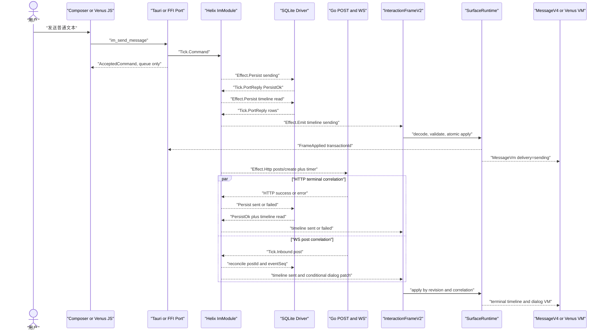

# G01 Helix、PC、Mobile V2 验收合同

> 查证日期：2026-07-24。本文只描述代码已存在且本轮实际验证的路径。Mock、
> source pin、真实 Native 和双账号链分层记账，任一层不能替代另一层。

## 1. 切换策略

全仓采用逐 Gate 切换：

1. 某 Gate 的 producer、Fixture 和 consumer 完成 V2 接入后，该 Gate 运行时只认
   `InteractionFrame.schemaVersion=2`。
2. 已迁移 Gate 不保留 V1 正向 Fixture、V1 parser fallback 或 raw business event
   到 UI 的旁路。
3. 可以保留一个负向测试，证明 `InteractionFrameV1` 被拒绝。
4. 历史 V1 文件、旧文档和旧测试先留在仓内但不得被当前路径引用。
5. 所有 Gate 都 V2-green 后，再统一物理删除全部 V1 资产。

`ActionInvocation.schemaVersion=1` 属于 Action 上行 envelope，不属于
`InteractionFrameV1`，当前必须保留。

## 2. 三端职责类图

```mermaid
classDiagram
  class G01ScenarioRunner {
    +command(payload, nowMs)
    +portReply(correlation, outcome, nowMs)
    +inbound(eventBytes, nowMs)
    +emittedFrames() InteractionFrameV2[]
  }
  class ImModule {
    +handle(tick, nowMs) Effect[]
  }
  class InteractionFrameV2 {
    +u32 schemaVersion
    +string transactionId
    +string? causationId
    +InteractionRuntime runtime
    +SurfaceMutationV2[] mutations
    +UiDirective[] directives
  }
  class SurfaceMutationV2 {
    +string surface
    +SurfaceScope scope
    +u64 revision
    +u64? baseRevision
    +u64 surfaceEpoch
    +string? causationId
    +TypedSurfaceMutation mutation
  }
  class CsesSurfaceRuntime {
    +apply(frame)
    +ack(transactionId)
    +view(surface, scope)
  }
  class MobileSurfaceRuntime {
    +decode(frameJson)
    +ingestDomainEvent(eventJson)
    +apply(frame)
    +ackNextAppliedTransaction()
    +viewJson(surface, scope)
  }
  class TauriMockBridge {
    +mockAccepted(command) AcceptedCommand
    +replay(frame) void
  }
  class HelixImQuickJsBinding {
    +dispatchCommand(name, payload)
    +pumpDomainEvents()
    +attachSurface(surface, scope)
    +surfaceView(surface, scope)
  }
  class MessageV4 {
    +renderTimeline(MessageVm)
    +renderDialog(DialogRowVm)
  }
  class VenusQuickJS {
    +im.send(payload)
    +im.surface.view(input)
  }

  G01ScenarioRunner --> ImModule
  ImModule --> InteractionFrameV2 : Effect.Emit
  InteractionFrameV2 *-- SurfaceMutationV2
  TauriMockBridge --> CsesSurfaceRuntime : im:__bus__
  CsesSurfaceRuntime --> MessageV4 : typed VM
  HelixImQuickJsBinding --> MobileSurfaceRuntime : im:interaction:frame
  MobileSurfaceRuntime --> VenusQuickJS : read-only typed VM
```

关键边界：

- G01 普通发送是 direct `im_send_message`，不经过 `ActionBinding(message.create)`。
- `ActionBinding` 仍属于 Frame 内的行级 capability，调用时才产生独立
  `ActionInvocation`。
- `AcceptedCommand` 是同步入队结果，不是 Frame，不得插入 `sending` 行。
- PC 和 Mobile 都只渲染 Helix 产出的 typed VM，不在前端重算消息或会话摘要。

## 3. Producer 到 Consumer 时序



真实顺序是部分有序：

- `sending` 必须先于本地 terminal。
- HTTP 产生 `sent` 或 `failed`。
- WS `post` 独立产生 timeline reconciliation，并在条件满足时产生
  `message.left-dialog-list`。
- dialog Frame 不是固定第三帧。
- WS 已结算后，迟到 HTTP success 必须被 revision/terminal gate 吸收，不能重复写入
  或重复发布终态 Frame。

## 4. Canonical Fixture

Helix 唯一真源：

```text
crates/helix-im/tests/fixtures/g01-wdio/
  group-created.frame-v2.json
  sending.frame-v2.json
  sent.frame-v2.json
  failed.frame-v2.json
  ws-timeline-sent.frame-v2.json
  ws-left-dialog-list.frame-v2.json
  provenance.json
```

唯一生产链：

```text
Tick / PortReply / Inbound
-> G01ScenarioRunner
-> ImModule::handle
-> Effect::Emit
-> decode InteractionFrameV2
-> typed and semantic assertions
-> canonical JSON
-> Golden compare or explicit update
```

只有设置 `UPDATE_G01_WDIO_FIXTURES=1` 的 Helix 测试允许覆盖 Golden。PC 和 Mobile
同步脚本均只读复制，并校验 inventory、raw SHA-256、semantic SHA-256、schemaVersion
和 Surface inventory。

## 5. Frame 字段级不变量

### Envelope

| 字段 | G01 约束 |
|---|---|
| `schemaVersion` | 严格等于 `2` |
| `transactionId` | 非空；consumer 去重与 FrameApplied correlation |
| `causationId?` | 非空可选；关联 command/request |
| `runtime.connection` | `connecting/online/offline` |
| `runtime.initialSync` | `idle/syncing/ready/failed` |
| `runtime.recovery` | `idle/syncing/recovered/failed/blocked` |
| `mutations[]` | 非空；同一 Frame 不得重复 slot |
| `directives[]` | 数组；G01 canonical Fixture 当前为空 |

### Mutation

| 字段 | G01 约束 |
|---|---|
| `surface` | `message.timeline` 或 `message.left-dialog-list` |
| `scope` | timeline 使用 channel/window；dialog 使用 user/team |
| `revision` | 正整数；每个 slot 单调增加 |
| `baseRevision?` | patch 必须存在并等于当前 revision |
| `surfaceEpoch` | 正整数；不可由客户端生成 |
| `causationId?` | 关联 command 或 WS authority |
| `mutation.kind` | 与 `surface` 严格匹配 |
| `mutation.view/patch` | Helix producer-authored typed VM |

### G01 可观察字段

| Surface | 必须断言 |
|---|---|
| dialog group-created | channelId、group title、actor/observer avatar ids、memberCount=2、active lifecycle |
| timeline sending | channelId、temporaryId/row id、marker、delivery=sending |
| timeline sent | 正式 postId、eventSeq、delivery=sent、causation |
| timeline failed | 同一逻辑行、delivery=failed、reason、retryable |
| dialog WS | channelId、`simpleMessage` 前 50 个 Unicode 字符、lastActivityAt、计数与 lifecycle |

## 6. PC 消费链

```text
TauriMockBridge.mockAccepted()
-> 仅返回 AcceptedCommand

TauriMockBridge.replay(full InteractionFrameV2)
-> real im:__bus__ ingress
-> ProjectionBusService
-> ProjectionStore
-> Angular SurfaceRuntime atomic apply
-> FrameApplied
-> MessageV4 DOM
```

cses-client 不得手写 Helix 业务字段。允许动态替换的字段仅限 provenance 声明的
channelId、marker、reqId、transactionId 和测试所需 revision rebase。

timeline 与 dialog 的文本合同不同：timeline 保留完整发送文本；dialog 只消费 Helix
产出的 `simpleMessage`，即完整文本的前 50 个 Unicode 字符。WDIO 只能复刻这一截断
规则用于预期值，不能把完整 marker 强塞进 dialog Fixture 或在 Angular 内重算摘要。

## 7. Mobile 与 Venus 消费链

通用 Mobile QuickJS：

```text
im.channels.create(userIds=[678])
-> im_create_channel admission
-> group-created InteractionFrameV2
-> dialog VM exposes the authoritative channelId
-> im.send(channelId=the same created group)

FFI DomainEvent batch
-> MobileImSdk::pollBridgeEvents
-> SurfaceRuntime::ingest
-> FrameCache transaction
-> im.surface.view
```

Venus 实际入口：

```text
im.send(payload)
-> ImRootApi
-> HelixImQuickJsBinding::dispatchCommand
-> HelixImDriverRuntime
-> helix_driver_ffi
-> Accepted { ok, rc }（仅表示 command admission）

CppHostVtable.on_domain_events_batch
-> HelixImQuickJsBinding::enqueueDomainEvents
-> pumpDomainEvents
-> mobile_surface_runtime_ingest_event
-> SurfaceRuntime atomic apply
-> mobile_surface_runtime_ack_next
-> __helix_frame_applied
-> im.surface.view
```

Venus 已迁移 consumer 不再把以下 raw business event 交给业务 JS：

```text
im:post:*
im:channel:*
im:channels:*
im:messages:*
```

非目标诊断事件仍可进入 listener。生产宿主通过
`HelixImQuickJsBinding::attachSurface(surface, scope)` 建立 slot 并请求权威 snapshot；
业务 JS 只有 `im.surface.view` 只读能力。生产编译不注册 `im.store`，也不导出
`mobile_vmstore_*`；旧 row reducer 只在显式
`MOBILE_ENABLE_LEGACY_V1_CHARACTERIZATION` 的历史表征二进制中存在。

`MobileImSdk::send/sendWithTrace` 不再等待或解析 raw `im:post:sending` receipt；
delivery 的 `sending/sent/failed` 只能来自 `InteractionFrameV2`。因此 PC 与 Mobile
没有各自维护一份 G01 状态机，二者都是同一 Helix Frame 的机械 consumer。

## 8. 本轮验证结果

| 层 | 命令 | 结果 |
|---|---|---|
| Helix compile | `cargo check -p helix-im` | pass |
| Helix full flow | `cargo test -p helix-im --test g01_full_flow_test` | 4 pass |
| Helix Golden | `cargo test -p helix-im --test g01_wdio_fixture_contract_test` | 1 pass |
| cses Fixture | `node scripts/message-wdio/sync-helix-fixtures.mjs --check` | 6 parity pass |
| cses contracts | `yarn message:wdio:contracts` | 83 pass |
| cses Native Mock | `yarn message:wdio:g01:mock` | 4 pass |
| cses integration | `yarn message:wdio:g01:integration` | 2 pass；1 个非 required 性能项 skip |
| cses single-real | `yarn message:wdio:g01:single-real` | 1 pass；UI 新建群并选 678 |
| cses dual-real | `yarn message:wdio:g01:dual-real` | 2 pass；11/11 required stage pass |
| cses report | `yarn message:wdio:g01:report-contract` | 1 pass |
| cses artifact | `yarn message:wdio:artifact-redaction dual-real-20260725054942765-38416` | 12 files pass |
| Mobile Fixture | `node scripts/sync-g01-helix-fixtures.mjs --check` | 6 parity pass |
| Mobile source pin | `make surface-runtime-source-pin-gate` | pass |
| Mobile hard cut | `make surface-runtime-hard-cut-gate` | pass |
| Mobile C++/QuickJS | `./scripts/run-gtest-js-spec.sh surface-runtime --gtest-filter 'G01FrameContractTest.*'` | 5 pass |
| Venus G01 ingress | `./scripts/run-venus-g01-frame-gate.sh` | pass |

其中 source-pin parity 已由独立 Gate 通过，所以 GTest 的单个 skip 不是合同缺失；它只表示
直接运行测试二进制时没有注入 `HELIX_SURFACE_RUNTIME_SNAPSHOTS`。

## 9. 当前结论与停止条件

当前可以声明：

- Helix G01 V2 producer contract pass。
- cses-client Fixture、Mock、integration、single-real、dual-real 与 11 阶段报告 pass。
- Mobile 和 Venus G01 V2 consumer contract pass。
- Mobile 生产路径的 V1/raw receipt producer 与 consumer 已切断。
- 三端共享 Helix 状态机和 canonical Frame，不存在三份 G01 Store/reducer。
- 本地三仓 Gate01 行为验收 Green。

当前仍不把 Mock failed 升级成“真实网络故障注入 Green”，也不把 Venus offline Gate
升级成真手机、真 Go 双账号链。发布级统一 suite 仍应把各 lane 汇聚为同一个
`suiteRunId`；本轮各 lane 使用独立 runId，不能伪称单一发布证据包。

## 10. 代码与运行入口

| 职责 | 代码位置 |
|---|---|
| Helix 完整流程 | `crates/helix-im/tests/g01_full_flow_test.rs`、`tests/g01_full_flow/` |
| Helix Golden producer | `crates/helix-im/tests/g01_wdio_fixture_contract_test.rs` |
| Helix canonical JSON | `crates/helix-im/tests/fixtures/g01-wdio/` |
| cses 同步与 parity | `scripts/message-wdio/sync-helix-fixtures.mjs`、`tests/e2e/wdio/fixtures/g01/` |
| cses Mock replay | `tests/e2e/wdio/harness/tauri-mock-bridge.ts`、`specs/g01-mock-suite.e2e.ts` |
| Mobile Fixture 同步 | `scripts/sync-g01-helix-fixtures.mjs`、`tests/fixtures/g01/` |
| Mobile V2 runtime | `cpp/SurfaceRuntime.hpp`、`cpp/SurfaceRuntime.cpp` |
| Mobile 字段级测试 | `tests/gtest/surface_runtime/G01FrameContractTest.cpp` |
| Venus consumer | `venus/HelixImQuickJsBinding.cpp`、`venus/api/ImSurfaceApi.cpp` |
| Venus Gate | `scripts/run-venus-g01-frame-gate.sh`、`make venus-g01-frame-gate` |
