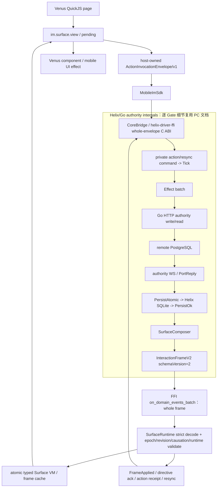

# Mobile Frame V2 目标公共架构

唯一依赖方向是 Mobile adapter -> Helix contract。Venus 不再维护业务 reducer；
`MobileImSdk + SurfaceRuntime + quickjs/bind_mobile_im` 是唯一 V2 runtime，`venus/` 只负责页面
生命周期、线程切换、QuickJS 注入和有界 batch 队列。

图中的 `HelixInternal` 是完整链路中的折叠边界，不表示 Mobile 重新实现这些逻辑。每个 Gate 的
Command、Tick、Effect、HTTP、WS、PG、SQLite、Persist 和 Frame 字段跳转复用
[PC/Helix 对应 UC](../interaction-frame-v2-全量替换-按UC/README.md)。

目标 consumer 必须精确接受当前 Rust `InteractionFrameV2`：

- 根：`schemaVersion/transactionId/causationId?/runtime/mutations/directives`；
- mutation：V1 mutation 字段加必填 `surfaceEpoch`；
- Surface：九个封闭值，包含 `message.composer`；
- apply：整帧预校验、`O(m)` staging、一次 swap；任一 slot 失败则不产生部分可见状态；
- ack：`FrameApplied`、directive ack、action receipt 与 resync 都按 transaction/request/surface
  关联，不能由 JS raw listener 代偿。
