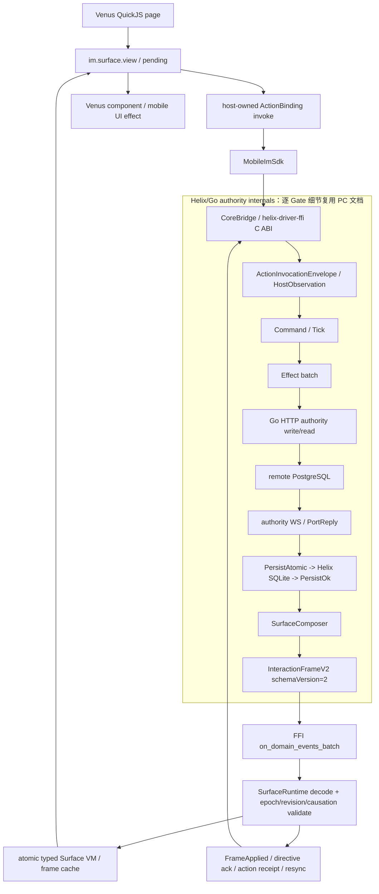

# Mobile Frame V2 目标公共架构

唯一依赖方向是 Mobile adapter -> Helix contract。Venus 不再维护业务 reducer；
`MobileImSdk + SurfaceRuntime + quickjs/bind_mobile_im` 是唯一 V2 runtime，`venus/` 只负责页面
生命周期、线程切换、QuickJS 注入和有界 batch 队列。

图中的 `HelixInternal` 是完整链路中的折叠边界，不表示 Mobile 重新实现这些逻辑。每个 Gate 的
Command、Tick、Effect、HTTP、WS、PG、SQLite、Persist 和 Frame 字段跳转见
[Helix/PC/Go 外联索引](./07-Helix-PC-Go外联索引.md)。
