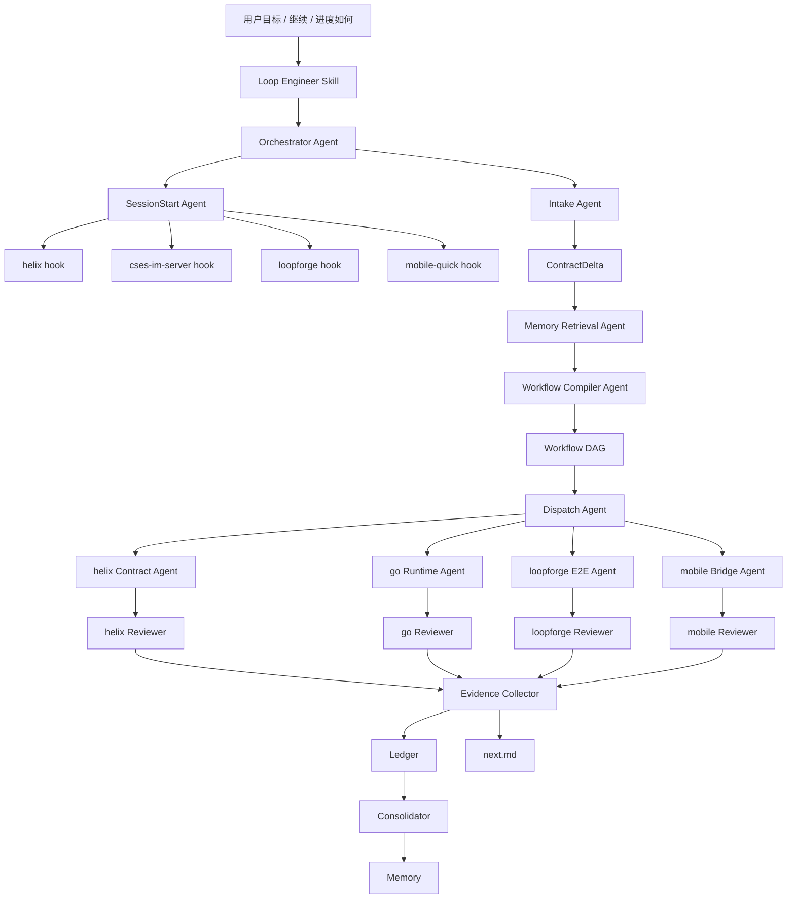

# Loop Engineer 自治 Skill-Agent 统一计划

Date: 2026-07-06
Status: 主线计划
Supersedes: `0001`、`0002`、`0003`

## 1. 为什么重写

`0001` 偏向 CLI / cmd-first，不是目标形态。

`0002` 定义了 skill-agent 自治工作流。

`0003` 定义了四仓 SessionStart hooks。

这份 `0004` 把 `0002 + 0003` 合并成一条主线：以 skill 为入口，以 agent mesh 为执行体，以 SessionStart hooks 作为每次接上 loop 的开局动作，以 `.loop-engine/` 作为共享状态和证据面。

## 2. 核心理念

```text
用户只提目标。
skill 负责接管。
orchestrator 负责组织。
repo agents 负责执行。
reviewer agents 负责防假绿。
evidence collector 负责判节点状态。
consolidator 负责沉淀 memory。
SessionStart 负责每次开局恢复上下文。
```

`cmd` 不是主角。任何脚本或命令都只是 agent 内部 helper，不是用户入口，也不是架构中心。

## 3. 用户体验

用户输入：

```text
目标：新增 im:channel:changed，PC 和 mobile 都要联调通过。
```

Loop Engineer 自动：

1. 读取四仓 SessionStart hooks。
2. 生成当前全局战情板。
3. 提炼 ContractDelta。
4. 检索 memory 和 log observations。
5. 编译 workflow DAG。
6. 生成 Work Packets。
7. 派 helix / go-server / loopforge / mobile agents。
8. 每个 repo agent 自动补测试。
9. reviewer agents 审查。
10. evidence collector 写 ledger。
11. consolidator 更新 memory。
12. 下次继续时自动知道做到哪。

## 4. Architecture



## 5. Main Deliverables

### 5.1 Skill

```text
skill-agent/loop-engineer/SKILL.md
```

它是新入口，不再沿用旧 `cmd-first` 语义。

必须明确：

- 用户不需要手动运行工作流命令。
- 跨仓 IM 目标自动进入自治模式。
- SessionStart 是第一步。
- Work Packet 是派 agent 前的契约。
- reviewer 和 collector 是防假绿闸门。
- memory 不判 done。

### 5.2 Agent Templates

```text
skill-agent/loop-engineer/agents/orchestrator-agent.md
skill-agent/loop-engineer/agents/sessionstart-agent.md
skill-agent/loop-engineer/agents/repo-worker-agent.md
skill-agent/loop-engineer/agents/reviewer-agent.md
skill-agent/loop-engineer/agents/evidence-collector-agent.md
skill-agent/loop-engineer/agents/consolidator-agent.md
```

### 5.3 Repo SessionStart Hooks

```text
skill-agent/loop-engineer/hooks/helix-sessionstart.md
skill-agent/loop-engineer/hooks/cses-im-server-sessionstart.md
skill-agent/loop-engineer/hooks/loopforge-tauri-im-sessionstart.md
skill-agent/loop-engineer/hooks/mobile-quick-sessionstart.md
```

### 5.4 Protocols

```text
skill-agent/loop-engineer/protocols/sessionstart.md
skill-agent/loop-engineer/protocols/work-packet.md
skill-agent/loop-engineer/protocols/test-compensation.md
skill-agent/loop-engineer/protocols/state-files.md
skill-agent/loop-engineer/protocols/memory-ledger.md
```

## 6. SessionStart Protocol

SessionStart 是每次接上 loop 的开局自检。

触发时机：

- 用户给新目标。
- 用户说继续。
- 用户问进度。
- worker/reviewer/collector 完成。
- 用户在四仓任一仓提出相关问题。

输出必须包括：

- 当前进度
- 已有证据
- 未完成 todo
- 合理改进点
- 阻塞 / 风险
- 需要其他仓配合
- 下一步 autonomous action

四仓 hook 分工：

| Repo | SessionStart 重点 |
|---|---|
| helix | command/event/FFI 合约、Rust unit/fixture/FFI test、下游依赖 |
| cses-im-server | HTTP/WS/projection/storage、Go test、Apifox/WS scenario |
| loopforge | PC/Tauri/UI real-chain、WDIO/DOM/WS evidence、NEED_HELIX |
| mobile-quick | C++/QuickJS/FFI、gtest、contract gate、real-chain report |

## 7. ContractDelta Protocol

ContractDelta 是用户目标的最小业务变化单元。

必须包含：

```json
{
  "id": "delta-...",
  "goal": "...",
  "surfaces": ["command", "event", "http", "ws", "ffi", "projection"],
  "target_clients": ["pc", "mobile"],
  "affected_repos": ["helix", "cses-im-server", "loopforge-tauri-im", "mobile-quick"],
  "acceptance": [],
  "test_compensation_required": true
}
```

## 8. Workflow DAG Protocol

DAG 由 Workflow Compiler Agent 动态生成。

节点示例：

```text
helix-contract
cses-runtime
loopforge-e2e
mobile-bridge
review
collect
consolidate
```

规则：

- 合约源头一般先走 helix。
- HTTP/WS/projection 必须走 cses-im-server。
- PC/Tauri/UI 真实链路必须走 loopforge。
- mobile/FFI/QuickJS 必须走 mobile-quick。
- 能并行的节点并行。
- 发现跨仓 gap 时写 NEED_FIX，不阻塞本仓可做部分。

## 9. Work Packet Protocol

每个 repo worker 只从 Work Packet 开始，不靠聊天历史。

必须包含：

```text
run_id:
node_id:
repo:
cwd:
goal:
ContractDelta:
memory context:
log observations:
allowed files:
forbidden files:
implementation tasks:
required test compensation:
required gates:
evidence output:
NEED_FIX protocol:
report file:
cannot claim full-chain DONE:
```

## 10. Test Compensation Protocol

测试补偿是强制项。

| Repo | 必须补偿 |
|---|---|
| helix | Rust unit / fixture / FFI contract tests |
| cses-im-server | Go handler/usecase/ws tests、Apifox 或等价 scenario |
| loopforge | Angular/service/Tauri tests、WDIO/e2e |
| mobile-quick | gtest、QuickJS binding tests、contract gate、real-chain report |

collector 规则：

```text
implementation changed but required tests missing -> node cannot be green
```

## 11. Evidence And Ledger Protocol

事实等级：

```text
memory < log observation < worker report < reviewer report < gate evidence < collector ledger
```

只有 Evidence Collector 可以写节点 green。

全链路 DONE 必须满足：

- 相关 repo node green。
- reviewer 通过。
- gate evidence 存在。
- declared-only 没被当 runtime。
- cross-repo blockers 关闭。

## 12. Memory Consolidation Protocol

Consolidator 只沉淀稳定事实：

- 已证实的 contract ownership。
- 已证实的 repo capability。
- 已重复或高置信 failure。
- 用户拍板的 decision。
- 已完成的 test/gate discipline。

每条 memory 必须有 provenance。

禁止写入：

- token
- cookie
- raw ssh log
- 未证实猜测
- 临时 worker 自述

## 13. 0002 与 0003 的并集

`0002` 的核心：

- skill 是入口
- agent mesh 是执行体
- `.loop-engine/` 是 blackboard
- worker/reviewer/collector/consolidator 分权
- 测试补偿强制

`0003` 的核心：

- 四仓 SessionStart hooks
- 进度/证据/todo/改进点/阻塞汇总
- repo-local 与 global loop state 区分
- SessionStart 作为继续和查进度的入口

统一后：

```text
SessionStart 是 skill-agent 自治工作流的第一环。
四仓 hooks 是 SessionStart Agent 的输入。
workflow DAG 是 Orchestrator 的计划输出。
Work Packets 是 Dispatch 到 repo workers 的契约。
review/collector/consolidator 是防假绿和沉淀层。
```

## 14. 废弃 0001

`0001-foolproof-loop-engineer-implementation-plan.md` 只保留为历史草案。

废弃原因：

- 把 cmd 当主入口。
- 容易让用户回到手动调用心智。
- 不符合“给目标后自治多端联调”的初衷。

后续主线只看本计划和新版 skill。

## 15. 下一步落地顺序

1. 使用新版 `SKILL.md` 替换旧 skill。
2. 补齐 protocols 文档。
3. 保留 agent templates 与 repo hooks。
4. 用一次 dry-run 目标验证：只生成 SessionStart、ContractDelta、DAG、Work Packets，不改代码。
5. 再用一个小的真实目标验证：repo worker + reviewer + collector + consolidator 全链路。

## 16. Done Definition

当用户说：

```text
目标：让 xxx 在 PC/mobile 都通。
```

Codex 必须能自动完成：

```text
四仓 SessionStart
-> ContractDelta
-> Memory Retrieval
-> Workflow DAG
-> Work Packets
-> Repo Worker Agents
-> Reviewer Agents
-> Evidence Collector
-> Memory Consolidator
-> Next SessionStart
```

并且全程不要求用户手动驱动命令。

