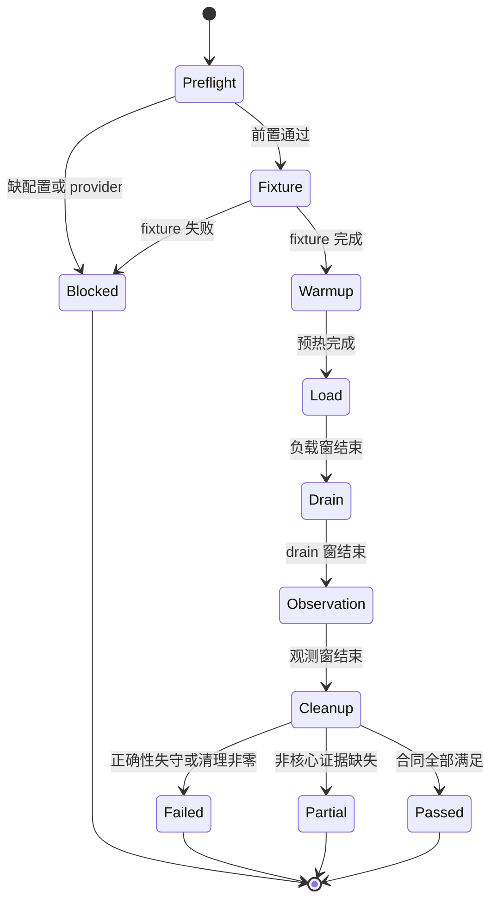
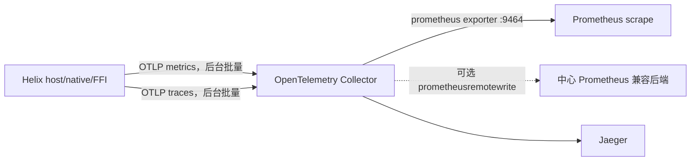

# Helix 分层性能压测 SPEC

> 版本：1.2.0
> 日期：2026-07-14
> 状态：待实施审阅
> 适用仓库：`/System/Volumes/Data/workspace/rust/helix`
> 依据：`docs/GOAL.md`、HX-C005/HX-C007/HX-C009/HX-C010/HX-C011/HX-C017
> 方案背景：`docs/过会方案/helix-分层性能压测指标与工具方案-2026-07-14.md`

## 0. 规范语言

本 SPEC 使用以下关键词：

- **MUST**：实现和证据必须满足，否则不得验收。
- **MUST NOT**：禁止行为。
- **SHOULD**：默认应当满足；例外必须在 run manifest 记录理由。
- **MAY**：可选能力，不影响基础 PASS。

本 SPEC 是性能工具与证据的实施合同。上述过会方案用于记录分析过程；两者冲突时，以本 SPEC 为准。

## 1. 背景与问题

Go 服务端已有 G-01 热点单频道 5 RPS 与 50 频道 25/50/75/100 RPS 证据，但这些数据不能直接回答 Helix 的客户端瓶颈：

1. Go HTTP/WS 端到端延迟同时包含网络、Go handler、Pulsar、DB、Hub 与 Helix 客户端处理。
2. Helix 是 sans-IO core + host driver，core step、Effect dispatch、SQLite、HTTP/WS adapter、EventSink 必须分层归因。
3. 多 channel 总吞吐不等于热点单 channel 保序容量。
4. HTTP 200 、WS 到达、SQLite 落库、Projection 完成是不同证据面，不得互相替代。

因此需要一套可重放、可归因、可证伪的 Helix 独立性能 Harness。

## 2. 目标

### 2.1 功能目标

1. MUST 分别测量 core step、Effect、Storage、HTTP、WS、Event/Projection、PortReply。
2. MUST 提供 L1 纯 core、L2 host driver、L3 Go K8s 真链三层入口。
3. MUST 分别测量 `hot-1`、`parallel-50`、`fan-in-50-to-1-client`。
4. MUST 将 `load_duration`、`drain_duration`、`observation_duration` 记录为三个独立窗口。
5. MUST 为每个 run 生成机器可读证据包。
6. MUST 在正确性不变量失守时立即失败，不得用高吞吐覆盖丢失、重复或乱序。
7. MUST 使标准命令无手工 `export` 即可运行。
8. MUST 在缺真实 fixture/provider/凭据时 fail-closed。
9. MUST 支持异步上传低基数聚合指标到 Prometheus 体系，且上传失败、排队或退避不得阻塞业务主线程。

### 2.2 质量目标

1. 同一 Tick 剧本 MUST 产生 byte-identical、顺序一致的 Effect/Projection。
2. 性能结论 MUST 能定位到 core、queue、SQLite、HTTP、WS、EventSink 或 Go/RTT。
3. 指标 MUST 使用低基数维度，correlation 标识只进 trace/JSONL。
4. 基准闸门 MUST 记录 runner 环境，不得在未固定共享 runner 上用绝对墙钟硬阻断。

## 3. 非目标

1. 不将 metrics/OTel/tokio/墙钟依赖引入 `helix-core`。
2. 不在本 SPEC 中优化队列容量、SQLite SQL、Effect 分配或 FFI ABI。
3. 不把 UI DOM/render FPS 纳入 Helix 客户端核心 PASS；UI 属独立产品壳压测。
4. 不机械复制 Go “23 UC x 6 档”为 Helix 性能矩阵。
5. 不将一次本机跑分提升为跨平台绝对性能承诺。
6. 不继续维护已归档 wasm driver 的性能基线。
7. 不让 Helix 客户端直接实现 Prometheus remote-write 协议，也不把 Pushgateway 用作长生命周期客户端的默认上报通道。

## 4. 领域模型

### 4.1 聚合根：`PerformanceRun`

`PerformanceRun` 代表一次可独立审计的压测运行。

```text
PerformanceRun
  - RunId
  - GitRevision
  - Scenario
  - EnvironmentSnapshot
  - FixtureLease
  - WindowPlan
  - MetricSeries
  - TraceIndex
  - CorrectnessOracle
  - CleanupResult
  - Verdict
```

不变量：

1. RunId MUST 唯一，所有 fixture、trace、DB 查询、cleanup 都必须可按 RunId 归属。
2. 一个 `PerformanceRun` MUST 只有一个 Scenario 和一个 rate 档。
3. 每档 MUST 用新 RunId，不得将 5/25/50/75/100 混在同一 histogram。
4. Verdict MUST 在 cleanup 完成后生成。
5. 任一必需证据缺失时，Verdict MUST NOT 为 PASS。

### 4.2 值对象

| 值对象 | 定义 |
|---|---|
| `ScenarioId` | 稳定、可发现的工作负载 ID |
| `ChannelShape` | `hot-1` / `parallel-50` / `fan-in-50-to-1-client` / `multi-module` |
| `Rate` | operations/s 或 events/s，含单位 |
| `WindowPlan` | warmup/load/drain/observation 的独立时长 |
| `PayloadBucket` | `256B` / `2KiB` / `16KiB` 或显式定义的新档 |
| `MetricName` | SPEC 登记的指标名 |
| `CorrelationKey` | trace 中串联 req/message/event 的高基数标识 |
| `Verdict` | `PASS` / `PARTIAL` / `BLOCKED` / `FAIL` |

### 4.3 领域服务

| 服务 | 责任 |
|---|---|
| `ScenarioPlanner` | 解析场景、档位、窗口与平台约束 |
| `LoadDriver` | 按时间窗驱动 Tick、HTTP、WS 或真链命令 |
| `MetricCollector` | 采集 histogram/counter/gauge 与环境快照 |
| `CorrectnessOracle` | 判定 lost/dup/order/wrong-channel/cursor/projection |
| `EvidenceWriter` | 原子生成 manifest 和证据包 |
| `VerdictEvaluator` | 按本 SPEC 产生终态，不从 Markdown 反向解析 |
| `CleanupCoordinator` | 删除仅属于 RunId 的资源并验证零残留 |

## 5. 分层边界

### 5.1 L1：纯 core/模块

L1 MUST 不发真 HTTP、不连真 WS、不打开真 SQLite。

L1 可测：

- `ExecutionShell::step`
- `ImModule` command/PortReply/Inbound handler
- WS JSON parse、gate、sync backfill
- Effect 数量、类型、字节和顺序
- Projection 构造
- 确定性 hash
- allocations/op 和 instructions/op

L1 MUST NOT 将 mock I/O 的时间计入 core step。

### 5.2 L2：host driver

L2 MUST 使用：

- 真文件 SQLite WAL
- loopback HTTP/WS server
- 真 engine loop 队列和 PortReply 回灌
- Native EventSink 或 FFI BatchSink
- 可控 0/10/100/500ms I/O delay、timeout、disconnect、reorder

L2 MUST 将 profiler 模式和容量模式分开运行。

### 5.3 L3：Go K8s 真链

L3 MUST 包含两类拓扑：

```text
L3-A inbound:
k6/Go sender -> cses-im-server -> WS -> Helix receiver
  -> Tick::Inbound -> Persist -> Event/Projection

L3-B roundtrip:
Helix Command -> optimistic Persist -> Http Effect -> cses-im-server
  -> WS echo -> Helix reconcile Persist -> final Projection
```

L3-A 不得被表述为 Command 完整闭环。L3-B 不得仅用 HTTP 200 判 PASS。

## 6. 工作负载目录

### 6.1 L1 场景

| ScenarioId | 输入 | 输出重点 |
|---|---|---|
| `L1-STEP-INORDER` | 有序 post，1/50/500 channels | step CPU、events/s、effects/event |
| `L1-GATE-GAP` | gap=1/100/500/5000 | buffer/flush、cursor、顺序 |
| `L1-SYNC-BACKFILL` | batch=1/100/500/5000 | parse、Persist ops、commit/flush |
| `L1-SEND-RECONCILE` | Command + optimistic persist reply + WS echo | temporaryId 对账、effects/tick |
| `L1-LOCAL-QUERY` | 100/1K/10K local rows | scan plan、rows codec、projection bytes |
| `L1-PROJECTION-EGRESS` | 1/10/100 projections per step | event bytes、顺序、allocations |

L1 MUST 覆盖 `256B/2KiB/16KiB` payload bucket。

### 6.2 L2 场景

| ScenarioId | 拓扑 | 重点 |
|---|---|---|
| `L2-ENGINE-MIXED` | WS inbound + HTTP reply + Persist + Event | queue wait/depth、PortReply 优先级 |
| `L2-STORAGE-WAL` | file SQLite、大批+小批+cursor | tx duration、rows/s、WAL |
| `L2-EVENT-NATIVE` | Native broadcast + fast/slow receiver | lagged/no-receiver/恢复 |
| `L2-EVENT-FFI` | BatchSink -> C++ callback | batch bytes、callback duration、FFI_BUSY |
| `L2-MULTI-MODULE` | 两模块共享 HostStorage | 单写者竞争、公平性 |
| `L2-RECONNECT-SOAK` | WS 断连/重连 + 30-60 分钟 | RSS slope、任务泄漏、cursor 收敛 |

L2 额定档位 MUST 包含 5/25/50/100/200 events/s，saturation MAY 扩展到 500/1000 events/s。

### 6.3 L3 场景

| ScenarioId | ChannelShape | 档位 | 证据边界 |
|---|---|---|---|
| `L3-G01-HOT-INBOUND` | `hot-1` | 5 RPS | 与 Go 已证热点模型对齐 |
| `L3-G01-PARALLEL-INBOUND` | `parallel-50` | 25/50/75/100 RPS | 多 channel 总吞吐 |
| `L3-G01-FANIN` | `fan-in-50-to-1-client` | 25/50/75/100 RPS | 单 Helix 实例最坏聚合入站 |
| `L3-G01-SEND-ECHO` | `hot-1` | 5 RPS | Helix Command 到 final projection |
| `L3-SYNC-BACKFILL` | `hot-1` + backlog | 500/5000 events | 离线回补与 cursor 收敛 |

在 Go 热点单 channel 10-100 RPS 未有真实证据前，Harness MAY 运行实验，但 verdict MUST NOT 标为“与服务端已证容量对齐”。

## 7. 场景配置合同

默认配置位于 `perf/scenarios/default.toml`。

```toml
schema_version = 1

[run]
scenario = "L2-ENGINE-MIXED"
platform = "native-macos"
channel_shape = "parallel-50"
rate = 100
rate_unit = "events_per_second"
payload_bucket = "2KiB"

[windows]
warmup = "15s"
load = "120s"
drain = "90s"
observation = "120s"

[topology]
channels = 50
senders = 1
receivers = 1

[thresholds]
profile = "calibration-v1"
```

约束：

1. `schema_version` MUST 存在。
2. duration MUST 是带单位的字符串。
3. rate MUST 同时带 `rate_unit`。
4. 非敏感默认值 MUST 在仓内配置中提供。
5. 环境变量 MAY 作为调试覆盖，MUST NOT 成为标准入口的必填参数。

## 8. 指标 Schema

### 8.1 通用格式

```json
{
  "schemaVersion": 1,
  "runId": "perf-260714-123000-ab12cd",
  "tsUnixNs": 1784003400000000000,
  "name": "helix_core_step_duration_seconds",
  "kind": "histogram",
  "unit": "s",
  "value": 0.0000425,
  "labels": {
    "layer": "L1",
    "scenario": "L1-STEP-INORDER",
    "platform": "native-macos",
    "channel_shape": "hot-1",
    "status": "ok"
  },
  "traceRef": "optional-trace-index-key"
}
```

### 8.2 允许标签

MUST 只使用低基数标签：

- `layer`
- `scenario`
- `stage`
- `action`
- `tick_kind`
- `effect_kind`
- `storage_op`
- `platform`
- `channel_shape`
- `payload_bucket`
- `rate_bucket`
- `status`
- `service_name`
- `deployment_environment`
- `protocol`
- `operation`
- `direction`
- `status_class`
- `error_kind`
- `exporter_state`

MUST NOT 作为指标标签：

- `runId`；它只进入 evidence manifest、trace/exemplar，不进入 pre Prometheus 常驻时序
- 任意业务实体 ID
- `corr_key`
- `req_id`
- `temporaryId`
- `postId`
- `channelId`
- `userId`
- `eventSeq`

上述高基数值 MUST 只进 trace index 或 run-owned JSONL。

### 8.3 必需指标

| 指标 | kind | unit | 必需层 |
|---|---|---|---|
| `helix_operations_total` | counter | operations | L1/L2/L3 |
| `helix_errors_total` | counter | errors | L2/L3 |
| `helix_core_step_duration_seconds` | histogram | s | L1/L2 |
| `helix_tick_queue_wait_seconds` | histogram | s | L2/L3 |
| `helix_tick_queue_depth` | gauge | count | L2/L3 |
| `helix_tick_queue_capacity` | gauge | count | L2/L3 |
| `helix_effects_per_tick` | histogram | count | L1/L2/L3 |
| `helix_effect_bytes_per_tick` | histogram | bytes | L1/L2/L3 |
| `helix_effect_amplification_ratio` | histogram | ratio | L1/L2/L3 |
| `helix_http_queue_wait_seconds` | histogram | s | L2/L3 |
| `helix_http_request_duration_seconds` | histogram | s | L2/L3 |
| `helix_http_inflight` | gauge | count | L2/L3 |
| `helix_persist_queue_wait_seconds` | histogram | s | L2/L3 |
| `helix_storage_tx_duration_seconds` | histogram | s | L2/L3 |
| `helix_storage_rows_total` | counter | rows | L2/L3 |
| `helix_port_roundtrip_seconds` | histogram | s | L2/L3 |
| `helix_ws_ingress_to_effect_seconds` | histogram | s | L2/L3 |
| `helix_ws_ingress_to_event_seconds` | histogram | s | L2/L3 |
| `helix_command_to_projection_seconds` | histogram | s | L3-B |
| `helix_event_lagged_total` | counter | count | L2/L3 |
| `helix_event_no_receiver_total` | counter | count | L2/L3 |
| `helix_event_batch_size` | histogram | count | L2/L3 |
| `helix_ffi_batch_events` | histogram | count | L2 FFI |
| `helix_ffi_batch_bytes` | histogram | bytes | L2 FFI |
| `helix_ffi_callback_duration_seconds` | histogram | s | L2 FFI |
| `helix_ffi_busy_total` | counter | count | L2 FFI |
| `helix_alloc_count_per_op` | histogram | count | L1/profile |
| `helix_alloc_bytes_per_op` | histogram | bytes | L1/profile |
| `helix_process_resident_memory_bytes` | gauge | bytes | L2/L3 soak |
| `helix_shutdown_drain_seconds` | histogram | s | L2/L3 |
| `helix_metrics_queue_depth` | gauge | count | L2/L3 |
| `helix_metrics_queue_capacity` | gauge | count | L2/L3 |
| `helix_metrics_dropped_total` | counter | count | L2/L3 |
| `helix_metrics_export_batch_size` | histogram | count | L2/L3 |
| `helix_metrics_export_duration_seconds` | histogram | s | L2/L3 |
| `helix_metrics_export_errors_total` | counter | count | L2/L3 |
| `helix_metrics_exporter_state` | gauge | state | L2/L3 |
| `helix_metrics_last_success_age_seconds` | gauge | s | L2/L3 |

### 8.4 正确性指标

以下指标 MUST 为 counter，且 PASS 时全部为 0：

- `helix_lost_total`
- `helix_duplicate_total`
- `helix_order_violation_total`
- `helix_wrong_channel_total`
- `helix_cursor_regression_total`
- `helix_projection_mismatch_total`
- `helix_persist_remaining_total`
- `helix_cleanup_residue_total`

## 9. Correlation 合同

### 9.1 传播键

L3 发送链 MUST 尽可能保留：

```text
traceparent
req_id
temporaryId -> postId
channelId
eventSeq
```

### 9.2 逐跳阶段

`L3-G01-SEND-ECHO` MUST 至少能索引：

1. `command.accept`
2. `core.step.command`
3. `effect.persist.optimistic`
4. `storage.optimistic.done`
5. `effect.http.dispatch`
6. `http.request.done`
7. `ws.inbound.post`
8. `core.step.inbound`
9. `effect.persist.reconcile`
10. `storage.reconcile.done`
11. `event.projection.emit`
12. `projection.consumer.received`

缺失任一必需 hop 时，run MAY 保留用于诊断，但 Verdict MUST NOT 为 PASS。

## 10. Run 状态机



约束：

1. MUST 真实等待三个窗口，不得用报告时间戳伪造。
2. Load 结束后 MUST 停止生成新业务操作。
3. Drain 期只允许在途任务收敛。
4. Observation 期用于检查队列、RSS、cursor、重连和迟到回包。
5. Cleanup MUST 在任何终态前执行；进程崩溃时由独立 cleanup 入口接管。

## 11. Verdict 合同

### 11.1 `PASS`

MUST 同时满足：

- preflight/fixture/provider 完整。
- 三窗时长真实且分开。
- 所有必需指标存在。
- 所有正确性 counter 为 0。
- 必需 hop 完整。
- cleanup 零残留。
- SLO 未失守。

### 11.2 `PARTIAL`

负载与核心正确性通过，但非核心证据面缺失时使用。

PARTIAL MUST 列出：

- 已通过的证据面。
- 缺失的 provider/metric/hop。
- 为什么不能提升 PASS。

### 11.3 `BLOCKED`

负载开始前因 fixture、凭据、K8s、provider、平台工具或架构闸门不满足而停止。

BLOCKED MUST NOT 生成性能数字 0 来冒充未运行。

### 11.4 `FAIL`

任一正确性失守、cleanup 非零、硬 SLO 失守、run 中断或证据损坏时使用。

## 12. Fail-closed 错误码

| 错误码 | 含义 | Verdict |
|---|---|---|
| `PERF_CONFIG_INVALID` | 场景或配置 schema 无效 | BLOCKED |
| `PERF_CREDENTIALS_MISSING` | 敏感凭据未找到 | BLOCKED |
| `PERF_FIXTURE_UNAVAILABLE` | 真 fixture 不可用 | BLOCKED |
| `PERF_PROVIDER_MISSING` | evidence/cleanup provider 缺失 | BLOCKED |
| `PERF_TOPOLOGY_MISMATCH` | Pod/digest/HPA 不符合 | BLOCKED |
| `PERF_LOAD_ABORTED` | load 中途中断 | FAIL |
| `PERF_CORRECTNESS_VIOLATION` | 丢失/重复/乱序/错频道/cursor 回退 | FAIL |
| `PERF_REQUIRED_HOP_MISSING` | 必需 correlation hop 丢失 | PARTIAL |
| `PERF_METRICS_PIPELINE_UNAVAILABLE` | 业务继续运行，但本次 run 的 Prometheus/OTLP 必需指标不可用 | PARTIAL |
| `PERF_PRE_TELEMETRY_UNAVAILABLE` | 本地 Collector、kubectl tunnel、pre Collector 或 Prometheus canary 不通 | BLOCKED |
| `PERF_GRAFANA_APPLY_FAILED` | Dashboard 发布或回读合同失败 | PARTIAL |
| `PERF_SLO_VIOLATION` | 硬 SLO 失守 | FAIL |
| `PERF_CLEANUP_NONZERO` | run-owned 资源残留 | FAIL |
| `PERF_EVIDENCE_CORRUPT` | manifest/metrics/histogram 无法解析 | FAIL |

## 13. 证据包合同

### 13.1 文件布局

```text
perf/reports/<run-id>/
  manifest.json
  summary.json
  histograms.hdr
  metrics.jsonl
  trace-index.jsonl
  correctness.json
  sqlite.json
  cleanup.json
  profiles/                # 只在 profile 模式存在
```

### 13.2 `manifest.json`

```json
{
  "schemaVersion": 1,
  "runId": "perf-260714-123000-ab12cd",
  "scenarioId": "L3-G01-FANIN",
  "verdict": "PASS",
  "git": {
    "sha": "0123456789abcdef",
    "branch": "main",
    "dirty": false
  },
  "runtime": {
    "rustc": "captured-at-runtime",
    "profile": "release",
    "platform": "native-linux",
    "cpu": "captured-at-runtime",
    "os": "captured-at-runtime",
    "memoryMiB": 0
  },
  "scenario": {
    "channelShape": "fan-in-50-to-1-client",
    "rate": 100,
    "rateUnit": "events_per_second",
    "payloadBucket": "2KiB"
  },
  "windows": {
    "warmupMs": 15000,
    "loadMs": 120000,
    "drainMs": 90000,
    "observationMs": 120000
  },
  "server": {
    "image": "captured-at-runtime",
    "digest": "captured-at-runtime",
    "topology": "fixed-two-pod"
  },
  "telemetry": {
    "localCollectorImage": "captured-at-runtime",
    "preCollectorImage": "captured-at-runtime",
    "prometheusVersion": "captured-at-runtime",
    "prometheusDatasourceUid": "prometheus",
    "scrapeIntervalMs": 30000,
    "canarySeries": "otel_helix_telemetry_canary_total",
    "dashboardUid": "helix-runtime-performance-pre",
    "dashboardQueryDigest": "captured-at-runtime"
  },
  "evidence": {
    "metrics": "metrics.jsonl",
    "histograms": "histograms.hdr",
    "traces": "trace-index.jsonl",
    "correctness": "correctness.json",
    "cleanup": "cleanup.json"
  },
  "errors": []
}
```

`memoryMiB=0` 只是 schema 示例占位；真 run MUST 写实测值，不得默认为 0。

### 13.3 原子性

1. 证据文件 MUST 先写临时文件，fsync/关闭成功后 atomic rename。
2. manifest MUST 最后写入。
3. manifest 引用的所有文件 MUST 存在且 schema 可解析。
4. 中断 run MUST 保留 `verdict=FAIL` 和已有原始证据，不得冒充完整运行。

## 14. CLI 合同

唯一顶层入口：`scripts/perfctl`。

```bash
scripts/perfctl preflight
scripts/perfctl smoke
scripts/perfctl l1
scripts/perfctl l2
scripts/perfctl l3 g01-hotspot-5
scripts/perfctl run --scenario L2-ENGINE-MIXED --rate 100
scripts/perfctl cleanup --run-id <run-id>
scripts/perfctl report --run-id <run-id>
scripts/perfctl telemetry up
scripts/perfctl telemetry verify
scripts/perfctl telemetry down
scripts/perfctl dashboard apply
scripts/perfctl dashboard verify
scripts/perfctl full
```

CLI 约束：

1. `smoke/l1/l2/l3/full` MUST 有仓内非敏感默认值。
2. `preflight` MUST 只读，不创建 fixture。
3. `run` MUST 先自动执行 preflight。
4. `cleanup` MUST 仅删除指定 RunId 资源。
5. `report` MUST 从结构化证据生成 Markdown，MUST NOT 反向从日志猜结论。
6. 敏感值 MUST 自动读 OS 凭据或 gitignored 本地文件。
7. 缺敏感值 MUST 返回 `PERF_CREDENTIALS_MISSING`，不得提示用户必须手工组装一长串 `export`。
8. `telemetry up` MUST 启动本地 Collector、建立 pre Collector 的 kubectl port-forward，并写 PID/端口状态文件。
9. `telemetry down` MUST 只关闭本命令创建的 Docker/port-forward 资源。
10. `dashboard apply/verify` MUST 通过 Grafana API 幂等创建并回读校验，不得要求用户手工复制 JSON。

## 15. 工具合同

| 工具 | 规范用途 |
|---|---|
| Criterion | L1/L2 统计基准和趋势 |
| iai-callgrind | 固定 Linux runner 上的 L1 instructions/cache/branch 回归 |
| Rust runner + HDR Histogram | L2/L3 长窗分位数和 receiver/oracle |
| OTel/Jaeger | 高基数 correlation 和逐跳归因 |
| k6 | L3 外部 HTTP 生压和 Go fixture/provider 编排 |
| perf/cargo-flamegraph | Linux CPU profile |
| samply/Instruments | macOS CPU/分配诊断 |
| DHAT/heaptrack | 分配和泄漏诊断 |
| tokio-console | host runtime task/poll/blocking 诊断 |
| SQLite trace/profile/EXPLAIN | transaction/prepare/WAL/SQL 诊断 |

MUST NOT 使用 tokio-console、OTel SDK 或 metrics crate 污染 `helix-core`。

## 15.1 Prometheus 与异步指标上传合同

### 15.1.1 目标拓扑

Helix SDK MUST NOT 从每个桌面或手机客户端直接向 Prometheus 写入。默认拓扑为：



1. 本地、CI、K8s 内 Prometheus 可主动抓取时，MUST 优先使用 Collector `prometheus` exporter 暴露 `:9464`。
2. 跨网络、NAT 后客户端或中心化托管场景 MAY 使用 Collector `prometheusremotewrite`，但远端必须显式具备接收能力。
3. 协议、鉴权、重试和后端切换 MUST 收敛在 Collector，不得散落进 `helix-core`、IM module 或各业务 handler。
4. Pushgateway MUST NOT 作为 native/FFI 长生命周期实例的默认方案；它只 MAY 用于短生命周期批任务。

### 15.1.2 当前 SDK 与基础设施盘点

以下为 2026-07-14 当前仓库代码事实，不代表已完成 metrics 接入：

| 位置 | 当前能力 | 仍需介入 |
|---|---|---|
| workspace | `tracing = 0.1` | 保留结构化日志/trace facade，不承载 Prometheus 上传 |
| `helix-driver-host` | `opentelemetry/opentelemetry_sdk/opentelemetry-otlp = 0.32`，仅启用 trace + OTLP gRPC | 为 SDK/OTLP 开启 metrics 能力；新增独立 metrics pipeline 与有界入口 |
| `otel.rs` | trace exporter 使用独立单 worker Tokio runtime，线程名 `helix-otel-export` | 现有逐 span `spawn` + 最多 8 次重试不是有界 metrics 模型；metrics MUST NOT 复制该模式 |
| `helix.config.yaml` | 已有 `observability.otel`、sampler、facets、attributes | Rust 配置模型尚无 `attributes` 字段，production runtime 仍主要走 `HostOtelRuntime::from_env`；MUST 把 YAML 配置接到真实 runtime，环境变量只作可选覆盖 |
| native | engine 已有 trace hook 接缝；`TraceHooks::noop()` 内部仍从 env 构造 OTel runtime | 注入共享 `AsyncMetricSink`，只在 driver/host hop 记录，不进入 core |
| FFI | pump 显式调用 `HostOtelRuntime::from_env`，EventSink 有 batch 边界 | 复用同一后台 metrics sink；记录 batch count/bytes/callback duration，不在 C callback 内上传 |
| 仓库本地 OTel Collector | `docker/otel` 只有 OTLP receiver、batch processor、Jaeger/logging trace pipeline | 增加 metrics pipeline、memory limiter，并按 §15.2 转发到 pre Collector |
| 仓库本地 Prometheus 配置 | 当前没有 scrape/remote-write 配置 | 默认复用 pre Collector + pre Prometheus，不新增第二套本地 Prometheus |

当前 trace 上传虽然已经离开主 Tokio worker，但每个 span 仍会构造快照、加锁取得 runtime handle 并创建异步任务；失败重试也可能积累。它可保留为 trace 基线，但在完成“有界队列 + 丢弃计数 + 批量导出”前，MUST NOT 宣称遥测对业务热路径无影响。

### 15.1.3 SDK 介入边界

| 层 | 是否介入 | 允许职责 | 禁止职责 |
|---|---|---|---|
| `helix-core` | 否 | 无 | metrics SDK、墙钟、线程、队列、网络、Prometheus 类型 |
| `helix-im` | 原则上否 | 只复用既有确定性语义值；必要时由 host 在边界映射 action/tick kind | 直接 record、动态 label、上传 |
| `helix-driver-host` | 是，主实现 | `AsyncMetricSink`、预注册 instrument、时间测量、队列、后台 exporter、自观测 | 在 engine/dispatch 热路径 await 或同步导出 |
| `helix-driver-native` | 是，薄接缝 | native broadcast、receiver lag/no receiver、平台属性 | 自建 exporter/runtime |
| `helix-driver-ffi` | 是，薄接缝 | FFI batch count/bytes、callback duration、busy/drop | callback 内网络 I/O、逐 event 上传 |
| `helix-host-cli` / perf runner | 是，装配层 | YAML 装配、run attributes、flush/关闭预算、证据快照 | 把敏感配置写进指标或报告 |
| OTel Collector | 是，基础设施 | batch、memory limit、重试、Prometheus 暴露/remote-write | 反向进入 Helix 业务依赖图 |

### 15.1.4 主线程零阻塞合同

业务热路径只允许调用同步、常数时间的 `try_record`：

```rust
pub trait AsyncMetricSink: Send + Sync {
    fn try_record(&self, event: MetricEvent) -> RecordOutcome;
}

pub enum RecordOutcome {
    Accepted,
    Disabled,
    DroppedQueueFull,
}
```

`MetricEvent` MUST 是紧凑、owned 或 Copy 的低基数值，不携带 payload、`req_id`、`channel_id`、`post_id` 或任意自由文本。

热路径 MUST：

1. 使用预注册 instrument ID、静态枚举标签与固定容量有界队列。
2. 只调用 `try_send`/无等待 ring-buffer 写入；复杂度为时间 O(1)、额外空间 O(1)。
3. 禁止 `.await`、网络、磁盘、DNS、TLS、序列化大对象、无界分配和可能等待的互斥锁。
4. 队满时只丢遥测，业务 Effect、PortReply、Storage、Event MUST 继续执行。
5. 队满 MUST 增加无锁/原子 `helix_metrics_dropped_total{reason="queue_full"}`；不得递归把该计数再次写入已满队列。
6. disabled/noop 路径 SHOULD 退化为一次分支，且不得初始化 exporter runtime。

后台 worker MUST：

1. 使用独立线程或专用 runtime，禁止占用业务主线程与 core pump。
2. 按固定数量或固定周期批量聚合并 OTLP export；默认建议 `interval=5s`、`batch_max=512`、`queue_capacity=8192`，最终值由 L2 校准冻结。
3. 单次 export MUST 有超时；重试 MUST 有总次数/总时长上限、指数退避与 jitter。
4. 连续失败 MUST 进入熔断/降采样，禁止生成无界异步任务或无界内存积压。
5. shutdown flush MUST 有独立预算；超时后记录未发送数量并退出，不得无限阻塞 engine/FFI 销毁。
6. 默认只保留内存有界队列。若将来增加磁盘 spool，必须由独立 writer 执行，且性能基准默认关闭。

### 15.1.5 配置合同

仓库默认配置 SHOULD 扩展为：

```yaml
observability:
  otel:
    enabled: true
    endpoint: "http://127.0.0.1:4317"
    protocol: "grpc"
    metrics:
      enabled: true
      exportIntervalMs: 5000
      exportTimeoutMs: 2000
      queueCapacity: 8192
      batchMax: 512
      retryMax: 3
      maxBackoffMs: 30000
      shutdownTimeoutMs: 1500
```

1. 非敏感默认值 MUST 位于仓库配置，标准命令不得要求先手工 `export`。
2. 环境变量 MAY 覆盖默认值，但不得成为普通运行的唯一入口。
3. endpoint、interval、queue capacity 和 retry budget MUST 固化进 run manifest。
4. Token/认证头 MUST 由 OS 凭据或 gitignored 本地配置读取，禁止进入 YAML、label 或 manifest。

Collector 最小 metrics pipeline SHOULD 等价于：

```yaml
processors:
  memory_limiter:
    limit_mib: 256
  batch/metrics: {}

exporters:
  prometheus:
    endpoint: "0.0.0.0:9464"

service:
  pipelines:
    metrics:
      receivers: [otlp]
      processors: [memory_limiter, batch/metrics]
      exporters: [prometheus]
```

这是通用 scrape 示例。当前 pre 环境的既有 Collector 使用 `:8889`，本地开发链路 MUST 以 §15.2 的 OTLP 转发方案为准。

### 15.1.6 遥测自观测与验收

以下自观测指标 MUST 存在：

| 指标 | 目的 |
|---|---|
| `helix_metrics_queue_depth` | 当前队列水位 |
| `helix_metrics_queue_capacity` | 解释水位比例 |
| `helix_metrics_dropped_total{reason}` | 证明队满/禁用/编码失败没有静默 |
| `helix_metrics_export_batch_size` | 证明批量而非逐条上传 |
| `helix_metrics_export_duration_seconds` | exporter 自身延迟 |
| `helix_metrics_export_errors_total{reason}` | 超时、连接、拒绝、编码失败 |
| `helix_metrics_exporter_state` | running/backoff/open/disabled |
| `helix_metrics_last_success_age_seconds` | 识别“业务正常但指标已断流” |

异步上传验收 MUST 包含：

1. Collector 停机、DNS 不可达、连接拒绝、持续超时四类故障注入。
2. 故障期间 Helix 主链吞吐、correctness counter 与 queue wait 不得出现由 exporter 锁等待造成的退化。
3. 破坏性测试将队列缩小并暂停 worker 后，`dropped_total` MUST 增长，而业务 lost/dup/order/cursor 指标仍为 0。
4. profiler MUST 证明业务主线程栈上没有 OTLP、tonic、DNS、TLS、Prometheus remote-write 调用。
5. 额定负载下 telemetry CPU、allocation、RSS 开销 MUST 单独报告；校准前不先验承诺“零开销”。

### 15.1.7 建议实施落点

| 文件/模块 | 计划改动 |
|---|---|
| `crates/helix-driver-host/Cargo.toml` | 在现有 OTel 0.32 依赖上开启 metrics 能力，不再引入第二套直连 Prometheus SDK |
| `crates/helix-driver-host/src/metrics/` | 新增 `MetricEvent`、`AsyncMetricSink`、bounded queue、worker、OTLP metrics adapter 和 noop 实现 |
| `crates/helix-driver-host/src/{engine,dispatch,network,storage}.rs` | 在真实 hop 边界记录 core/queue/HTTP/WS/SQLite 指标，热路径只 `try_record` |
| `crates/helix-driver-host/src/{trace,otel}.rs` | 将 trace 与 metrics 的配置/生命周期统一装配；trace exporter 的无界逐 span 任务作为后续收敛项 |
| `crates/helix-driver-native/src/{engine_loop,event_sink}.rs` | 注入共享 sink，记录 broadcast lag/no receiver/final delivery |
| `crates/helix-driver-ffi/src/{pump,event_sink,batch}.rs` | 注入共享 sink，记录 batch、bytes、callback duration、busy/drop |
| `crates/helix-host-cli/src/config_observability.rs` | 增加 metrics、attributes、queue/retry/shutdown 配置并接入 production assembly |
| `docker/otel/{otel-collector,docker-compose}.yaml` | 增加 metrics pipeline、Prometheus exporter 与 `9464` 端口 |
| `tools/helix-perf/` | 做故障注入、开销对比、Prometheus 查询与证据快照，不把测试逻辑塞入 SDK |

## 15.2 本地 Collector 到 pre Prometheus 合同

### 15.2.1 2026-07-14 活体拓扑快照

以下状态已通过本机 `kubectl`、Prometheus API 和 Grafana API 只读复核：

| 组件 | 当前事实 |
|---|---|
| kubectl context | `kubernetes-admin@kubernetes` |
| pre OTel Collector | namespace `monitoring`，镜像 `otel/opentelemetry-collector-contrib:0.152.0`，Service `opentelemetry-collector` |
| pre Collector 端口 | OTLP gRPC `4317`、OTLP HTTP `4318`、Prometheus exporter `8889` |
| pre metrics pipeline | 已有 `otlp -> memory_limiter -> batch -> prometheus` |
| Prometheus 抓取 | `ServiceMonitor/opentelemetry-collector` 每 30s 抓 `/metrics`，`up=1` |
| pre Prometheus | `v3.7.3`，集群地址 `http://prometheus-stack-kube-prom-prometheus.monitoring:9090/`，NodePort `http://192.168.6.66:30090/` |
| remote-write receiver | 当前未开启；POST `/api/v1/write` 返回 `404 remote write receiver needs to be enabled` |
| Grafana | `http://192.168.6.66:30300/`，当前版本 `12.2.1` |
| Grafana datasource | `Prometheus`，UID `prometheus`，URL 指向上述集群内 Prometheus，且为默认数据源 |
| 既有 Helix dashboard | 按 `helix` 搜索为空，需新增 |

上述版本、Pod IP 和运行态会漂移。`scripts/perfctl telemetry preflight` MUST 每次重查，不得把本快照当永久事实。

### 15.2.2 默认数据路径

pre 已有可用 Collector metrics pipeline，因此默认路径 MUST 复用它，而不是开启 Prometheus remote-write receiver：

```mermaid
flowchart LR
    A["Helix 本地进程"] -->|"OTLP 127.0.0.1:4317"| B["本地 Docker Collector"]
    B -->|"OTLP host.docker.internal:14317"| C["kubectl port-forward"]
    C -->|"monitoring/otel-collector:4317"| D["pre OTel Collector"]
    D -->|"Prometheus exporter :8889"| E["ServiceMonitor 30s scrape"]
    E --> F["pre Prometheus"]
    F --> G["Grafana datasource uid=prometheus"]
```



该路径具备以下优点：

1. 不需要在 pre Prometheus 开启无认证的 remote-write receiver。
2. 不需要让 pre 集群反向访问开发机或 Docker Desktop。
3. 本地 Collector、kubectl tunnel 或 pre Collector 任一失败时，只影响遥测，不影响 Helix 业务主线程。
4. pre Collector 继续统一负责 Prometheus 命名、resource label 转换、batch 与 scrape 暴露。

### 15.2.3 本地 Docker Collector

仓库本地 Collector SHOULD 与 pre 固定到同一主版本 `0.152.0`，避免当前本地 `0.103.0` 与 pre 组件能力漂移。配置 MUST 包含：

```yaml
receivers:
  otlp:
    protocols:
      grpc:
        endpoint: 0.0.0.0:4317
      http:
        endpoint: 0.0.0.0:4318

processors:
  memory_limiter:
    check_interval: 1s
    limit_mib: 256
    spike_limit_mib: 64
  batch: {}

exporters:
  otlp/pre:
    endpoint: host.docker.internal:14317
    tls:
      insecure: true

service:
  pipelines:
    metrics:
      receivers: [otlp]
      processors: [memory_limiter, batch]
      exporters: [otlp/pre]
```

`otlp/pre` MUST 启用内存有界 sending queue、export timeout 和有界 retry；总重试时间建议不超过 30s。不得启用无界队列；默认不得使用磁盘持久队列。具体字段名以固定的 Collector `0.152.0` 配置校验结果为准，启动时必须 fail-fast 拒绝未知字段。

Helix SDK resource MUST 至少提供 `service.name`、`deployment.environment=pre` 和 `platform`；pre Collector 的 `resource_to_telemetry_conversion` 将其转换为 `service_name`、`deployment_environment`、`platform` 标签。唯一设备/用户/消息标识不得作为 resource attribute 进入常驻指标。

`scripts/perfctl telemetry up` MUST 编排：

1. 校验 kubectl context、pre Collector Pod Ready、ServiceMonitor 与 Prometheus `up=1`。
2. 建立 `kubectl -n monitoring port-forward svc/opentelemetry-collector 14317:4317`。
3. 启动本地 Docker Collector，并将本机 `4317/4318` 映射进容器。
4. 发送低频 `helix_telemetry_canary_total`，随后从 pre Prometheus 查询 `otel_helix_telemetry_canary_total` 非空。
5. 任一步失败则返回 `PERF_PRE_TELEMETRY_UNAVAILABLE`，不得启动要求 Prometheus 证据的正式 run。

端口被占用、port-forward 中断、Collector restart 和 Docker 停止 MUST 被 `telemetry verify` 检出。PID、容器名和启动时间 MUST 写入 gitignored 状态文件，`telemetry down` 只能清理本次创建的资源。

### 15.2.4 Prometheus 命名

pre Collector 当前 `prometheus.namespace=otel`，因此：

- OTel counter `helix_operations_total` 导出为 `otel_helix_operations_total`。
- OTel histogram `helix_http_request_duration_seconds` 导出为 `otel_helix_http_request_duration_seconds_bucket/_sum/_count`。
- OTel gauge `helix_tick_queue_depth` 导出为 `otel_helix_tick_queue_depth`。

Dashboard MUST 查询导出后的 `otel_helix_*` 名称；HDR/JSONL 证据仍使用无 `otel_` 前缀的 canonical 名称。`telemetry verify` MUST 查询 Prometheus metadata/API 确认实际名称，禁止仅靠命名推断生成 PASS。

### 15.2.5 direct remote-write 备选

本环境 Prometheus remote-write receiver 当前明确关闭，因此本 SPEC 不采用 `http://192.168.6.66:30090/api/v1/write` 作为默认出口。

只有同时满足以下条件才 MAY 切 direct remote-write：

1. Prometheus Operator 显式配置 `enableRemoteWriteReceiver: true`。
2. NodePort 写入口增加认证、NetworkPolicy 或其他等价访问控制。
3. 完成容量、乱序样本、重复样本和恶意 series cardinality 风险评审。
4. Collector 仍启用有界 sending queue、重试预算和熔断。

不得为了本地压测方便直接开启一个 LAN 可写、无认证的 Prometheus ingestion endpoint。

## 15.3 Grafana Dashboard 合同

### 15.3.1 Dashboard 身份

| 字段 | 固定值 |
|---|---|
| Grafana | `http://192.168.6.66:30300/` |
| folder | `Helix` |
| UID | `helix-runtime-performance-pre` |
| title | `Helix Runtime Performance / PRE` |
| datasource | `{type: prometheus, uid: prometheus}` |
| tags | `helix`, `performance`, `otel`, `pre` |
| default time | `now-30m` |
| refresh | `30s` |
| timezone | `browser` |

Grafana 凭据 MUST 从 macOS Keychain 或 gitignored 本地凭据文件自动读取。用户提供的账号、密码 MUST NOT 写入 SPEC、脚本、Dashboard JSON、Git、SESSION、日志或命令帮助文本。

Dashboard JSON MUST 以 Git 管理并通过 Grafana API 幂等发布；建议路径：

```text
perf/grafana/
  helix-runtime-performance-pre.json
  recording-rules.yaml
  dashboard.contract.json
```

### 15.3.2 模板变量

| 变量 | 来源/默认值 |
|---|---|
| `$datasource` | datasource variable，默认 UID `prometheus` |
| `$service` | `label_values(otel_helix_operations_total, service_name)` |
| `$platform` | `label_values(otel_helix_operations_total{service_name=~"$service"}, platform)`，支持 All |
| `$scenario` | `label_values(..., scenario)`，支持 All |
| `$channel_shape` | `label_values(..., channel_shape)`，支持 All |
| `$stage` | `core,effect,http,ws,storage,port_reply,event,ffi,telemetry`，支持 All |
| `$operation` | 稳定、低基数 operation 枚举，支持 All |
| `$rate_window` | custom `2m,5m,15m,30m`，默认 `5m`；不得小于 4 倍 30s scrape interval |

`runId`、用户 ID、频道 ID、消息 ID、correlation ID MUST NOT 成为 Dashboard 变量；单请求钻取通过 exemplar/trace link 完成。

### 15.3.3 RPS、QPS 与错误口径

统一 counter 为 `otel_helix_operations_total{stage,operation,status,...}`：

- **HTTP RPS**：`stage="http"` 的 operations/s。
- **WS RPS**：分别显示 `stage="ws",direction="inbound|outbound"` 的 frames/s，不与 HTTP 相加。
- **Event RPS**：`stage="event"` 的 events/s。
- **Storage QPS**：`stage="storage"` 的 operations/s。
- **Core/Effect throughput**：分别显示 `stage="core|effect"` 的 steps/s、effects/s。
- **错误数**：`helix_errors_total` 在选定时间范围内的 increase。
- **错误速率**：errors/s。
- **错误率**：error operations / all operations；分母为 0 时显示 0，不产生 NaN/Inf。

标准 PromQL：

```promql
# RPS/QPS
sum by (stage, operation) (
  rate(otel_helix_operations_total{service_name=~"$service",platform=~"$platform",scenario=~"$scenario",stage=~"$stage",operation=~"$operation"}[$rate_window])
)

# 选定范围错误总数
sum by (stage, operation, error_kind) (
  increase(otel_helix_errors_total{service_name=~"$service",platform=~"$platform",scenario=~"$scenario"}[$__range])
)

# 错误率
sum(rate(otel_helix_operations_total{service_name=~"$service",status="error"}[$rate_window]))
/
clamp_min(sum(rate(otel_helix_operations_total{service_name=~"$service"}[$rate_window])), 0.000001)
```

### 15.3.4 P50/P95/P99/AVG 合同

每一个 duration/queue-wait histogram 面板 MUST 同时包含 P50、P95、P99、AVG 四条序列，不能只展示 P99。

```promql
# P50/P95/P99：将 0.50 替换为 0.95/0.99
histogram_quantile(
  0.50,
  sum by (le) (
    rate(otel_helix_http_request_duration_seconds_bucket{service_name=~"$service"}[$rate_window])
  )
)

# AVG
sum(rate(otel_helix_http_request_duration_seconds_sum{service_name=~"$service"}[$rate_window]))
/
clamp_min(
  sum(rate(otel_helix_http_request_duration_seconds_count{service_name=~"$service"}[$rate_window])),
  0.000001
)
```

同一公式 MUST 套用于：

- core step duration
- tick/http/persist queue wait
- HTTP request duration
- storage transaction duration
- PortReply roundtrip
- WS ingress → Effect/Event
- Command → Projection
- FFI callback duration
- exporter duration
- shutdown drain

单位统一存秒，Grafana MAY 显示为 ms/µs。直方图 bucket MUST 在正式实现前按起步 SLO 冻结，保证 P50/P95/P99 不长期落在 `+Inf`。

### 15.3.5 面板矩阵

| Row | 必需面板 |
|---|---|
| `00 Overview` | HTTP RPS、WS inbound/outbound RPS、Storage QPS、Event RPS、错误总数、错误率、Command→Projection P50/P95/P99/AVG、telemetry drops |
| `10 Core & Effect` | core steps/s、core duration 四统计、effects/s、effects/tick、effect bytes/tick、amplification ratio |
| `20 Queue & Dispatch` | tick depth/capacity、tick wait 四统计、HTTP wait 四统计/inflight、persist wait 四统计、queue-full drops |
| `30 HTTP` | RPS by operation/status、duration 四统计、inflight、错误数/错误率 TopN |
| `40 WebSocket` | inbound/outbound frames/s、ingress→Effect/Event 四统计、错误数、重连/断开状态（能力落地后） |
| `50 Storage & PortReply` | storage QPS by op/status、tx duration 四统计、rows/s、PortReply/s、roundtrip 四统计、错误数 |
| `60 Event & Projection` | events/s、batch size、lagged/no receiver、Command→Projection 四统计、projection errors |
| `70 FFI` | batch size/bytes、callback duration 四统计、busy count/rate、drop/error count |
| `80 Allocation & Lifecycle` | alloc count/op、alloc bytes/op、resident memory current/avg/max、10m RSS deriv slope、shutdown drain 四统计 |
| `90 Telemetry Pipeline` | queue depth/capacity、dropped、batch size、export duration 四统计、export errors、exporter state、last-success age |
| `100 Correctness` | lost/duplicate/order/wrong-channel/cursor/projection/persist/cleanup 八个 counter，全部带绿色 0 / 红色 >0 阈值 |

Counter 面板 MUST 同时支持 `rate()` 和所选时间范围 `increase()`；Gauge 面板 MUST 显示 current、`avg_over_time`、`max_over_time`；Histogram 面板 MUST 遵守四统计合同。这样才能覆盖 QPS/RPS、P50/P95/P99/AVG、错误数、峰值和均值。

### 15.3.6 发布与验收

`scripts/perfctl dashboard apply` MUST：

1. 通过 Grafana `/api/datasources` 验证 datasource UID `prometheus`。
2. 创建或复用 `Helix` folder。
3. 以固定 UID 和 `overwrite=true` 发布 Dashboard。
4. 回读 `/api/dashboards/uid/helix-runtime-performance-pre` 并校验 title、datasource、变量、panel 数和 query digest。
5. 不打印认证头、密码或完整 Grafana response。

Dashboard 验收 MUST 同时满足：

1. canary 指标在 pre Prometheus 和 Grafana 查询均非空。
2. metric schema 中所有 `grafana=true` 指标至少被一个 panel query 引用；多余/缺失均由 contract test 判红。
3. 每个必需 histogram 都有 P50/P95/P99/AVG 四个 target。
4. 每个 stage 都有 throughput、error count 和 error rate 面板。
5. Grafana query inspector 无 datasource/query error，空数据与 0 有视觉区分。
6. correctness 任一 counter >0 时对应 panel 立即变红。
7. Dashboard 更新 MUST 保留稳定 UID，不得每次创建重复 Dashboard。

## 16. 起步 SLO 与校准

以下数值是实施起步预算，不是当前 `main` 跑分。

| 指标 | 起步预算 |
|---|---|
| core step ordinary post | desktop P99 <= 1ms |
| tick queue wait | rated load P99 < 10ms |
| tick queue depth | steady max < 75% capacity |
| HTTP queue wait | P99 < 20ms |
| persist queue wait | desktop P99 < 20ms |
| storage ordinary post tx | desktop P99 < 20ms |
| WS ingress -> Effect | desktop 100 events/s P99 < 20ms |
| WS ingress -> Event | desktop P99 < 50ms |
| FFI callback | mobile P99 < 4ms，真机校准后冻结 |
| Event lag/no receiver/FFI busy | 0 |
| RSS slope | 10 分钟 < 5% |

固定 runner 完成 10-20 次校准后：

- median 退化 >20% SHOULD 判红。
- P99 退化 >30% SHOULD 判红。
- 吞吐下降 >15% SHOULD 判红。
- 正确性不变量 MUST 从第一天就硬阻断，不等校准。

## 17. CI 合同

### 17.1 Pull Request

MUST 运行：

- L1 正确性和确定性。
- iai-callgrind 指令数回归，限固定 Linux runner。
- 指标 schema、scenario schema、manifest schema。
- 证据原子写与损坏拒绝测试。

Criterion 在未固定 runner 上 SHOULD 只告警。

### 17.2 Nightly

MUST 运行：

- 固定 Linux runner 上的 L1 Criterion。
- L2 loopback HTTP/WS + file SQLite WAL + Native EventSink。
- 完成 FFI runner 后的 L2 FFI batch。
- 趋势基线对比。

### 17.3 隔离真链环境

L3 MUST NOT 进入普通 PR。L3 必须固定：

- Go image digest
- Pod 拓扑
- HPA 冻结策略
- Helix git SHA
- run-owned 用户/channel/message fixture
- receiver/oracle/provider/cleanup

## 18. 目录布局

```text
tools/helix-perf/
  Cargo.toml
  src/
    domain/
    application/
    infrastructure/
    main.rs

perf/
  contracts/
    run.schema.json
    metric.schema.json
    scenario.schema.json
  scenarios/
    default.toml
    l1.toml
    l2.toml
    l3.toml
  baselines/
    README.md
  grafana/
    helix-runtime-performance-pre.json
    dashboard.contract.json
    recording-rules.yaml
  reports/
    .gitignore

docker/otel/
  docker-compose.yaml
  otel-collector.yaml

scripts/
  perfctl

docs/perf/
  README.md
```

依赖方向：

```text
scripts/perfctl
  -> tools/helix-perf application
  -> infrastructure adapters
  -> helix-core / helix-im / helix-driver-host/native/ffi public surfaces
```

`helix-core` MUST NOT 反向依赖 `tools/helix-perf`、HDR、Criterion 或 OTel。

## 19. 安全与数据卫生

1. Token、cookie、password、DSN、私钥 MUST NOT 进入 Git、manifest、trace、profile 或 Markdown 报告。
2. HTTP/WS payload 原文 SHOULD 默认脱敏或 hash，只保留字节长度和 schema 标识。
3. cleanup MUST 仅删除 run-owned 资源，禁止全表清理和无条件 topic/subscription 删除。
4. 本地证据目录 MUST 默认 gitignored。
5. 报告引用外部证据时 MUST 记录 digest/hash，不得只记一个可变 URL。
6. Grafana 基本认证、API token 与 Prometheus 写凭据 MUST 只进 OS Keychain 或 gitignored 本地凭据文件；命令输出必须脱敏。
7. Dashboard MAY 保存 Grafana URL 和 datasource UID，但 MUST NOT 保存用户名、密码、cookie 或 Authorization header。

## 20. 禁止的实现

1. MUST NOT 在 core 调 `Instant::now` / `SystemTime::now` 采性能数据。
2. MUST NOT 用最终 WS P99 反推 core P99。
3. MUST NOT 将 `helix.core.step` 现有大 scope 直接命名为纯 core CPU。
4. MUST NOT 用 `:memory:` SQLite 数字代替文件 WAL 生产基线。
5. MUST NOT 将 profiler 打开时的延迟作为容量证据。
6. MUST NOT 将 `parallel-50@100` 表述为 `hot-1@100`。
7. MUST NOT 以静态 entrypoint 存在代替真 fixture/provider 可用。
8. MUST NOT 在 BLOCKED 场景填 0 伪造实测值。
9. MUST NOT 只有 subject 或 Markdown 结论而无机器证据。
10. MUST NOT 从业务热路径直接调用 OTLP exporter、Prometheus remote-write、Pushgateway 或任何同步网络上传。
11. MUST NOT 为每条 metric 创建独立异步任务、独立 retry loop 或无界 channel。
12. MUST NOT 在当前无认证 NodePort 上直接开启 Prometheus remote-write receiver。
13. MUST NOT 把 HTTP、WS、Storage、Event 多个 stage 的 operations/s 相加后命名为单一 RPS，避免一条业务链被重复计数。

## 21. 分阶段交付

### Phase P0-1：合同与执行器

交付：

- `perfctl`
- run/metric/scenario JSON Schema
- `PerformanceRun` 状态机
- manifest/evidence atomic writer
- 预置 L1/L2 scenario

验收：

- 标准命令无必填环境变量。
- schema 损坏、证据缺失、中断 run 全部 fail-closed。
- 未引入 core 运行时依赖。

### Phase P0-2：可归因指标

交付：

- queue wait/depth
- pure shell.step timer
- effects/tick/bytes/amplification
- storage tx/rows
- PortReply roundtrip
- Event final delivery
- host 级有界 `AsyncMetricSink` 与独立 exporter worker
- OTel Collector metrics pipeline + Prometheus scrape endpoint
- YAML 到 runtime 的 metrics/trace 统一装配
- exporter queue/drop/error/last-success 自观测
- 本地 Docker Collector + kubectl tunnel + pre Collector canary 编排
- `Helix Runtime Performance / PRE` Dashboard JSON、PromQL 与 coverage contract

验收：

- 一条 L2 链能展开每 hop histogram。
- 指标标签无高基数实体 ID。
- 通过破坏性测试证明 lost/order/cursor 闸门可证伪。
- Collector 故障时业务主链继续，遥测只产生 drop/error/PARTIAL，不阻塞或改变业务结果。
- pre Prometheus 可查询 `otel_helix_telemetry_canary_total`，Grafana 固定 UID Dashboard 回读合同通过。
- 所有 histogram 均有 P50/P95/P99/AVG，所有 stage 均有 QPS/RPS、错误数和错误率。

### Phase P0-3：L3 双场景

交付：

- external sender -> Helix receiver
- Helix Command -> Go -> WS echo -> final projection
- run-owned provider/receiver/oracle/cleanup

验收：

- `hot-1@5`、`parallel-50@25/50/75/100`、`fan-in-50-to-1-client@25/50/75/100` 独立报告。
- 每档三窗独立。
- 正确性与 cleanup 全绿才能 PASS。

### Phase P1：平台与竞争

交付：

- Linux 真盘固定 runner
- Flutter 真机 FFI
- multi-module SQLite 竞争
- reconnect soak

### Phase P2：自动诊断与趋势

交付：

- flamegraph/DHAT/heaptrack/SQLite profile
- 30-60 分钟 soak
- 长期容量趋势、recording rules 与 Grafana alert rules

## 22. SPEC 验收清单

- [ ] `scripts/perfctl` 按 CLI 合同实现。
- [ ] run/metric/scenario schema 存在并有正反测试。
- [ ] L1/L2/L3 场景 ID 可发现、可单独运行。
- [ ] HTTP/WS/Effect/Storage/Event/PortReply 可分段归因。
- [ ] 三窗真实且独立。
- [ ] 正确性 counter 全部是硬闸。
- [ ] 高基数实体 ID 未进指标 label。
- [ ] manifest 最后原子写，损坏证据被拒绝。
- [ ] 敏感凭据未进 Git/证据包/报告。
- [ ] `helix-core` 零新增运行时/指标/profiler 依赖。
- [ ] metrics 热路径只有有界 `try_record`，无 await/网络/磁盘/阻塞锁。
- [ ] exporter 独立运行、批量、有界重试、退避、熔断与有界关闭均有故障注入证据。
- [ ] 本地 Collector 经 kubectl tunnel 把 OTLP metrics 送入 pre Collector，pre Prometheus scrape canary 非空。
- [ ] exporter queue depth/drop/error/last-success 自观测指标完整。
- [ ] Grafana datasource UID `prometheus`、Dashboard UID `helix-runtime-performance-pre` 均通过 API 回读。
- [ ] Dashboard 覆盖全部 schema 指标；histogram 有 P50/P95/P99/AVG，counter 有 rate/increase，gauge 有 current/avg/max。
- [ ] HTTP/WS/Event RPS、Storage/Core/Effect QPS、错误数、错误率均有独立面板，未跨 stage 重复相加。
- [ ] Grafana 密码和认证头未进入仓库、SESSION、日志、Dashboard JSON 或证据包。
- [ ] 固定 runner 校准前，未将本机绝对墙钟设为硬闸。
- [ ] `hot-1`、`parallel-50`、`fan-in-50-to-1-client` 报告完全分离。

## 23. 实施前置

当前 `scripts/review-gap.sh` 为 `gap=182/10`。按仓库约束，实施 Phase P0-1 前 MUST 先完成 `architecture-drift-review` 并更新 review ledger。本 SPEC 可在 review 前完成审批，但不授权越过架构闸门修改性能基础设施。
