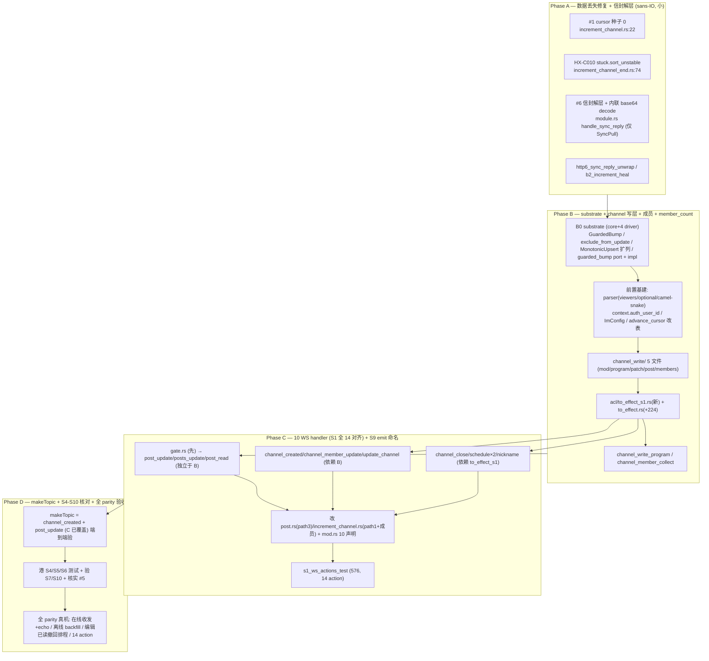
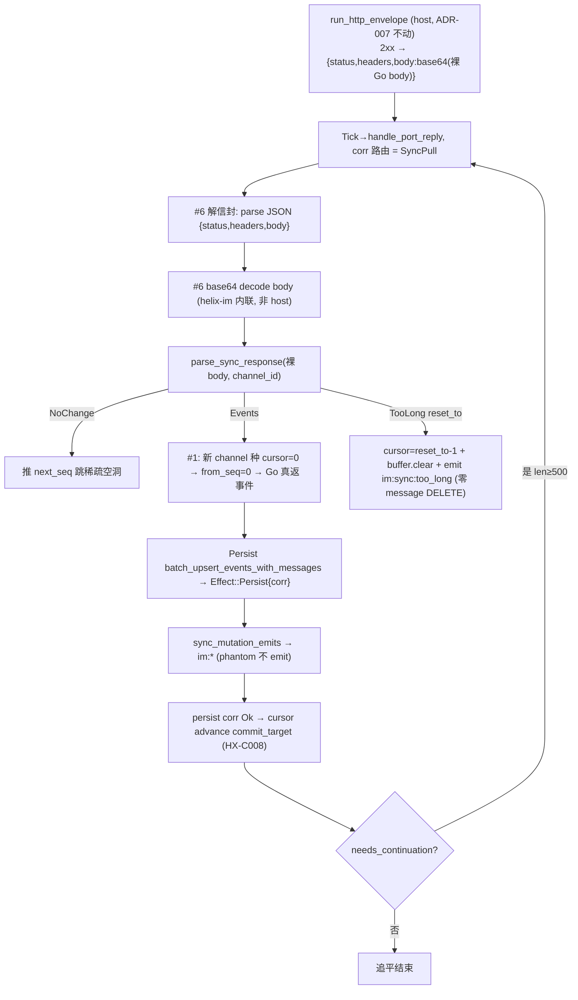
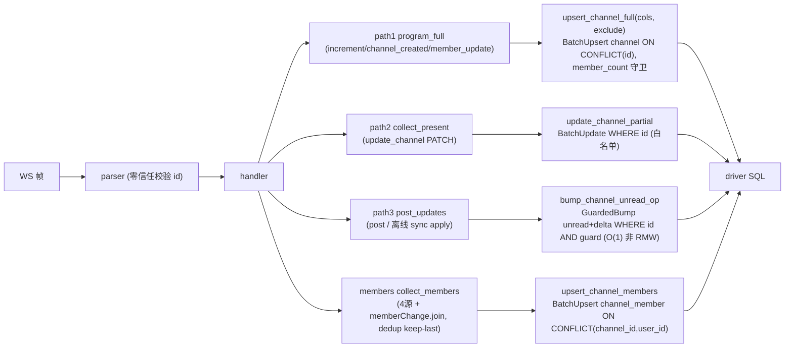
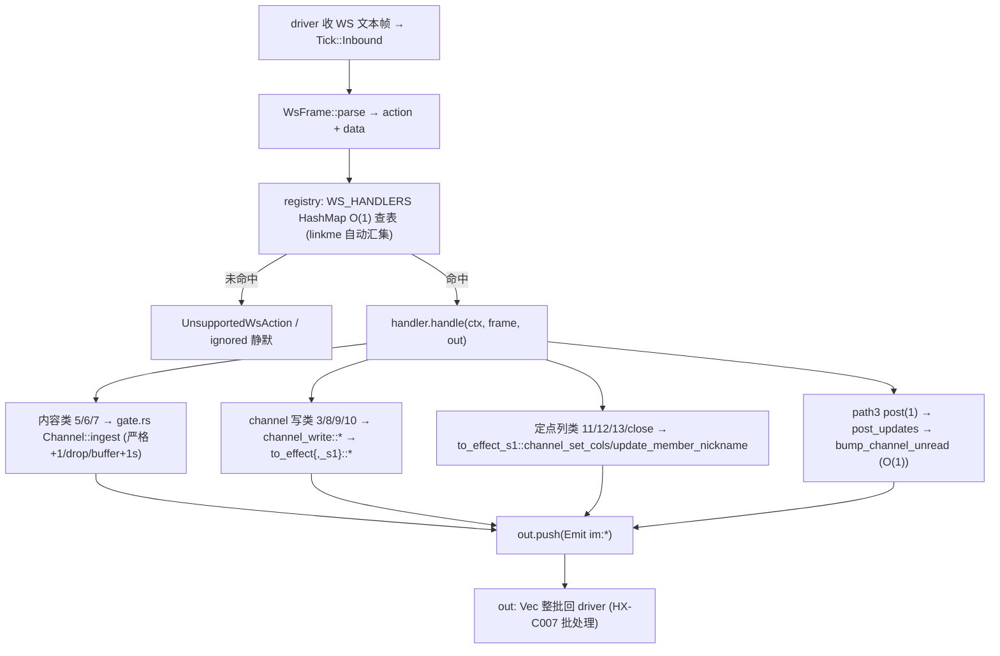
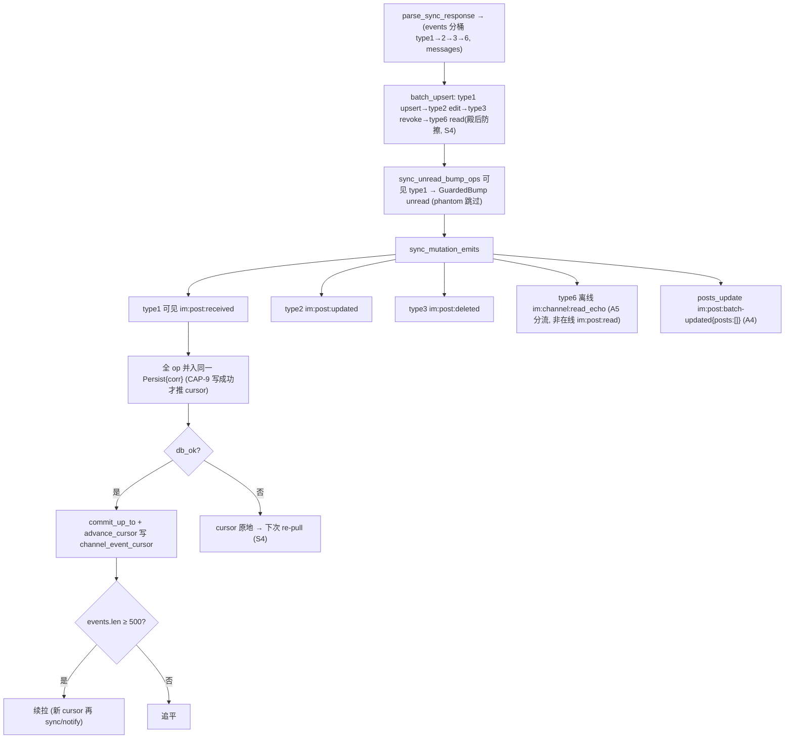

# SPEC — sync-v2 全 parity re-port 到 dev-zlc(ADR-007)

> 目标：把 `feat/sync-v2-full-replacement`（真机验证，**参照源，不文本合并**）的 **整条 sync-v2 业务**
> 逐项 re-port 到 `dev-zlc` 的 ADR-007 架构（engine 下沉 host、native/FFI 薄壳、http_envelope 信封契约），
> 落到分支 `feat/sync-v2-report-on-adr007`（worktree `worktrees/sync-v2-report`）。
> **验收 = feat 全 parity**（不只 6 个 fix）：在线收发+echo、离线 backfill、编辑/已读/撤回/排程、makeTopic、
> channel/成员落库、14 WS action，在线+离线真机（localhost:8065）跑通。
>
> 真源：本仓 §4.5 行为真源 = 现网 cses-client；feat 自带 spec = `crates/helix-im/docs/csesapi-migration/SPEC-sync-v2-full-replacement.md`（515 行）；
> 列契约 = `channel-52col-mapping.md`（218 行）。逐阶审计 = `audit-{A,B,C,D}.md`（本目录）。

---

## 0. Step 0 全枚举审计结论（feat 有 / dev-zlc 缺或不同）

diff 基线：`git diff dev-zlc...feat/sync-v2-full-replacement -- crates/`（helix-im +5209/−162，60 文件；另含 core+driver 5 crate）。

| 区块 | feat 状态 | dev-zlc 状态 | 裁决 |
|---|---|---|---|
| #1 cursor 种子 | `Channel::new(id, 0)` | `Channel::new(id, lastEventSeq)` = **数据丢失 bug** | 🔴 改（Phase A）|
| HX-C010 stuck 有序 | `stuck.sort_unstable()` | `let stuck`（无序，SipHash 随机）| 🔴 改（Phase A）|
| #6 信封解层 | feat 删信封（driver 返裸 body）| 保 ADR-007 信封 → `parse_sync_response` 吃信封 → 静默 NoChange **bug** | 🔴 加消费侧解信封+base64（Phase A）|
| **B0 substrate** GuardedBump / exclude_from_update / MonotonicUpsert 扩列 / guarded_bump port | 5 crate 36+ 处 | **0 命中**（core+全 driver 缺）| 🔴 港（Phase B0）|
| channel_write/ 整目录（5 文件）| 有 | 无 | 🔴 新建（Phase B）|
| acl/to_effect_s1.rs（183）+ to_effect.rs(+224) | 有 | 无 / 缺增量 | 🔴 港（Phase B）|
| member（memberChange.join）+ member_count | 有 | 无 | 🔴 港（Phase B）|
| channel_event_cursor 表 | 有 | **已有**（14 命中）| ✅ 已有（仅 advance_cursor 改表对齐）|
| 10 个 WS handler 文件（9 action + gate.rs）| 有 | 无 | 🔴 新建（Phase C）|
| parser viewers / lastEventSeq Optional / camel-snake | 有 | 无 | 🔴 港（Phase B 前置基建）|
| context.auth_user_id / ImConfig.auth_user_id | 有 | 无 | 🔴 港（Phase B 前置基建）|
| S9 emit：A5 read_echo 分流 / A4 batch_updated | 有 | **统一命名 = bug** | 🔴 改（Phase C，工厂在 B）|
| S4 写顺序 / S5 echo / S6 续拉+too_long / S7 2D 读契约 / S10 命名 | 有 + 测试 | 机制**已合规**，缺测试钉死 | 🟢 仅补测试（Phase D）|
| #5 auth | ImConfig（feat 不是此形态）| 全局头 cookieId 已覆盖（ADR-010）| ✅ 仅核实，**不搬**（Phase D）|

**关键纠偏**：SESSION §0 假设「helix-im 是 sans-IO，re-port 干净，只 #6 碰 driver」**不成立**——Phase B 的 channel_write 依赖
**core+全 driver 的 GuardedBump substrate**（B0），跨 helix-core / host / native / ffi / wasph(编译 parity)，受 HX-C001（core 零运行时）+ HX-C005（unread 热路径 O(1) 自增非 RMW）约束。B0 是本 re-port 风险最高的一块，单独门控。

---

## 1. Phase 计划（顺序执行 A → B → C → D；每阶 cargo + 真机 e2e）

### Phase A — 数据丢失修复 + 信封解层（纯 sans-IO，无 substrate 依赖）

| 项 | 改什么 | 落点 |
|---|---|---|
| #1 | `or_insert_with(\|\| Channel::new(channel_id, 0))`（**不**用 lastEventSeq；lastEventSeq 只喂 `increment_target`）| `ws/handlers/increment_channel.rs:22` |
| HX-C010 | `let mut stuck` + `stuck.sort_unstable()`（resync 前；corr load-bearing 需确定性序）| `ws/handlers/increment_channel_end.rs:74` |
| #6 | `handle_sync_reply` 内、`parse_sync_response` 前：解 `{status,headers,body}` 信封 → **helix-im 内联 base64 decode**（**禁** import host 的 `base64_encode`，违 HX-C001；零新 crate dep）→ 解码裸 body 喂 parser。**仅 SyncPull 路径，不碰 scan**；解码零信任走 Result | `module.rs handle_sync_reply (fn:517, wrap~:528)` |

**base64 放置决策**：选 **(A) helix-im 自带内联 decode**（镜像 `ABC…+/` 表，无 `base64` crate dep，与 feat 测试 inline `base64_std` 同形）。(B) 移 core 仅当出现第 3 消费方。
**cargo 门**：`cargo check -p helix-im` + `cargo test -p helix-im` 跑 Phase A 两测。**e2e**：删库重拉验离线 backfill 真触发（cursor=0 → from_seq=0 → Go 返事件）。

### Phase B — B0 substrate（最高风险）+ channel 写层 + 成员 + member_count

**B0（先做，单独 cargo 门）** — core + 全 driver：

| substrate | 落点 | 不变量 |
|---|---|---|
| `StorageOp::GuardedBump(GuardedBumpSpec)` 变体 + struct | `helix-core/src/effect.rs` | core 仅加**数据**（enum/struct），零运行时（HX-C001）|
| `UpsertSpec.exclude_from_update: Vec<&'static str>` + `UpsertSpec::new()` | `helix-core/src/effect.rs` | `&'static str` 非 String（HX-C005）|
| `MonotonicUpsertSpec` 扩 `table/key_col/value_col/touch_col` | `helix-core/src/effect.rs` | |
| `Storage::guarded_bump()` port method | `helix-core/src/ports/storage.rs` | Send 边界遵 HX-C002 |
| guarded_bump SQL（`col=col+delta WHERE pk AND guard`）+ exclude_from_update SQL + 复合 conflict_key | `helix-driver-host/src/{ops,storage}.rs` | **O(1) 自增非 RMW**（HX-C005）|
| native/ffi/wasm storage impl + storage_conformance | `helix-driver-{native,ffi,wasm}/src/storage.rs` | 三端 parity（wasm 仅编译） |

**B0 cargo 门**：`cargo check -p helix-core -p helix-driver-native -p helix-driver-ffi -p helix-driver-host` + `cargo test -p helix-driver-host -p helix-driver-native` + `cargo tree -p helix-core | grep -iE 'tokio|sqlx|reqwest|web-sys|tauri'` **必须空**。

**B 业务**（B0 后）：前置基建（parser viewers/lastEventSeq-Optional/camel-snake；context.auth_user_id；ImConfig.auth_user_id；advance_cursor 改表 channel_event_cursor）→ channel_write/ 5 文件（每文件 ≤300 行硬顶）→ acl/to_effect_s1.rs(新)+to_effect.rs(+224)（**保持 s1 分文件，不回灌**）。
**写策略**：member_count = path1 单行 ON CONFLICT(id) 守卫列（O(1) 冷路径）；unread = path3 `GuardedBump` SQL 自增（**唯一刻意偏离现网 RMW**，HX-C005 合规）；memberChange.leave 解析后接 `StorageOp::BatchDelete(channel_member)`。

### Phase C — 10 个 WS handler（S1 全 14 对齐）+ S9 emit 命名

注册经 `linkme::distributed_slice(WS_HANDLERS)` **自动汇集**——唯一 wiring = `ws/handlers/mod.rs` 加 10 个 `pub(crate) mod`。落地序：gate.rs → 内容类（post_update/posts_update/post_read，独立于 B）→ channel 写类（channel_created/channel_member_update/update_channel，依赖 B）→ 定点列类（channel_close/schedule×2/nickname）→ 改 post.rs(path3)/increment_channel.rs(path1+成员) → mod.rs 全声明 → s1_ws_actions_test(576) 绿。
**S9 emit 命名修复**（工厂在 B 的 to_effect.rs，C 接入）：A5 type6 在线 `im:post:read` vs 离线 `im:channel:read_echo` 分流（dev-zlc 当前统一命名 = bug）；A4 posts_update → `im:post:batch-updated{posts:[]}`。
**e2e**：在线发 14 类帧验落库形态 + emit 名。

### Phase D — makeTopic + S4-S10 核对 + 全 parity 验收

makeTopic 无独立模块 = `channel_created`(52 列 upsert)+`post_update` 流（C 已落）→ 端到端验。港 S4/S5/S6 测试钉死（写顺序/echo 三级/too_long 不删表 + fan-out 有序）；S7（2D 读契约靠 S3 列对齐）/S10（命名靠 golden）随带验；#5 auth 核实 dev-zlc 全局头 cookieId 已覆盖（**不搬**）。
**全 parity 真机验收**（localhost:8065，在线+离线）：① 在线发收 + echo 回填 ② 删库重拉离线 backfill（Go `kind=events fromSeq=0` → message 落行）③ 编辑/已读/撤回/排程 ④ makeTopic ⑤ channel/成员落库 member_count 实数 ⑥ 14 action 全跑。

---

## 2. 流程图

### 2.1 Sync-reply 数据流（Phase A #6 解信封 + #1 种子）

### 2.2 Channel 三路径写（Phase B）

### 2.3 WS 帧分发（Phase C — linkme 14 action）

### 2.4 emit 全集 + 续拉/too_long（Phase D — S9/S6/HX-C008）

---

## 3. 约束与门控（每阶必过）

- **HX-C001** core 零运行时：B0 改 core 后 `cargo tree -p helix-core | grep -iE 'tokio|sqlx|reqwest|web-sys|tauri'` 必须空；base64 decode 禁从 host import。
- **HX-C005** 热路径 O(1)：unread = GuardedBump SQL 自增（非 RMW）；member_count = 单行 upsert；`&'static str` 非 String。
- **HX-C007** Effect 整批回 driver。**HX-C008** cursor 锚 nextSeq（非 maxEvent），续拉看 len≥500。**HX-C010** 集合迭代前 sort。
- **code-structure §1** `src/**` 单文件 ≤300 行硬顶（channel_write 各文件已 ≤300；to_effect_s1 分文件守限，不回灌 to_effect.rs）。
- **每文件夹 CLAUDE.md+AGENTS.md 镜像**：新建 `channel_write/` 不强制（子模块级非硬顶），但若建则成对。
- **§4.7 drift-review**：本 re-port 跨多 commit，每 10 commit 检查点过 architecture-drift-review（已在开局清 gap=11）。
- **cargo cadence**（CLAUDE.md §3）：每阶完成前 `cargo check -p helix-core -p helix-im -p helix-driver-native -p helix-driver-ffi` + `cargo test -p helix-core`；autonomous workflow 自跑验证回报。
- **真机 e2e 铁律**（SESSION）：所有 HTTP 头带 `HELIX_DEVICE_ID`；用 `scripts/dev-loop.sh`（焊死 base 含 `/api/cses`）；grpc 障碍查 Go(`mmlog/mattermost.log`)+Java(`workspace/java/cses`) 日志。

## 4. 已知偏离 / 风险登记

1. **B0 跨 5 crate**（最高风险）：core+host+native+ffi+wasm，HX-C001/C005 + FFI parity。单独 cargo 门控，native 测试零回归作安全网。
2. **memberChange.leave 物理删行已接通**：`collect_member_leaves` → `StorageOp::BatchDelete(channel_member, scope=channel_id, key=user_id)`，host conformance 锁定跨 channel 隔离。
3. **auth_user_id 空降级**：无身份 → 保守 count-in；§5 验收（self+0/echo 无 unread）仅在 host 注入真 auth 时成立。
4. **#6 仅 SyncPull**：解信封禁碰 scan（scan reply 非信封）。
5. **S9 统一命名是 bug**：A5/A4 分流是真机定位的前端零改动契约修复，必须落。
