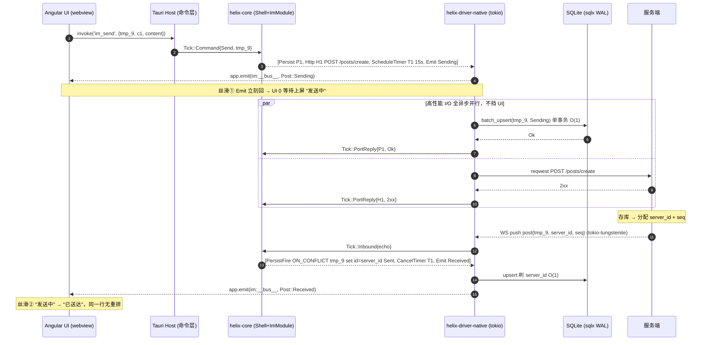
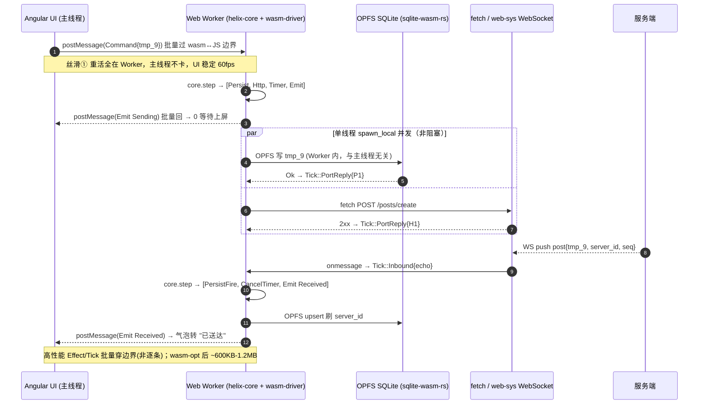
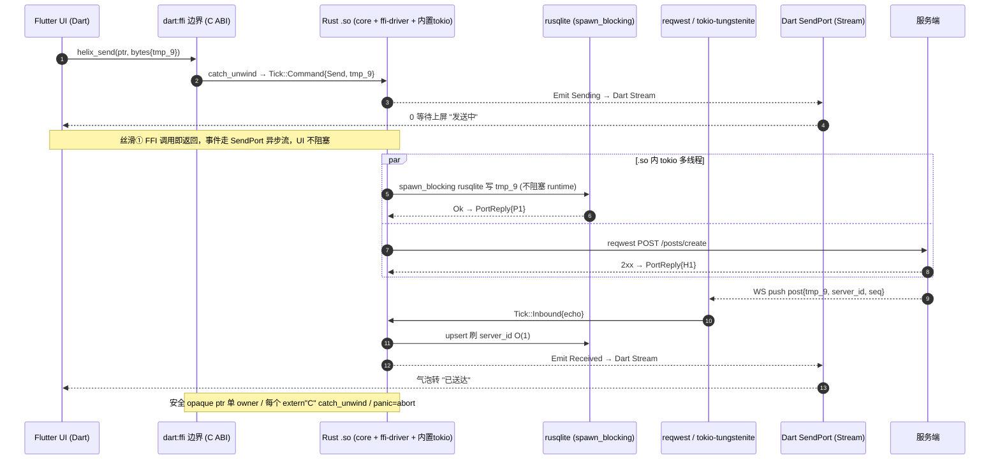

# 发一条消息 · 三端全链路（丝滑 / 高性能 / 流畅）

> **链路**：用户发消息 → 乐观落库 + HTTP 发送 → 服务端存库后 WS 推 echo → core 对账落库 → 发 `DomainEvent` → UI 订阅推送。
> **一句话**：**三端的 core 事件序列（Tick/Effect）是同一份；不同的只是 driver 怎么执行、host 怎么喂意图/送事件。** 那段最难写的"乐观发送 + echo 对账 + 15s 超时 + 迟到覆盖 + cursor"只写一次。
> 受众：消息系统开发团队。关联：[`../GOAL.md`](../GOAL.md) · [`架构设计 §4.5 发送消息机制`](../过会方案/helix-core-im-架构设计.md)

---

## 0. 统一 Core 时间线（三端一字不差）

```
阶段 A 发送（乐观 + HTTP 出站）
  Host → step( Tick::Command{Send, tmp_9, c1, content}, now )
  ImModule 吐:
    Effect::Persist{corr=P1, Upsert(messages, key=tmp_9, status=Sending)}   ← 乐观落库
    Effect::Http{corr=H1, POST /posts/create, body{tmp_9,...}}              ← 发服务端
    Effect::ScheduleTimer{T1, 15000ms}                                      ← 发送超时
    Effect::Emit(Post::Sending{tmp_9})                                      ← 通知 UI 先上屏
  driver 执行 → UI 立刻显示"发送中"；DB/HTTP 异步并行，结果回灌 PortReply

阶段 B 服务端（契约，不在 Helix 内）
  收 POST → 存库分配 server_id + channel_event seq → WS 推 post 帧（回带 tmp_9 + server_id + seq）

阶段 C 收 echo → 对账落库 → 发事件 → 订阅推送
  Host/Driver → step( Tick::Inbound{post, tmp_9, server_id, seq}, now )
  ImModule 吐:
    Effect::PersistFire{ Upsert(ON CONFLICT key=tmp_9 → id=server_id, status=Sent) }  ← 同一行刷 server id
    Effect::CancelTimer{T1}                                                            ← 对账成功撤超时
    Effect::Emit(Post::Received{完整消息})                                             ← 发事件
  driver 执行 → UI "发送中" → "已送达"，同一行无重排

两序收敛（C006）：echo 15s 没来 → Tick::Timer{T1} → 标 UnSend；迟到 echo 仍按 tmp_9 覆盖回 Sent。
```

**丝滑的根（三端共因）**：
1. **乐观先行**：`Emit(Sending)` 在任何网络等待之前就回，UI **0 等待上屏**，永不卡输入。
2. **I/O 全异步、离开 UI/渲染路径**：DB / HTTP / WS 并行跑，结果以 `Tick::PortReply` 回灌，主线程/渲染从不阻塞。
3. **热路径 O(1)**：单 INSERT/UPDATE WHERE PK、`&'static str` 不堆分配、禁 read-modify-write。
4. **core 纯逻辑、无 GC、无锁争用**：`step()` 是同步纯函数，确定性、可预测延迟。
5. **跨边界批处理**：一个 step 的 `Vec<Effect>` 一次过 wasm/FFI 边界，不逐条穿越。

---

## 1. PC = Tauri（helix-driver-native，tokio 多线程）



**为什么 Tauri 端丝滑高性能**：tokio 多线程把 DB/HTTP/WS 全派到工作线程，webview 主线程只收 `app.emit` 事件渲染；sqlx WAL 让读不阻塞写；core 单线程被 driver 泵，I/O 结果走 mpsc 回灌——**渲染线程永远不碰 I/O**。

---

## 2. Web = WASM（helix-driver-wasm，单线程 + Web Worker）



**为什么 WASM 端丝滑高性能**：core+driver 整个跑在 **Web Worker**，UI 主线程只做渲染 → 滚动/输入永不掉帧；OPFS 持久化只能在 Worker 里，正好契合；异步用 `spawn_local`（无多线程但本就不需要）；**Tick/Effect 批量过 wasm↔JS 边界**（sledgehammer 教训）避免逐条穿越的固定开销；wasm 纯逻辑无 GC 停顿。

---

## 3. 移动 = Flutter + FFI（helix-driver-ffi，.so 内置 tokio + Dart SendPort）



**为什么 Flutter+FFI 端丝滑高性能**：FFI 调用 `helix_send` 立即返回，**事件不走返回值、走 Dart `SendPort` 异步流**（allo-isolate / flutter_rust_bridge 风格）→ Dart UI 订阅 `Stream`，主 isolate 永不阻塞；.so 内置 tokio 多线程跑 HTTP/WS，rusqlite 同步调用包 `spawn_blocking` 不阻塞 runtime；FFI 铁律（opaque ptr 单 owner / catch_unwind / panic=abort）保证不崩、无 UB。

---

## 4. 三端"丝滑/高性能"共因对照

| 维度 | PC / Tauri | Web / WASM | 移动 / Flutter-FFI | 共性结论 |
|---|---|---|---|---|
| UI 是否被 I/O 阻塞 | 否（tokio 工作线程） | 否（Worker 隔离） | 否（SendPort 异步流） | **渲染永不碰 I/O** |
| 乐观上屏 | app.emit 立回 | postMessage 立回 | SendPort 立回 | **0 等待先上屏** |
| 并发 | tokio 多线程 | spawn_local 单线程 | .so 内 tokio | core 不假设线程，各取所长 |
| 跨边界开销 | 进程内 | 批量过 wasm↔JS | 批量过 FFI | **批处理不逐条** |
| 热路径写 | sqlx O(1) WAL | OPFS O(1) | rusqlite O(1) | **单 INSERT/UPDATE WHERE PK** |
| 抖动来源 | 无 GC | 无 GC | 无 GC | Rust 纯逻辑、确定性延迟 |
| 对账/超时/cursor 逻辑 | 同一份 | 同一份 | 同一份 | **写一次、可单测、三端一致** |

---

## 5. 关键不变量（保证三端都"流畅"且正确）

- **先落库再 emit**：`Emit` 排在 `Persist` 完成之后（driver 顺序执行 effects）→ UI 看到的永远是已落库的状态。
- **对账幂等**：以 `temporaryId` 为 PK + `ON CONFLICT` 刷 server id，echo/timer 两序收敛到一致终态（C006）。
- **cursor 两段式**：写成功（PortReply Ok，事务已提交）才推进 cursor；失败回滚、cursor 不动、幂等重拉 → 断线/弱网下不丢不重。
- **Effect 批处理**：跨 wasm/FFI 边界一次传一个 step 的全部 effect → 高频消息洪峰下边界开销不线性叠加。

> 这套链路的业务逻辑只在 `helix-im` 写一次，可在**无 webview / 无真网络 / 无真数据库**下用回放单测验证（喂剧本化 `Tick` 断言吐出的 `Effect`），三端共享、行为可证一致。
