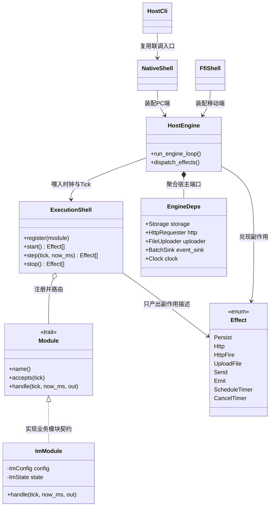
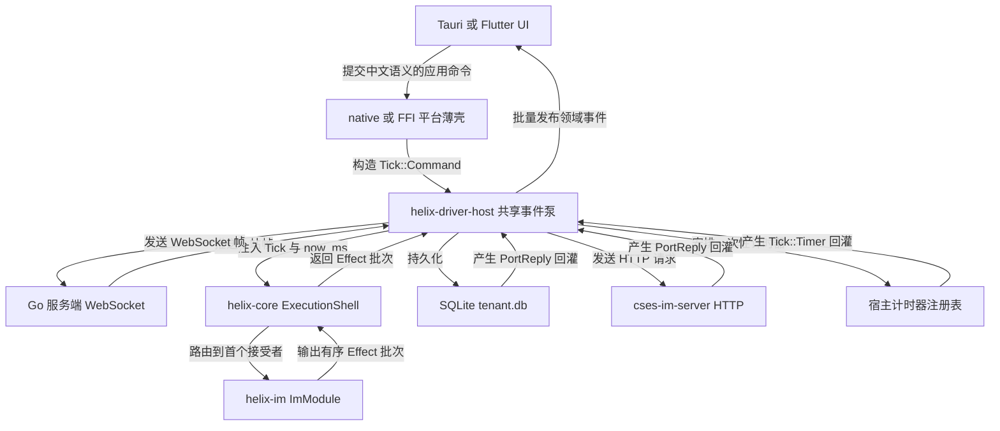
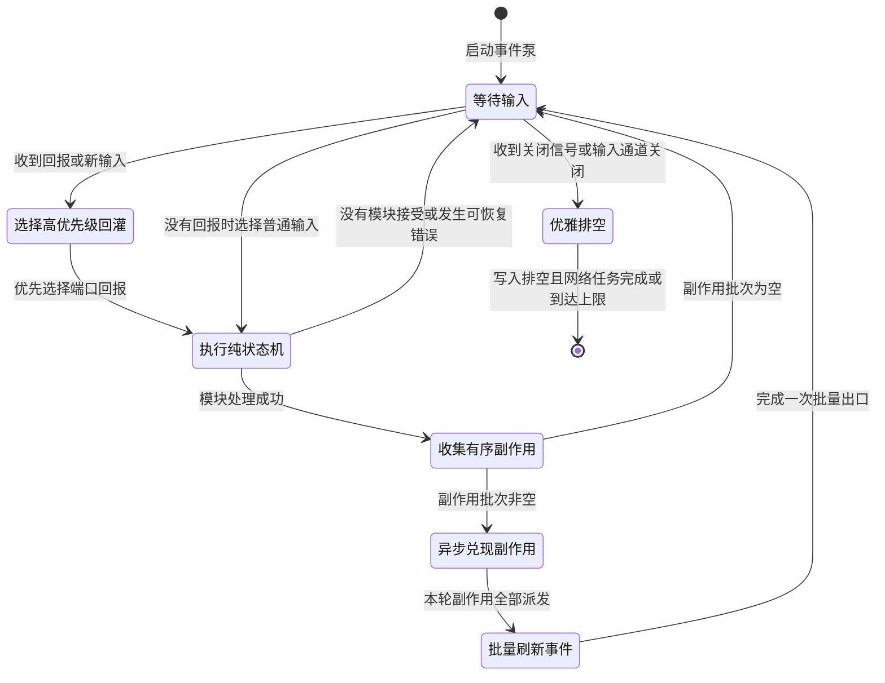
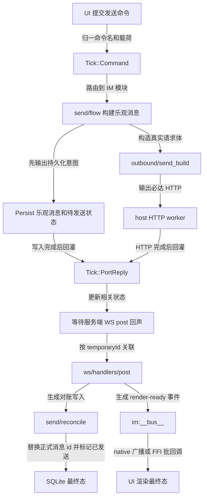
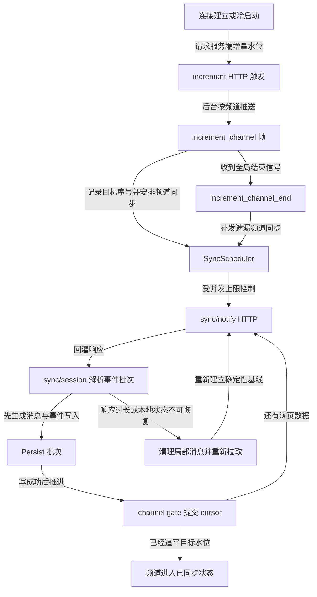

# Helix 系统总览

> 基线：`main@e0252dc`。本页先给全局模型，细节进入后续模块文档。

## 1. 系统定位

Helix 是运行时无关的确定性业务内核。`helix-core` 只定义纯同步状态机、模块宿主和端口；`helix-im` 实现业务规则；`helix-driver-host` 把 Effect 兑现成真实 I/O；native 与 FFI 只装配平台能力。时间、网络、存储、文件上传、线程和事件出口都从外部注入。

## 2. 全局模块类图

## 3. 全局依赖流程图

依赖方向只有外层指向内层：driver 可以依赖 core，core 不依赖 tokio、SQLite、reqwest、Tauri 或 Flutter。`helix-im` 只依赖 `helix-core`，不直接执行 I/O。

## 4. 单次 Tick 生命周期

核心顺序不变量：`PortReply` 优先于新 Tick；同表集合的 Persist 用单写者保持顺序；HTTP 与上传走有界 worker；每个 step 的 Emit 在 dispatch 后只刷新一次，FFI 不逐条跨边界。

## 5. 发送消息端到端流程

“HTTP 成功”不是 UI 完成。完成判据是 WS 回声携带相同 `temporaryId`，本地正式 id/发送状态完成对账，并产生可渲染投影。

## 6. 增量与离线同步流程

cursor 只在对应持久化成功后单调推进；服务端目标水位和本地确认 cursor 分离；满页续拉看实际长度，不依赖不存在的 wire flag。

## 7. 查询与渲染投影流程

```mermaid
flowchart LR
  A["UI 发起本地查询命令"] -->|进入 Tick::Command| B["query/dispatch"]
  B -->|规划 ScanSpec| C["Effect::Persist 读取"]
  C -->|SQLite 返回行| D["Tick::PortReply"]
  D -->|按 correlation 恢复查询上下文| E["query/render_ready"]
  E -->|组装消息、成员、回执、回复| F["版本化投影载荷"]
  F -->|发布 im:__bus__| G["平台事件出口"]
  G -->|只负责绑定与渲染| H["Tauri 或 Flutter UI"]
```

UI 不应重复实现排序、关联、回执或回复组装。render-ready 是业务模块的输出，平台只负责传输和展示。

## 8. 存储与复杂度边界

| 路径 | 结构/算法 | 目标复杂度 | 说明 |
|---|---|---:|---|
| corr/timer 路由 | `HashMap` | 平均 O(1) | `PortReply` 和 Timer 定向投递 |
| Inbound/Command 模块选择 | 小型 `Vec` 顺序扫描 | O(m)，m 小于 10 | 开闭原则优先，实践视为常数级 |
| WS action 路由 | 静态 registry | 平均 O(1) | 未知 action 显式报可观测错误 |
| 单条主键写 | `INSERT/UPDATE WHERE PK` | O(log n) | 禁止 read-modify-write |
| 同表集合写入 | 单写者队列 | O(k) | 保持 Effect 顺序并避免交错 |
| render-ready 组装 | 扫描窗口 + map/index | O(n) | 避免嵌套全表匹配 |
| FFI 事件出口 | 单批 len-prefixed buffer | O(k) | 一批一次跨边界 |

## 9. 当前产品边界

- 当前交付端：PC Tauri native 与 Flutter FFI。
- `helix-driver-wasm` 已按 ADR-006 归档，不进入 roadmap、CI 必跑矩阵或交付验收。
- `helix-host-cli` 是联调/验收宿主，不是业务所有者。
- `helix-driver-host` 是 shared host I/O 单一实现，native 与 FFI 不应各自复制事件泵、SQLite 或网络语义。
