# helix-core 架构

> 目录：`crates/helix-core`。它是运行时无关的确定性内核，不认识 IM、SQLite、tokio、Tauri 或 Flutter。

## 1. crate 模块

### 职责

`helix-core` 提供系统的通用语言：输入是 `Tick`，业务扩展点是 `Module`，输出是 `Effect`，执行聚合根是 `ExecutionShell`，外部能力以 ports trait 表达。

### crate 类图

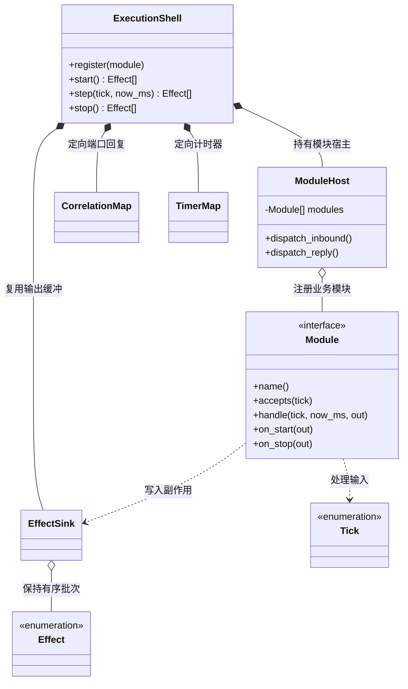

### crate 流程图

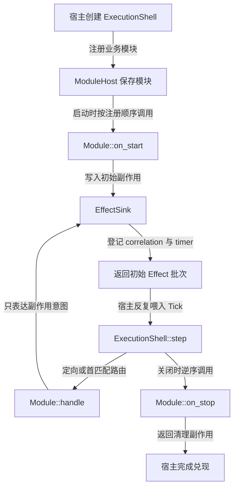

## 2. `src/` 文件夹

### 文件职责

| 文件 | 关键类型/入口 | 作用 |
|---|---|---|
| `lib.rs` | 公共 re-export | 统一导出 `ExecutionShell`、`Module`、`Tick`、`Effect`、错误和平台约束 |
| `auth.rs` | `AuthKind` | 只表达 Session/Bot 鉴权意图，不保存真实 token |
| `effect.rs` | `Effect`、`StorageOp`、各类 spec | 副作用与通用存储协议真源 |
| `tick.rs` | `Tick`、`AppCommand`、`PortOutcome` | 状态机输入 tagged union |
| `module_host.rs` | `Module`、`ModuleHost` | 模块注册、首匹配路由和定向回复 |
| `engine.rs` | `ExecutionShell` | 启停、step、corr/timer 注册与回收 |
| `error.rs` | `CoreError`、端口 `PortError` | 区分内核错误和端口实现错误 |
| `platform.rs` | `MaybeSend`、`MaybeSync` | 按目标平台约束 Send/Sync |
| `engine_tests.rs` | 测试模块 | 验证一次性 timer 与空壳行为 |

当前 `Effect` 有 10 个顶层变体：`Send`、`Persist`、`PersistFire`、`Http`、`UploadFile`、`HttpFire`、`Request`、`Emit`、`ScheduleTimer`、`CancelTimer`。当前 `StorageOp` 有 8 个变体：`BatchUpsert`、`MonotonicUpsert`、`BatchUpdate`、`GuardedBump`、`Get`、`Scan`、`BatchDelete`、`DeleteWhere`。

### `src/` 类图

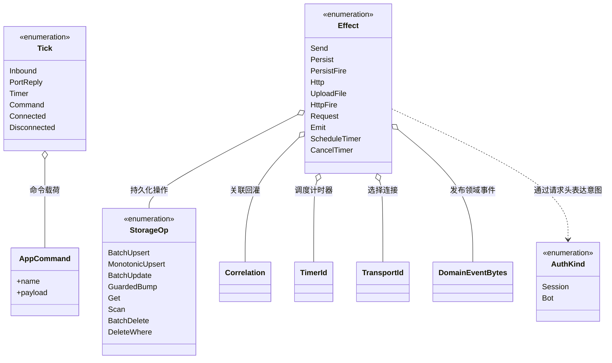

### `src/` 输入路由流程图

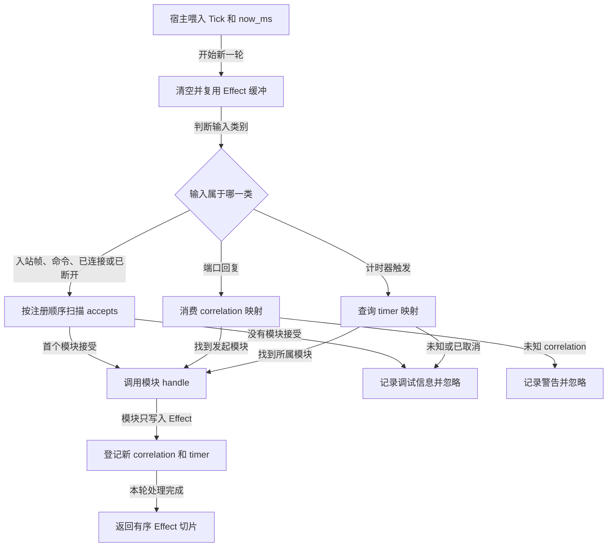

### 模块生命周期状态图

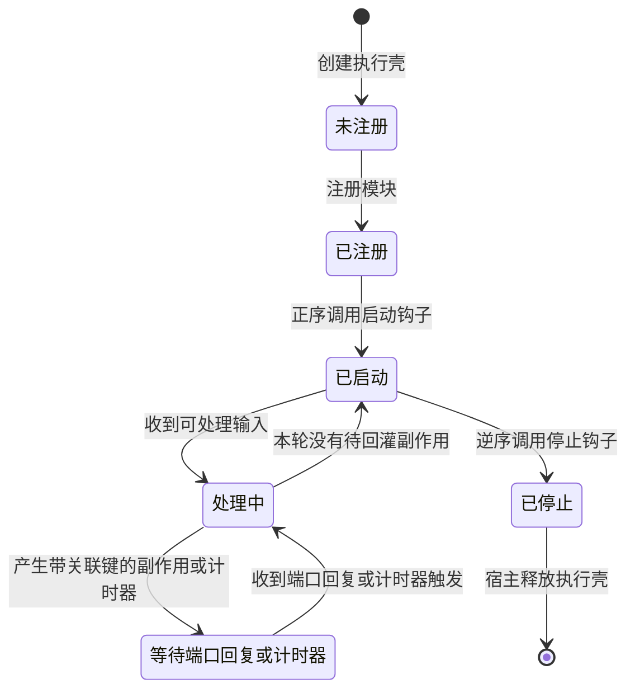

### 路由复杂度

- `Inbound/Command`：遍历模块 `Vec`，O(m)。设计预期 m 小于 10，优先保持开闭原则。
- `PortReply`：`HashMap<Correlation, module_index>` 平均 O(1)，回复后消费并移除。
- Timer：`HashMap<TimerId, module_index>` 平均 O(1)，当前语义是一次性触发后移除；周期行为必须分配新 id 再调度。
- `EffectSink`：复用 `Vec` 容量，按产生顺序追加，单轮 O(k)。

## 3. `src/ports/` 文件夹

### 文件职责

| 文件 | trait | 契约 |
|---|---|---|
| `clock.rs` | `Clock` | 注入 `now_ms`；测试提供 `MockClock` |
| `event_sink.rs` | `EventSink` | 同步、非阻塞发布领域事件 |
| `http.rs` | `HttpRequester` | 执行 HTTP 请求并返回响应 |
| `id.rs` | `IdSource`、`Random` | 注入 ID 和随机数 |
| `storage.rs` | `Storage` | 兑现 8 类通用存储操作 |
| `transport.rs` | `Transport` | connect/send/recv/close WebSocket 类传输 |
| `upload.rs` | `FileUploader` | 按本地路径流式上传文件 |
| `mod.rs` | re-export | ports 唯一公共入口 |

### `src/ports/` 类图

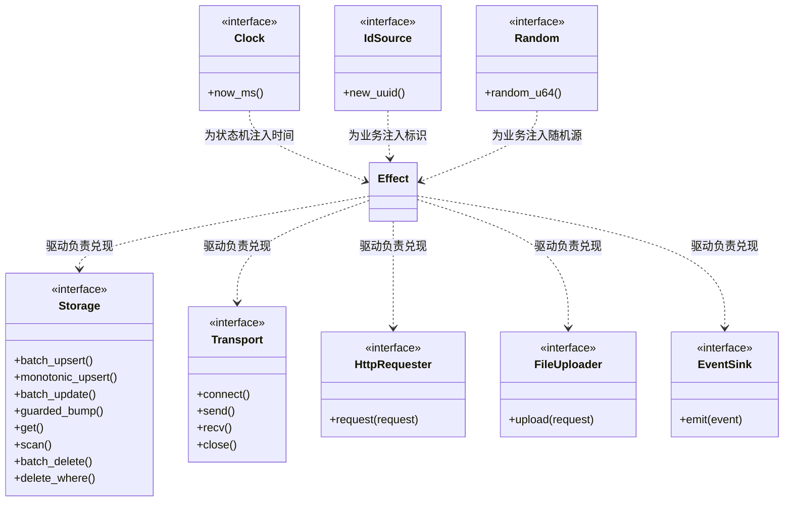

### `src/ports/` 兑现流程图

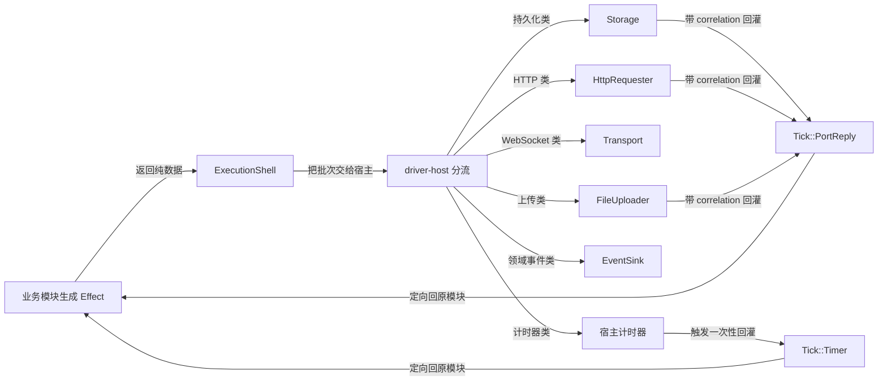

## 4. `tests/` 文件夹

### 验证对象类图

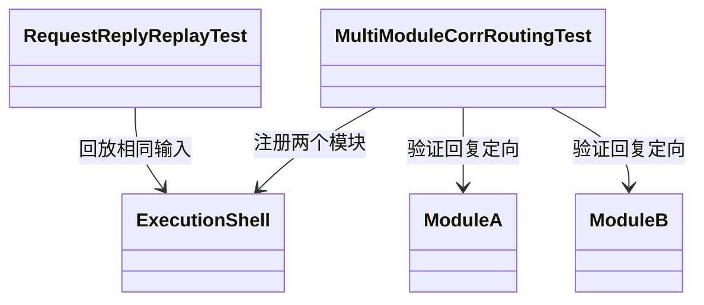

### 验证流程图

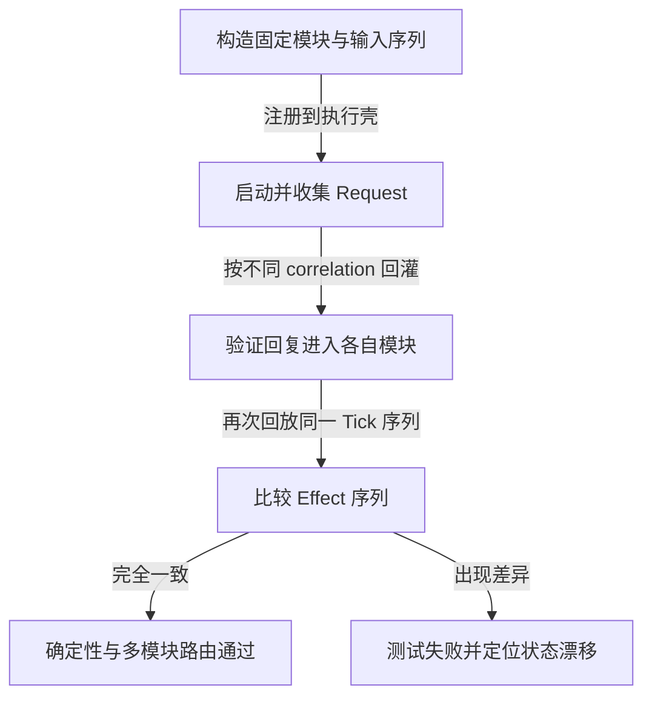

## 5. `docs/design/` 文件夹

### 文档关系类图

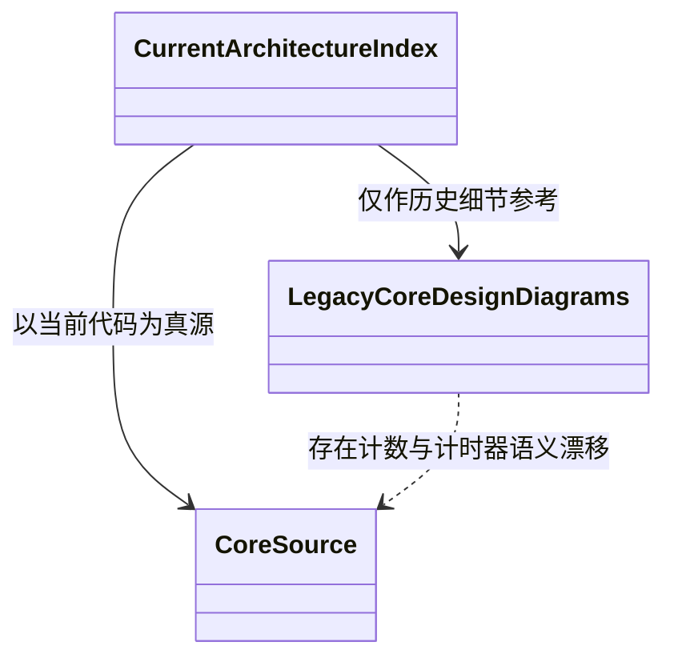

### 阅读流程图

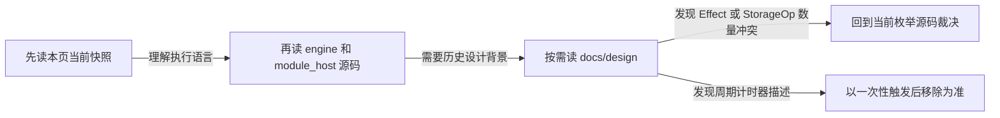

现有旧图仍写 Effect 9 类、StorageOp 7 类，并包含旧 timer 描述；当前真值分别是 10、8，timer 是 one-shot-on-fire。旧图不可单独作为当前架构依据。
