# helix-im 架构

> 目录：`crates/helix-im`。当前 `main@e0252dc` 下，`src` 有 153 个 Rust 文件和 18 个源码目录。`ImModule` 是唯一业务编排入口。

## 1. crate 模块

### 当前事实

- 输入：`Tick::{Inbound, Command, PortReply, Timer, Connected, Disconnected}`。
- 状态：`ImState`、per-channel `Channel`、`PendingSend`、`SyncScheduler`、correlation context。
- 输出：只写 `EffectSink`，没有 I/O、`await` 或 runtime 句柄。
- 出站命令：live test 断言当前 registry 计数为 123。
- WS：`WS_HANDLERS` 当前注册 28 项；`ws/handlers/` 有 26 个源码文件，其中 `gate.rs`、`post_echo_settle.rs` 是共享辅助。

### crate 类图

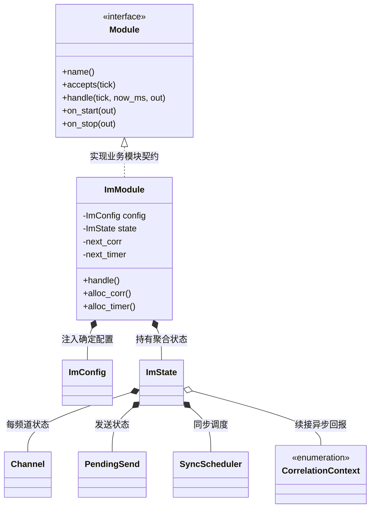

### crate 总流程图

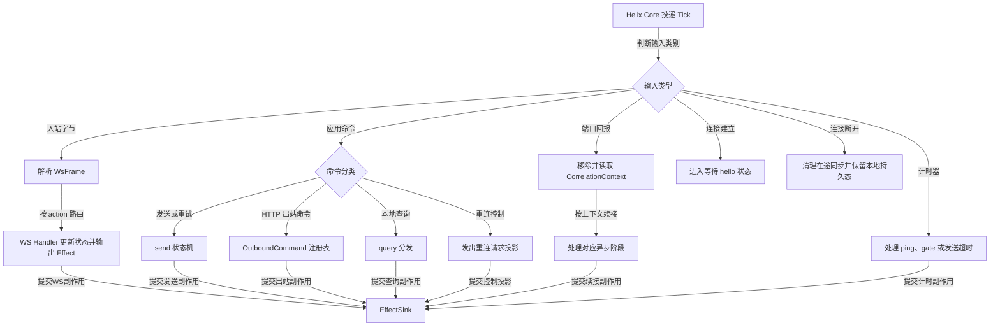

## 2. `src/` 文件夹

### 根文件职责

| 文件 | 作用 |
|---|---|
| `lib.rs` | 模块树和兼容 re-export 门面 |
| `module.rs` | `ImConfig`、`ImModule`、Module 实现和 Tick 总分发 |
| `state.rs` | ID 值对象、连接/发送状态、`ImState` |
| `correlation.rs` | 异步回报的 tagged context 真源 |
| `schema.rs` | message/channel/member/cursor DDL 静态数据 |
| `commands.rs` | outbound registry 兼容 re-export |
| `port_reply.rs` | 按 correlation 精确续接 |
| `port_reply_emit.rs` | 读族回报与双投影出口 |
| `mobile_contract.rs` | public alias、载荷归一、capabilities 和事件闭集 |
| `mobile_query.rs` | 移动端同步本地查询计划与 JSON 整形 |
| `dialog_patch.rs` | channel 写后读回的累计 DialogPatch |
| `forward.rs`、`forward_shape.rs` | 本地源消息查询和单发/合并转发装配 |
| `increment_hydration.rs` | 陌生频道补水两阶段 |
| `channel_capabilities.rs` | 频道权限终态布尔能力 |
| `message_capabilities.rs` | 消息事实到交互能力 |
| `http_envelope.rs`、`base64.rs` | 解 host HTTP 信封 |
| `error.rs` | IM 边界错误 |
| `module_tests.rs`、`state_tests.rs` | 同目录拆出的单元测试 |

### `src/` 类图

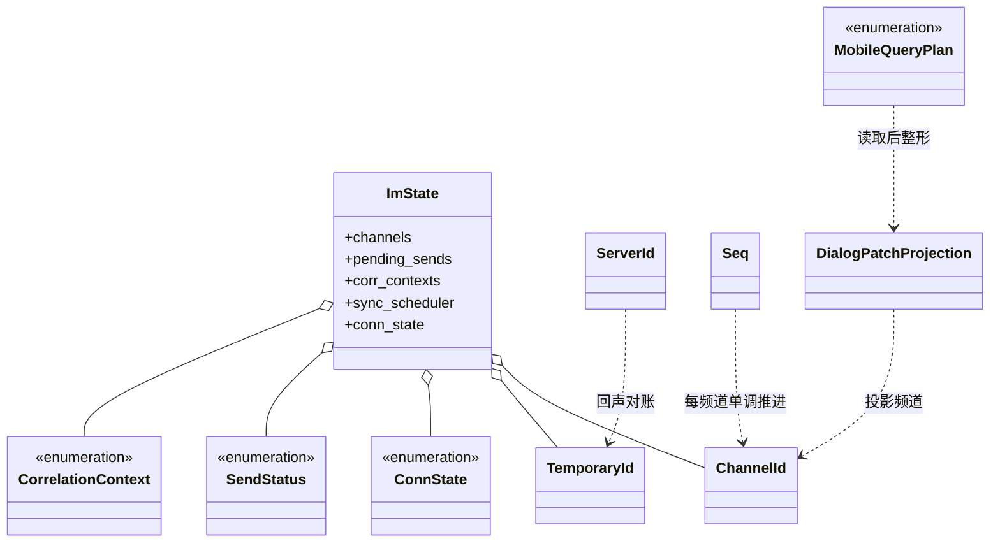

### `src/` 端口回报流程图

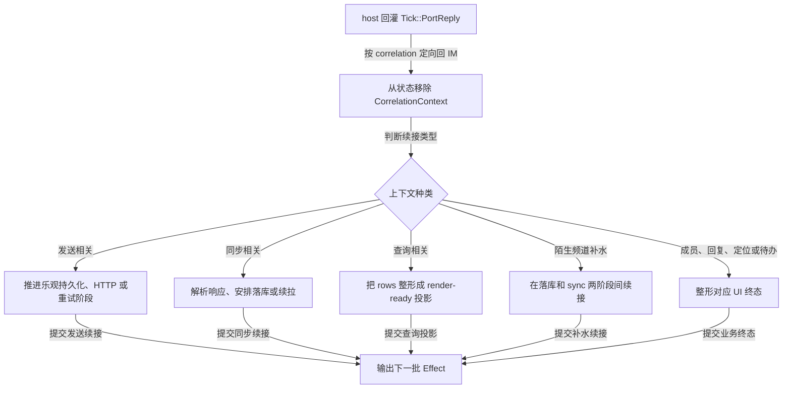

`CorrelationContext` 不是“一个 HTTP callback”。它覆盖 cursor scan、channel persist、too-long、DialogPatch、乐观发送、发送 HTTP、重试、sync pull、消息/会话查询、转发源、通用读回报、退群、hydration、成员快照、候选联系人、回复、定位、批量转发、读者列表、TODO 和历史上拉等续接点。

## 3. `src/acl/` 文件夹

### 文件职责

`from_tick.rs` 判定输入归属；`to_effect.rs` 是 facade；transport/storage/sync HTTP/sync batch/projection 各文件将 IM 概念翻译成 core 通用 `Effect` 和 `StorageOp`；`to_effect_s1.rs` 保留 S1 兼容转换。

### `src/acl/` 类图

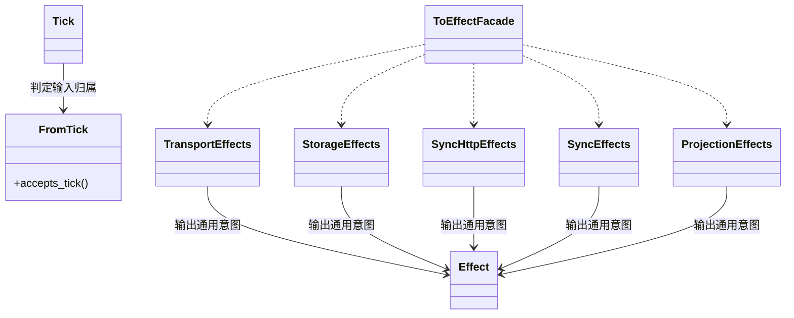

### `src/acl/` 翻译流程图

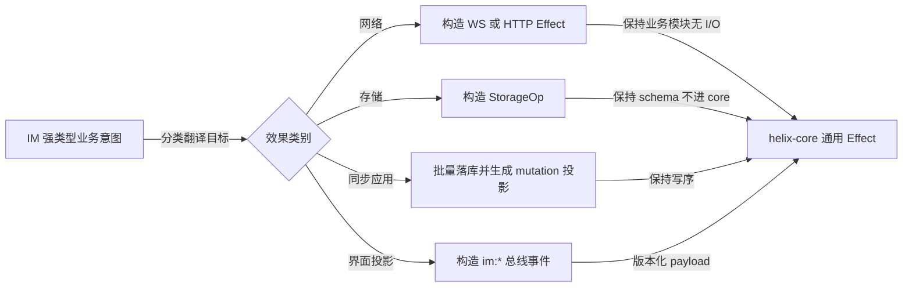

## 4. `src/channel/` 文件夹

### 文件职责

`gate.rs` 是 `Channel` 聚合和乱序补洞；`lifecycle.rs` 处理启动、hello、ping、gate timer、发送 timeout；`lifecycle_scan.rs` 处理 cursor 冷启动恢复；`older_context.rs` 管多轮历史上拉；`mod.rs` 为门面。

### `src/channel/` 类图

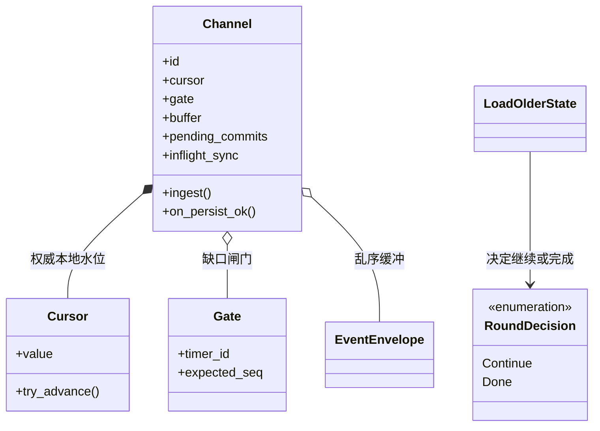

### `src/channel/` gate 状态图

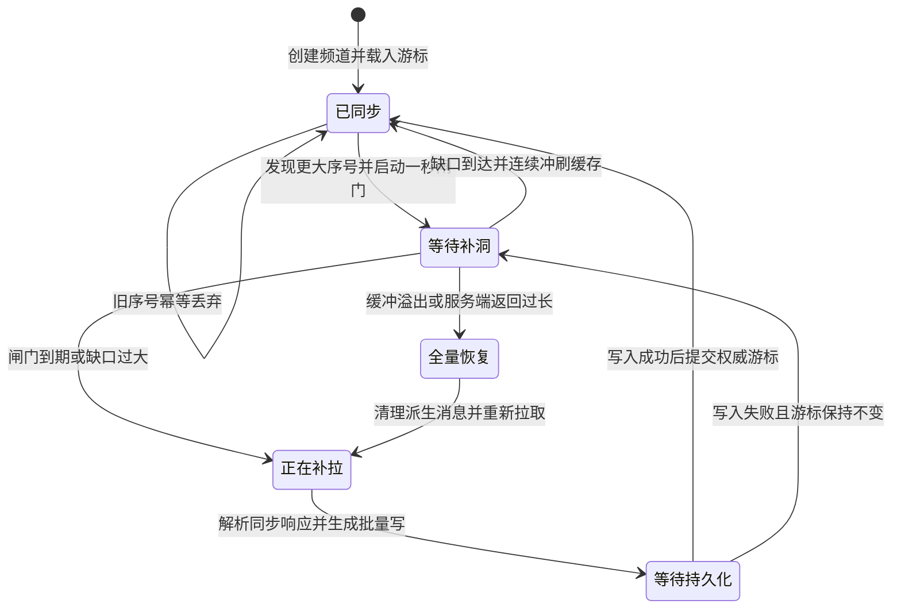

## 5. `src/channel/write/` 文件夹

### 文件职责

`program.rs` 编排有序存储程序；`patch.rs` 只收集 wire 实际存在的字段；`members.rs` 归一 owner/admin/member/join/leave；`post.rs` 计算可见性、未读、mention、urgent 和 lastPost；`mod.rs` 定义受控列集合。

### `src/channel/write/` 类图

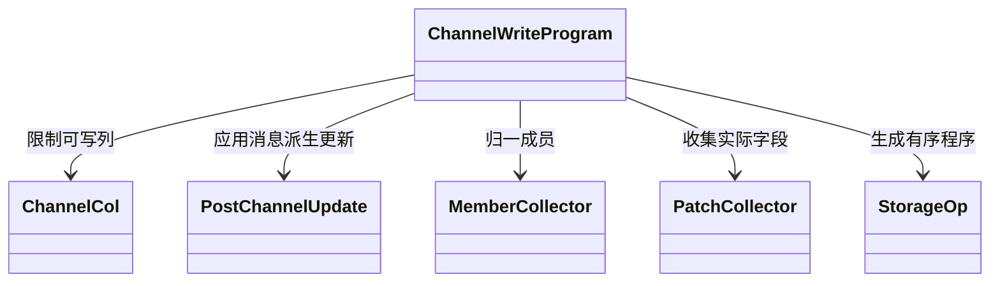

### `src/channel/write/` 写入流程图

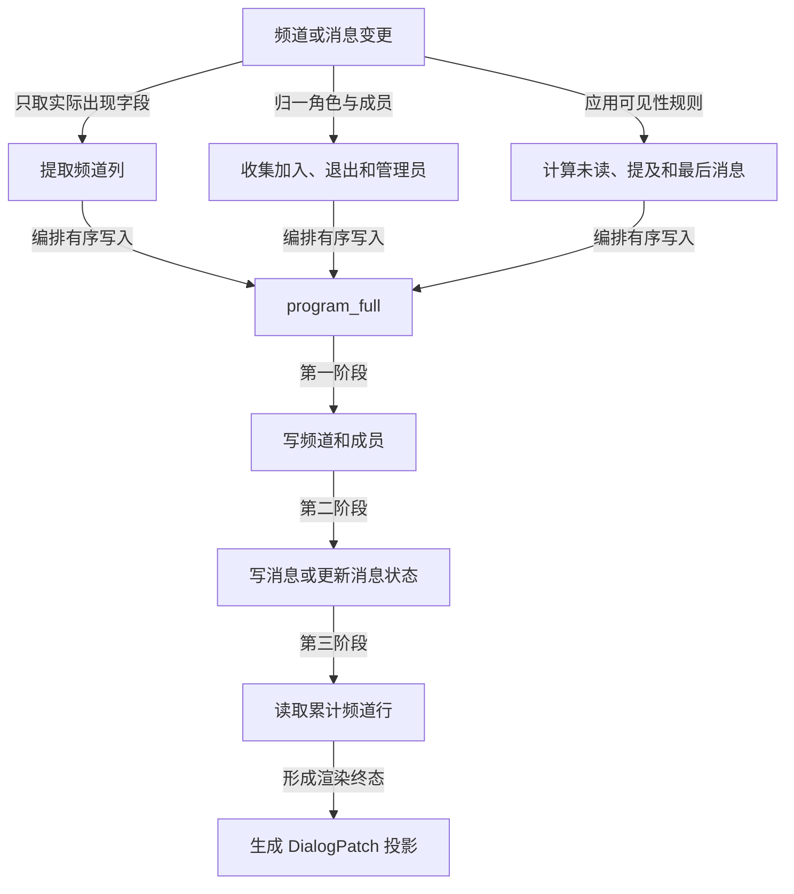

## 6. `src/send/` 文件夹

### 文件职责

`flow.rs` 是发送编排；`pending.rs` 持有状态；`reconcile.rs` 处理 HTTP/WS 对账；`upload_props.rs` 管上传计划；`retry_send.rs` 和 `retry_upload.rs` 恢复失败状态；`pong_compensate.rs` 处理补偿信号。

### `src/send/` 类图

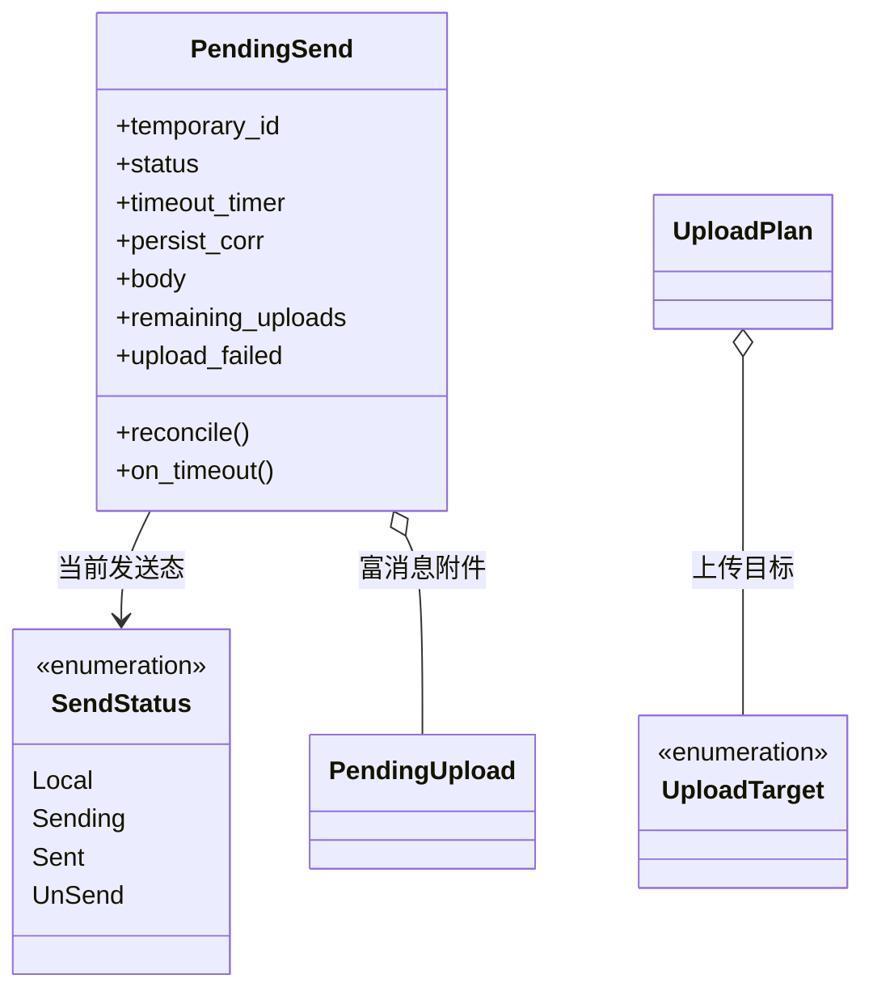

### `src/send/` 状态图

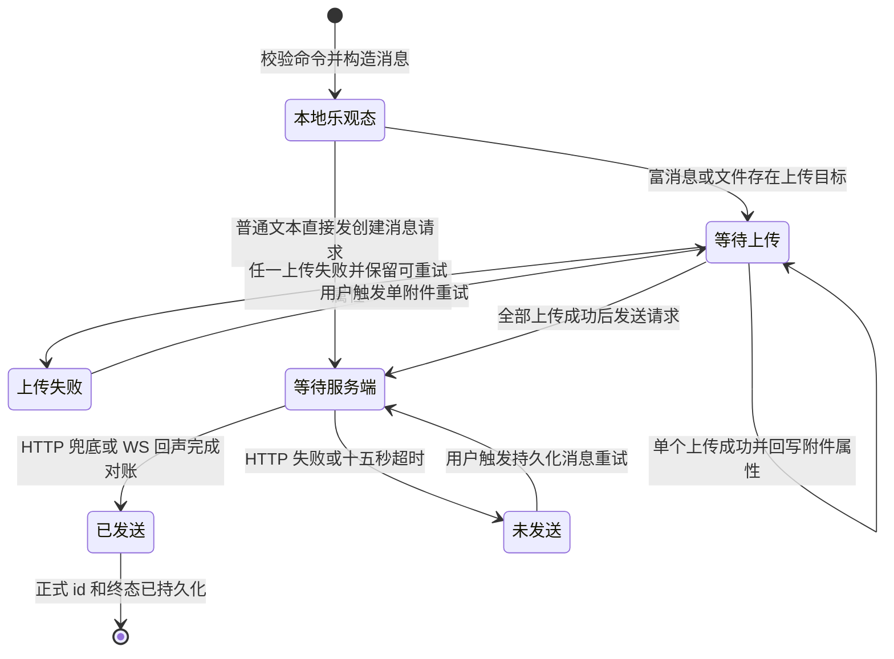

HTTP 200 只是 self-omit WS echo 场景的兜底；正常权威链仍是 `temporaryId` 对应的 WS `post` 回声。迟到回声可幂等补正式 id。

## 7. `src/sync/` 文件夹

### 文件职责

`session.rs` 定义同步 wire 模型；`flow.rs` 处理回报四态；`increment.rs` 生成根 cursor 快照和 `allHash`；`scheduler.rs` 保证每频道单飞并限制全局最多 8 个在途。

### `src/sync/` 类图

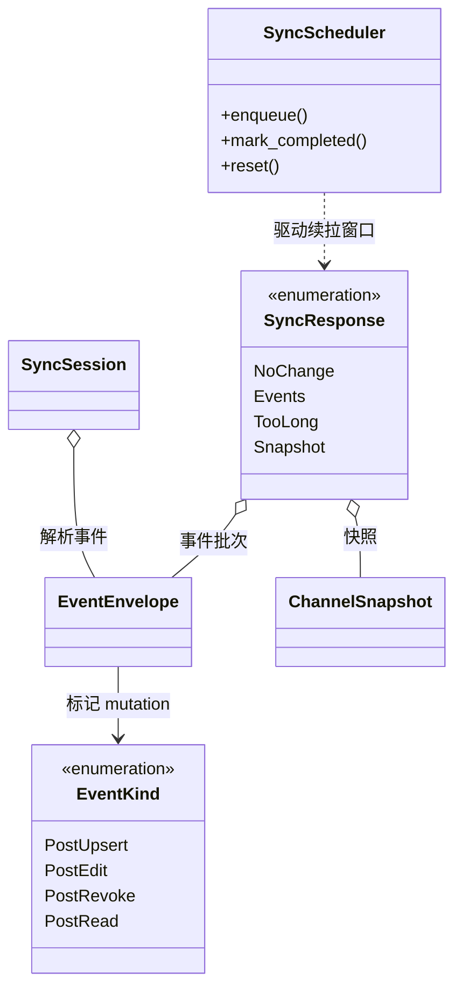

### `src/sync/` 流程图

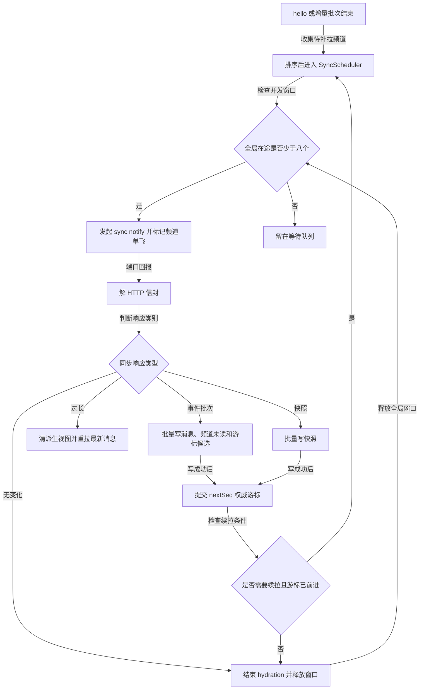

## 8. `src/query/` 文件夹

### 文件职责

`dispatch.rs` 路由 4 个本地命令；`core.rs` 生成消息/会话 ScanSpec 与清理操作；`dialog_render.rs`、`dialog_wire.rs` 组装会话；`read_relay.rs` 统一读回报；`render_ready/` 负责终态投影。

当前本地命令是 `im_query_messages_by_channel`、`im_delete_all_dialogs`、`im_query_dialog_list`、`im_load_older_context`。

### `src/query/` 类图

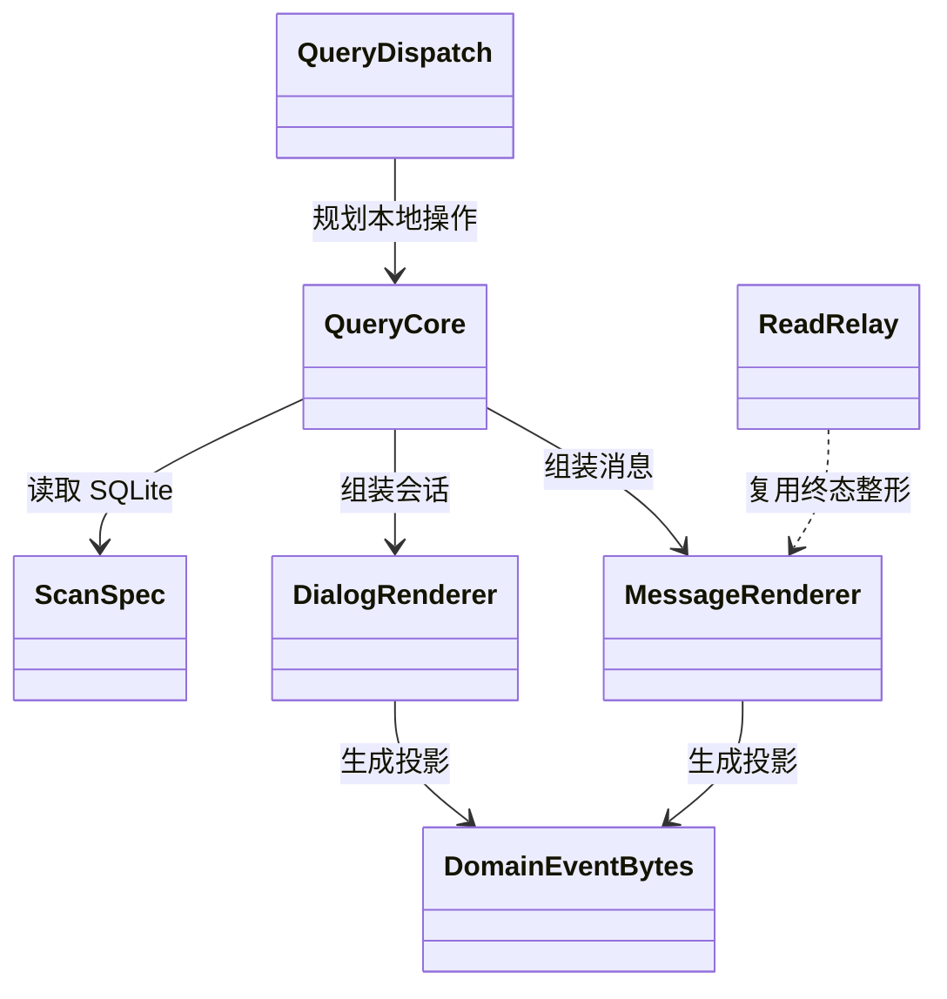

### `src/query/` 流程图

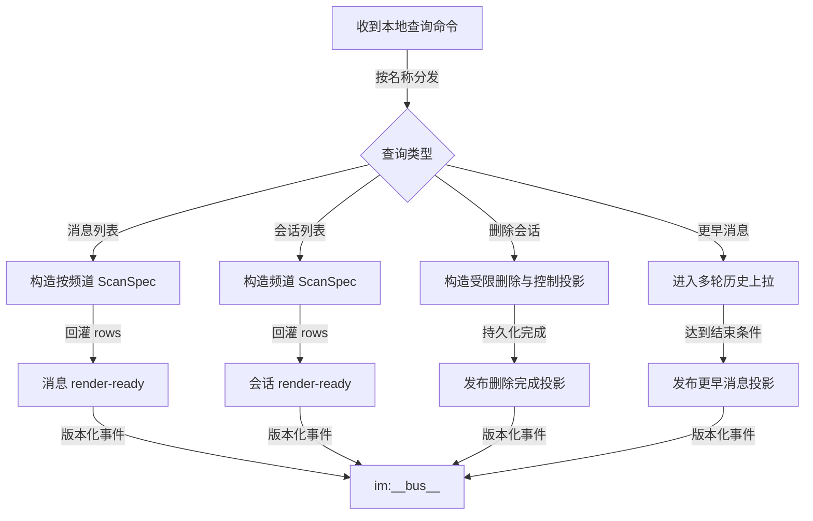

## 9. `src/query/render_ready/` 文件夹

### 文件职责

`core.rs` 统一 DB snake_case/wire camelCase 消息；`replies.rs` 处理 snapshot/append、revision 抑制和跨页去重；`members.rs` 归一角色；`candidates.rs` 生成联系人候选；`locate.rs` 定位消息；`receipts.rs` 组装已读用户；`batch_result.rs` 组装批量转发结果。

### `src/query/render_ready/` 类图

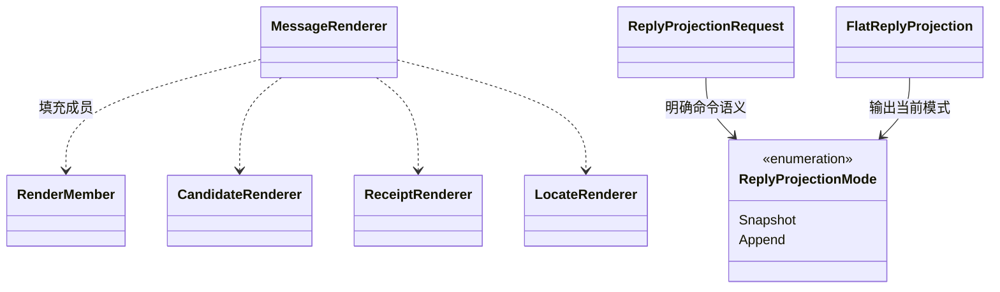

### `src/query/render_ready/` 流程图

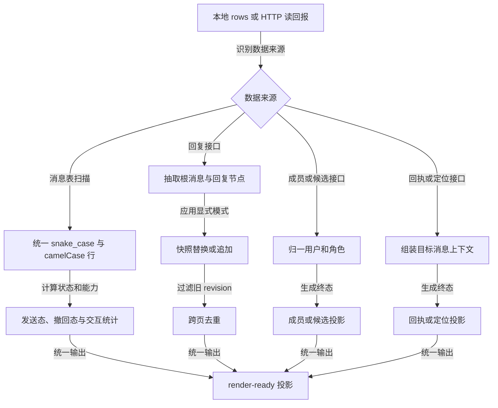

## 10. `src/todo/` 文件夹

### 类图

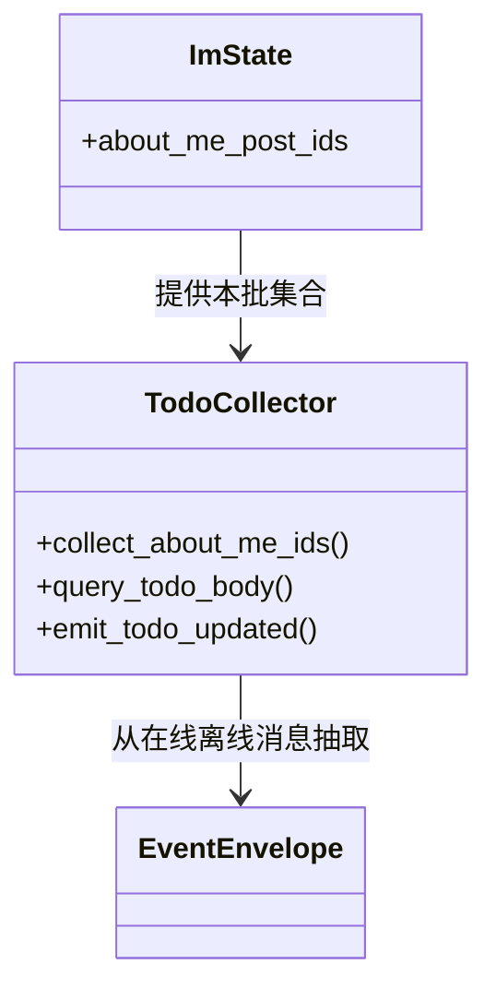

### 流程图


## 11. `src/outbound/` 文件夹

### 文件职责

`registry.rs` 定义 `OutboundCommand` Strategy、`Gateway` 和 linkme 注册表；`send_build.rs` 构造 `posts/create` 请求、身份快照和乐观存储行；`mod.rs` 汇总五个子域；`registry_tests.rs` 锁定重复注册、错配、计数和闭集。

### `src/outbound/` 类图

```mermaid
classDiagram
  class OutboundCommand {
    <<interface>>
    +name()
    +build(args)
    +path_override(args)
    +auth_kind()
    +method()
    +is_read()
    +gateway()
  }
  class OutboundRegistration
  class OutboundRegistry
  class Gateway {
    <<enumeration>>
    Im
    Default
  }
  class HttpEffect
  class BuildInput
  class UserIdentity
  OutboundRegistration --> OutboundCommand : 注册命令策略
  OutboundRegistry o-- OutboundRegistration : 静态闭集
  OutboundCommand --> Gateway : 选择业务网关
  OutboundRegistry --> HttpEffect : 构造通用请求意图
  BuildInput o-- UserIdentity : 构建发送快照
```

### `src/outbound/` 总流程图

```mermaid
flowchart TD
  A["语义命令和 snake_case 参数"] -->|按名称查找| B["123 项注册表"]
  B -->|Strategy 校验| C["构造真实 wire body"]
  C -->|选择静态或动态路径| D["形成请求路径"]
  D -->|按命令声明选择| E["IM 或默认业务网关"]
  E -->|只附加鉴权意图| F["Session 或 Bot 标记"]
  F -->|补 connectionId 和追踪标识| G["输出 HTTP Effect"]
  G -->|判断命令语义| H{"是否读族"}
  H -->|是| I["登记 correlation 并等待 HTTP body"]
  H -->|否| J["等待 WS 权威回声或结束"]
```

## 12. `src/outbound/posts/` 文件夹

### 文件职责

`existing.rs` 覆盖已读、撤回和排程；`read.rs`、`read_ext.rs` 覆盖读族；`announcement.rs`、`approval.rs`、`props.rs`、`relay.rs` 覆盖公告、审批、属性和转发。

### `src/outbound/posts/` 类图

```mermaid
classDiagram
  class PostReadCommand
  class RevokeCommand
  class ScheduleCommand
  class AnnouncementCommand
  class ApprovalPostCommand
  class UpdatePostPropsCommand
  class CreatePostsCommand
  class OutboundCommand {
    <<interface>>
  }
  OutboundCommand <|.. PostReadCommand
  OutboundCommand <|.. RevokeCommand
  OutboundCommand <|.. ScheduleCommand
  OutboundCommand <|.. AnnouncementCommand
  OutboundCommand <|.. ApprovalPostCommand
  OutboundCommand <|.. UpdatePostPropsCommand
  OutboundCommand <|.. CreatePostsCommand
```

### `src/outbound/posts/` 流程图

```mermaid
flowchart LR
  A["消息类命令"] -->|判断命令语义| B{"写族或读族"}
  B -->|写族| C["组装消息操作请求"]
  C -->|发送到服务端| D["等待 post 或 post_update 回声"]
  B -->|读族| E["组装分页、上下文、回复或检索请求"]
  E -->|HTTP body 回灌| F["read relay 和 render-ready"]
  D -->|权威事件到达| G["WS Handler 落库并投影"]
```

## 13. `src/outbound/channel_admin/` 文件夹

### 文件职责

`change.rs`、`change_dedicated.rs` 管频道设置；`create.rs` 建群；`existing.rs` 管退群/关闭等既有频道操作；`member_admin.rs` 管成员；`pinned.rs` 管置顶；`read.rs` 管频道读族。

### `src/outbound/channel_admin/` 类图

```mermaid
classDiagram
  class ChangeInfoCommand
  class ChangeSourceCommand
  class ChangePictureCommand
  class ChangeNoticeCommand
  class CreateChannelCommand
  class MemberAdminCommand
  class PinnedCommand
  class ChannelReadCommand
  class OutboundCommand {
    <<interface>>
  }
  OutboundCommand <|.. ChangeInfoCommand
  OutboundCommand <|.. ChangeSourceCommand
  OutboundCommand <|.. ChangePictureCommand
  OutboundCommand <|.. ChangeNoticeCommand
  OutboundCommand <|.. CreateChannelCommand
  OutboundCommand <|.. MemberAdminCommand
  OutboundCommand <|.. PinnedCommand
  OutboundCommand <|.. ChannelReadCommand
```

### `src/outbound/channel_admin/` 流程图

```mermaid
flowchart LR
  A["频道治理命令"] -->|提取频道、成员与设置| B["转换为后端 camelCase 请求"]
  B -->|进入统一注册表| C["发送 HTTP"]
  C -->|判断回声合同| D{"是否存在 WS 权威回声"}
  D -->|有| E["频道 Handler 落库并发终态投影"]
  D -->|无且为读族| F["HTTP 回报发布 read-result"]
  D -->|无且为写族| G["只确认命令接收，不伪造服务端事件"]
```

## 14. `src/outbound/engagement/` 文件夹

### 文件职责

`quick_reply.rs`、`template_received.rs`、`urgent.rs`、`vote_score.rs` 分别处理快捷回复、模板确认、加急、投票/评分。投票和评分使用 `Gateway::Default`，其余走 IM 网关。

### `src/outbound/engagement/` 类图

```mermaid
classDiagram
  class QuickReplyCommand
  class TemplateReceivedCommand
  class UrgentCommand
  class VoteScoreCommand
  class Gateway {
    <<enumeration>>
    Im
    Default
  }
  QuickReplyCommand --> Gateway : 选择IM网关
  TemplateReceivedCommand --> Gateway : 选择IM网关
  UrgentCommand --> Gateway : 选择IM网关
  VoteScoreCommand --> Gateway : 选择默认业务网关
```

### `src/outbound/engagement/` 流程图

```mermaid
flowchart LR
  A["互动命令"] -->|判断互动类型| B{"互动类型"}
  B -->|快捷回复、模板或加急| C["构造 IM 请求"]
  B -->|投票或评分| D["构造默认网关请求"]
  C -->|发送写族请求| E["等待 post_update 回声"]
  D -->|读族| F["等待 HTTP 回灌"]
  D -->|写族| G["等待服务端终态"]
```

## 15. `src/outbound/user_misc/` 文件夹

### 文件职责

`core.rs` 用宏注册 users、teams、modules、notifications、search、bookmark 等命令；`helpers.rs` 负责通用字段翻译；`mod.rs` 汇总导出。

### `src/outbound/user_misc/` 类图

```mermaid
classDiagram
  class UserMiscMacro
  class UserCommand
  class TeamCommand
  class ModuleCommand
  class NotificationCommand
  class SearchCommand
  class OutboundCommand {
    <<interface>>
  }
  UserMiscMacro ..> UserCommand : 生成实现
  UserMiscMacro ..> TeamCommand : 生成实现
  UserMiscMacro ..> ModuleCommand : 生成实现
  UserMiscMacro ..> NotificationCommand : 生成实现
  UserMiscMacro ..> SearchCommand : 生成实现
  OutboundCommand <|.. UserCommand
  OutboundCommand <|.. TeamCommand
  OutboundCommand <|.. ModuleCommand
  OutboundCommand <|.. NotificationCommand
  OutboundCommand <|.. SearchCommand
```

### `src/outbound/user_misc/` 流程图

```mermaid
flowchart LR
  A["用户、团队、模块、通知或搜索命令"] -->|宏生成 Strategy| B["OutboundCommand 实现"]
  B -->|共享 helpers 转换字段| C["后端 wire 参数"]
  C -->|登记静态命令| D["统一注册表"]
  D -->|选择网关与鉴权| E["HTTP Effect"]
```

## 16. `src/outbound/bot_agent/` 文件夹

### 文件职责

`gateway.rs`、`bot_manage.rs`、`config.rs`、`calls.rs`、`agents.rs`、`webhook.rs` 分别覆盖网关、Bot 管理、配置、Bot token 调用、Agent 和 Webhook。动态路径统一做 path segment 校验。

### `src/outbound/bot_agent/` 类图

```mermaid
classDiagram
  class BotCommandMacro
  class SessionBotCommand
  class BotTokenCommand
  class OutboundCommand {
    <<interface>>
  }
  class AuthKind {
    <<enumeration>>
    Session
    Bot
  }
  BotCommandMacro ..> SessionBotCommand : 生成会话命令
  BotCommandMacro ..> BotTokenCommand : 生成机器人命令
  OutboundCommand <|.. SessionBotCommand
  OutboundCommand <|.. BotTokenCommand
  SessionBotCommand --> AuthKind : 标记Session意图
  BotTokenCommand --> AuthKind : 标记Bot意图
```

### `src/outbound/bot_agent/` 流程图

```mermaid
flowchart LR
  A["Bot 或 Agent 命令"] -->|判断鉴权身份| B{"调用身份"}
  B -->|当前用户会话| C["管理 Bot、配置、频道和 Webhook"]
  B -->|机器人令牌| D["Agent 信息、发消息和查团队成员"]
  C -->|只标记意图| E["Session 鉴权标记"]
  D -->|只标记意图| F["Bot 鉴权标记"]
  E -->|到达 driver 横切层| G["注入真实凭据"]
  F -->|到达 driver 横切层| G
```

## 17. `src/ws/` 文件夹

### 文件职责

`frame.rs` 只解析一次 JSON 并提取 action/event_seq；`context.rs` 给 Handler 提供窄状态上下文；`registry.rs` 定义 `WsMessageHandler` Strategy 和 28 项注册；`mod.rs` 为内部门面。

### `src/ws/` 类图

```mermaid
classDiagram
  class WsFrame {
    -raw
    -root
    +parse()
    +action()
    +event_seq()
  }
  class ImWsContext
  class WsMessageHandler {
    <<interface>>
    +action()
    +handle(ctx, frame, out)
  }
  class WsHandlerRegistration
  class WsRegistry
  WsHandlerRegistration --> WsMessageHandler : 注册策略
  WsRegistry o-- WsHandlerRegistration : 静态动作表
  WsRegistry --> WsFrame : 按动作选择
  WsRegistry --> ImWsContext : 提供状态访问
```

### `src/ws/` 路由流程图

```mermaid
flowchart TD
  A["Tick 入站字节"] -->|单次 JSON 解析| B["WsFrame"]
  B -->|判断动作来源| C{"是否有显式 action"}
  C -->|有| D["使用服务端 action"]
  C -->|无且为 pong 补偿帧| E["合成 pong action"]
  C -->|其他无 action| F["合成 legacy action"]
  D -->|平均常数时间查找| G["选择 Handler"]
  E -->|平均常数时间查找| G
  F -->|平均常数时间查找| G
  G -->|找到注册项| H["更新纯状态并输出 Effect"]
  G -->|未知 action| I["返回不支持动作错误"]
```

## 18. `src/ws/parser/` 文件夹

### 文件职责

`core.rs` 解析 `EventEnvelope`、`IncrementChannel` 和四态 `SyncResponse`，并按 bucket 确定性排序；`post_props.rs` 合并 quickReply 等服务端消息属性；`mod.rs` 为导出门面。

### `src/ws/parser/` 类图

```mermaid
classDiagram
  class WsParser
  class EventEnvelope
  class IncrementChannel
  class SyncResponse
  class PostFields
  WsParser --> EventEnvelope : 解析在线事件
  WsParser --> IncrementChannel : 解析增量水位
  WsParser --> SyncResponse : 解析同步四态
  EventEnvelope *-- PostFields : 携带消息字段
```

### `src/ws/parser/` 流程图

```mermaid
flowchart LR
  A["外部 JSON"] -->|校验信封和字段| B{"载荷种类"}
  B -->|在线事件| C["生成 EventEnvelope"]
  B -->|频道增量| D["生成 IncrementChannel"]
  B -->|同步响应| E["生成四态 SyncResponse"]
  C -->|消除 HashMap 迭代随机性| F["按频道和序号确定性排序"]
  E -->|消除批次随机性| F
```

## 19. `src/ws/handlers/` 文件夹

### 文件分组

- 连接与同步：`hello.rs`、`pong.rs`、`increment_channel.rs`、`increment_channel_end.rs`。
- 消息：`post.rs`、`post_update.rs`、`posts_update.rs`、`post_read.rs`、`post_pin.rs`、排程事件、`posted.rs`。
- 频道：创建、关闭、成员、角色、频道更新、昵称、公告、审批、退公司。
- 兼容与辅助：`legacy_event.rs`、`ignored.rs`、`gate.rs`、`post_echo_settle.rs`、`mod.rs`。

`status_change`、`multiple_channels_viewed`、`typing`、`presence` 明确忽略；`posted`、`post_urgent`、`post_edited` 当前是显式 dead/no-op 路由，避免误入真实 `post` 链。

### `src/ws/handlers/` 类图

```mermaid
classDiagram
  class WsMessageHandler {
    <<interface>>
  }
  class HelloHandler
  class PongHandler
  class PostHandler
  class IncrementHandler
  class ChannelHandler
  class IgnoredHandler
  WsMessageHandler <|.. HelloHandler
  WsMessageHandler <|.. PongHandler
  WsMessageHandler <|.. PostHandler
  WsMessageHandler <|.. IncrementHandler
  WsMessageHandler <|.. ChannelHandler
  WsMessageHandler <|.. IgnoredHandler
```

### `src/ws/handlers/` 流程图

```mermaid
flowchart TD
  A["注册表选中 Handler"] -->|判断事件领域| B{"事件领域"}
  B -->|连接问候帧| C["完成握手、重置会话批次并触发增量"]
  B -->|心跳响应帧| D["解析 gap 或 hash 不一致并补偿同步"]
  B -->|消息内容| E["先做发送回声对账，再进入频道 gate"]
  B -->|消息编辑、撤回或已读| F["按 event_seq 进入共享 gate"]
  B -->|频道或成员变化| G["更新频道或成员存储并发投影"]
  B -->|增量开始或结束| H["更新水位、调度同步和待办查询"]
  B -->|兼容或忽略事件| I["legacy 解析或显式无操作"]
  E -->|持久化后| J["推进游标并发布消息与会话投影"]
  F -->|持久化后| J
  G -->|形成频道终态| K["发布频道投影"]
  H -->|进入受限调度| L["SyncScheduler"]
```

## 20. `contracts/` 文件夹

### 合同类图

```mermaid
classDiagram
  class StrictMatrixSchema
  class StrictMatrixV1
  class StrictMatrixContractTest
  StrictMatrixV1 --> StrictMatrixSchema : 必须通过结构校验
  StrictMatrixContractTest --> StrictMatrixV1 : 校验Gate闭集
  StrictMatrixContractTest --> StrictMatrixSchema : 校验拒绝错误输入
```

### 合同验证流程图

```mermaid
flowchart LR
  A["读取 strict-matrix.v1.json"] -->|按 JSON Schema 校验| B["检查 Gate 唯一性和必填证据面"]
  B -->|生成文档和消费产物| C["对账生成结果"]
  C -->|全部一致| D["合同层通过"]
  B -->|缺字段、重复或 alias 混入| E["立即失败"]
  C -->|生成物漂移| E
```

## 21. `tests/` 文件夹

### 验证对象类图

```mermaid
classDiagram
  class CommonHarness
  class ReplayHarness
  class GateTests
  class SendTests
  class SyncTests
  class WsTests
  class QueryProjectionTests
  class OutboundTests
  class StrictMatrixTests
  class StressTests
  CommonHarness --> GateTests
  CommonHarness --> SendTests
  CommonHarness --> SyncTests
  ReplayHarness --> WsTests
  CommonHarness --> QueryProjectionTests
  CommonHarness --> OutboundTests
  CommonHarness --> StrictMatrixTests
  CommonHarness --> StressTests
```

### 验证流程图

```mermaid
flowchart TD
  A["固定 Tick 剧本、真实 Go frame 或 golden fixture"] -->|喂入同一 ImModule| B["采集有序 Effect"]
  B -->|回灌持久化、HTTP 和 timer 结果| C["推进完整状态机"]
  C -->|检查状态| D["cursor、pending、sync window"]
  C -->|检查输出| E["StorageOp、HTTP、WS、投影 schema"]
  D -->|满足不变量| F["领域状态验证通过"]
  E -->|满足合同| G["边界输出验证通过"]
  F -->|压力与破坏性证伪也通过| H["形成可发布代码证据"]
  G -->|压力与破坏性证伪也通过| H
```

`tests/` 当前有 51 个集成测试文件；fixture 主要位于 `tests/fixtures/f5/` 与 `tests/fixtures/real_go_frames/`。测试覆盖不等于远端 runtime green，真链路仍需 Strict Matrix 的环境和证据包。

## 22. `benches/` 文件夹

### 基准类图

```mermaid
classDiagram
  class GateBench
  class StepInOrderBench
  class ChannelGate
  class ImModule
  GateBench --> ChannelGate : 测量乱序与决策热点
  StepInOrderBench --> ImModule : 测量连续事件step吞吐
```

### 基准流程图

```mermaid
flowchart LR
  A["准备连续或乱序事件序列"] -->|预热状态机| B["重复执行 ingest 或 step"]
  B -->|记录延迟和吞吐| C["Criterion 统计"]
  C -->|比较性能基线| D["判断 gate 或 step 是否退化"]
```

## 23. `docs/` 文件夹

### 文档族类图

```mermaid
classDiagram
  class CurrentArchitectureIndex
  class ProjectionSchema
  class StrictMatrixDocs
  class CsesApiMigrationMap
  class UcAutomationDocs
  class EventBusDocs
  class LegacyDesignDiagrams
  CurrentArchitectureIndex --> ProjectionSchema : 读取投影真源
  CurrentArchitectureIndex --> StrictMatrixDocs : 读取发布证据合同
  CurrentArchitectureIndex --> CsesApiMigrationMap : 读取HTTP和WS全图
  CurrentArchitectureIndex --> UcAutomationDocs : 读取命令闭集
  CurrentArchitectureIndex --> EventBusDocs : 读取下游语义
  CurrentArchitectureIndex --> LegacyDesignDiagrams : 仅作历史参考
```

### 文档阅读流程图

```mermaid
flowchart TD
  A["先读本页当前代码架构"] -->|掌握模块边界| B["读 projection-schema 和 Strict Matrix"]
  B -->|需要接口全景| C["读 csesapi-migration full-map"]
  C -->|需要命令和自动化| D["读 uc-automation"]
  D -->|需要下游事件语义| E["读 eventbus"]
  E -->|需要历史设计背景| F["最后按需读 docs/design"]
  F -->|出现旧路径或旧计数| G["回到当前源码和本索引裁决"]
```

旧 `docs/design` 仍写“7 类 handler”、旧 `CorrelationContext` 数量，并引用迁移前文件路径；它不再是 current snapshot。当前命令/WS 计数必须以 registry 和 live test 为准。
