# helix-driver-host 架构

> 目录：`crates/helix-driver-host`。这是 native 与 FFI 共用的宿主 I/O 和事件泵单一实现。

## 1. crate 模块

### 职责

该 crate 接收 `ExecutionShell` 产出的 Effect，将借用数据转换为 owned 数据，再兑现为 SQLite、HTTP、上传、WebSocket、计时器或事件出口，并把带 correlation 的结果回灌为 `Tick::PortReply`。

### crate 类图

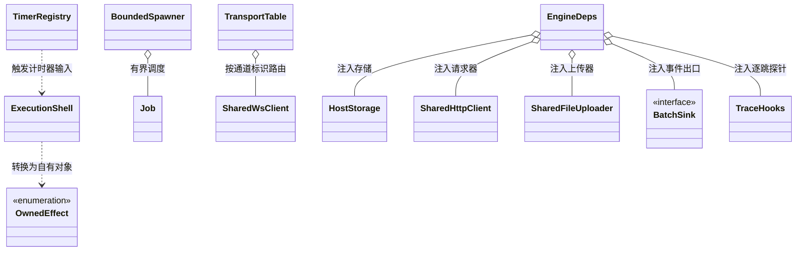

### crate 主流程图

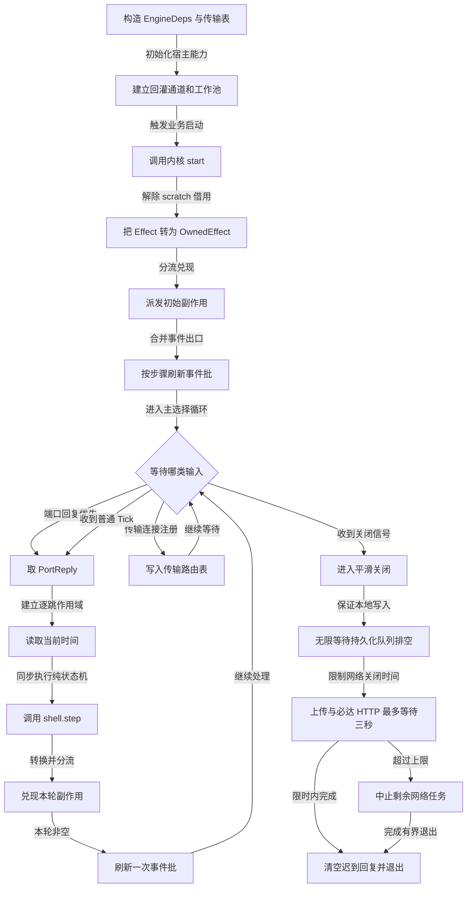

## 2. `src/` 文件夹

### 文件职责

| 文件 | 关键类型/入口 | 作用 |
|---|---|---|
| `lib.rs` | 公共 facade | 导出 20 个模块和队列容量常量 |
| `engine.rs` | `EngineDeps`、`run_engine_loop` | pump 主循环、优先级和关闭排空 |
| `owned_effect.rs` | `OwnedEffect`、`consume_effects` | 解除 core scratch 借用，允许后续 async |
| `dispatch.rs` | `dispatch_effects` | Effect 分流总入口 |
| `spawner.rs` | `BoundedSpawner`、`Overflow` | 有界 worker、Block/DropNewest 和关闭策略 |
| `pools.rs` | pool 工厂 | 创建 Persist、HTTP、上传 worker |
| `ops.rs` | `execute_storage_ops` | 顺序执行 StorageOp、结果编码和错误分类 |
| `batch_sink.rs` | `BatchSink` | 给 EventSink 增加每 step 一次 `flush` |
| `instrument.rs` | `RecordingSink` | observe-first 的事件出口装饰器 |
| `timer.rs` | `TimerRegistry` | 调度、取消、惰性回收一次性 timer |
| `codec.rs` | rows codec | SQLite row 与 PortReply JSON 互转 |
| `http_envelope.rs` | `run_http_envelope` | HTTP 响应编码为 status/headers/base64 body |
| `upsert_sql.rs` | SQL shape cache | 按表/列/conflict key 缓存 upsert SQL |
| `storage.rs` | `HostStorage`、`ReadPool` | 1 写 + 4 读、WAL、spawn_blocking、8 类操作 |
| `local_store.rs` | `LocalStoreLocator` | 多租户稳定 store key、tenant.db、manifest |
| `network_util.rs` | 私有纯函数 | URL/header 校验、合并和错误转换 |
| `network.rs` | shared HTTP/WS | 共享头、请求、push/pull WS 和状态机 |
| `http_cross.rs` | `CrossCuttingHttp` | 鉴权意图、trace、401/离线事件装饰 |
| `upload.rs` | `SharedFileUploader` | 64 KiB 流式 PUT 上传 |
| `reconnect.rs` | reconnect supervisor | 指数退避和重新注册 transport |
| `trace.rs` | `TraceCarrier`、`TraceHooks` | W3C carrier、6 个 hop、command sidecar |
| `otel.rs` | `HostOtelRuntime` | span 快照、OTLP worker 和重试 |
| `dispatch_tests.rs` | cfg test 子模块 | 分流、上传、trace 和 reply JSON |
| `spawner_tests.rs` | cfg test 子模块 | 背压、保序、超时中止与回灌 |

### `src/` 总类图

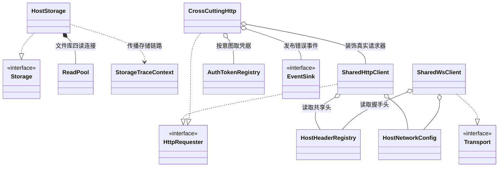

### Effect 分流流程图

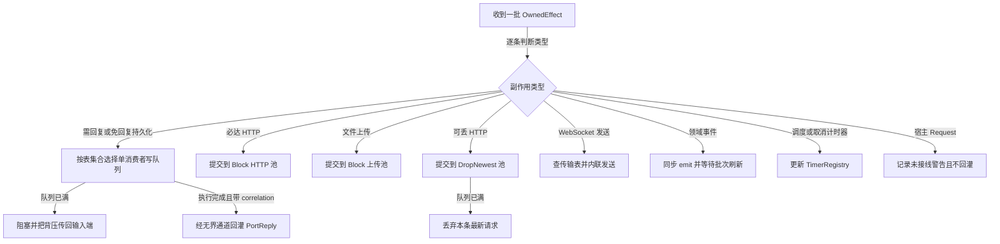

`Effect::Request` 当前仍是 deferred stub，只记录警告，不产生 `PortReply`。任何文档都不应把这条链描述为已闭合。

## 3. `src/storage.rs` 所属存储子域

### 类图

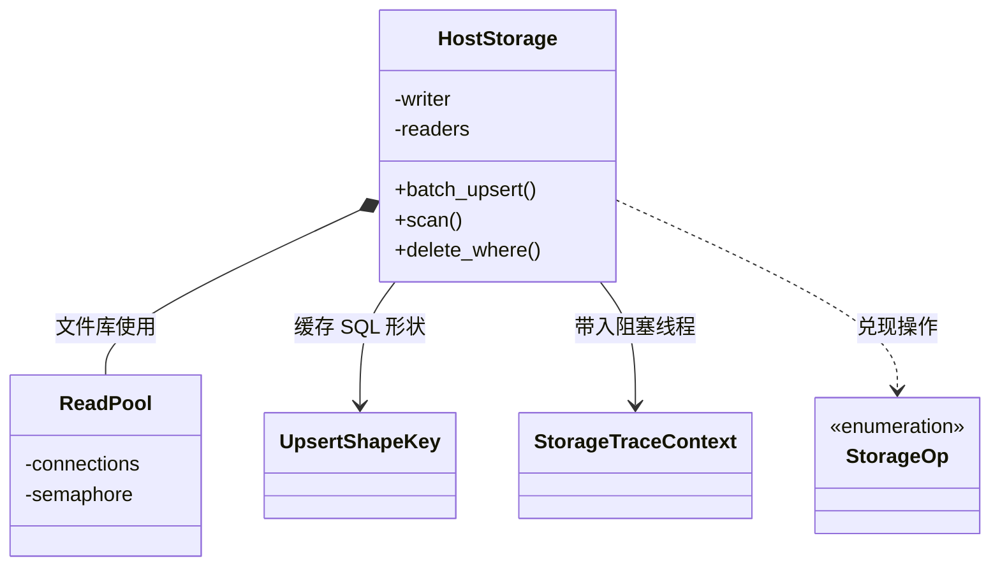

### 存储流程图

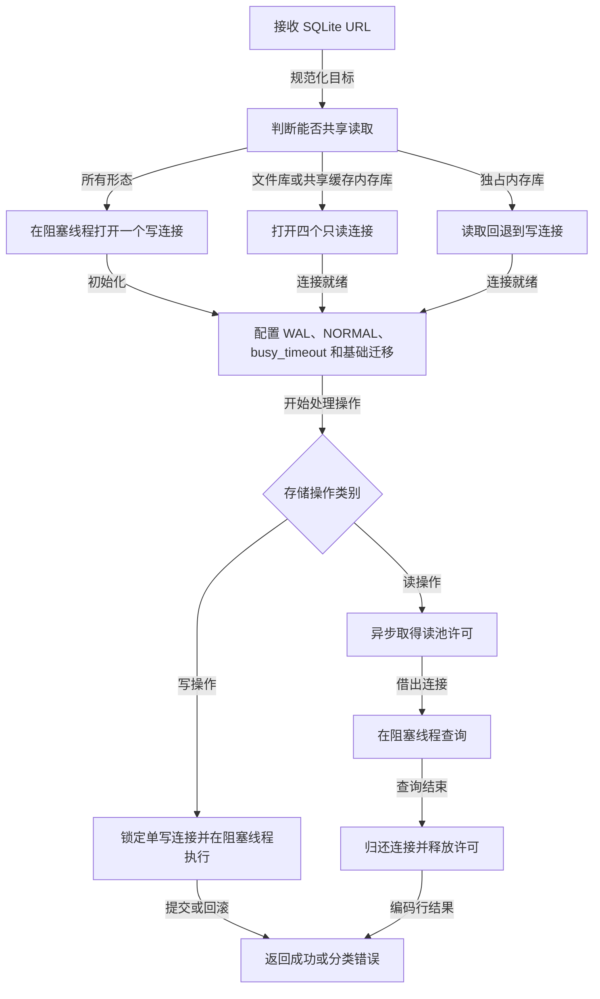

### 存储状态图

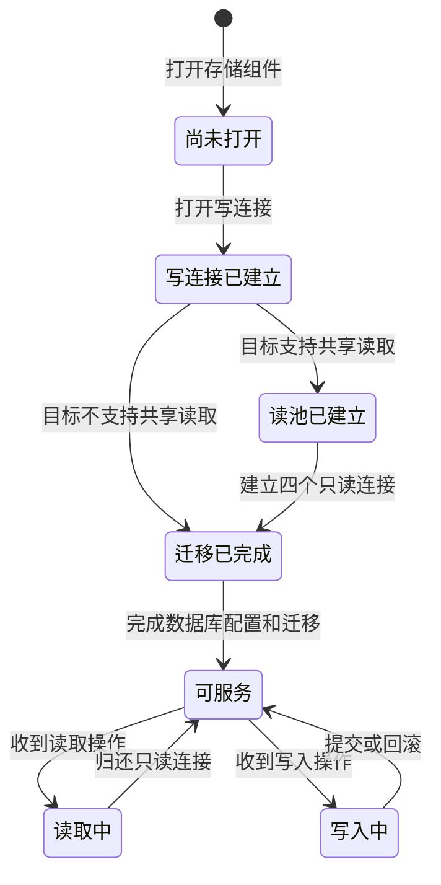

存储复杂度：主键/唯一键 upsert 依赖 SQLite 索引，通常 O(log n)；一批 k 行为 O(k log n)；Scan 由 spec 限定条件/排序并设置 10000 硬上限；同 table-set 写入由 N=1 worker 保序。

## 4. `src/network.rs` 与 `src/http_cross.rs` 网络子域

### 类图

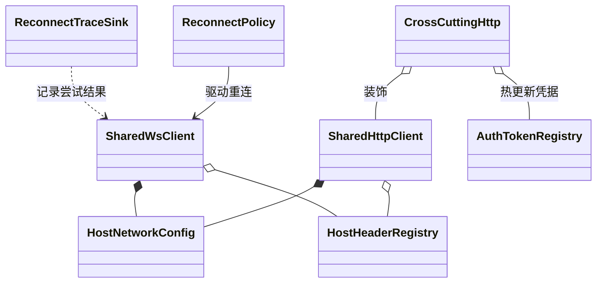

### HTTP 横切流程图

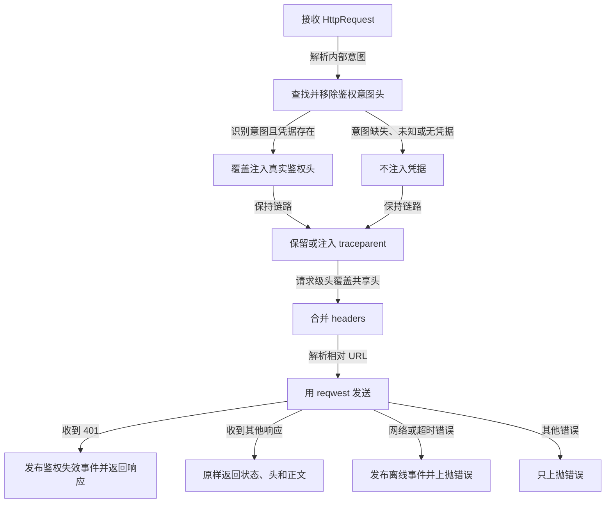

### WebSocket 与重连状态图

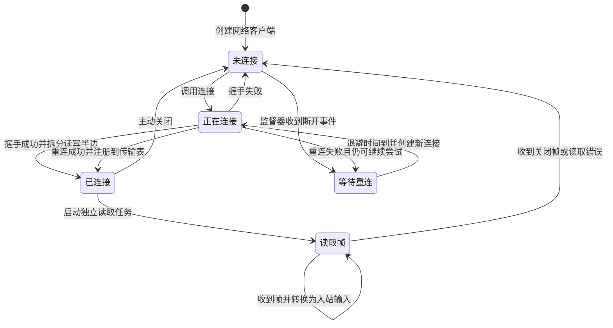

## 5. `src/trace.rs` 与 `src/otel.rs` 可观测子域

### 类图

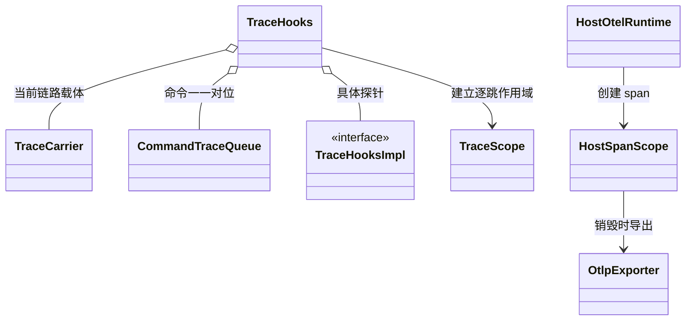

### Trace 流程图

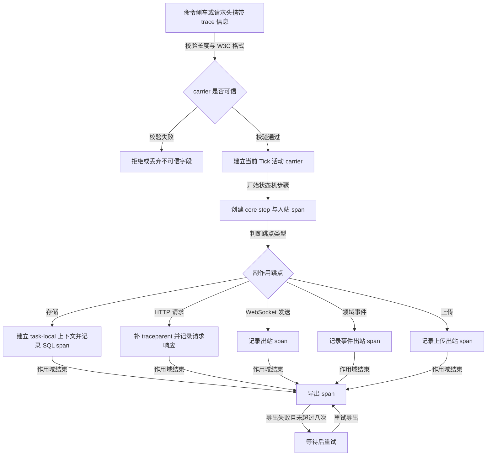

## 6. `src/local_store.rs` 多租户路径子域

### 类图

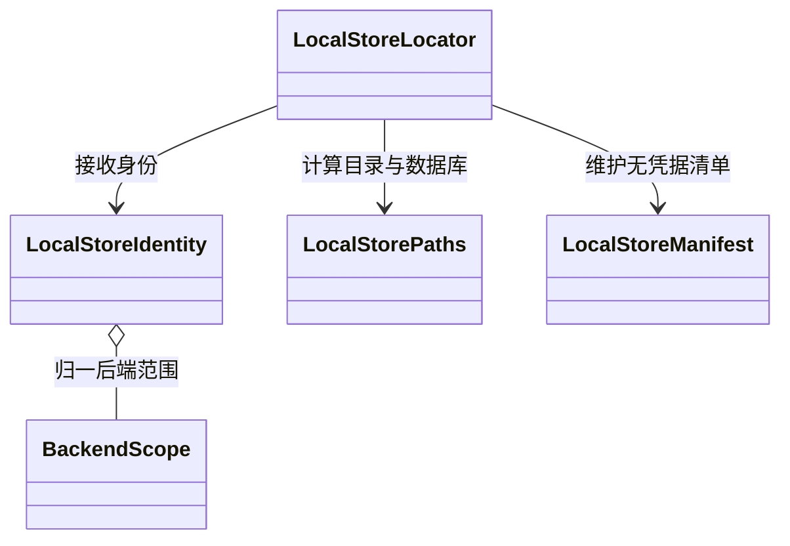

### 路径派生流程图

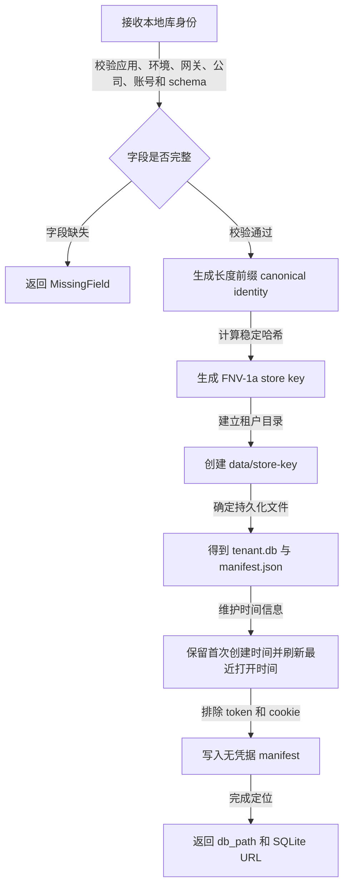

## 7. `tests/` 文件夹

### 验证对象类图

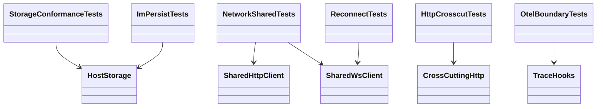

### 验证流程图

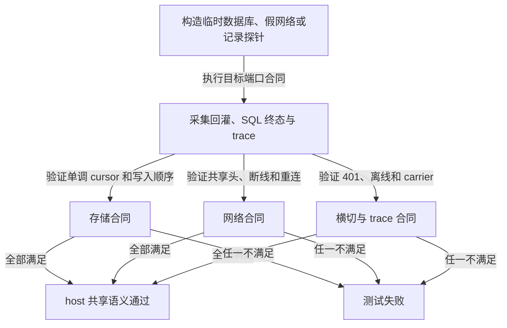

## 8. `benches/` 文件夹

### 基准关系类图

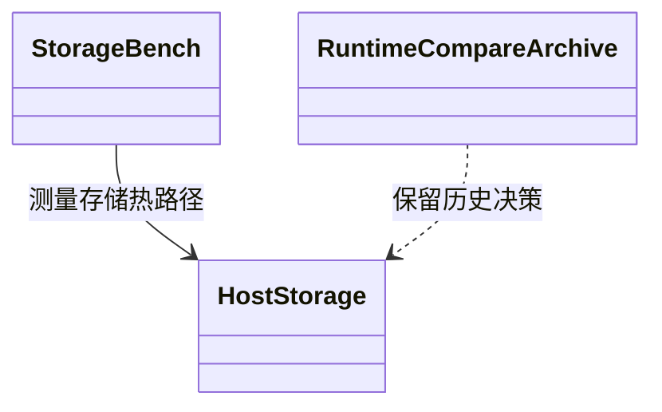

### 基准流程图

`storage_bench` 是 Cargo 注册的 active bench；`runtime_compare.rs` 当前未注册，只保留历史实现/决策参考。

## 9. `docs/design/` 文件夹

### 文档关系类图

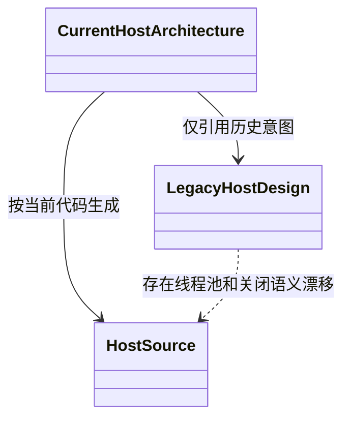

### 阅读流程图

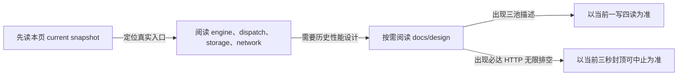
