# helix-driver-native 与 helix-host-cli 架构

> `helix-driver-native` 是 PC/Tauri 的具体端口薄壳；`helix-host-cli` 是复用它的无 UI 联调宿主和 SQLite 检查工具。两者不拥有 IM 业务规则。

## 1. `helix-driver-native` crate 模块

### 模块类图

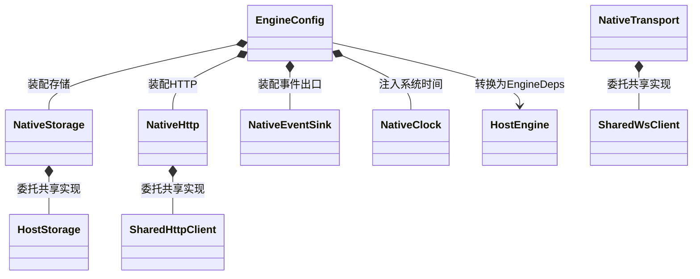

### 模块流程图

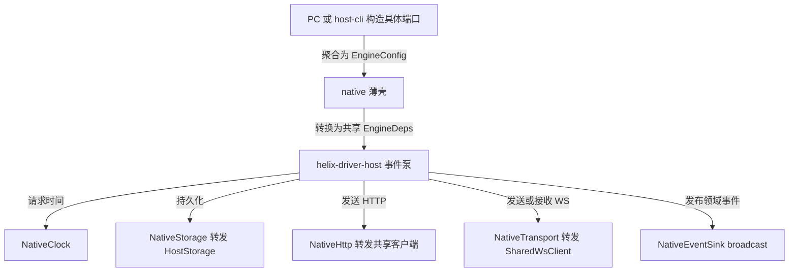

## 2. `helix-driver-native/src/` 文件夹

### 文件职责

| 文件 | 关键类型 | 作用 |
|---|---|---|
| `lib.rs` | facade | 导出 native adapters 和 host 兼容 API |
| `clock.rs` | `NativeClock` | 用 `SystemTime` 实现 `Clock` |
| `storage.rs` | `NativeStorage` | 完整转发 8 个 Storage 操作到 `HostStorage` |
| `http.rs` | `NativeHttp` | Plain/Cross 两种形态，当前 host-cli 实际使用 crosscut |
| `transport.rs` | `NativeTransport` | 包装 shared WS、握手头、入站 Tick、幂等断开 |
| `engine_loop.rs` | `EngineConfig`、`TransportTable` | 只装配具体端口并调用 host pump |
| `event_sink.rs` | `NativeEventSink`、`EventReceiver` | Tokio broadcast，显式暴露 Lagged |
| `bus_guard.rs` | `GuardedEnvelope` | 防 `im:__*` 自环并归一数组 data |

### `src/` 类图

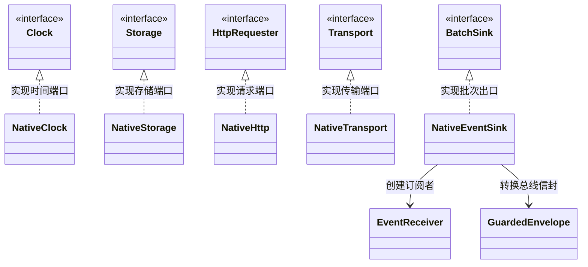

### WebSocket 入站状态图

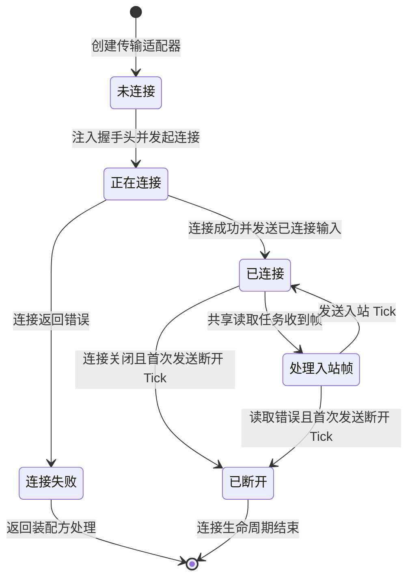

### native 事件出口流程图

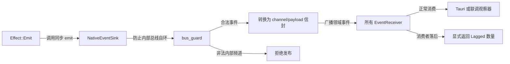

## 3. `helix-driver-native/tests/` 文件夹

### 验证类图

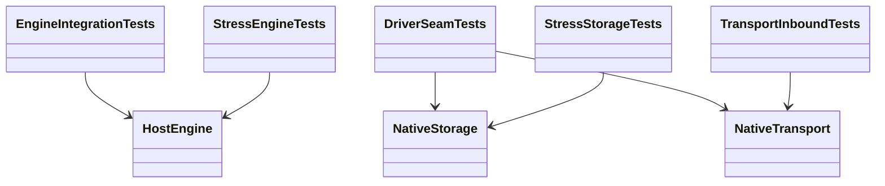

### 验证流程图

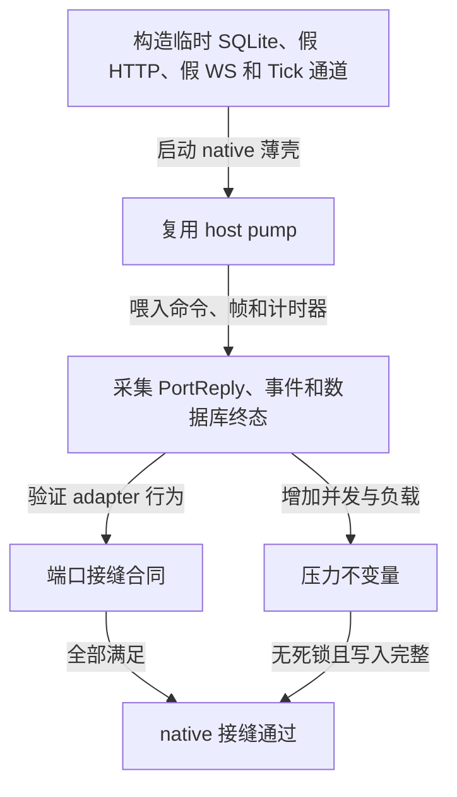

## 4. `helix-driver-native/benches/` 文件夹

### 基准类图

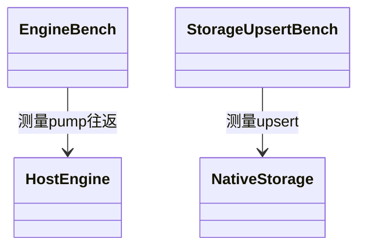

### 基准流程图


## 5. `helix-driver-native/docs/design/` 文件夹

### 文档类图

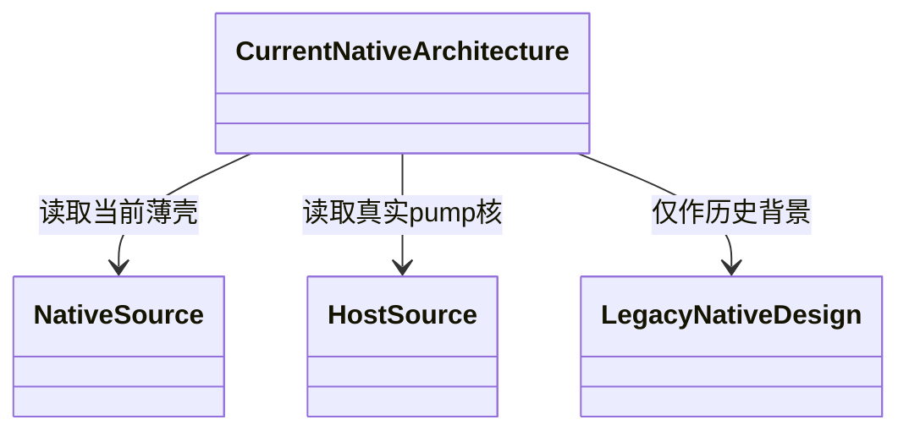

### 阅读流程图

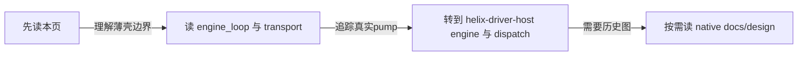

## 6. `helix-host-cli` crate 模块

### 模块类图

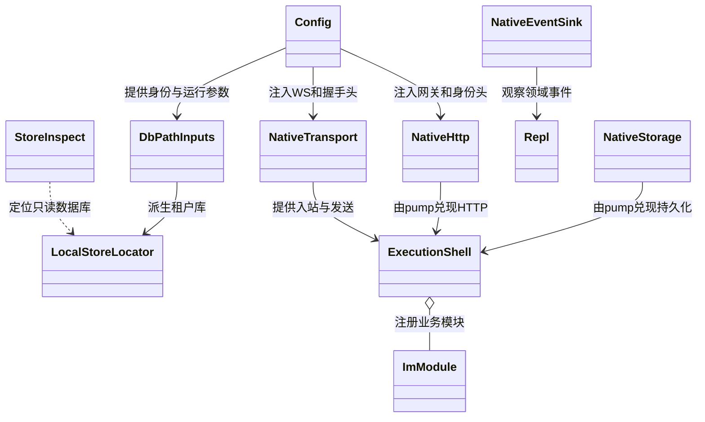

### 模块装配流程图

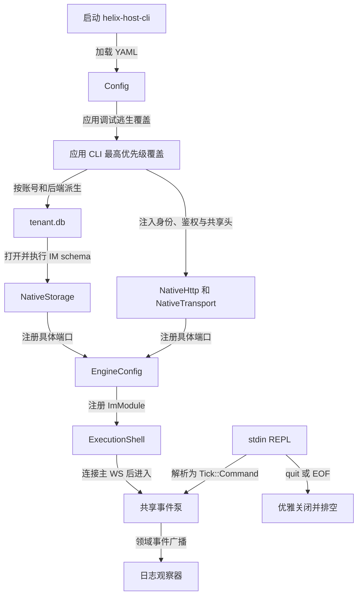

## 7. `helix-host-cli/src/` 文件夹

### 文件职责

| 文件 | 作用 |
|---|---|
| `main.rs` | 配置、租户库、schema、HTTP/WS、IM、REPL、pump 总装配 |
| `config.rs` | YAML < debug env < CLI 覆盖模型 |
| `config_observability.rs` | OTel 配置模型；当前 main 尚未消费，不能声称已生效 |
| `config_tests.rs` | 配置默认值与覆盖测试 |
| `host_env.rs` | 默认业务网关、DB 路径和 device id 派生 |
| `cmd_parse.rs` | send/read/schedule/raw 等专用命令解析 |
| `cmd_parse_generic.rs` | `cmd <name> <json>` 通用逃生口 |
| `cmd_parse_member.rs` | nickname/role/notify 成员命令 |
| `repl.rs` | stdin 异步循环、错误不崩泵、quit/EOF 关闭 |
| `lib.rs` | 只公开 store inspect |
| `store_inspect.rs` | allowlist、只读 SQLite、脱敏和路径哈希 |
| `store_inspect_main.rs` | `helix-store-inspect` 二进制入口 |

### `src/` 配置类图

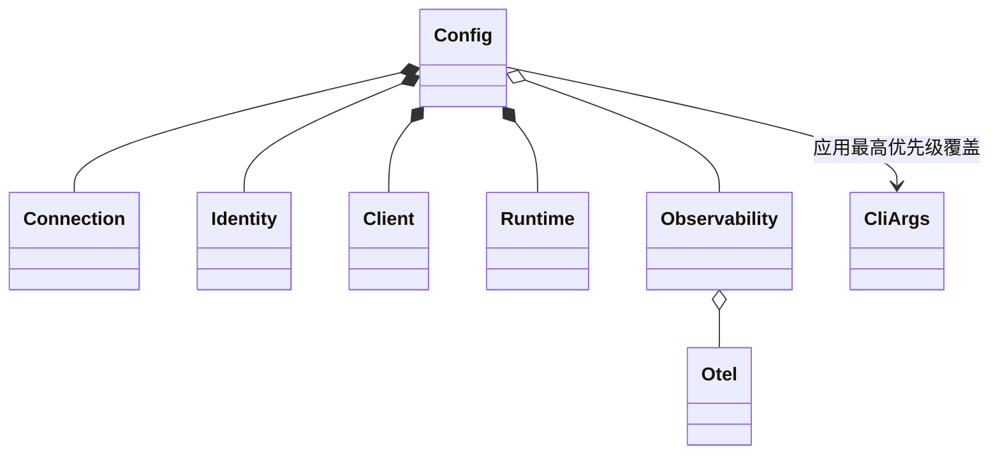

### `src/` 运行状态图

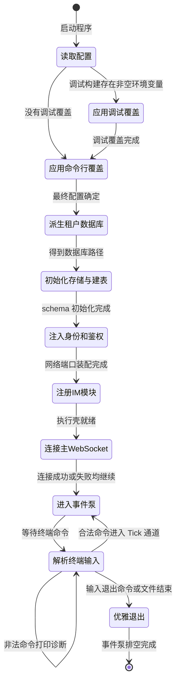

### store inspect 类图

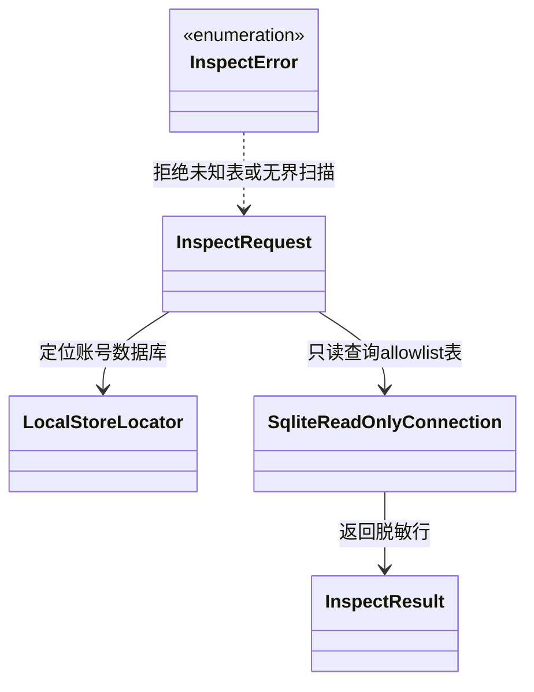

### store inspect 流程图

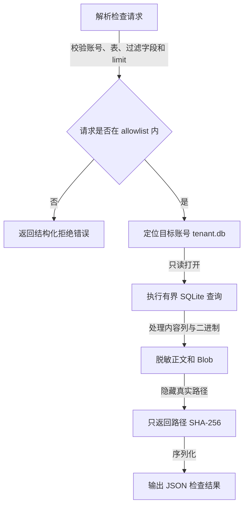

## 8. `helix-host-cli/tests/` 文件夹

### 验证类图

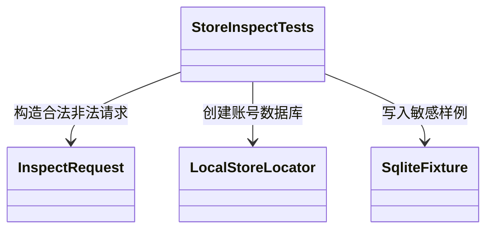

### 验证流程图

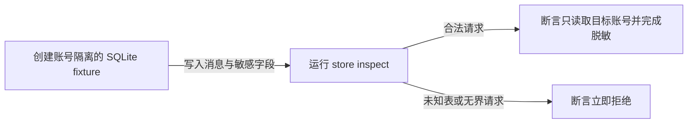

## 9. `helix-host-cli/docs/design/` 文件夹

### 文档类图

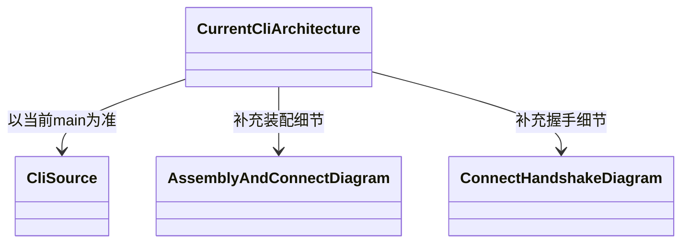

### 阅读流程图

```mermaid
flowchart LR
  A["先读本页装配全景"] -->|定位 main 入口| B["阅读 main、config、repl"]
  B -->|需要连接时序细节| C["阅读 assembly-and-connect.mmd"]
  C -->|需要握手字段| D["阅读 connect-handshake.mmd"]
  D -->|发现命令数量文案| E["回到 helix-im registry live test 裁决"]
```

REPL 中任何硬编码命令数量都不是真源；当前出站命令总数应以 `helix-im` registry 测试为准。`config_observability.rs` 能解析 OTel，但当前 `main.rs` 尚未消费该配置。
