# helix-driver-ffi 架构

> 目录：`crates/helix-driver-ffi`。这是 Flutter/C++ 宿主的 C ABI 薄壳。Rust 自持 SQLite、HTTP 和 WebSocket；C++ 只提供壁钟和批量领域事件回调。

## 1. crate 模块

### C ABI 面

当前导出 7 个冻结函数：`helix_create_with_network`、`helix_destroy`、`helix_set_header`、`helix_remove_header`、`helix_command`、`helix_query`、`helix_query_free`。W3C trace carrier 通过 `helix_command` payload 的保留 `__trace` metadata 传入，driver 入队前剥离，不增加 ABI 符号，也不进入业务 payload。

### crate 类图

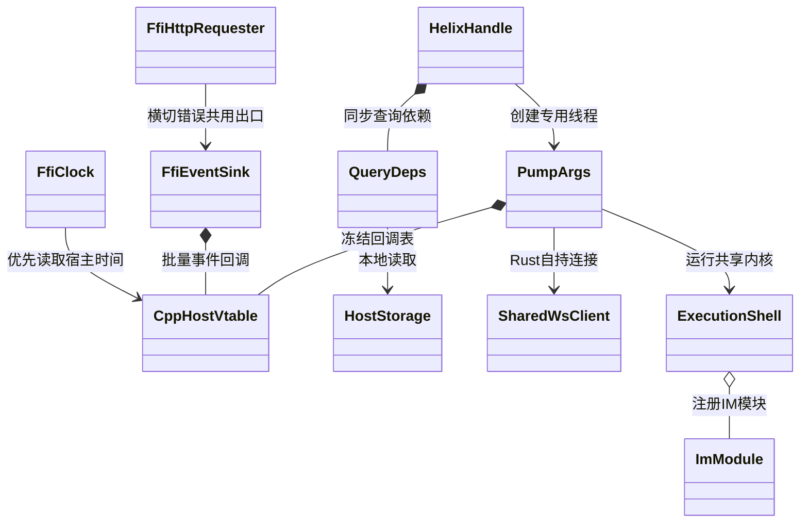

### crate 生命周期状态图

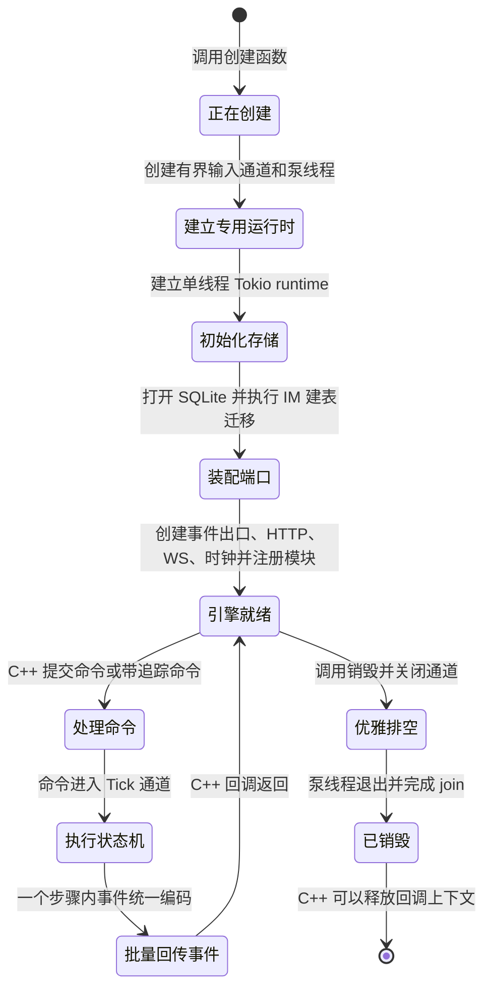

## 2. `src/` 文件夹

### 文件职责

| 文件 | 关键类型/入口 | 作用 |
|---|---|---|
| `lib.rs` | facade | 声明 C++ 直连模型和模块导出 |
| `api.rs` | `HelixHandle`、8 个 C ABI | 指针复制、返回码、线程和内存生命周期 |
| `pump.rs` | `PumpArgs`、`QueryDeps`、`run` | current-thread runtime、schema、端口、WS、重连和共享 pump |
| `vtable.rs` | `CppHostVtable` | `on_domain_events_batch`、`now_ms` 和 `ctx` |
| `event_sink.rs` | `FfiEventSink` | emit 只攒批，flush 才跨边界 |
| `batch.rs` | batch codec | 小端 `count + (len,payload)*` 编解码 |
| `clock.rs` | `FfiClock` | 优先 C++ `now_ms`，缺失才后退系统时间 |
| `http.rs` | `FfiHttpRequester` | 固定使用 crosscut shared HTTP |
| `api_tests.rs` | cfg test | 参数、UTF-8、busy/null、trace 和生命周期 |
| `api_e2e_tests.rs` | cfg e2e | 命令到批回调、建表到 query |

### `src/` 类图

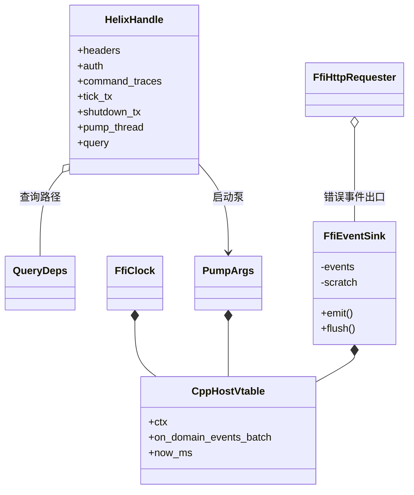

### create 流程图

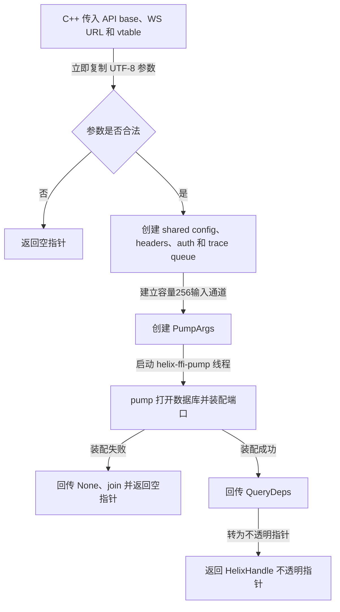

### command 流程图

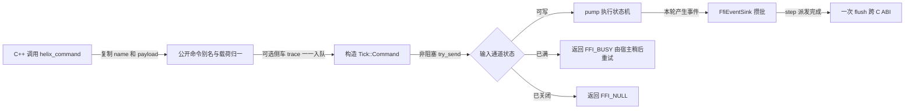

### query 流程图

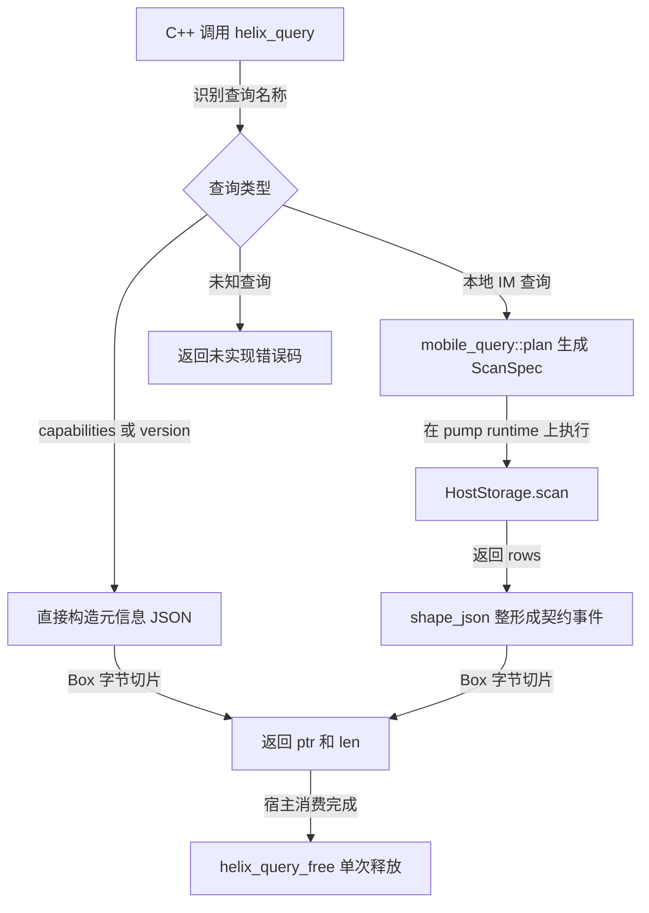

### destroy 流程图

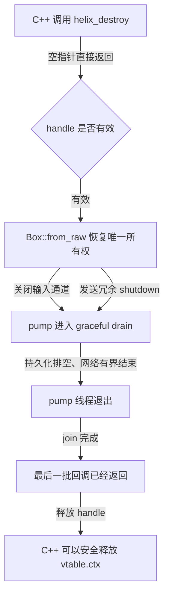

## 3. `tests/` 文件夹

### 验证类图

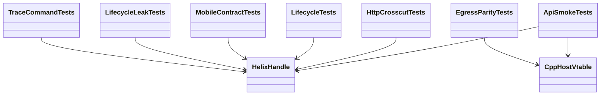

### 验证流程图

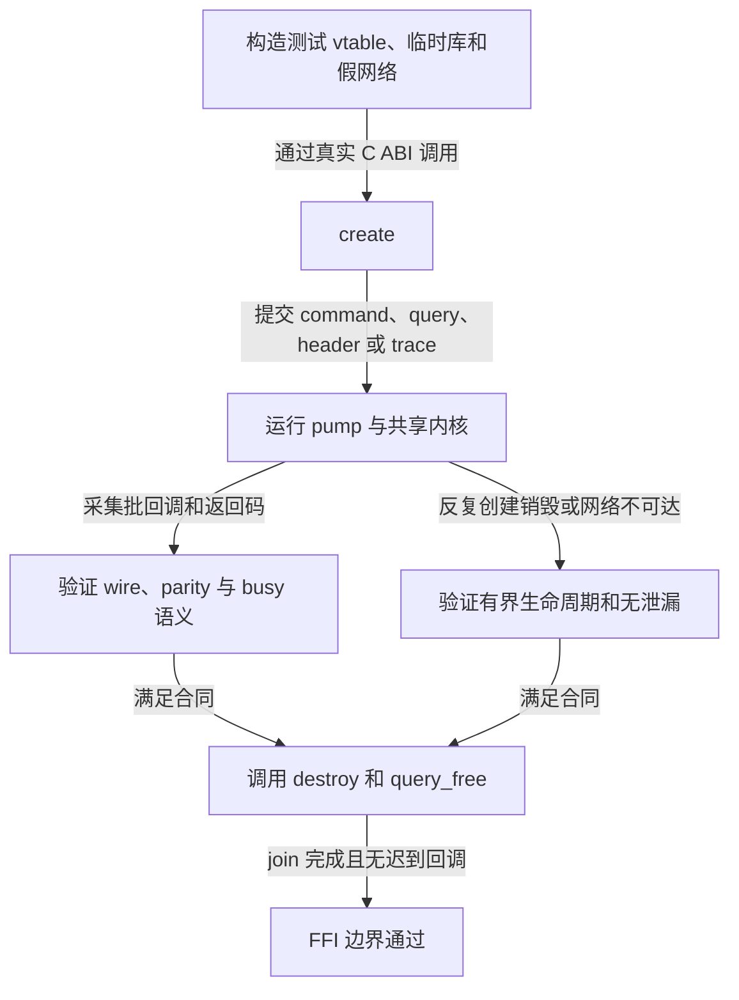

## 4. `smoke/` 文件夹

### C++ 烟测类图

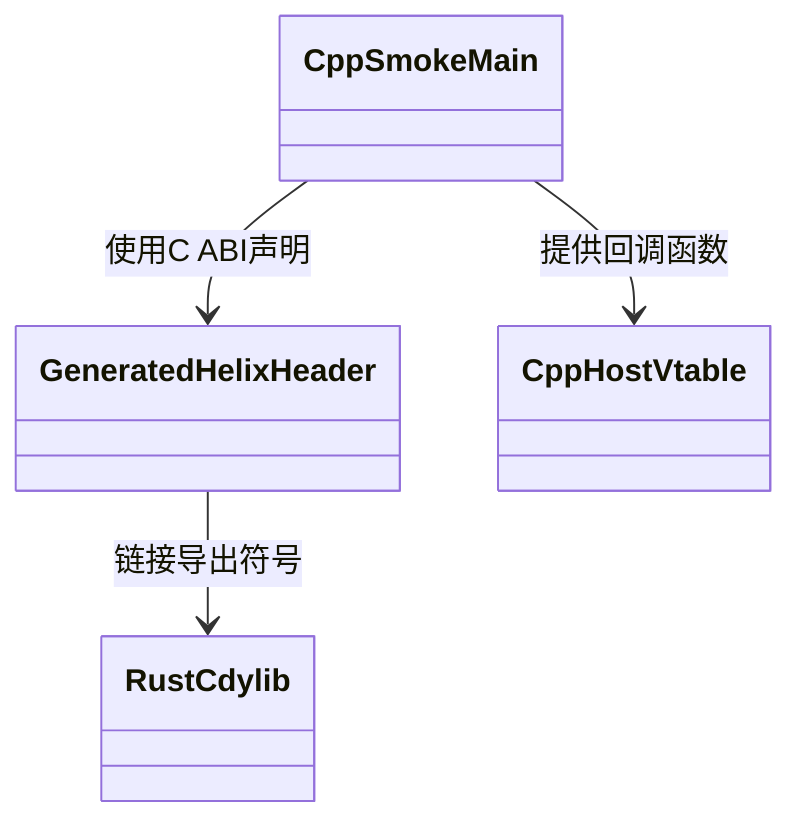

### C++ 烟测流程图

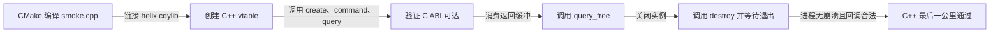

`smoke/build/` 是生成目录，不属于源码架构，不纳入文档维护范围。

## 5. `docs/design/` 文件夹

### 文档类图

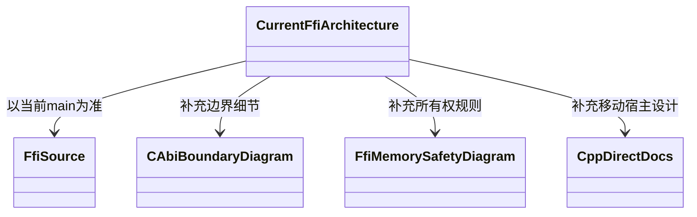

### 阅读流程图

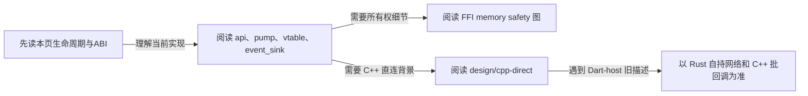

## 6. `docs/design/cpp-direct/` 文件夹

### 边界类图

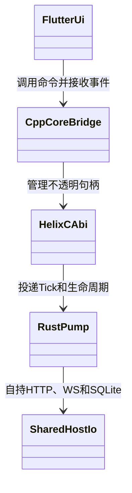

### C++ 直连流程图

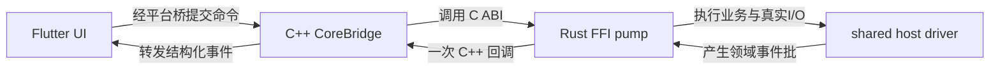

边界铁律：不允许 unwind 跨 `extern "C"`；`Box::into_raw/from_raw` 各一次；`destroy` 返回前 vtable 和 `ctx` 必须仍有效；事件按 step 批量跨边界。
