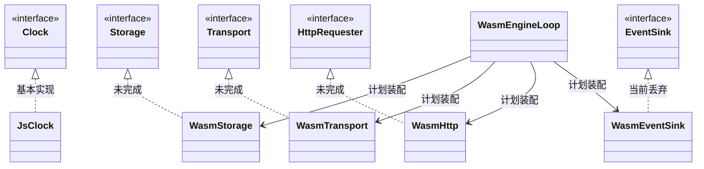
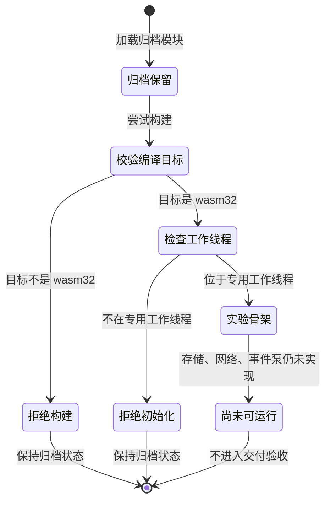
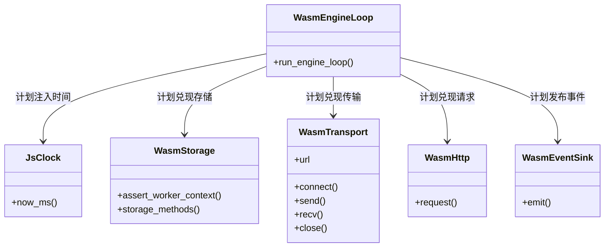
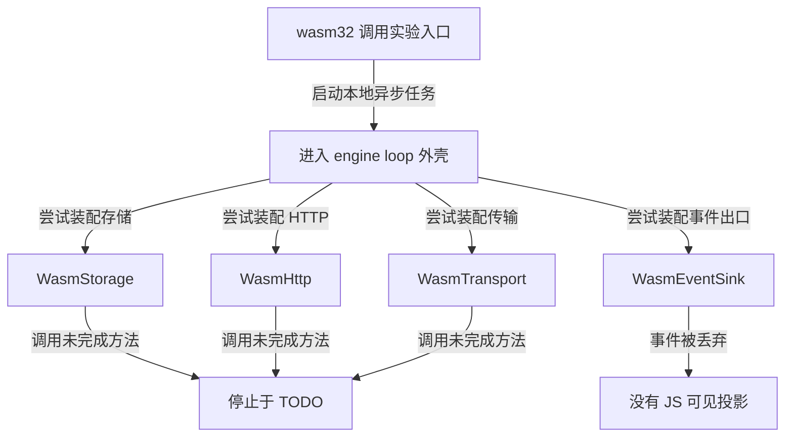
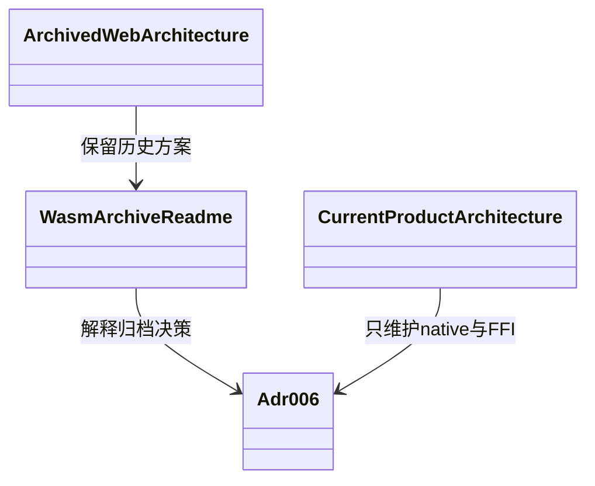

# helix-driver-wasm 归档架构

> 目录：`crates/helix-driver-wasm`。ADR-006 已将 Web/wasm 暂停维护；它不是 native 与 FFI 之外的第三个可交付端。

## 1. crate 模块

### 当前完成度

- 非 `wasm32` 目标直接 `compile_error!`。
- `JsClock` 基本可用。
- Storage、Transport、HTTP 和 engine loop 仍是 TODO 或骨架。
- EventSink 当前丢弃事件，没有接 JS callback。

### crate 类图

### 归档状态图

## 2. `src/` 文件夹

### 文件职责

| 文件 | 当前事实 |
|---|---|
| `lib.rs` | 目标守卫和模块声明 |
| `clock.rs` | `Date.now()` 实现 `Clock` |
| `storage.rs` | 做 Worker 环境检查，8 个 Storage 方法仍未实现 |
| `transport.rs` | 保存 URL，connect/send/recv/close 未实现 |
| `http.rs` | request 未实现 |
| `event_sink.rs` | emit 丢弃事件 |
| `engine_loop.rs` | `spawn_local` 外壳存在，循环未实现 |

### `src/` 类图

### `src/` 实际流程图

## 3. `docs/design/` 文件夹

### 文档类图

### 阅读流程图

## 4. 未来重新激活的前置条件

1. 新 ADR 明确 Web 产品目标和维护人。
2. 恢复 wasm CI 和当前已归档的编译护栏。
3. 完成 Worker 环境下 Storage、HTTP、WS、EventSink 和 pump。
4. 用和 native/FFI 同一 Tick 剧本做 byte-level 或语义 parity 验收。
