# 工程支撑与验证架构

> 本页覆盖不进入产品运行时、但决定代码能否安全演进和证据能否成立的根目录与辅助文件夹。

## 1. `crates/` 文件夹

### 模块关系类图

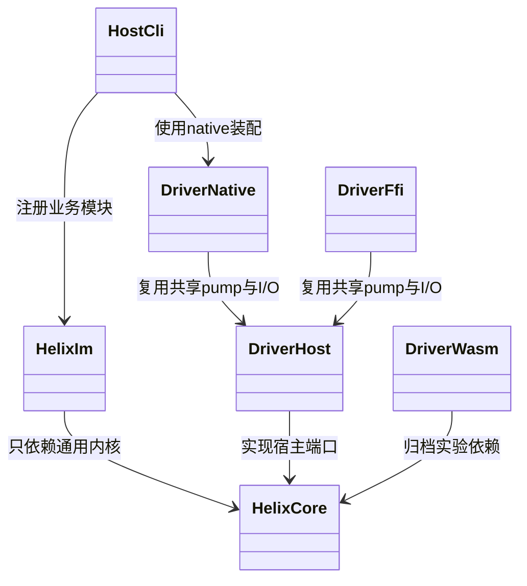
### workspace 构建流程图

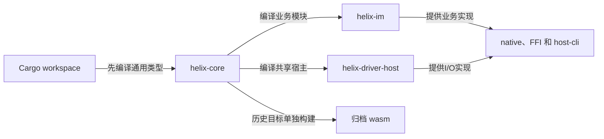

## 2. `docs/` 文件夹

### 子目录职责

| 文件夹 | 角色 | 证据等级 |
|---|---|---|
| `架构索引/` | 当前 main 的代码阅读入口 | current snapshot |
| `harness/` | HX-C 护栏、ADR、操作索引和坑卡 | 可执行约束/决策 |
| `review/` | drift review、覆盖台账和审查结论 | reviewer 证据 |
| `trace/` | trace scope 合同与本地 Jaeger runbook | 可观测边界 |
| `specs/` | 当前需求/验收 spec | 计划与合同，不自动代表 green |
| `reports/` | 战报和性能留痕 | 历史证据 |
| `sync-v2-report/` | sync-v2 历史审计材料 | supporting/historical |
| `api-baseline/` | 公共 API 基线 | 静态兼容证据 |
| `agents/` | issue tracker、triage、domain 约定 | 协作治理 |
| `过会方案/` | 机制设计和已拍板方案 | 设计真源，仍须代码复核 |

### 文档治理类图

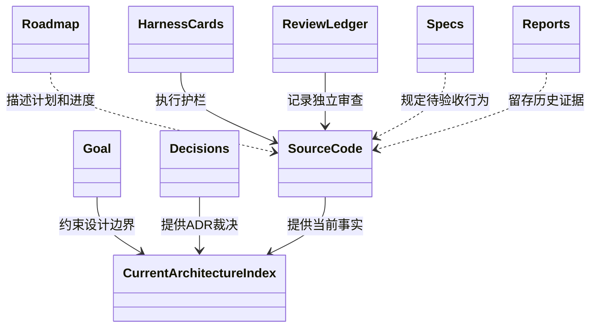

### 文档裁决流程图

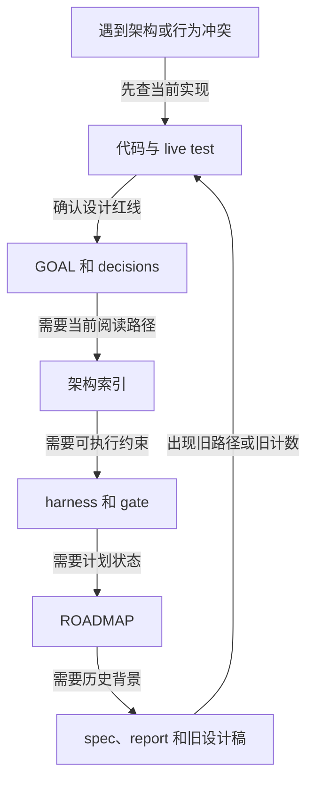

## 3. `docs/harness/` 文件夹

### 护栏类图

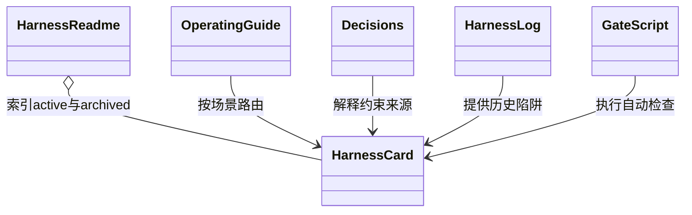

### 护栏演进流程图

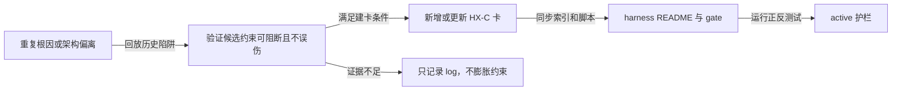

## 4. `scripts/` 文件夹

### 脚本分组

| 流程 | 脚本 |
|---|---|
| 聚合提交门 | `gate.sh` |
| 架构/结构门 | `structure-gate.sh`、`ddd-structure-gate.sh`、`trace-static-gate.sh`、`review-gap.sh`、`fullmap-coverage.sh` |
| Strict Matrix | `strict-matrix/check.mjs` |
| 分支/依赖治理 | `branch-identity.sh`、`branch-sync-gate.sh`、`check-downstream-helix-pins.sh`、`install-hooks.sh` |
| 运行与证据 | `dev-loop.sh`、`host-cli-session.sh`、FULL/dual-account e2e、`ffi-verify.sh`、`cpp-smoke.sh`、`coverage.sh` |
| 配置共享 | `lib-config.sh` |

### 脚本类图

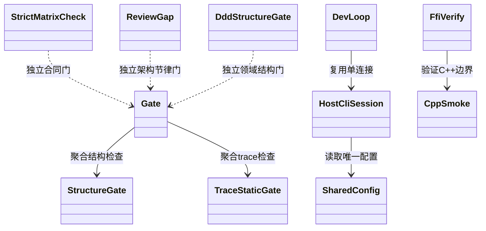

### `gate.sh` 流程图

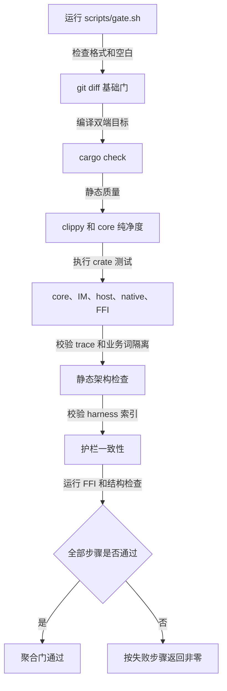

### 真 Go 证据流程图

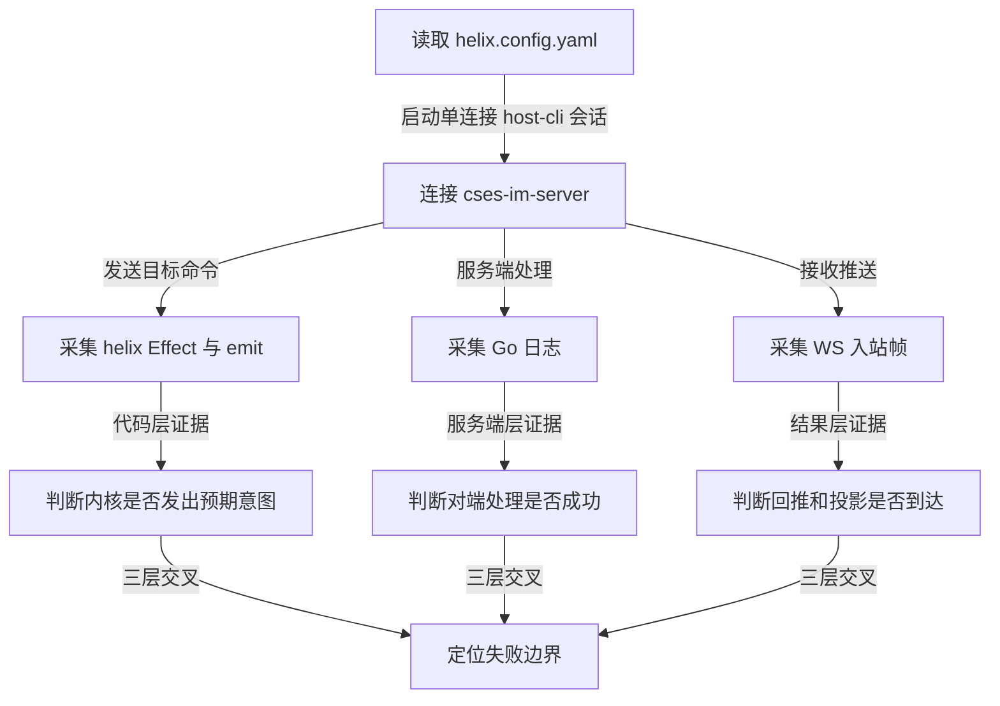

## 5. `scripts/strict-matrix/` 文件夹

### 合同类图

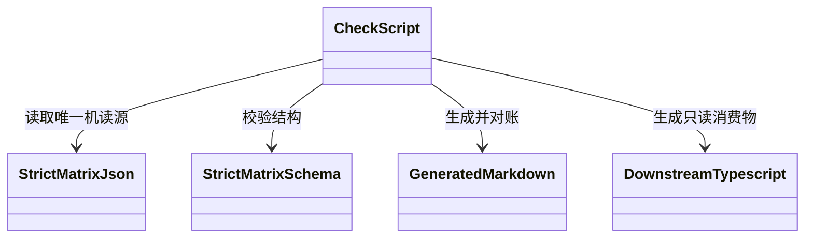

### 合同流程图

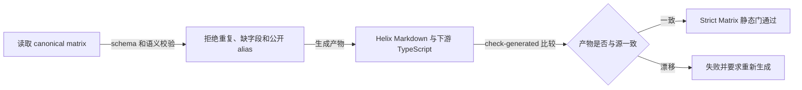

## 6. `tools/` 文件夹

### 工具类图

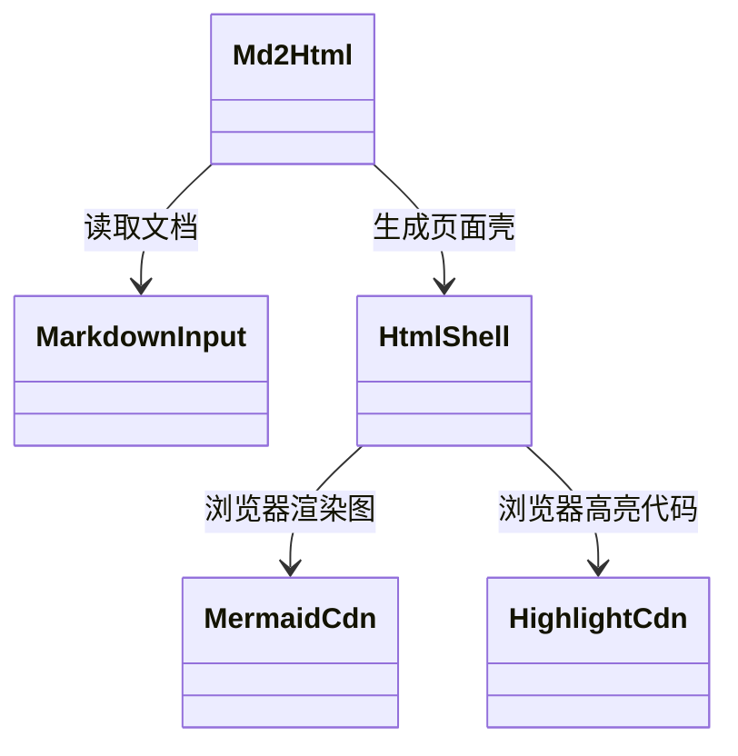

### 工具流程图

`md2html.py` 是展示工具，不是 Mermaid 语法校验器。本次架构文档使用 Mermaid CLI 单独解析每个代码块。

## 7. `docker/` 与 `docker/otel/` 文件夹

### 可观测基础设施类图

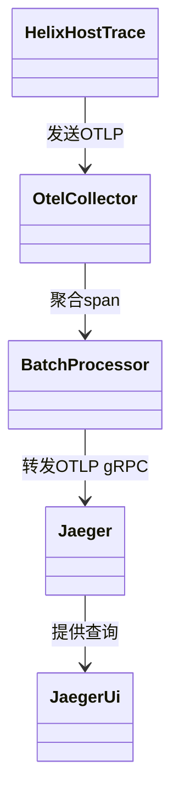

### OTel 流程图

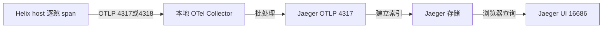

Collector 占宿主 4317/4318；Jaeger 容器的 OTLP gRPC 对宿主映射为 4319，避免端口冲突。

## 8. `.agents/` 文件夹

### 子目录职责

| 子目录 | 作用 |
|---|---|
| `agents/modules/` | crate/治理模块 agent |
| `agents/domains/` | 跨 crate 领域 agent |
| `agents/reviewers/` | contract/evidence/harness/test reviewer |
| `manifests/` | agent、模块、领域、约束、引用、保留策略机器源 |
| `router/` | 路由规则和 workflow 类型 |
| `bin/` | `agentctl.py` 控制器 |
| `scripts/` | 对控制器子命令的一行 wrapper |
| `schemas/` | task/report/run/route JSON 合同 |
| `templates/` | worker/reviewer/worktree/swarm/TDD prompt |
| `diagrams/` | agent 路由图，不是产品架构图 |
| `skills/` | Helix 四个操作手册 |
| `tools/` | SQLite inspect 工具注册和 schema |
| `runs/`、`tmp/` | gitignored 运行态 |
| `references/` | 引用锁 |
| `examples/` | 合同样例 |

### agent 控制面类图

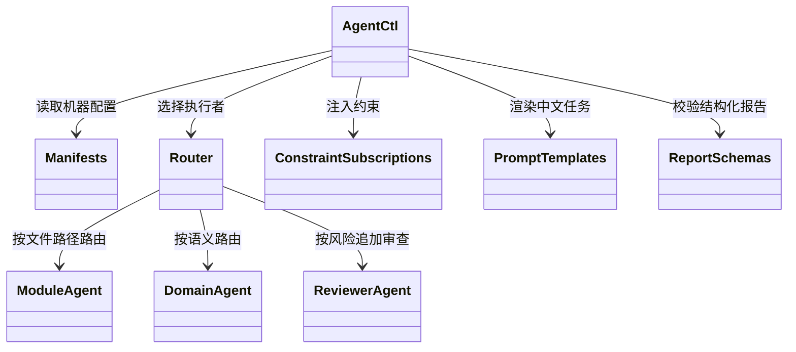

### agent 路由流程图

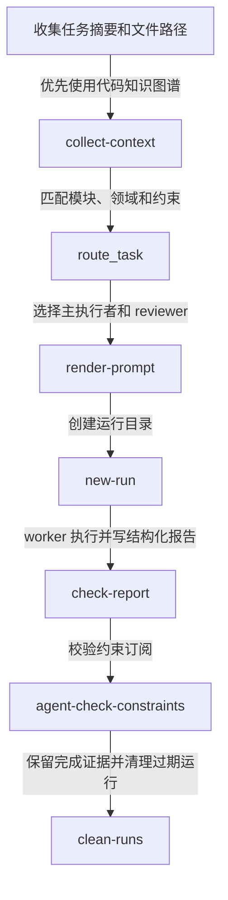

当前 `.agents/diagrams/*.mmd` 只表达 agent 路由，不可替代本目录的产品模块类图和业务流程图。`references.json` 当前是路径型索引，而复制同步项为空；文档只能声称“有引用索引”，不能声称引用复制已实际运行。

## 9. 辅助目录的统一证据边界

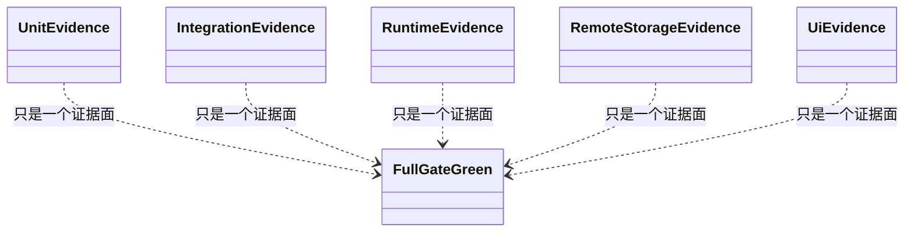

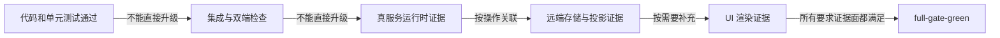
