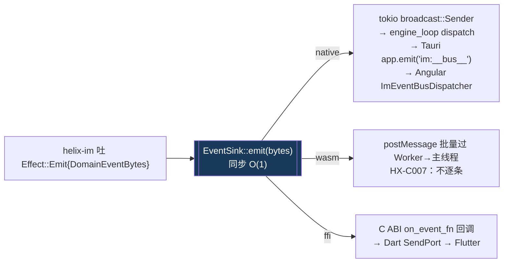
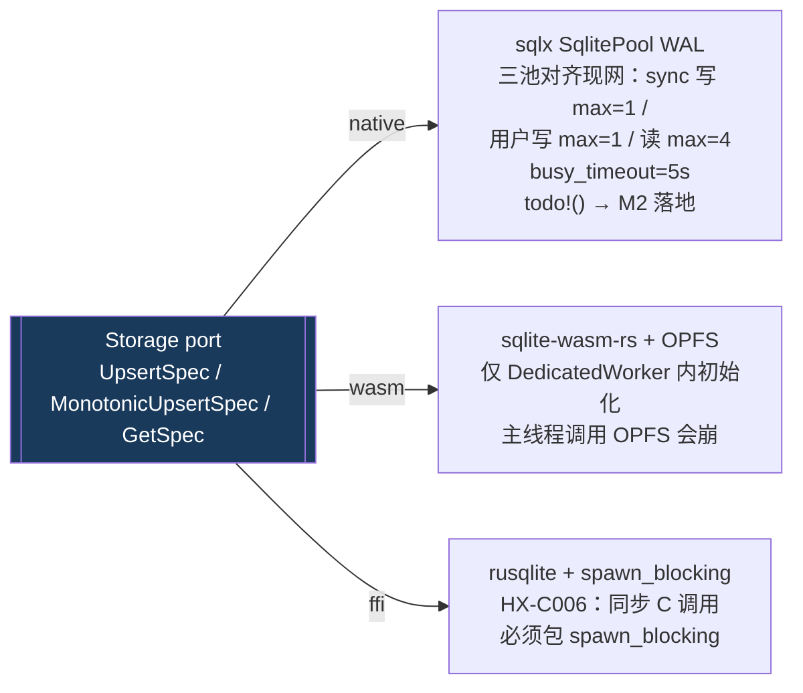
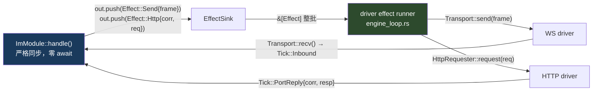
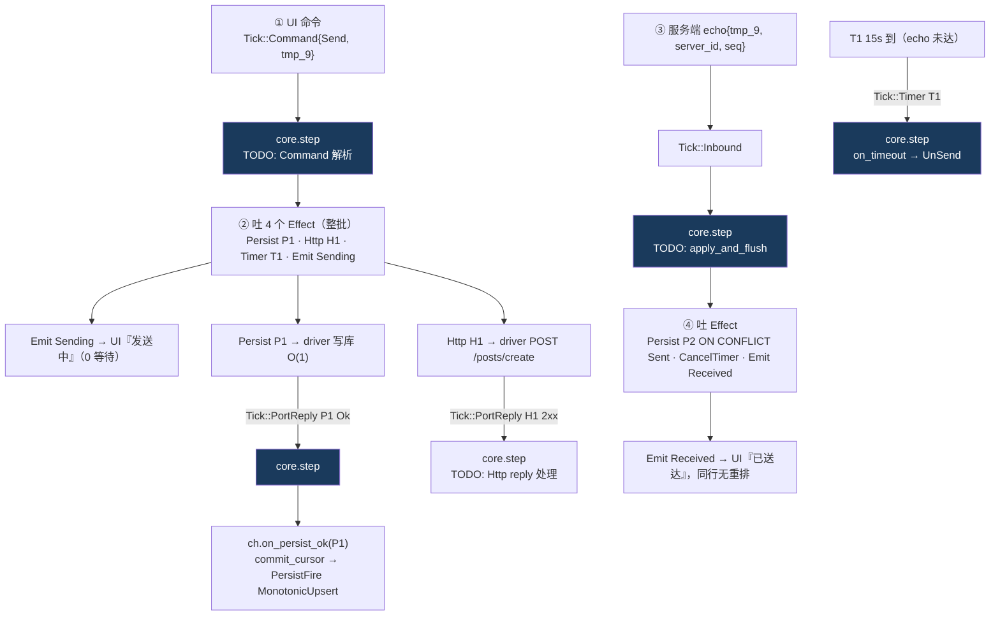
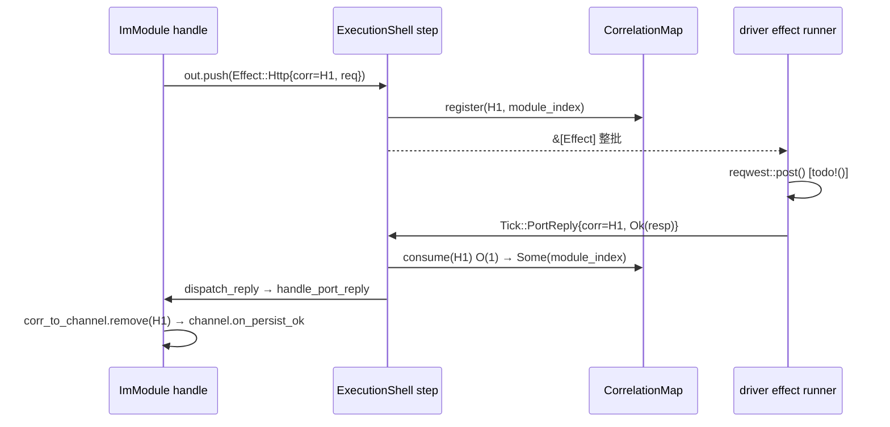
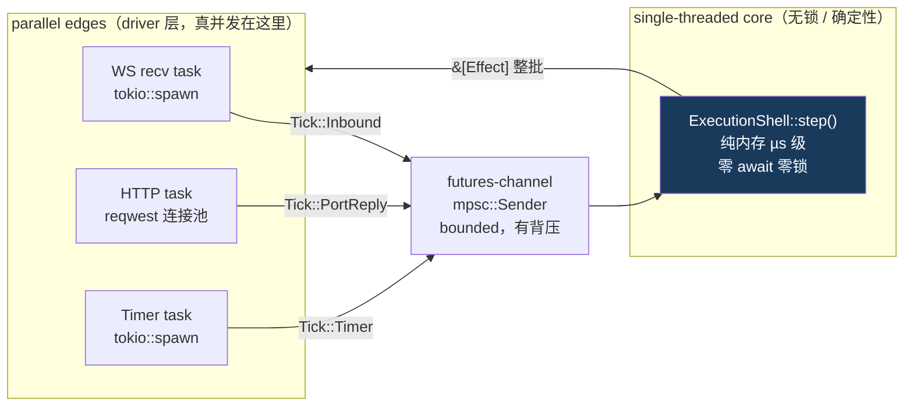

# Helix 完美过会指南

> 适用范围：技术过会现场。所有 grep/cargo 命令可当场验证。源码基线：2026-06-09 M0。
>
> 📚 **文档关联**（完整阅读顺序见 [`README.md`](./README.md)）：[大白话解读](./helix-方案-大白话解读.md) → [技术过会方案](./helix-Rust-Core-技术过会方案.md) → **本篇·完美过会指南** → [评审纪要](./helix-技术评审纪要.md)。**最新拍板结论以评审纪要为准。**

---

## §0 完美过会的总策略

**三个支柱：诚实 + 原点 + 主动摆洞。**

**诚实是最大加分**。driver 方法体当前全部是 `todo!()`——NativeTransport 四个方法、NativeStorage 四个方法、NativeEventSink 的 `emit` 仅有一行 tracing::debug 占位、`engine_loop` 的 `tokio::select!` 是注释掉的伪代码。过会中描述这些路径时，措辞必须是「编译期类型约束已验证为真的契约意图，运行时端到端待 M2」，而不是「已能跑通」。过度声称是过会杀手。

**原点经得起敲**。三个痛点全是真实数据：P1（2550 行，三端各一份，真数过）；P2（cursor Bug 在 native 修完，FFI/wasm 4 个月后才同步，亲手联调过的疤）；P3（业务逻辑散在平台回调里，时序 Bug 无法 proptest）。价值锚：IM 一个模块、一份逻辑两端一致已经回本；presence 等第二模块是彩头，不是地基。

**主动把最大的洞摆上桌**。乱序增量同步（断线重连 backfill）是头号未验证风险，`channel.rs` 的骨架结构已在，`apply_and_flush_contiguous` 和 `flush_contiguous_from_buffer` 方法体是空 `Ok(())`。主动说「这墙我还没砌」的人，没有人能用这个洞打你。

**两个关键修正必须讲对**（评审纪要已拍板，被反问时不能退回旧版本）：
- 四能力解耦是**行为级**，不是编译级裁剪。`effect.rs:176` 是单一 `Effect` enum，7 个 variant 无 feature gate，现场 grep 一秒验证。
- **重试不归 helix-im**。`http.rs:24` 注释原文：「driver 负责连接复用、重试策略（helix-im 不重试，失败标 unSend）」。helix-im 失败只标 UnSend，不发起重试。

**两个 PortError 类型必须区分清楚**：`tick.rs:56` 里有 `PortError { Timeout, Http(u16), Storage(u32), Network, Other(u32) }`，这是 `PortOutcome::Err` 里的本地类型，只在模块内部用于分类决策。`error.rs:51` 里有 `PortError { Storage(String), Transport(String), Http(String), ... }`，这是 `lib.rs:37` 公开导出的 `helix_core::PortError`，是所有 port trait 方法的返回类型。两个同名 enum 并存，骨架期遗留，M1 统一。

---

## §1 EventBus

### 设计

`EventSink` trait 定义在 `crates/helix-core/src/ports/event_sink.rs:21`：

```rust
pub trait EventSink: MaybeSend + MaybeSync + 'static {
    fn emit(&self, event: DomainEventBytes);
}
```

`emit` 是**同步非阻塞**的。不是 async，不等待订阅者处理完成，只是「登记意图」。driver 把事件放入 broadcast channel，实际分发在 driver 内部异步进行。这保证 `Module::handle` 严格无 await。

`DomainEventBytes` 定义在 `effect.rs:80`：`pub struct DomainEventBytes(pub Bytes)`。`bytes::Bytes` 是引用计数，`clone()` = O(1) 指针复制，不拷贝字节。**core 只搬字节，永不解析 IM 事件类型**。IM 的 `ImDomainEvent` enum 在 `helix-im/src/acl/to_effect.rs` 的 ACL-1 序列化为字节，序列化点在 core 外部。

**评审已拍板（#4）**：`DomainEventBytes` 当前是裸 bytes，必须版本化，否则「业务回调地狱」换成「事件 schema 对不齐地狱」。M2 前必须加 envelope（前缀 version tag 或 messagepack 信封），接收端检查 version 字段路由反序列化逻辑。这是 M1 决策点，当前是已知技术债。

`NativeEventSink::emit`（`helix-driver-native/src/event_sink.rs`）当前方法体是：`let _ = event; tracing::debug!(...)`，M2 接通 `tokio::sync::broadcast::Sender<DomainEventBytes>`。

### 三端路径



**driver 方法体当前全是 `todo!()` 或占位**。上图描述的是编译期类型约束为真的契约意图，不是已运行的代码。

### im:__bus__ 单总线模式（cses-client 实战）

来自 cses-client 生产实践：上百种 IM 事件合并为单个 `im:__bus__` Tauri 事件频道（-190ms 启动时间），前端 `ImEventBusDispatcher` 懒注册，`envelope { channel, payload }` 解复用。Helix 的 `DomainEventBytes` 就是该 envelope 的 payload 字节，helix-im ACL-1 序列化时确定 channel 字段（如 `im:post:received`，命名规则 module:sub:action kebab）。driver 转发时只透传字节，不反序列化。

### broadcast lagged 处理

`broadcast::Sender::send()` 是非阻塞的。没有接收者时 `send()` 返回 `Err(SendError)`，忽略。接收者 lagged（ringbuffer 溢出）时，接收方下次 `recv()` 拿到 `RecvError::Lagged(n)`，由接收方决定降级策略（如触发全量 resync）。`emit` 本身永远不 block `engine_loop`，慢消费者不会拖死生产者。

### 杀手问答

**Q：`emit` 是同步的，broadcast channel 满了会 block 吗？会丢事件吗？**

A：不 block。`tokio::sync::broadcast::Sender::send()` 是非阻塞的，channel 满时慢接收方触发 `RecvError::Lagged(n)` 而非阻塞发送方。emit 本身永远不会 panic 或死锁。慢消费者（如 Angular 渲染线程卡顿）会丢帧，UI 侧需实现 lagged 处理：收到 `RecvError::Lagged(n)` 后发 `Tick::Command{refresh_channel}` 从服务端或本地 Storage 补拉。当前 NativeEventSink 是占位实现，M2 接通 broadcast，lagged 处理是 M2 同步的 UI 侧责任。

**Q：helix-im 里能 grep 到 `Effect::Emit` 产出点吗？**

A：当前 helix-im 里没有实际的 `Effect::Emit` 产出点。`pending_send.rs:74` 有一条注释掉的 TODO：`// fx.push(Effect::Emit { event: acl::serialize_post_received(...) })`，`apply_and_flush_contiguous` 方法体本身也是空 `Ok(())`。这是诚实的技术债，ACL-1 序列化路径（helix-im 产生字节、core 不解析）在架构上是正确的，实际 Emit 产出点在 M2 的 apply 实现里补全。

**Q：四能力解耦说的是行为级，那 EventSink 和 Storage 可以编译期独立吗？**

A：helix-core 的 trait 定义互不依赖，`EventSink` import 不了 `Storage` 的任何类型，可当场 `grep -n 'Storage\|SqlitePool' crates/helix-core/src/ports/event_sink.rs` 验证，0 行。当前 `helix-driver-native` 是无条件依赖 tungstenite/sqlx/reqwest 全家，四能力的 driver feature 拆分是 M2 目标——拆成 optional dep 后「只启 eventbus 不拉 storage」才可编译期验证。现在不能说「可以单独编译 EventSink 不拉 Storage 实现」。

---

## §2 Storage

### 设计

`Storage` trait 定义在 `crates/helix-core/src/ports/storage.rs:34`，4 方法：

```rust
#[cfg_attr(not(target_arch = "wasm32"), async_trait::async_trait)]
#[cfg_attr(target_arch = "wasm32", async_trait::async_trait(?Send))]
pub trait Storage: MaybeSend + MaybeSync + 'static {
    async fn batch_upsert(&self, spec: UpsertSpec)         -> Result<(), PortError>;
    async fn batch_update(&self, table: &str, ...)         -> Result<(), PortError>;
    async fn monotonic_upsert(&self, spec: MonotonicUpsertSpec)  -> Result<(), PortError>;
    async fn get(&self, spec: GetSpec)                     -> Result<Option<Row>, PortError>;
}
```

**port 上零 IM 语义**：`UpsertSpec.table` 是 `&'static str`（`effect.rs:108`，编译期常量，零堆分配），`conflict_key` 值（如 `"temporary_id"`）由 helix-im ACL-1 提供，driver 只拼 SQL，不理解含义。`grep 'temporaryId\|channel\|message' crates/helix-core/src/ports/storage.rs` = 0 行。

**已知不一致（M1 修复项）**：`Storage` trait 的 `batch_update` 方法参数是 `&str`（非 `&'static str`），而 `BatchUpdateSpec.table` 在 `effect.rs:129` 已是 `&'static str`。两处不一致，`&'static str` 可 coerce 为 `&str` 所以编译通过，但热路径零分配的完整性未完全覆盖 batch_update 路径，M1 统一。

**cursor 归属（ADR-004 已拍板）**：cursor 是 IM 模块的同步游标概念，归 `helix-im`，不进 core。`monotonic_upsert` 的 `scope_key` 是运行时 `String`（channel_id 字符串，运行时值），`value` 是 `i64`，core 只传字符串不理解语义。`Channel::commit_cursor()` 在 `channel.rs:85` 是 cursor 推进的唯一聚合根，`scope_key = self.id.0.to_string()` 在第 90 行。**口径护栏**：代码与架构设计稿均已定名 `monotonic_upsert`（2026-06-10 核实：`crates/` 内零处 `cursor_upsert` 残留）——core 内的通用单调写原语（类比 CAS），cursor / presence 心跳 / 任何单调计量都用它，不是 IM 概念；core「零业务概念」的 grep 承诺对象**只含 channel / message / temporaryId 三词，不含 cursor**——现场绝不能声称「grep cursor = 0」，会当场翻车。

**port 方法返回的 PortError** 是 `error.rs:51` 里的版本：`Storage(String) / Transport(String) / Http(String) / ...`（String 包装）。这与 `PortOutcome::Err` 里内嵌的 `tick::PortError`（`Http(u16) / Storage(u32) / ...`，带数值分类）是两个不同类型。两个同名 enum 并存是骨架期遗留，M1 统一。

### 热路径 O(1) 保证

| 操作 | SQL 形态 | 复杂度 |
|---|---|---|
| `batch_upsert`（消息落库）| `INSERT ON CONFLICT(PK) DO UPDATE` | O(log N) ≈ O(1) |
| `monotonic_upsert`（MAX guard）| `WHERE excluded.value > cursors.value` | O(log N) |
| `batch_update`（状态刷新）| `UPDATE WHERE key_col IN (...)` | O(log N) per row |

禁 read-modify-write：不允许读出 JSON 数组 → 应用层 push → UPDATE 整列回写。`UpsertSpec.table = "messages"` 是 `&'static str`，每次消息落库零堆分配。`NativeStorage` 注释（`storage.rs:5-7`）写的是写池 max=1 / 读池 max=4 的配置意图，方法体是 `todo!()`。**注意该注释是骨架期简化**：现网 DbManager 实为**三池**——`tenant_write`（sync 写 max=1）+ `tenant_user_write`（用户交互写 max=1，与 sync 大批量写隔离 FIFO）+ `tenant_read`（读 max=4），共享同一 WAL 文件；M2 落地按现网三池对齐，被反问时不能说成「写1读4」两池。

### 三端后端



**sqlx 为什么不能编 wasm32**（必备，现场可追问）：sqlx 锁死 tokio runtime，tokio io-driver→mio 需要 OS 级 epoll/kqueue/iocp，`wasm32-unknown-unknown` 不提供这些 syscall（wasm 的 async 由浏览器事件循环驱动）。这是 Storage port 后面放三套实现、而非「同一个 sqlx 三端跑」的根因。

### Persist vs PersistFire 两段式

`Effect::Persist { corr, ops }` 带 Correlation，driver 执行后必须产出 `Tick::PortReply`。`Effect::PersistFire { ops }` 是 fire-and-forget，不带 Correlation，**仅用于满足「幂等且丢失可接受」全部条件的写操作**（如 monotonic_upsert 的 MAX guard 天然幂等）。禁止用 PersistFire 落库首次业务数据。`effect.rs:192-211` 有强约束注释原文。

cursor 推进两段式：`Effect::Persist{corr=P1, batch_upsert(messages)}` 落库消息 → `PortReply{P1, Ok}` → `channel.on_persist_ok(P1, fx)` → `commit_cursor(target_seq, fx)` → `Effect::PersistFire{MonotonicUpsert(MAX guard)}`。cursor 只在写成功后推进，不允许乐观推进后回滚。

### 杀手问答

**Q：monotonic_upsert 的 MAX guard 在 SQL 里是原子的吗？并发写会有 race 吗？**

A：MAX guard 是单条 `INSERT ON CONFLICT ... WHERE excluded.value > cursors.value` 语句，原子性由语句自身 + SQLite WAL 单写锁保证，不需要 SELECT+UPDATE 事务，比 CAS+retry 更简单。native 侧 M2 对齐现网**三池**（tenant_write sync 写 max=1 + tenant_user_write 用户交互写 max=1 + tenant_read 读 max=4，共享同一 WAL）——即便两条写池并发提交，也由 SQLite 写锁串行，无 race。wasm 端 OPFS SAHPool 单文件单连接，读写都经同一 Worker 内 sqlite 实例串行，更不存在。ffi 侧 rusqlite 单连接，同步串行。注意：NativeStorage 当前方法体是 `todo!()`，`storage.rs` 注释里的「写1读4」是骨架期简化，M2 落地时按三池对齐。

**Q：`UpsertSpec.rows` 是 `Vec<Row>`，Row 是 `Vec<(String, SqlValue)>`，热路径不是照样每条消息 alloc 一堆 String 吗？**

A：是的，rows 容器本身有分配。MAJ-5 修复消掉了 `table` 和 `conflict_key` 这两个高频字段的 String 分配（改为 `&'static str`，`effect.rs:108/111`），rows 内容的 String 分配在 M1 的热路径审计中处理，候选方案是 SmallVec 或 arena。M0 骨架优先保证类型契约正确和三栖编译，热路径 alloc 全面优化是 HX-C005 追踪的 M1 工作项。

**Q：wasm 端 OPFS 仅 Worker 内可初始化，架构如何保证？**

A：这是 HX-C003 追踪的已知陷阱。wasm driver 必须在 `DedicatedWorkerGlobalScope` 内初始化 sqlite-wasm-rs，主线程不直接调 Storage，所有存储操作通过 postMessage 过 Worker 边界（批量过，不逐条，HX-C007）。CI 必须对 wasm32 target 单独跑 `cargo check --target wasm32-unknown-unknown`，`#[cfg(target_arch="wasm32")]` 分支在 native CI 不被类型检查，这是 HX-C003 的根因。

---

## §3 WS + HTTP Transport

### 设计

`Transport` trait 定义在 `crates/helix-core/src/ports/transport.rs:20`，4 方法：

```rust
#[cfg_attr(not(target_arch = "wasm32"), async_trait::async_trait)]
#[cfg_attr(target_arch = "wasm32", async_trait::async_trait(?Send))]
pub trait Transport: MaybeSend + MaybeSync + 'static {
    async fn connect(&mut self) -> Result<(), PortError>;
    async fn send(&mut self, frame: Bytes) -> Result<(), PortError>;
    async fn recv(&mut self) -> Result<Option<Bytes>, PortError>;
    async fn close(&mut self) -> Result<(), PortError>;
}
```

`HttpRequester` trait 定义在 `crates/helix-core/src/ports/http.rs:21`，单方法：`async fn request(&self, req: HttpRequest) -> Result<HttpResponse, PortError>`。

**关键不变量**：port 只暴露四个纯语义操作。握手、帧分片、TLS 是 driver 私有。**重连退避 / 心跳 / cursor reset 是 helix-im 的业务策略**，不进 port。

**http.rs:24 注释原文**：「driver 负责连接复用、重试策略（helix-im 不重试，失败标 unSend）」。这是已在代码里拍板的设计，helix-im 收到 `PortError` 后标 UnSend，不发起重试请求。

**Tick::Connected / Tick::Disconnected** 当前不存在于 `tick.rs`（只有 4 个 variant：Inbound/PortReply/Timer/Command）。重连的业务策略（cursor reset / pendingSends flush）在 M2 补充这两个 variant 后才能由 ImModule 响应。这是已知的 M2 TODO。

`NativeTransport` 四个方法（`transport.rs:26-44`）全部 `todo!()`。`engine_loop` 的 `tokio::select!` 是注释掉的伪代码（`engine_loop.rs:37-62`）。

### 模块不直接调用 port



### WS 状态机（helix-im，不在 driver）

```mermaid
stateDiagram-v2
    [*] --> Disconnected
    Disconnected --> Connecting: on_start backoff_timer 到期
    Connecting --> Connected: Tick::Inbound hello_ack（M2 实现）
    Connected --> Closing: on_stop
    Connected --> Disconnected: 心跳超时 / close 帧
    Closing --> Disconnected: close 确认
```

重连退避计算在 helix-im 的 `handle_timer` 里（纯内存，指数退避 + jitter），不在 driver。当前 `module.rs:147-152` 有 `backoff_timer` 处理骨架，内部 `connect` 逻辑是 TODO。

### 心跳 self-arm

`on_start` 吐 `Effect::ScheduleTimer{ping_timer, 8000ms}`，`module.rs:233-241` 可验证。`handle_timer` 在 `module.rs:132-143`：ping_timer 触发时 self-arm 新 timer（`alloc_timer() + ScheduleTimer`）实现无限循环心跳。不需要 `Module::tick()` 周期方法。

### 三端对比

| 能力 | native | wasm | ffi |
|---|---|---|---|
| WS | tokio-tungstenite .split() | web-sys WebSocket + futures-channel 手桥（~80 行）| C ABI 帧注入 + catch_unwind |
| HTTP | reqwest 0.12 连接池 | gloo-net fetch（无 streaming，IM v1 req-resp 不受影响）| host HTTP 回调 |
| 重连退避 | helix-im handle_timer | 同一份 | 同一份 |
| 心跳 | self-arm ScheduleTimer 8s | 同一份 | 同一份 |
| 重试 | driver 负责 | driver 负责 | driver 负责 |

### 杀手问答

**Q：重试在哪里？helix-im 收到 PortError::Http 后怎么处理？**

A：`http.rs:24` 注释明确：driver 负责重试策略，helix-im 不重试，失败标 UnSend。helix-im 的 `handle_port_reply` 在 `module.rs:96-122`：收到 `PortOutcome::Err` 时打 warn 日志、不推 cursor。最终 UI 收到 UnSend 状态，用户手动重试触发新的 `Tick::Command{send}`，这是新的发送请求，不是 port 层重试。

**Q：WS 断线时 pending 的 Http Effect corr 会泄漏 CorrelationMap 吗？**

A：这是当前诚实的技术债。`corr_map.consume(corr)` 在 `engine.rs:120-134` 对未知 corr 静默 warn 不 panic，不会崩溃，但会积累 stale entry。正确做法是 `on_stop` 时遍历 `corr_to_channel` 强制清理，或 engine 的 `stop()` 清空 CorrelationMap。当前 `on_stop`（`module.rs:246-256`）已 CancelTimer ping_timer 和 backoff_timer，但未遍历 pending 的 Http corr——这是 M2 补全 on_stop 时的第一件事。

**Q：Tick::Connected / Tick::Disconnected 没在代码里，重连业务逻辑现在怎么触发？**

A：`tick.rs` 当前只有 4 个 variant，Connected/Disconnected 是 M2 任务。现在 WS 重连的业务策略无法由 ImModule 响应——这是诚实的未完成骨架，`engine_loop` 的 `select!` 也是注释掉的伪代码。M2 的优先级顺序：先补 Tick 的两个 variant，再补 engine_loop 的事件泵，再补 NativeTransport 方法体，三者联调。

---

## §4 IM 发送消息真实链路

### 统一 Core 时间线

```
A 命令   step(Tick::Command{send_message, tmp_9}, now_ms) 产出（整批）：
          Persist{corr=P1, BatchUpsert(messages, key=tmp_9, Sending)}  ← 乐观落库
          Http{corr=H1, POST /posts/create}                           ← 发服务端
          ScheduleTimer{T1, 15000ms}                                  ← 15s 超时
          Emit{DomainEventBytes(Sending{tmp_9})}                      ← UI 0 等待上屏

         [Command 分支当前是 TODO：module.rs:203-205 只有 tracing::debug]

B 服务端  存库 → 分配 server_id + channel_event_seq → WS 推 echo（回带 tmp_9）

C 对账   step(Tick::Inbound{echo, tmp_9, server_id, seq}) 产出：
          Persist{corr=P2, BatchUpsert(ON CONFLICT tmp_9 → Sent+server_id)}
          CancelTimer{T1}
          Emit{DomainEventBytes(Received{...})}

         [apply_and_flush_contiguous 内部是 TODO，M1 补全]

D cursor  step(Tick::PortReply{corr=P2, Ok}) 触发 channel.on_persist_ok：
          PersistFire{MonotonicUpsert(scope_key=channel_id, value=seq)}  ← MAX guard
          [channel.rs:85-95 可验证 commit_cursor 实现]

E 超时   step(Tick::Timer{T1}, echo 未到) 触发 PendingSend.on_timeout：
          [pending_send.rs:83-94：on_timeout 方法体已有 status=UnSend，
           但 PersistFire 吐出点是 TODO（pending_send.rs:91-93）]
          迟到 echo：仍按 tmp_9 ON CONFLICT 覆盖回 Sent（幂等）
```

**诚实边界**：步骤 A 的 Command 分支解析是 TODO；步骤 C 的 apply 内部是 TODO；步骤 E 的 UnSend persist effect 是 TODO。步骤 D 的 `commit_cursor` 实现（`channel.rs:85-95`）是真实可运行的代码。

### 主链路



### 双序收敛代数律（无需加锁）

echo 与 timer 两条 racing 事件流靠两个代数律收敛到一致终态：

1. **对账幂等**：`temporaryId` 为 ON CONFLICT 的 conflict_key（`pending_send.rs:57-68`），重复写结果相同。
2. **cursor 单调**：`Cursor::try_advance` 实现在 `state.rs:67-73`：`if next > self.value { self.value = next; true } else { false }`，MAX guard，乱序回报推不回去。

因此 wasm 单线程和 native 多线程跑同一份 helix-im 代码，终态一致。不需要加锁串行化。

### 三端落地

| 维度 | native/Tauri | wasm/浏览器 | ffi/移动 |
|---|---|---|---|
| 并发模型 | tokio 多线程 | 单线程 spawn_local | .so 内 tokio |
| 写库 | sqlx WAL O(1) | sqlite-wasm OPFS O(1) | rusqlite spawn_blocking O(1) |
| Emit 路径 | broadcast → app.emit im:__bus__ | postMessage 批量 | C ABI 回调 |
| 对账/超时/cursor | 同一份 helix-im | 同一份 helix-im | 同一份 helix-im |

### Correlation 路由链



`corr_map.consume` 在 `engine.rs:120`（`module_host.rs:101`：`self.map.remove(corr)`）。BLK-1a 修复已落地（`engine.rs:105-106`）：传入真实 module_index，不再是硬编码 0。

### 杀手问答

**Q：15s 超时 timer 如何找到对应消息？pending_sends 用 TemporaryId 做 key，timer 触发时怎么反查？**

A：这是 `module.rs:154-157` 的 TODO，诚实说当前未实现。设计意图：`PendingSend` 结构体持有 `timeout_timer: TimerId`（`pending_send.rs:27`），handle_timer 遍历 `state.pending_sends` 找 `timer_id` 匹配项，调用 `on_timeout`。`pending_send.rs:83-94` 的 `on_timeout` 方法体已有 `status = UnSend`，但吐 PersistFire 的 Effect 是 TODO（91-93 行）。M1 补全。

**Q：15s 超时和 echo 之间存在 race 吗？如何收敛？**

A：存在 race，靠两条路径各自的幂等律收敛。echo 先到：`reconcile` 里 `CancelTimer{T1}` 产出，`engine.rs:173` 的 `CancelTimer => timer_map.remove(id)` 移除 T1，后续 `Tick::Timer{T1}` 到来时 `timer_map.peek` 返回 None，`engine.rs:148` 静默忽略。timer 先到：标 UnSend；迟到 echo 仍调 `reconcile`，ON CONFLICT tmp_9 覆盖回 Sent，幂等。两条路都收敛，不需要锁。

**Q：乐观落库 Persist P1 失败，UI 已经显示「发送中」了，怎么回滚？**

A：`module.rs:107-116`：`PortOutcome::Err` 时打 warn 日志、不推 cursor。但当前没有吐 `Effect::Emit{SendFailed}` 的逻辑，UI 无法自动从「发送中」退回「发送失败」。完整实现应吐 `Effect::PersistFire{BatchUpdate(→UnSend)} + Effect::Emit{SendFailed}`。这是 M2 需要补的错误处理路径，过会时诚实标注为 TODO。

---

## §5 海量并发

### 核心命题

客户端 IM 核的正确性和性能靠**架构属性**而非运行时参数调优：**single-threaded core + parallel edges**。



### step() 串行不是瓶颈

`step()` 签名（`engine.rs:98`）：`pub fn step(&mut self, tick: Tick, now_ms: u64) -> Result<&[Effect], CoreError>`，严格同步，零 await，零 I/O。

每次 step 做的事：① `scratch.clear()`（O(1)，复用 Vec 容量）；② match tick variant → `dispatch_inbound` 线性扫描（模块数 < 10，实践 O(1)）或 HashMap O(1) 定向路由；③ `register_effects_to_maps` 扫描本次 scratch（仅几个 Effect）。全程纯内存，无 syscall。

**量化**：IM 客户端消息峰值约 50-1000 msg/s。step 纯内存 µs 级，单核吞吐 > 100,000/s，比峰值高两到三个数量级。真正的延迟瓶颈在 WS recv 和 SQLite WAL 写（毫秒级）。

**诚实边界**：当前 ImModule 的 handle 尚未实现完整业务逻辑（Command 分支是 TODO，apply 是 TODO），µs 级是对「helix-core 本身的 step 框架开销」的估算，不是包含完整 IM handle 逻辑的实测数据。M1 用 criterion mock ImModule bench 验证。

### futures-channel 不是品位偏好，是三栖强约束

`tokio::sync::mpsc` 在 wasm32-unknown-unknown 编译失败（tokio rt 不支持 wasm32）。`futures-channel` 是 executor-agnostic 的纯 Rust crate，`helix-core/Cargo.toml` 已包含此依赖，三端共用。背压语义：channel 满时 `try_send` 立即返回 Err，`send().await` 是标准 Future，在 tokio 上挂起不阻塞 worker，在 wasm `spawn_local` 里 `.await` 同样有效。

### 热路径零分配三件套

| 位置 | 代码 | 零分配说明 |
|---|---|---|
| `EffectSink::clear()` | `effect.rs:261`：`self.buf.clear()` | 不释放 Vec 容量，跨 step 复用 |
| `UpsertSpec.table` | `effect.rs:108`：`&'static str` | 零堆分配，编译期常量 |
| `UpsertSpec.conflict_key` | `effect.rs:111`：`Option<&'static str>` | 同上 |
| `InboundBytes` | `tick.rs:24`：`bytes::Bytes` | O(1) 引用计数 clone |
| `DomainEventBytes` | `effect.rs:80`：`Bytes` | broadcast clone = O(1) 原子加 |
| `EffectSink::new()` | `effect.rs:250`：`Vec::with_capacity(8)` | 预分配 8 槽，典型 step 不 realloc |

### Effect 批处理（Dioxus sledgehammer 经验）

Dioxus core 把 N 条 DOM Mutation 编码成单个 byte buffer 一次过 wasm 边界（sledgehammer），而非逐条 `web_sys::Node::append_child`，性能数量级差异。Helix 采用相同模式：`step()` 返回 `&[Effect]`（slice），driver 一次性拿到整批后并发兑现：

```
// wasm：
postMessage({effects: [...]})     // 不是 postMessage × N
// FFI：
on_effects(ptr: *const Effect, len: usize)  // 不是 N 次 extern "C" 回调
// native：
for effect in effects { spawn_task(execute(effect)) }  // 进程内，开销可忽略
```

大群高扇出（一帧 → 多 Effect）时批处理的量级优势：接收一条群消息的 step 产出 2-3 个 Effect（Persist + Emit，接收路径）；发送一条消息的 step 产出 4 个 Effect（Persist + Http + Timer + Emit，发送路径）。逐条过边界 vs 批处理，在 1000 msg/s 下 wasm postMessage 调用次数差 2-4 倍。

### 无锁优势

`ExecutionShell` 持有 `&mut self`，driver 的 engine_loop 单 tokio task 独占访问，无 Mutex，无 RwLock，无原子竞争。真正的并发在 driver 的 tokio 多线程（WS recv / HTTP / Timer 各自 tokio::spawn），结果通过 channel 串行喂入 step。这是 actor 模型的正确实现：mailbox（channel）保护 actor 状态（shell），消息单排处理，无共享状态。

### 背压与慢消费

- **bounded channel**：`futures-channel::mpsc::channel(256)` bounded，慢消费时 sender 背压，倒逼 WS recv 暂停，TCP 接收窗口收缩，背压自然传导到服务端。
- **broadcast lagged**：EventSink 的 broadcast channel 有界，慢 UI 订阅者触发 `RecvError::Lagged(n)` 而非无界增长，防 OOM。
- **pending_sends 有界**：`HashMap<TemporaryId, PendingSend>` 大小 = 用户当前未 echo 的消息数，由 15s `timeout_timer` 保证有界，`on_timeout` 移除 pending entry。

### Send/!Send cfg 切（platform.rs 源码为证）

```rust
// platform.rs:17-41，纯 cfg，零运行时代码
#[cfg(not(target_arch = "wasm32"))]
pub trait MaybeSend: Send {}   // native: 要求 Send
#[cfg(target_arch = "wasm32")]
pub trait MaybeSend {}          // wasm: 空约束，任何 T 满足
```

`Module trait`（`module_host.rs:33`）bound 为 `MaybeSend + 'static`：native 编译时要求模块 `Send`（可在 tokio 多线程 engine_loop 里 spawn）；wasm 编译时 bound 自动消失，模块无需 `Send`（`spawn_local` 不要求）。这是编译期正确性保证，不是运行时检查。

### 杀手问答

**Q：step() 是串行的，如果有一个 channel 的 handle 执行特别慢，会饿死其他 Tick 吗？**

A：step() 是纯内存操作，不会有真正意义上的「慢」。BTreeMap 的 insert/查找是 O(log N)，N 是乱序缓冲里的帧数。客户端场景下 buffer 里的帧数不超过几十（超过就触发 gate → sync 请求清空 buffer）。如果 step 真出现 O(N) 慢路径，保护机制是 pending_sends 和 buffer 的有界设计（15s 超时清 pending_sends，gate 1s 触发 sync 清 buffer）。真正的保护是 sans-IO 的架构逃生阀：如果 handle 内出现 O(N) 操作，应将其拆为 Effect（结果异步回灌 PortReply）而不是在 step 内阻塞，这正是 sans-IO 的意义。

**Q：EffectSink 跨 step 复用，返回 `&[Effect]` 借用 scratch，driver 下次 step 前没消费完怎么办？**

A：这是 `engine.rs:83-84` 文档注释里明确的契约：「返回 `&[Effect]` 借用 `self.scratch`，在下一次 `step()` 调用前有效。driver 必须在下一次 `step()` 之前消费完（或 clone）这些 Effect。」driver engine_loop 是单 tokio task，`execute_effects(effects).await` 完成后才从 channel 取下一个 Tick 调 step。这个时序由 driver 的串行事件循环保证，不需要额外同步。若需编译期保证可改返回 `Vec<Effect>`（owned），代价是每次 step 额外分配，当前选择零分配优先，以文档契约补偿。这是已知设计权衡。

**Q：你说 step() µs 级，有 benchmark 数据吗？**

A：当前 M0 骨架没有 benchmark，µs 级是对「helix-core 本身」的 step 框架开销估算：`scratch.clear()` + HashMap O(1) dispatch + 扫描几个 Effect 的 register_effects_to_maps，纯内存无 syscall。真实 handle 内的业务逻辑耗时取决于 ImModule 的具体实现，当前 Command 分支和 apply 都是 TODO。M1 加 criterion benchmark：用 mock ImModule bench，给出完整 handle 逻辑后的 step throughput 实测数据。

**Q：Engine 是单个 ExecutionShell，100 个 channel 同时收消息会成为单点瓶颈吗？**

A：架构支持 shard，但当前是单 shell。`engine_loop.rs:11-12` 注释原文：「可选：多 shell hash 分片（hash(channel_id) % N，每 shard 独立 JoinHandle），这是 native driver 的实现细节，helix-core 和 helix-im 不知道此决策。」因为 `step()` 是纯函数，多个 `ExecutionShell` 实例各自独立、各持独立状态、无共享内存，driver 层按 channel_id hash 分发 Tick 即可，helix-im 代码零改动。当前 M0/M1 是单 shell，shard 是 M2+ 的可选优化，在单 shell 确认成为瓶颈之后才做，不提前过度设计（YAGNI 在三端目标集合下的正确应用）。

---

## §6 全场杀手问答总表

| 问题 | 应答要点 | 可现场验证命令 |
|---|---|---|
| core 零业务概念怎么证明？ | `grep -rn 'channel\|message\|temporaryId' crates/helix-core/src/ \| grep -v '//'` 输出 0 行；`cargo tree -p helix-core \| grep -iE 'tokio\|sqlx\|reqwest\|web-sys\|tauri'` 空输出。承诺对象只含这三词，**不含 cursor**（monotonic 单调写是 core 通用原语，见 §2 口径护栏），不要主动扩大承诺 | 上述两条 |
| helix-core 依赖哪几个库？ | 6 个纯 Rust 库：serde / thiserror / bytes / async-trait / futures-channel / tracing，无任何运行时 | `cat crates/helix-core/Cargo.toml` |
| 四能力可插拔是什么意思？ | 行为级解耦（评审拍板 #3）：trait 互不依赖，模块只 emit 自己需要的 Effect variant；不是编译级裁剪（Effect enum 无 feature gate） | `grep -n 'pub enum Effect' crates/helix-core/src/effect.rs`，看到 7 个 variant 全在一起 |
| cursor 归 core 还是 im？ | ADR-004 已拍板归 helix-im：`channel.rs:85` commit_cursor 是唯一聚合根，`scope_key = self.id.0.to_string()` 在 90 行；core 只有通用 MAX guard 原语 | `grep -n 'commit_cursor' crates/helix-im/src/channel.rs` |
| driver 方法体实现了吗？ | 全是 `todo!()`，engine_loop 的 select! 是注释伪代码；流程图描述的是编译期类型验证为真的契约意图，M2 补全 | `grep -rn 'todo!()' crates/helix-driver-native/src/` |
| PortError 有几个？区别是什么？ | 两个：`tick::PortError`（Timeout/Http(u16)/Storage(u32)，PortOutcome::Err 内嵌的，供模块做分类决策）；`error::PortError`（Storage(String)/Http(String)，公开导出的，port trait 方法返回值）；骨架期遗留，M1 统一 | `grep -n 'enum PortError' crates/helix-core/src/tick.rs crates/helix-core/src/error.rs` |
| http 重试在哪里？ | driver 负责重试策略，helix-im 不重试失败标 unSend，`http.rs:24` 注释原文可验证 | `sed -n '20,26p' crates/helix-core/src/ports/http.rs` |
| Tick 有几个 variant？Connected/Disconnected 在吗？ | 只有 4 个（Inbound/PortReply/Timer/Command），Connected/Disconnected 是 M2 任务 | `grep -n 'enum Tick' -A 20 crates/helix-core/src/tick.rs` |
| step() 是同步的，async trait port 每次 Box 分配不是热路径开销吗？ | port 调用在 driver 的 effect 兑现器里（tokio task），不在 core step 热路径上。`Module::handle` 是同步的，step 里无 await，无 port 调用；Box Future 分配（~50ns）相对于 SQLite WAL 写（~1-10ms）可忽略 | `grep -n 'async' crates/helix-core/src/engine.rs`，0 行 |
| MaybeSend 怎么做到三栖 Send/!Send？ | platform.rs cfg 切：native 用 `trait MaybeSend: Send {}`，wasm 用 `trait MaybeSend {}`（空约束），Module bound 是 `MaybeSend + 'static`，编译期自动切换 | `cat crates/helix-core/src/platform.rs` |
| timer_map 用 peek 不 consume，recurring timer 会泄露吗？ | 会积累——`CancelTimer` 才触发 `timer_map.remove`（`engine.rs:173`）。on_stop 必须 cancel 所有 arm 的 timer。当前 ImModule::on_stop（`module.rs:246-256`）已 cancel ping_timer 和 backoff_timer，剩余债是未遍历 pending_sends 取消每条消息的 timeout_timer（`module.rs:155`：TODO） | `grep -n 'peek\|remove' crates/helix-core/src/module_host.rs` |
| OPFS 主线程初始化会怎样？ | 主线程调用 OPFS API 会崩（不是编译期错误，是运行时 DOMException）。正确做法是在 DedicatedWorkerGlobalScope 内初始化，主线程通过 postMessage 过 Worker 边界。这是 HX-C003 追踪的 wasm-only 陷阱，native CI 不被类型检查 | CI 命令：`cargo check --target wasm32-unknown-unknown -p helix-driver-wasm` |
| 乱序增量同步验证了吗？ | 没有。这是主动上桌的头号未验证风险。`channel.rs` 的 BTreeMap buffer + gate + ingest 三路分支骨架已实现，`apply_and_flush_contiguous` 和 `flush_contiguous_from_buffer` 方法体是空 `Ok(())`。M1 第一件事用 proptest 钉死 | `grep -A 5 'fn apply_and_flush' crates/helix-im/src/channel.rs` |
| 读命令为什么不进内核？写后立读能看到吗？ | 写走 `Tick::Command` 进内核；读（`im_query_*` 查询族）直连 Storage 读池**旁路内核**——sans-IO 壳只管事件流，硬塞请求-响应查询会把 corr_map 变成 RPC 框架。查询读到的是**已落库**状态；UI 实时性靠 Emit 事件乐观上屏，从不依赖「写后立读可见」；cursor scan 读到旧值最多 benign over-sync（单调 + 幂等兜住）。wasm 端无独立读池（OPFS SAHPool 单连接），同 Worker 内串行 | 架构设计 §4.4.1 接缝① + §3.2 三端差异 |
| IPC 契约面只有 10 个命令吗？ | 不止——还有**第四条隐式接缝**：`store:*` 命令族（`store_get_messages` 的 `(create_at, temporary_id)` 复合游标分页）+ `tauri.service.ts` 内 `imDataSource:query/queryCache/reset` 前端旁路直调。这批 SQL 语义与 camelCase 入参映射同属冻结契约，Helix Storage driver 必须逐字段对齐，否则 Angular 读路径悄然失效 | 架构设计 §4.4.1 接缝④ |
| §4.8 proactive resync 要扫全表 cursor，Storage port 支持吗？ | 当前不支持（`get` 只返回 `Option<Row>` 单行）——已主动识别并升级为 **MVP 实现前置阻塞项**（待办 C3）：新增 `StorageOp::Scan(ScanSpec)` 返回 `Vec<Row>`（现有 GetSpec 单行语义不动），预估 2 天（trait + 三端 driver 各一条 SQL + on_start 调用）。答辩话术：这是「设计已闭环、实现排了序」的缺口，不是没想到 | 待办清单 C3 + 架构设计 §4.8 注 |
| 多模块下 Correlation / TimerId 会不会碰撞？ | 两者是**独立 newtype + 独立路由表**（CorrelationMap / TimerMap），类型层天然隔离不可能互撞；**跨模块 corr 唯一性**当前靠各模块起点偏移约定——源码 BLK-1b 注释主动标记（`module.rs:64`），`channel.rs:116` 的 `TimerId::from_raw(channel_id)` 是已知 placeholder；多模块落地前由 core 统一分配器（AtomicU64 + module 前缀）收口，<20 行改动；MVP-1 单模块零风险 | `grep -rn 'BLK-1b\|placeholder' crates/helix-im/src/` |
| on_start 吐的带 corr Effect 会不会注册错模块？ | 不会——`engine.rs::start()` 逐模块 `start_one(idx)` + 立即 `register_effects_to_maps(idx)`（BLK-1a 已修：传真实 module_index 而非 0 占位），每模块初始 corr 注册到自己的 index；PortReply 续产的新 Effect 也注册回原 corr 所属模块 | `grep -n 'BLK-1a' crates/helix-core/src/engine.rs` |

---

## §7 头号风险主动上桌

### 乱序增量同步（断线重连 backfill）

**架构在最干净的发消息链上已证明**（双序收敛两个代数律）。**在最脏的乱序帧路径上一字未证**。

**骨架已在（`channel.rs` 可验证）**：

```
channel.ingest(ev) 三路分支：
  Equal   → apply_and_flush_contiguous(...)  // 方法体空 Ok(())
  Less    → Ok(())                           // dup drop，已实现
  Greater → buffer_and_arm_gate(...)         // buffer.insert + ScheduleTimer 1s，已实现

flush_contiguous_from_buffer(...)            // 方法体空 Ok(())

SyncResponse 4 种形态（sync_session.rs:39）：
  NoChange / Events / Snapshot / TooLong{reset_to}  // 已建模
```

**M1 第一优先级**：先写乱序 backfill 的 proptest，再写任何 driver。

```rust
// 属性：任意乱序 Tick 序列，落库顺序 == 排序后顺序
proptest! {
    #[test]
    fn backfill_order_invariant(
        seqs in prop::collection::vec(1u64..=100, 1..=50).prop_shuffle()
    ) {
        // 喂乱序 EventEnvelope → channel.ingest
        // 触发 gate timer
        // 断言产出的 Persist ops 里 seq 严格递增
    }
}
```

过了 → 架构在 hard path 上证完，过会底气十足。逼着 ImModule 膨胀成丑八怪 → 以最低成本在 M1 撞到天花板，远胜 M4 才撞。范式参考：Telegram `getDifference(pts)`，per-channel pts 连续水位 + diff 补齐。

**TooLong 降级路径**：`SyncResponse::TooLong{reset_to}` → helix-im 清**内存** gate buffer + cursor 复位为 `reset_to - 1`，产出 `Http{getLatestPost 首屏重拉} + Emit{SyncTooLong}`。**SQLite 不清表**，旧数据靠 upsert 覆盖（现网已知 trade-off，迁移后可补按 channel 懒清理）——被追问时不能说成「清表重拉」。不允许「全量加载到崩」。

---

### 过会开场白一句话

> **「核心是 IM 一份逻辑两端一致、可回放可单测——这已经回本，是底座；唯一未验证的硬骨头是乱序增量同步，M1 第一件事就是用 proptest 把它钉死；平台叙事与第二模块是彩头，不是地基。」**

主动把最大的洞摆在桌上的人，没有人能用那个洞打你。