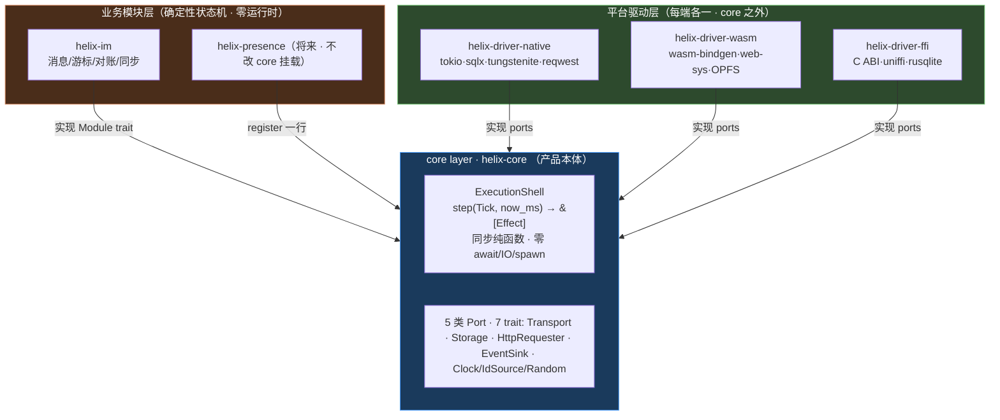
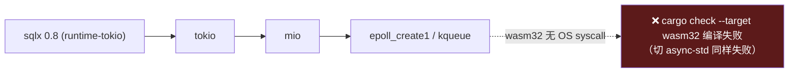
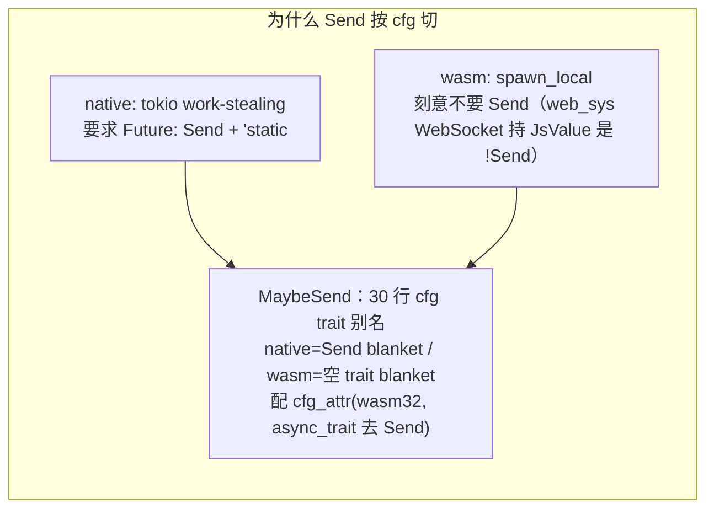
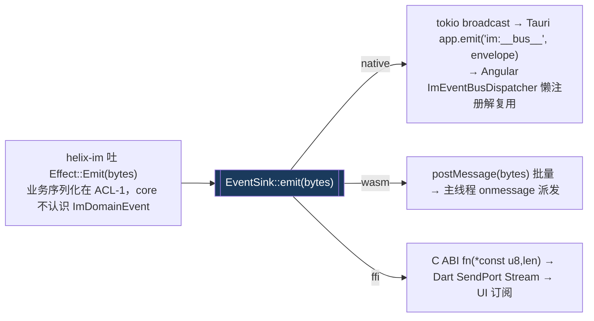
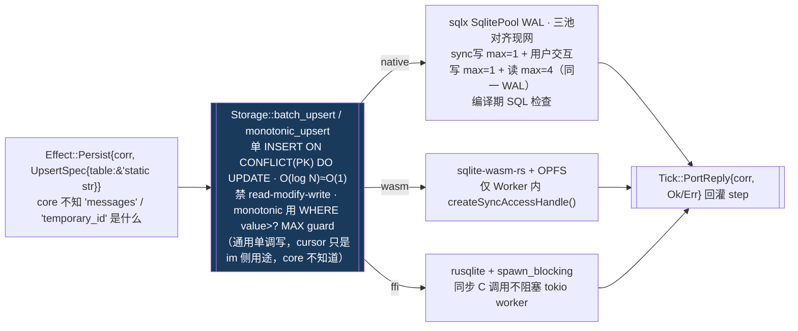
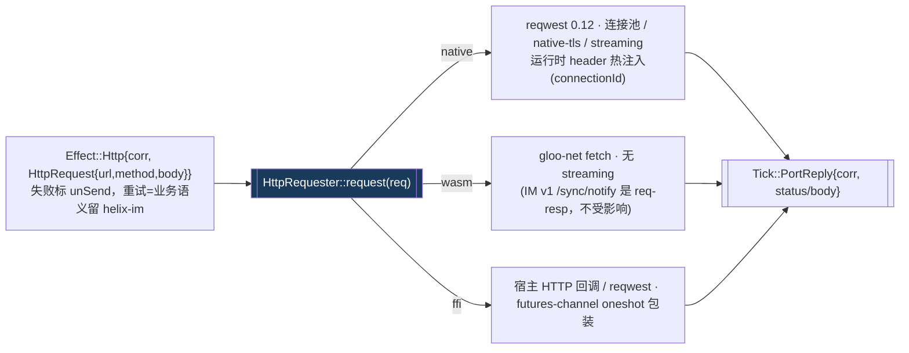
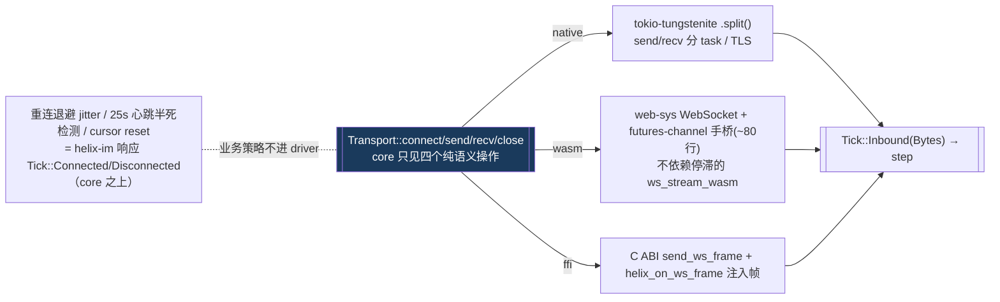
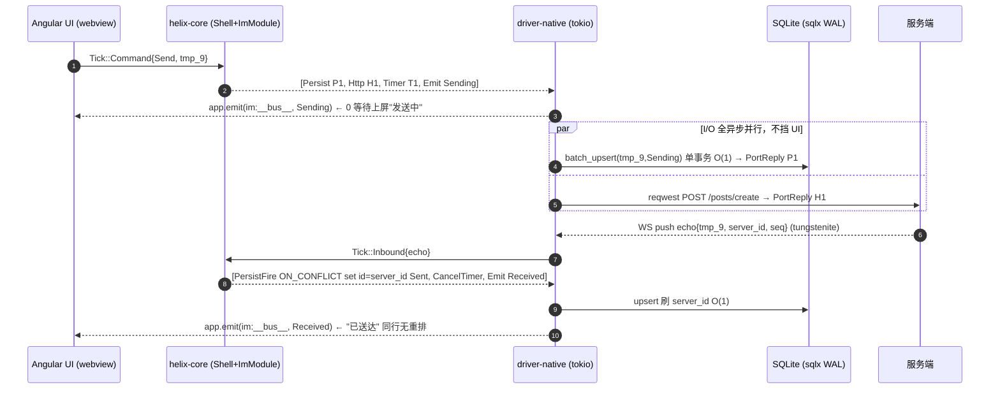
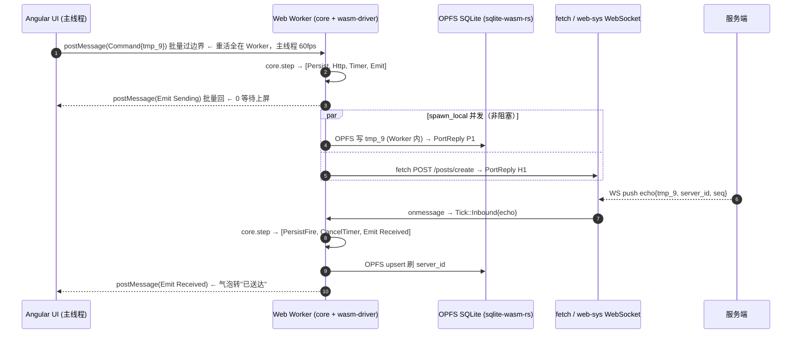
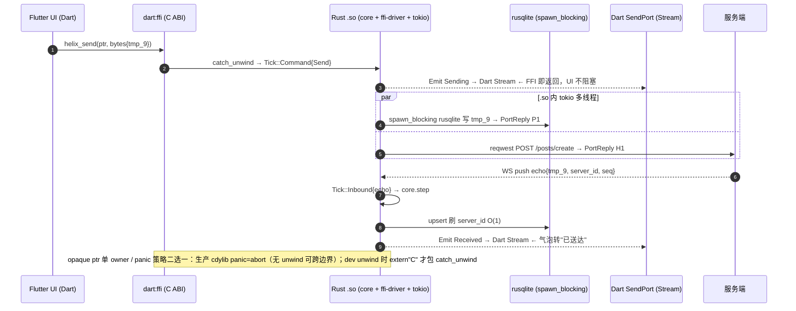

# Helix · Rust Core 技术过会（图驱动版）

> 第一人称 · 2026-06-09 · 围绕**技术选型 / 架构设计 / 流程图**，不堆文字。
> 事实基准：`helix-core` 零运行时实测绿 + 三栖编译绿 + 7 条 HX-C 护栏。

---

## §0 原点（一句话量这次过会）

> **Helix = 运行时无关的确定性业务内核**：业务逻辑写一次，编译到三端（native/Tauri · wasm/浏览器 · FFI/移动），行为一致、可回放可测试；core 不认识任何业务，IM 是第一个 guest 模块。

要解决的三个核心问题 → 这次每个技术选型都回答「它为哪个问题打地基」：

| | 核心问题 | 现状的痛 |
|---|---|---|
| **P1** | 业务逻辑写三份 | 三端各写 IM ≈2550 行，维护三份 |
| **P2** | Bug 修三处、行为分叉 | cursor Bug native 修完，FFI/wasm **后续**才同步 |
| **P3** | 业务逻辑测不动 | 测试依赖真实平台，覆盖率 <40%，时序 Bug 难复现 |

判据：**是为原点构建的框架，不是打补丁。** 下面用图说话。

---

## §1 架构设计（一张图看依赖方向）



**所有箭头指向 core，core 无任何指向外部的箭头。** 不是审查约定，是 Cargo 编译铁律——core 的 `Cargo.toml` 写了 `tokio` 或 `helix-im` 立即编译报错。


---

## §2 技术选型总表 + 为什么（第一性原理）

| 维度 | native | ffi | wasm | core/im | 为什么这样切 |
|---|---|---|---|---|---|
| Async 执行器 | tokio multi-thread | 宿主线程池 | spawn_local | 无执行器 | wasm 无 OS 线程，tokio 编不过 |
| Channel | tokio::sync | futures-channel | futures-channel | **futures-channel** | 唯一 executor-agnostic + 实现标准 Stream/Sink |
| async trait | async-trait(Send) | async-trait(Send) | async-trait(?Send) | `MaybeSend` cfg 切 | wasm `!Send`，AFIT 非 dyn-safe（见下） |
| Storage | sqlx + SQLite WAL | rusqlite + spawn_blocking | sqlite-wasm-rs + OPFS | `Storage` port | sqlx 依赖链 wasm 编不过（见下） |
| HTTP | reqwest 0.12 | 宿主回调 | gloo-net fetch | `HttpRequester` port | wasm fetch 无 streaming，IM v1 不受影响 |
| WebSocket | tokio-tungstenite | C ABI 回调 | web-sys WS + 手桥 | `Transport` port | 换库不改 core/im 一行 |
| 时钟 | SystemTime | host fn | js_sys::Date | `Clock` port 注入 | `Instant::now()` 在 wasm **运行时 panic** |
| panic | abort | 二选一：生产 abort；dev unwind 时 extern "C" 包 catch_unwind | abort | 返回 Result | panic 跨 FFI 是 UB；wasm 省 unwind 表 |

**两条最常被挑战的选型，根因图：**





> **为什么不用 AFIT 全静态分发省掉 Box**：AFIT 的关联 future 非 dyn-safe，而 `Box<dyn Transport>` 要同时持 native+wasm 两种实现，必须 dyn-safe；改泛型则 driver 类型被拉进 core，违反铁律。Box 开销不在 `step()` 热路径（step 同步、不调 port），可接受。

---

## §3 核心数据流：sans-IO 闭环（一张图）

```mermaid
flowchart TD
    IO["平台 I/O：WS 帧 / HTTP 响应 / Timer 到期 / 宿主命令"] -->|包成 Tick| STEP
    STEP["ExecutionShell.step(Tick, now_ms)<br/>严格同步 · 零 await/IO/spawn · 返回 &[Effect]"]
    STEP --> E1["Effect::Send → driver 写 WS 出站"]
    STEP --> E2["Effect::Persist{corr} → driver 写库(await)"]
    STEP --> E3["Effect::Http{corr} → driver 发请求"]
    STEP --> E4["Effect::ScheduleTimer → driver 注册定时器"]
    STEP --> E5["Effect::Emit(bytes) → EventSink（emit 入队立即返回 · 批次边界=一次 step）"]
    E2 -->|Tick::PortReply{corr,Ok/Err}| STEP
    E3 -->|Tick::PortReply| STEP
    E4 -->|Tick::Timer| STEP
    style STEP fill:#1a3a5c,color:#fff,stroke:#4a9eff
```

**确定性来源**：相同 Tick 序列 + 相同初态 = 相同 Effect 序列 → `proptest` 可回放（解 P3）。时间/随机/ID 全由 port 注入，core 不调 ambient `Instant::now`/`rand`。

---

## §4 四大能力 · 一个 port，三端流程图（headless 可插拔核心）

四能力 = 四个互不依赖的 trait，任一可单独 feature 启用。统一形态：**core 吐意图 → port → 三端 driver 各自兑现 → 结果回灌 Tick**。

### §4.1 EventBus —— `EventSink::emit(DomainEventBytes)`（同步 O(1)，core 只见不透明字节）


落地约束：emit 单点收口（CI grep gate 防回环）；fan-out 用 broadcast，core 内部 channel 用 futures-channel。

### §4.2 Storage —— `batch_upsert / monotonic_upsert / get`（热路径 O(1)，port 无 IM 语义）



### §4.3 HTTP —— `HttpRequester::request(HttpRequest)`（url 由 im 拼，重试不内置）



### §4.4 WebSocket —— `Transport::connect/send/recv/close`（握手/重连/心跳=driver 私有，业务策略在 im）



**headless 可证**（现场跑）：`cargo tree -p helix-driver-native --features storage | grep tungstenite` → 空（只启 storage 不拉 ws）；`cargo test -p helix-core --no-default-features` → mock port 纯单测，不起 tokio/SQLite/WS。feature additive（Cargo unification 单调并集，互斥必爆）。

---

## §5 真实例子：发一条消息，三端怎么扭转

**统一 Core 时间线（三端一字不差，业务逻辑只写一次）**：

```
A 发送   step(Tick::Command{Send, tmp_9, content}) 吐:
           Persist{P1, Upsert(messages, key=tmp_9, Sending)}   ← 乐观落库
           Http{H1, POST /posts/create}                        ← 发服务端
           ScheduleTimer{T1, 15000ms}                          ← 超时
           Emit(Sending{tmp_9})                                ← UI 0 等待上屏
B 服务端  存库 → 分配 server_id + channel_event seq → WS 推 echo(带 tmp_9)
C 对账   step(Tick::Inbound{echo}) 吐:
           PersistFire{ ON CONFLICT key=tmp_9 → id=server_id, Sent }  ← 同行刷 id 无重排
           CancelTimer{T1}
           Emit(Received{完整消息})
收敛(C006)  echo 15s 没来 → Tick::Timer → 标 UnSend；迟到 echo 仍按 tmp_9 覆盖回 Sent
```

### ① PC = Tauri（driver-native · tokio 多线程）



### ② Web = WASM（driver-wasm · 单线程 + Web Worker）



### ③ 移动 = FFI（driver-ffi · .so 内置 tokio + Dart SendPort）



### 三端共因对照（同一份 core 逻辑，driver 各取所长）

| 维度 | PC/Tauri | Web/WASM | 移动/FFI | 结论 |
|---|---|---|---|---|
| UI 被 I/O 阻塞 | 否(tokio 线程) | 否(Worker 隔离) | 否(SendPort 流) | **渲染永不碰 I/O** |
| 乐观上屏 | app.emit 立回 | postMessage 立回 | SendPort 立回 | **0 等待先上屏** |
| 并发 | tokio 多线程 | spawn_local | .so 内 tokio | core 不假设线程 |
| 跨边界 | 进程内 | 批量过 wasm↔JS | 批量过 FFI | **批处理不逐条** |
| 热路径写 | sqlx O(1) | OPFS O(1) | rusqlite O(1) | **单 INSERT/UPDATE WHERE PK** |
| 对账/超时/cursor | 同一份 | 同一份 | 同一份 | **写一次、可单测、三端一致** |

---

## §6 一致性不变量（红线：不一致 = 架构失败）

| 不变量 | 守护机制 |
|---|---|
| 对账幂等 | temporaryId 为 PK + ON CONFLICT 刷 server_id，echo/timer 两序收敛 |
| Emit 非阻塞 · 乐观上屏 | EventSink::emit 三端契约：入队立即返回（不阻塞 step）；UI 实时性靠 Emit 事件驱动，不依赖「写后立读可见」；Persist/Http 任意到达顺序靠幂等 upsert + 单调 cursor 收敛 |
| 无自动补发 | Module::handle 不产出自动重发 Effect，UnSend 是终态 |

> **§0 的 P2「Bug 修三处、行为分叉」在此架构下不可能发生**——从来只有一份 cursor 逻辑在 helix-im，三端 driver 执行同一 spec。

---

## §7 路线图（核心问题还要几个 MVP）+ 决策请求

| 阶段 | 内容 | 工期 |
|---|---|---|
| M0 | 骨架三栖绿 + 7 护栏 + core 零运行时实测 |  |
| M1 | core 单测补全，sans-IO 可回放 |  |
| **M2** | **native 端到端跑通完整 IM（发送/对账/同步/心跳）** |  |
| M3 | wasm OPFS + WS 联调，浏览器演示 IM |  |
| M4 | FFI 移动端联调 | |
| M5 | presence 挂载（register 一行，**core 一行不改**）= 框架 vs 补丁终极验收 | |

**请求批准 M2**：1 名 Rust，3-4 周；交付 Tauri Desktop 完整 IM 路径运行 + 三栖编译持续绿；验收 `cargo test -p helix-im` 通过 + §10 验证命令（cargo tree 零运行时 / core 零 IM 概念 grep）现场为真。

---


## §10 回到那句反问

> 「我现在做的，是为原点构建的框架，还是在打各种补丁？」

- **headless 守住**：core 里 `channel/message/temporaryId` = 0 行（实测），等价「view 里没有 style」。
- **语义层建出来**：EventBus/Storage/HTTP/WS 是四个真实 port trait + 三端实现（§4 四张图），不是「该建的没人实现」。
- **没反复横跳**：关键决策落进 `decisions.md` ADR + 7 护栏，每条有第一性原理背书。
- **框架不是补丁**：每个选型对应 P1/P2/P3（§2/§4/§5）；M5 presence 挂载零改 core 用代码裁决。

**守原点不漂移的机制 = Cargo 依赖图 + 7 张可执行护栏 + 三端同一份 Tick/Effect 时间线。
