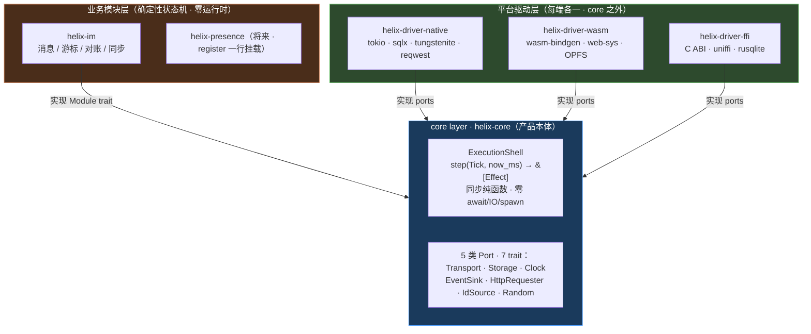
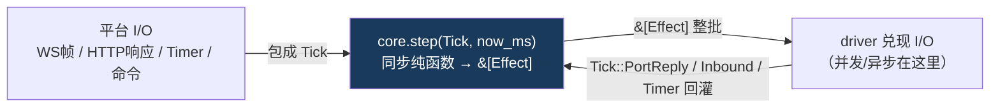
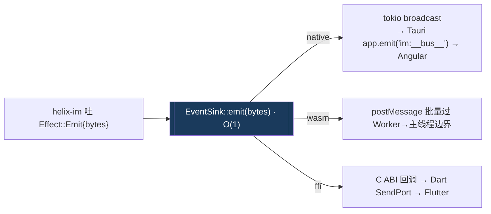
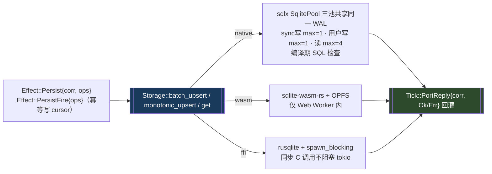
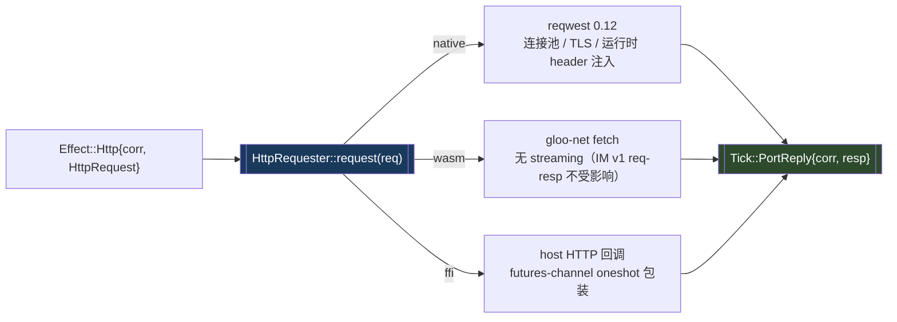
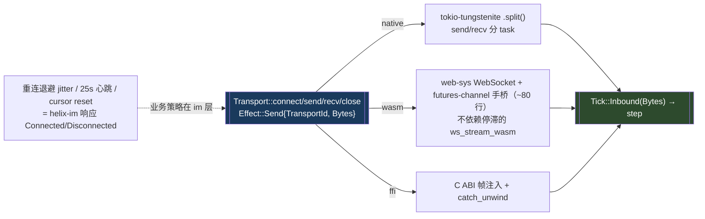
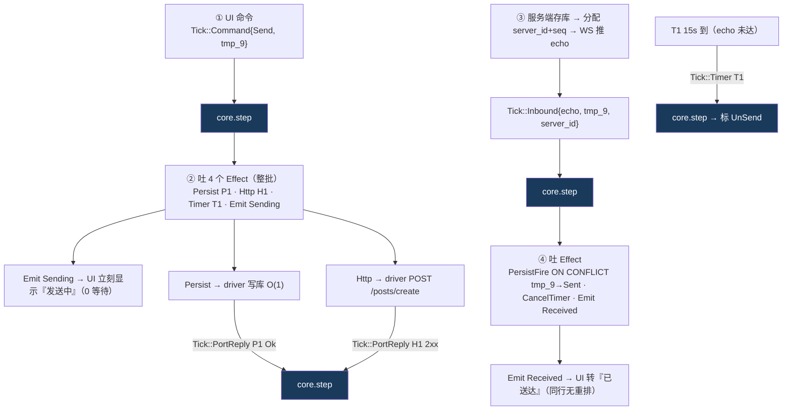
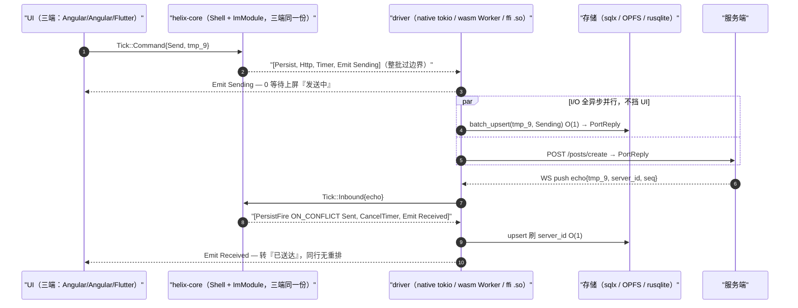

# Helix Core 技术过会方案

> 第一人称 · 2026-06-09 · 技术部
> 一句话：**Helix 是一个运行时无关的确定性业务内核——业务逻辑写一次，编译到三端（native/Tauri · wasm/浏览器 · FFI/移动），行为一致、可回放、可单测；core 不认识任何业务，IM 是第一个跑在上面的模块。**
>
> 📚 **文档关联**（完整阅读顺序见 [`README.md`](./README.md)）：[大白话解读](./helix-方案-大白话解读.md) → **本方案** → [完美过会指南](./helix-Rust-Core-完美过会指南.md) → [评审纪要](./helix-技术评审纪要.md)。**最新拍板结论以评审纪要为准。**

---

## 1. 目标：业务逻辑写一次，三端一致

我要解决的核心问题是：现在**两端在跑**（桌面 Tauri/Angular + 移动 Flutter，浏览器是未来），业务逻辑各写一套，维护多份、Bug 修多处、行为会分叉（亲手联调修过的疤：一端的 Bug 修完，另一端 4 个月后才同步；Flutter 再对一次就是回调地狱）。Helix 把业务逻辑收口成一份，编译到三端跑。

**具体要求：**

- **a.** 一份 IM 业务逻辑（发送/对账/增量同步/心跳）编译到三端，行为一致、可回放
- **b.** `helix-core` 零运行时依赖（不碰 tokio/sqlx/web-sys/tauri）、零业务概念——真正的 **headless**
- **c.** 业务逻辑可在**无 webview / 无真网络 / 无真数据库**下单测（确定性，可 proptest 穷举竞态）
- **d.** **EventBus / Storage / HTTP / WebSocket** 四大能力做成**可插拔、无头、行为级解耦**（模块只用它需要的能力）、**互不强依赖**（编译级裁剪未做，定性见 §3.5）
- **e.** 加新业务模块 = `register()` 一行；加新端 = 实现 ports；两种情况 **core 一行不改**（开闭原则）

**衡量标准（可现场验证）：**

| 目标 | 验证命令 | 现状 |
|---|---|---|
| a/e 三栖一份逻辑 | `cargo check` native + `--target wasm32-unknown-unknown` | ✅ 编译绿 |
| b core 零运行时 | `cargo tree -p helix-core \| grep -iE 'tokio\|sqlx\|reqwest\|web-sys\|tauri'` | ✅ 空输出 |
| b core 零业务概念 | `grep -rn 'channel\|message\|temporaryId' crates/helix-core/src/ \| grep -v '//'` | ✅ 0 行 |
| c 确定性 | `grep -rn 'Instant::now\|rand::' crates/helix-core/src/` | ✅ 0 行（time/random 由 host 注入）|

> `helix-core` 实测依赖只有 6 个纯 Rust 库：`serde / thiserror / bytes / async-trait / futures-channel / tracing`。

---

## 2. 架构设计：三层 + 依赖单向 + sans-IO

### 2.1 三层架构（依赖方向单向 driver → core，永不反向）



**所有箭头指向 core，core 无任何指向外部的箭头。** 这不是审查约定——core 的 `Cargo.toml` 一旦写了 `tokio` 或 `helix-im`，立即编译报错。**Cargo 依赖图是物理裁判。**

### 2.2 sans-IO 纯状态机：core 不做 I/O，只描述意图

core 是纯状态机：喂入 `Tick`（入站帧 / 端口响应 / 定时器 / 命令）+ `now_ms`，吐出 `&[Effect]`（想做的 I/O 声明）。`step()` 严格同步，零 `await`、零 I/O、零 `spawn`。真正的网络/存储由 driver 兑现 Effect，结果包成下一个 Tick 喂回。



**为什么这么做**：① wasm 单线程没有 tokio reactor，`step()` 不含 `await` 才能三端同跑；② 纯函数 → 相同 Tick 序列得相同 Effect 序列 → 可回放、可单测；③ 时间/随机/ID 由 host 经 port 注入，core 不调 `Instant::now`（在 wasm 会运行时 panic）。

> 工程内涵：这等于**手写了一个执行器无关的 stackless 协程**——把 async 控制流从「编译器生成的、绑定执行器的匿名状态机」reify 成显式数据（`Effect` + `Tick` + `Correlation` 延续令牌）。这是确定性 / 三栖 / 可回放三个属性的共同根因。

---

## 3. 四大能力设计（EventBus / Storage / HTTP / WS Transport）

统一形态：**core 吐意图（Effect）→ port trait（契约）→ 三端 driver 各自兑现 → 结果包成 Tick 回灌**。四个能力是四个**互不依赖**的 trait（`EventSink` 不 import `Storage` 任何类型，可现场 grep 验证）。模块只调 `out.push(Effect::...)`、按需选用，从不直接调 port——这是 headless 的落地方式。

### 3.1 EventBus —— `EventSink` port

```rust
pub trait EventSink: MaybeSend + MaybeSync + 'static {
    fn emit(&self, event: DomainEventBytes);   // 同步、非 async，只登记意图
}
```

`emit` 同步非阻塞；`DomainEventBytes` 是 `bytes::Bytes`（引用计数零拷贝），**core 只搬字节、不认识 IM 事件类型**（业务序列化在 helix-im 的 ACL-1）。



### 3.2 Storage —— `Storage` port（热路径 O(1)，无业务 schema）

```rust
pub trait Storage: MaybeSend + MaybeSync + 'static {
    async fn batch_upsert(&self, spec: UpsertSpec)        -> Result<(), PortError>;
    async fn batch_update(&self, table: &str, ...)        -> Result<(), PortError>;
    async fn monotonic_upsert(&self, spec: MonotonicUpsertSpec) -> Result<(), PortError>; // 通用单调写（MAX guard：WHERE value > current，严格 >）
    async fn get(&self, spec: GetSpec)                    -> Result<Option<Row>, PortError>;
}
```

port 上无 IM 语义：`UpsertSpec.table` 是 `&'static str`（编译期常量，零堆分配），值由 helix-im 提供，driver 只拼 SQL、不知道 `"temporary_id"` 是什么。热路径全是单 `INSERT ON CONFLICT(PK)`（O(1)），禁 read-modify-write。



> **sqlx 为什么不能编 wasm**：sqlx 锁死 tokio runtime，tokio io-driver→mio 需要 OS 级 epoll/kqueue/iocp，`wasm32-unknown-unknown` 不提供这些 syscall（wasm 的 async 由浏览器事件循环驱动）。这正是 trait 后面放三个不同后端、而非「同一个 sqlx 三端跑」的根因。

### 3.3 HTTP —— `HttpRequester` port

```rust
pub trait HttpRequester: MaybeSend + MaybeSync + 'static {
    async fn request(&self, req: HttpRequest) -> Result<HttpResponse, PortError>;
}
```

`url` 由 helix-im 拼；**重试是 driver 的责任**（driver 负责连接复用与重试策略，需幂等 + 退避）；**helix-im 不重试，失败只标 UnSend**（源码 `ports/http.rs` 注释为准）。



### 3.4 WebSocket Transport —— `Transport` port

```rust
pub trait Transport: MaybeSend + MaybeSync + 'static {
    async fn connect(&mut self) -> Result<(), PortError>;
    async fn send(&mut self, frame: Bytes) -> Result<(), PortError>;
    async fn recv(&mut self) -> Result<Option<Bytes>, PortError>;
    async fn close(&mut self) -> Result<(), PortError>;
}
```

port 只暴露四个纯语义操作。**握手、帧分片、TLS、重连退避、心跳全是 driver 私有；重连业务策略（cursor reset / pendingSends flush）在 helix-im**，由响应 `Tick::Connected/Disconnected` 表达。



### 3.5 四能力可插拔 / 单独可用

| 能力 | port | 三后端 | core 是否依赖它 |
|---|---|---|---|
| EventBus | `EventSink` | broadcast / postMessage / C ABI | 否（只定义 trait）|
| Storage | `Storage` | sqlx / OPFS / rusqlite | 否 |
| HTTP | `HttpRequester` | reqwest / fetch / host | 否 |
| WS | `Transport` | tungstenite / web-sys / C ABI | 否 |

四 trait 互不依赖——`NativeEventSink` 不 import `NativeStorage` 任何类型（core trait 层结构解耦，可现场 grep 验证）。feature 必须 **additive**（Cargo unification 是单调并集，互斥 feature 在 diamond dep 下必爆）。**定性（已拍板）**：这是**行为级解耦**——模块只 emit 它需要的 Effect；`Effect` 是单一 enum，**四能力编译级裁剪未做**（唯一未来口子是 wasm 包体积，见 §7）。集成测试可只用 `helix-core` + mock port，不起任何运行时。

> 现状：driver 的四能力 feature 拆分是 **M2 目标**，当前 `helix-driver-native` 仍是无条件依赖（见 §7 技术债）。`helix-core` 本身已是 feature 纯净的。

---

## 4. IM 发送消息真实链路（mermaid 流程图）

### 4.1 统一 Core 时间线（三端一字不差，业务逻辑只写一次）

```
A 发送   step(Tick::Command{Send, tmp_9}) 吐:
           Persist{corr=P1, Upsert(messages, key=tmp_9, Sending)}   ← 乐观落库
           Http{corr=H1, POST /posts/create}                       ← 发服务端
           ScheduleTimer{T1, 15000ms}                              ← 发送超时
           Emit(Sending{tmp_9})                                    ← UI 0 等待上屏
B 服务端  存库 → 分配 server_id + channel_event seq → WS 推 echo（回带 tmp_9）
C 对账   step(Tick::Inbound{echo}) 吐:
           PersistFire{ON CONFLICT key=tmp_9 → id=server_id, Sent}  ← 同行刷 id，UI 无重排
           CancelTimer{T1}
           Emit(Received{完整消息})
收敛     echo 15s 没来 → Tick::Timer → 标 UnSend；迟到 echo 仍按 tmp_9 覆盖回 Sent
```

### 4.2 主链路流程图（core 时间线 → Effect → driver → 回灌）



> **双序收敛**：echo 与 timer 两条 racing 事件流，靠两个代数律收敛到一致终态——① 对账幂等（`temporaryId` 为 PK + `ON CONFLICT`，重复写结果相同）② cursor 单调（`WHERE value > current` = SQL 层 CAS，乱序回报推不回去）。所以**不需要加锁串行化**，wasm 单线程也成立。

### 4.3 三端落地（同一份 core，driver 各取所长）



| 维度 | native/Tauri | wasm/浏览器 | ffi/移动 | 结论 |
|---|---|---|---|---|
| 并发 | tokio 多线程 | 单线程 spawn_local | .so 内 tokio | core 不假设线程 |
| UI 阻塞 | 否（工作线程）| 否（Worker 隔离）| 否（SendPort 流）| **渲染永不碰 I/O** |
| 跨边界 | 进程内 | 批量过 wasm↔JS | 批量过 FFI | **批处理不逐条** |
| 对账/超时/cursor | 同一份 | 同一份 | 同一份 | **写一次、三端一致** |

---

## 5. 技术选型对比表

### 5.1 三端选型总表

| 维度 | native | ffi | wasm | core/im | 为什么这样切 |
|---|---|---|---|---|---|
| Async 执行器 | tokio multi-thread | 宿主线程池 | spawn_local | 无执行器 | wasm 无 OS 线程，tokio 编不过 |
| Channel | tokio::sync | futures-channel | futures-channel | **futures-channel** | 唯一 executor-agnostic |
| async trait | async-trait(Send) | async-trait(Send) | async-trait(?Send) | `MaybeSend` cfg 切 | wasm `!Send`；AFIT 非 dyn-safe |
| Storage | sqlx + SQLite WAL | rusqlite + spawn_blocking | sqlite-wasm-rs + OPFS | `Storage` port | sqlx 依赖链 wasm 编不过 |
| HTTP | reqwest 0.12 | 宿主回调 | gloo-net fetch | `HttpRequester` port | wasm fetch 无 streaming |
| WebSocket | tokio-tungstenite | C ABI 回调 | web-sys WS + 手桥 | `Transport` port | 换库不改 core/im 一行 |
| 时钟 | SystemTime | host fn | js_sys::Date | `Clock` port 注入 | `Instant::now()` 在 wasm 运行时 panic |
| panic | abort | 生产 abort ／ dev unwind 时 extern "C" 必包 catch_unwind（二选一不混用） | abort | 返回 Result | panic 跨 FFI 是 UB；abort 下无 unwind 可跨边界，catch_unwind 无效也不需要 |

### 5.2 三栖必踩的三个陷阱（已在架构层解掉）

| 陷阱 | 现象 | 解法 |
|---|---|---|
| `Instant::now()` | wasm32 **运行时 panic** | `Clock` port 注入 `now_ms`（step 参数）|
| `sqlx` 依赖链 | wasm32 **链接失败** | `Storage` port 后面 wasm 端接 sqlite-wasm-rs + OPFS |
| `getrandom` 缺 js feature | wasm32 链接错误 | 仅在 `helix-driver-wasm` 的 wasm32 target 段加 `features=["js"]` |

---

## 6. 路线图 + 决策请求

| 阶段 | 内容 | 工期 |
|---|---|---|
| M0 ✅ | 骨架三栖编译绿 + 7 条护栏 + core 零运行时实测 | 完成 |
| M1 | core 单测补全，sans-IO 可回放，proptest 双序枚举 | 1 周 |
| **M2** | **native 端到端跑通完整 IM（补全 NativeStorage/NativeTransport 全部方法体）** | **3-4 周** |
| M3 | wasm OPFS + WS 联调，浏览器演示 IM | 3-4 周 |
| M4 | FFI 移动端联调（spawn_blocking 必补）| 2-3 周 |
| M5 | presence 模块挂载（`register()` 一行，**core 一行不改**）= 框架 vs 补丁终极验收 | 2 周 |

**请求批准 M2**：1 名 Rust 工程师，3-4 周；交付 Tauri Desktop 完整 IM 路径运行 + 三栖编译持续绿；验收 `cargo test -p helix-im` 通过 + §1 验证命令现场为真。

---

## 7. 现状与技术债（诚实）

| 项 | 状态 | 说明 / 计划 |
|---|---|---|
| driver 方法体 | 全部 `todo!()` | §3/§4 流程图描述的是**编译期类型验证为真的契约意图**；运行时端到端待 M2 补全 NativeStorage + NativeTransport |
| 四能力 feature 拆分 | M2 目标 | 当前 driver-native 无条件依赖 tungstenite/sqlx/reqwest；拆 optional dep 后「只启 storage 不拉 ws」才可验证 |
| cursor 归属（ADR-004）| **已拍板** | cursor 是 IM 模块的同步游标概念，**归 `helix-im`，不进 core**；core 只保留通用单调写原语 `monotonic_upsert`（类比 CAS，cursor/presence 心跳都用，非 IM 概念，**不进 grep 承诺**）。话术：grep 证明只含 channel/message/temporaryId 三词，须加 `\| grep -v '//'` 过滤注释行 |
| wasm OPFS 依赖 nightly | 已缓解 | CI pin nightly；`+atomics` stable 后仅改 CI |

**回到原点的判据**：headless 守住（core 零业务概念）、四能力是真实 port 设计、一份 cursor 逻辑消灭 P2「4 个月滞后」、step 纯函数让 P3「测不动」可 proptest——**每个选型都为原点打地基，不是补丁**。M5 presence 挂载零改 core，用代码裁决「框架还是补丁」。
