# Helix Rust-Core + Rust-IM 架构设计

> **现行性说明（2026-07-15）**：本文 §七的“方向 A = 只投影数据 ViewModel、view tree 属于红线”已被 ADR-015 覆盖，保留仅用于理解历史演进。现行 Headless 目标是由 `helix-im` 产出平台无关的 `InteractionFrame(ViewMutation + ActionBinding + UiDirective)`；`helix-core` 仍只提供不透明、确定性的 sans-IO 机制，具体 DOM/Angular Component/Flutter Widget/CSS/像素/动画仍在平台 shell。边界真源见 [`GOAL.md` §6](../GOAL.md) 与 [`UC01-16 跨端交互协议 SPEC`](../specs/2026-07-15-uc01-16-cross-platform-interaction-protocol-spec.md)。

> 第一人称 · 2026-06-10 · 技术部
> 机制依据：cses-client `Message-v3` + `src-tauri/src/features/im`（已逐文件核验）。
> 📚 关联：过会拍板结论以 [decisions.md「过会拍板」节](../harness/decisions.md) 为准 · 实现待办见 [ROADMAP.md §二 活账](../ROADMAP.md)（原「技术过会方案/评审待办清单」已随 docs 熵管理缩减，内容并入 decisions/ROADMAP）。
> 2026-06-15 更新：按 ADR-006，当前产品化目标收缩为 **PC Tauri + Flutter 手机端**；Web/WASM 章节保留为历史方案，不进入当前 roadmap、CI 必跑矩阵或交付验收。
> 2026-06-17 更新（实现进度落到本稿）：① **Effect 模型加 `Http`/`HttpFire` 二分**（§2.2/§3.3）+ **driver 分发统一 `BoundedSpawner`**（§3.5，背压根治）；② **sync-v2 数据路径已真 Go 端到端验证通过**（§六/§4.5/§4.6 的发送对账 + gate + 落库链路，从「契约意图待验」升级为「真 Go 跑通」，详见 [`helix-sync-v2-设计.md`](./helix-sync-v2-设计.md) §0）；③ **ping 心跳已实装**（self-arm 周期 timer + 单调 seq）；④ **refactor A**（入站二重分类 → 单 `InboundEvent` enum）+ **refactor B**（5 张 `corr_to_*` HashMap → 单 `corr_map`，`handle_port_reply` 一个 `match` 收口）已落地。

---

# 〇、术语表（先读这页，全文无障碍）

> 非 Rust / 非 IM 背景的评审从这张表进场即可。正文与流程图里的术语全部在此有一句话定义。

**内核与三件套**

| 术语 | 一句话含义 |
|---|---|
| **sans-IO（无 I/O 内核）** | 内核自己不碰网络/磁盘，只产出「我想做什么 I/O」的清单；真正动手的是外层驱动 |
| **helix-core（内核）** | 执行壳 + 端口定义 + 模块宿主，零业务、零运行时依赖 |
| **helix-im（IM 业务模块）** | 消息收发/对账/增量同步的全部业务状态机，写一份供 PC Tauri + Flutter 复用 |
| **helix-driver-native（桌面驱动）** | 桌面端的「手脚」：真正连 WebSocket、写 SQLite、发 HTTP 的实现层 |
| **Tick（输入事件）** | 喂给内核的一切「发生了的事」，共六种：四类核心——UI 命令（Command）/ 网络入站帧（Inbound）/ I/O 完成回报（PortReply）/ 定时器到期（Timer）；外加两类连接生命周期——连接建立（Connected）/ 连接断开（Disconnected） |
| **Effect（I/O 意图）** | 内核吐出的「待办清单」：发帧（Send）/ 落库（Persist·PersistFire）/ 发 HTTP（Http·HttpFire）/ 发事件（Emit）/ 定时器（ScheduleTimer·CancelTimer）。Http/HttpFire 与 Persist/PersistFire 同款二分：必达·绝不丢 vs 可丢·自愈 |
| **step()（步进函数）** | 内核唯一入口：喂一个 Tick + 当前时间，吐一批 Effect；严格同步、不做任何 I/O |
| **Port（端口）/ trait（接口）** | 内核与外界对话的 5 类抽象接口（共 7 个 Rust trait）：网络 / 存储 / HTTP / 事件 / 时间·ID·随机 |
| **Module（模块契约）** | 业务挂进内核要实现的接口：accepts（认不认这个事件）+ handle（处理并吐 Effect）+ on_start（启动时做什么） |
| **engine_loop（引擎循环）** | 驱动里那个常驻循环：收 Tick → 调 step → 兑现 Effect → 把结果包成新 Tick 喂回 |
| **确定性 / 可回放** | 同样的输入事件序列永远得到同样的输出——录下事件序列即可重放复现任何 bug |

**调度与落库**

| 术语 | 一句话含义 |
|---|---|
| **corr（关联号）/ corr_map** | 异步 I/O 的「取件码」：吐 Effect 时登记号码，I/O 完成后凭号码定向跳回发起它的模块 |
| **timer_map** | 定时器登记簿（TimerId 与 corr 是两种独立类型、两张独立登记簿，类型层互不碰撞）|
| **mpsc / broadcast** | 两种进程内通道：多生产者单消费者队列（喂命令用）/ 广播通道（发事件用） |
| **Persist vs PersistFire** | 两种落库意图：前者要回执（带取件码）；后者「写了就走」不要回执，仅限幂等写 |
| **batch_upsert / ON CONFLICT** | 批量「有则更新、无则插入」，主键冲突时覆盖——消息落库的 O(1) 热路径 |
| **monotonic_upsert（单调写）** | 「只许变大」的写库原语：新值 > 旧值才写，天然幂等、防回退（游标/心跳都用它） |
| **WAL** | SQLite 的写前日志模式，读写互不阻塞 |
| **读写分离池**（原「三池」） | native/FFI 共享 `helix-driver-host`（rusqlite，ADR-007）的连接形态：**1 个写连接**（WAL 单写者）+ **N=4 只读连接池**，共享同一 WAL 文件。原 sqlx「sync写1/用户写1/读4 三池」为重构前形态 |

**IM 同步机制**

| 术语 | 一句话含义 |
|---|---|
| **event_seq（事件序号）** | 服务端为每个频道维护的严格递增序号——增量同步的唯一依据（不是时间戳） |
| **cursor（游标/书签）** | 客户端记的「我已按序收到第几号」，断线后从这里继续补 |
| **GateState / gate（闸门）** | 每频道一份的乱序缓冲状态机：序号连续直接放行；断号先扣进缓冲，1 秒后触发 HTTP 增量同步、由**服务端**补齐缺失事件（闸门自己不补） |
| **flush_contiguous / flush_up_to** | 两种放行：弹出严格连续段（在线实时路径）/ 放行到指定号（同步权威路径） |
| **peek → 落库 → commit** | 同步落库三阶段：先只读预览、写库成功了才推进游标——防「写失败永久丢消息」 |
| **too_long（缺口过大兜底）** | 离线太久（缺口 > 5000）放弃逐条补：清内存缓冲、游标复位、重拉首屏（本地库不清，旧数据靠覆盖写） |
| **deadQueue / hello / connectionId** | 服务端短期续联三件套：断线保留的最近消息队列 / 握手帧 / 连接身份证 |
| **echo（回声）/ 对账** | 发消息后服务端经 WS 推回带正式 id 的同一条消息，客户端按临时 id（temporaryId）对上号改状态 |

**桥与平台**

| 术语 | 一句话含义 |
|---|---|
| **invoke / app.emit** | Tauri 的两个 IPC 原语：前端调 Rust 命令 / Rust 向前端广播事件 |
| **im:\_\_bus\_\_ / envelope（信封）** | 现网前后端事件单总线的频道名；信封 = `{channel, payload, tracing}` 三件套，前端按 channel 解复用 |
| **tokio / rusqlite / tungstenite / reqwest** | 桌面驱动用的四个 Rust 库：异步运行时 / SQLite 客户端 / WebSocket / HTTP |
| **wasm / OPFS / Worker** | 历史 Web 方案术语；当前已暂停维护，见 ADR-006 |
| **FFI / SendPort** | 跨语言 C 接口（移动端 Dart↔Rust 用）/ Dart 的跨 isolate 事件流通道 |

---

# 一、目标与不变量

我做一台 **sans-IO 确定性内核**（Rust-core）：定义五类端口（7 个 trait）+ 一个纯状态机执行壳，自己不做 I/O、不持有运行时。IM 的全部业务逻辑写在 **Rust-im 一份**，当前产品化编译到两端（native/Tauri · FFI/Flutter）行为一致。内核不认识任何业务，IM 是第一个 guest。wasm/浏览器端已按 ADR-006 暂停维护。

**不变量（铁律）：**

1. Rust-im 不碰内核：只依赖 core 的 ports（trait）；
2. 四能力（Http / Ws / Storage / EventBus）可插拔、可单独运行、互不强依赖。
3. 依赖单向 `driver → core`，Cargo 编译铁律强制。
4. 确定性：时间 / 随机 / ID 由 host 注入，core 纯函数可回放。

---

# 一·五、现状全景 → 目标全景（总览）

> 端到端整条 IM 链路的 as-is / to-be。**业务①** = 收发/同步/去重（方向 D），**展示②** = 排序/未读/分组/草稿（方向 A）。
> 注意时序：目标态 helix-im 内部**先 D 后 A**（Model 建好 `view()` 才有东西投影），见 [`../GOAL.md` §6](../GOAL.md) / [§七](#七core-viewviewmodel-投影机制方向-a--未来)。

## 🔴 现状全景（cses-client 今天）：业务逻辑两处分裂，移动重写一份

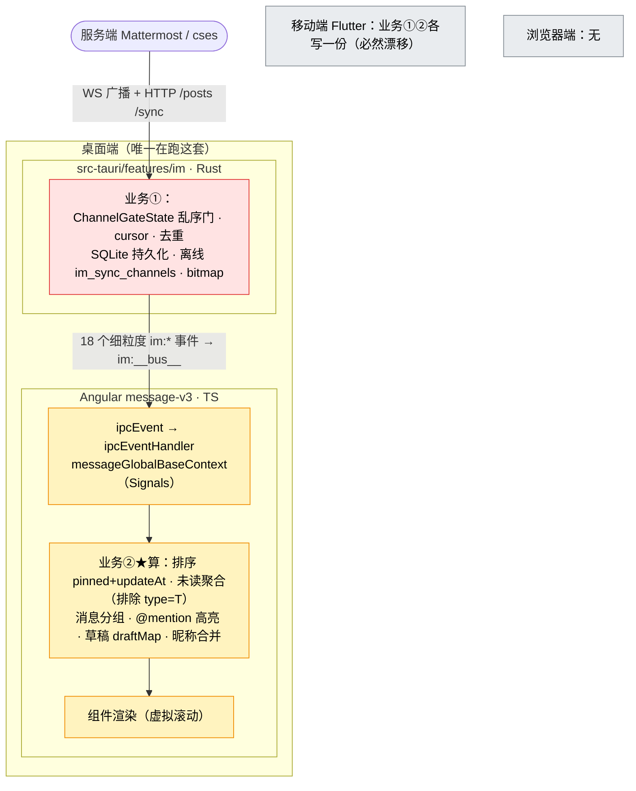

> 痛点：业务①在 Rust 但**仅桌面** · 业务②**全在 TS** · 移动**重写一份** · 不可回放测试。

## 🟢 目标全景（helix 三栖）：一份 core，业务①②全收进来，UI 退化成 dumb 渲染

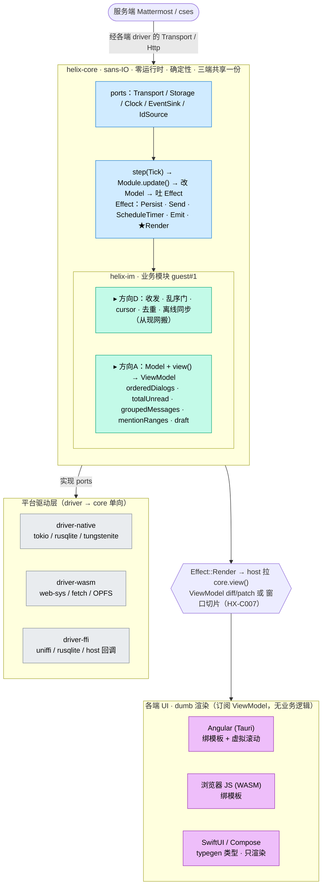

> 达成：业务①② 写一次**三端字节级一致** · 可回放测试 · 加端 = 加 driver · 加模块 = Module + register。

## 两图差异速读

| | 🔴 现状 | 🟢 目标 |
|---|---|---|
| 业务① 收发/同步/去重 | Rust，但**仅桌面**；移动重写 | helix-im 一份，**三端共享**（方向 D） |
| 展示② 排序/未读/分组/草稿 | **全在 Angular TS** | helix-im `view()`，三端共享（方向 A） |
| core ↔ UI 之间 | 18 个细粒度 `im:*` 事件 | 1 个 `im:viewmodel:patch`（Render 触发） |
| UI 各端职责 | 算业务 + 渲染 | **只渲染**（dumb） |
| 平台 I/O | 揉在 src-tauri | 关进三套 driver |
| 可测试性 | Signal 汤，不可回放 | `view`=Model 纯函数，可回放 |
| 红线 | — | core 出数字/区间 ✅，出 view 树/像素 ❌（方向 B） |

## 一·五.1 参考项目（本设计的 grounding 来源）

| 项目 | 路径 | 角色 |
|---|---|---|
| **Crux**（Red Badger） | `/workspace/rustWorkspace/crux` | 方向 A 的**参照实现**：Rust sans-IO core + `App{Model,update,view,ViewModel}` + Bridge(bincode FFI) + typegen(Swift/Kotlin/TS)。core-view / 三端边界映射直接对照它（见 [方向A设计 §1.1](./helix-core-view-方向A设计.md)） |
| **现网 cses-client** | `/Users/mac28/workspace/angular/cses-client` | **行为真源 + 现状对照**：Angular 20 + Tauri 2 IM 桌面端；`src-tauri/features/im`(业务①已在 Rust) + message-v3(展示②在 TS)。目标态的 IM 机制逐节对齐它 |
| **Dioxus core** | （上游 crate） | 内核经验来源：step 循环 / Effect 跨边界批处理（sledgehammer → `HX-C007`）/ `Scope<'a>` 生命周期教训（→ `HX-C002`）。**仅取内核，禁渲染层/RSX**（GOAL §6 方向 B 红线） |
| **Bun**（runtime 跑 JS） | — | 概念祖先：runtime 无关 + reference 行为真源方法论（见 AGENTS.md §4.5） |

---

# 二、Rust-Core 内核

## 2.1 三层架构

```mermaid
flowchart TB
    subgraph L1["业务模块层（零运行时）"]
        IM["helix-im"]
        PR["helix-meeting（第二模块·不改内核）"]
    end
    subgraph L2["★ Rust-Core 内核 ★"]
        SHELL["ExecutionShell：step(Tick, now_ms) → &[Effect]<br/>纯函数 · 零 await/IO/spawn"]
        PORTS["5 类 Port · 7 trait：Transport · Storage · HttpRequester · EventSink · Clock/IdSource/Random"]
    end
    subgraph L3["平台驱动层（内核之外）"]
        DN["driver-native：tokio·rusqlite·tungstenite·reqwest"]
        DW["driver-wasm：wasm-bindgen·web-sys·OPFS"]
        DF["driver-ffi：C ABI·uniffi·rusqlite"]
    end
    IM -->|"实现模块契约（Module trait）+ 注册挂载"| L2
    PR -->|"注册一行挂载（register）"| L2
    DN -->|"实现端口接口（ports）"| L2
    DW -->|"实现端口接口"| L2
    DF -->|"实现端口接口"| L2
    style L2 fill:#1a3a5c,color:#fff
    style L1 fill:#4a2d1a,color:#fff
    style L3 fill:#2d4a2d,color:#fff
```

箭头全指向内核，内核无外向箭头——core 的 `Cargo.toml` 写 `tokio`/`helix-im` 即编译报错。

## 2.2 内核数据流：`step(Tick) → Effect`

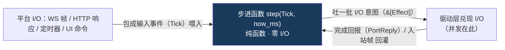

**Tick（输入字母表）：** `Command`（UI 命令） · `Inbound`（WS 帧） · `PortReply{corr, outcome}`（I/O 回报） · `Timer`（定时器到期） · `Connected`/`Disconnected`（连接生命周期，content-routed，模块据此做 cursor reset / proactive resync）。

**Effect（输出字母表）：** `Send`（发帧） · `Persist{corr}`（需回报落库） · `PersistFire`（幂等写） · `Http{corr}`（必达·绝不丢） · `HttpFire`（可丢·自愈） · `Emit`（领域事件） · `ScheduleTimer`/`CancelTimer`。

> **Http/HttpFire 可丢弃性二分（类型级背压契约，2026-06-17 落地）**：仿 `Persist`/`PersistFire`，按「这个请求丢了能不能自愈」拆两个变体——`Http{corr}` 必达（离线 sync 对账、发消息等绝不能丢，driver 队满则 Block 把背压传导回源 step）；`HttpFire` 可丢（纯遥测/可重算的轻量请求，driver 队满 DropOldest 自愈）。**sync fan-out 的 `/sync/notify` 走 `Http`（必达/Block）**。这是「丢不丢」这个语义事实进类型，不靠 driver 私自决定（详见 §3.3 + §3.5 BoundedSpawner）。

## 2.3 五类 Port · 7 个 trait（内核全部对外契约）

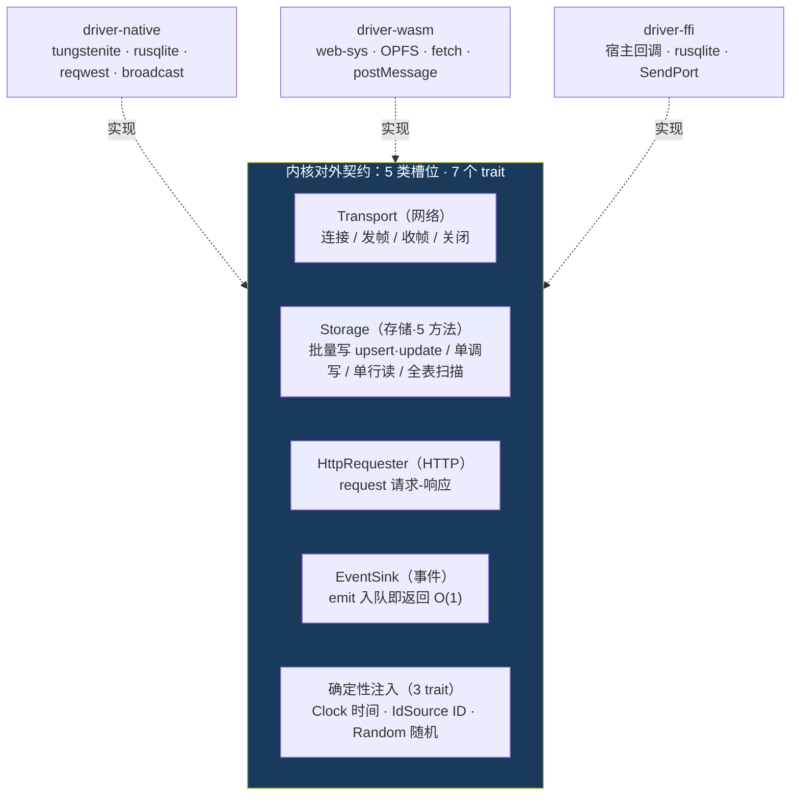

> 口径：5 类槽位 = 7 个 trait（确定性注入拆 Clock/IdSource/Random 三个）——评委问「几个 port」，两个数都对。`monotonic_upsert` 是通用单调写（MAX guard），**core 不知道这是 IM 的 cursor**。

## 2.4 业务模块挂载：`Module` trait（不碰内核的机制）

```rust
trait Module {
    fn name(&self) -> &'static str;                                // 模块名（日志/诊断）
    fn accepts(&self, tick: &Tick) -> bool;                        // 路由判定（纯函数）
    fn handle(&mut self, tick: &Tick, now_ms: u64, out: &mut EffectSink); // 处理（吐 Effect）
    fn on_start(&mut self, out) {}   // 启动：吐握手/读cursor/arm心跳
    fn on_stop(&mut self, out) {}    // 退出：必须 CancelTimer 自己 arm 的全部定时器（防 timer_map 驻留）
}
```

`handle` 签名里**没有任何 port 句柄**——模块物理上无法直接调 I/O，只能 `out.push(Effect::...)`；加模块 = `shell.register()` 一行，内核 dispatch 一行不改。

**路由（内核怎么决定事件归谁）：**

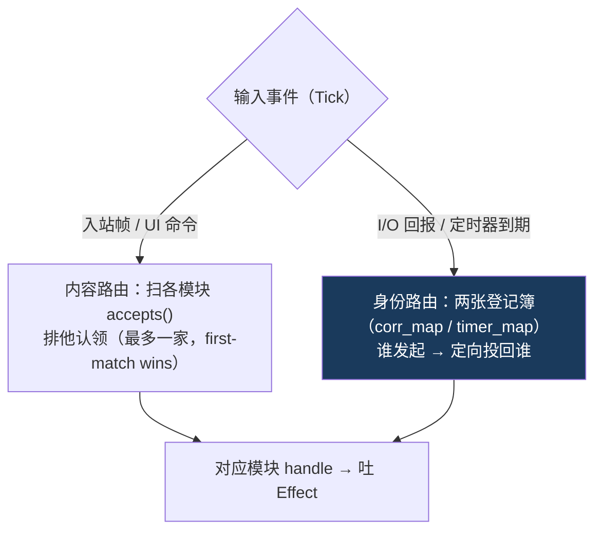

**协程调度（不写一行 async fn 的异步）：**

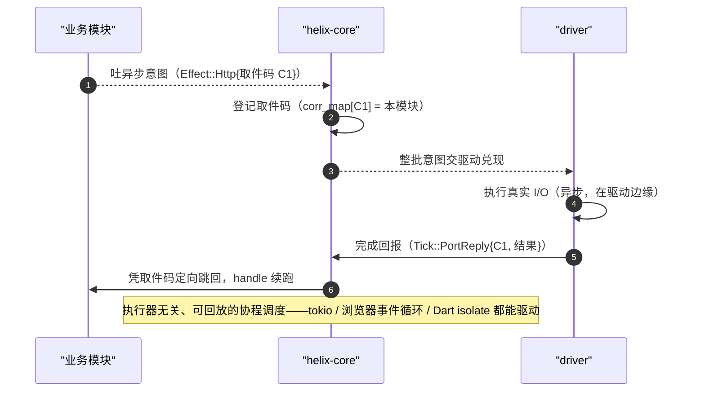

---

# 三、四大能力（可插拔基础设施）

统一形态：**内核吐 Effect → port → 三端 driver 兑现 → 回灌 Tick**。四 trait 互不 import，可单独 feature 启用。

## 3.1 EventBus —— `EventSink`（事件通知）

`emit` 入队即返回；`DomainEventBytes` 不透明字节（**core 不认识 IM 事件**），契约必须**版本化**（纪要拍板 #5，防 schema 对不齐地狱）。**批次边界 = 一次 step**：全部 Emit 攒一批过 UI 边界（HX-C007）；Persist/Http/Send 在 driver 内消化不过边界。对齐现网 `im:__bus__` 单总线 + 信封 + 懒注册。

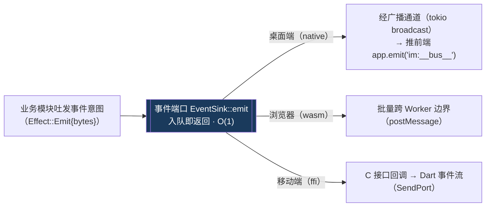

## 3.2 Storage —— `Storage`（热路径 O(1)）

port 零业务语义（`table: &'static str` 编译期常量）。native/FFI 共享 `helix-driver-host`（rusqlite，ADR-007）：**1 个写连接**（WAL 单写者，写串行本就正确）+ **N=4 只读连接池**（`SQLITE_OPEN_READ_ONLY`，WAL 下多读者与单写者并发），共享同一 WAL 文件；批量 `INSERT ON CONFLICT(PK)`（39/批，单事务）+ 禁 read-modify-write。

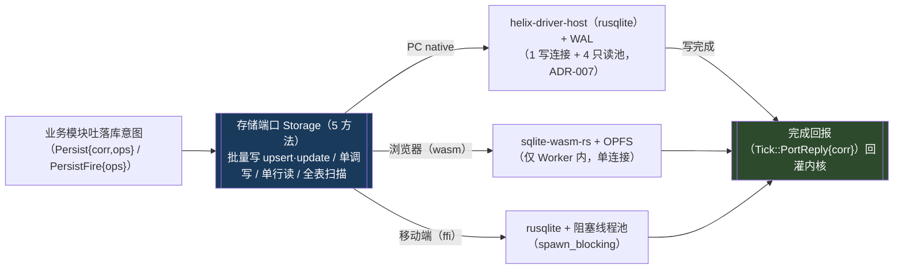

- **并发兑现**：内核 `step` 串行；driver 按 channel 分组——同 channel 顺序、跨 channel 并发（恢复现网 4-worker 性能），并发只在驱动边缘。
- **端差异**：native + FFI 共享 `helix-driver-host`——1 写连接 + 4 只读池（WAL 读并发）；FFI 经 `spawn_blocking` 不阻塞 worker。wasm（ADR-006 归档）OPFS SAHPool 单连接无读池。O(1) 热路径不变，差异只在吞吐上限。
- **存储后端选型（ADR-006/007）**：native + FFI 共享 `helix-driver-host`（rusqlite）；wasm 端已归档。（历史：sqlx 锁死 tokio→mio→OS epoll，编不过 wasm32，曾是分后端根因。）

## 3.3 Http —— `HttpRequester`

`request(HttpRequest)`。url 由 im 拼；**重试是 driver 责任**，im 不重试、失败标 UnSend。对齐现网运行时 header 注入（hello 后回注 connectionId）。
**必达 vs 可丢**：`Effect::Http{corr}` 必达（绝不丢，队满 Block）；`Effect::HttpFire` 可丢（队满 DropOldest 自愈）。sync fan-out（一次对 N channel 发 `/sync/notify`）走 `Http` 必达——离线对账不能丢。背压由统一 `BoundedSpawner` 兜（§3.5）。

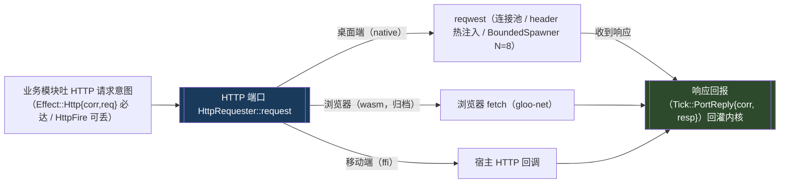

## 3.4 Ws —— `FrameSender`（core 只表达 outbound）

core port 只保留 `send(frame)`；`connect/recv/close/reconnect` 是平台连接生命周期，不再要求三端
实现同一套物理 socket API。PC/Flutter 默认复用 `SharedWsClient`，Web 由平台 bridge 兑现真实
WebSocket，并把 connected/frame/disconnected 统一喂成既有 Tick。帧解析、hello/ping、cursor reset
与主动补漏仍在 `helix-im`，不因物理连接实现不同而复制。

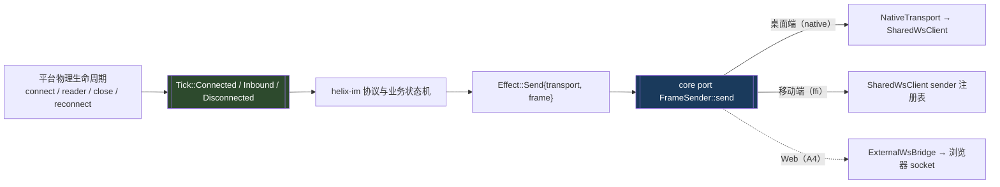

> **ping 心跳已实装（2026-06-17，commit 488e094）**：helix-im `on_start`/握手后 self-arm 一个 **recurring** timer（与 `hello.pingInterval` 对齐），到期吐 `Effect::Send{ping_frame}`，帧带**单调 seq**；`Disconnected` 时 `CancelTimer`。这修了早期握手后 ~8s 被现网 Go 断连（缺心跳保活）的问题。

## 3.5 driver effect 分发：统一 `BoundedSpawner`（背压根治，2026-06-17）

driver 兑现 Effect 的并发与背压**收敛为一套** `BoundedSpawner`，取代早期 per-type ad-hoc（旧形态是 semaphore + atomic 计数 + 泵顶 drain 三层各自为战，背压不传导回源 → sync fan-out 风暴）。

`BoundedSpawner` = 有界队列 + N worker + `on_overflow{Block, DropOldest}` + 独立 unbounded `reply_tx`（回报路径绝不背压，防回灌死锁）。Persist / Http / HttpFire 共用同一套，仅参数不同：

| Effect | N worker | on_overflow | 语义 |
|---|---|---|---|
| `Persist`/`PersistFire` | 1 | Block | WAL 单写者，写串行本就正确 |
| `Http` | 8 | **Block** | 必达——队满压回源 step（慢而不丢） |
| `HttpFire` | 8 | **DropOldest** | 可丢——队满丢最旧（自愈） |

**默认翻 Block**（背压传导回源，慢而不丢）；`DropOldest` 只给显式 `HttpFire`。删旧 semaphore + atomic + 泵顶 drain 三层。跨模块公平性 tripwire **暂不建**（YAGNI——当前单 IM 模块未现该问题）。这把「sync fan-out 不风暴」从纪律升级为结构保证：cursor 只锚 Persist 成功 PortReply（§六链路铁律），fan-out Http 必达 + Block 回压，sync 请求不被悄悄丢。

---

# 四、IM 业务模块（Rust-im）

## 4.1 用户接收消息 use case

| 用例 | 场景 | 要求 |
|---|---|---|
| UC-1 | 在线接收 | 格式通用 · 及时顺序可靠 · 不漏不重 · 只推该推的人 |
| UC-2 | 网络波动 / 极短离线 | 快速补上错过的消息，推送规则与服务端一致 |
| UC-3 | 关机隔夜 | 不全量更新；大批量分段拉；对话列表丝滑刷新 |
| UC-4 | 离线一周 | 置顶群优先 · 后台空闲无感同步 · 任意点切入滚动加载 |

## 4.2 满足用例1.a 的结构化事件推送格式

per-channel 严格单调 `event_seq` 是增量同步的心脏（非 timestamp）；WS 实时 + HTTP 增量同用一套 `ImEvent`：

```rust
struct ImEvent {
    event_seq: i64,    // per-channel 严格单调（cursor 推进 / 乱序检测唯一依据）
    event_type: i8,    // 1=new  2=edit  3=delete  6=read(已读echo,多设备)
    msg_id: Option<String>,
    actor_id: String,
    created_at: i64,
    payload: Option<Value>,
}
// WS 帧：{ action, data:{ post, event_seq, channel_id }, broadcast:{channel_id} }
// action 全集：hello · post/post_update/posts_update/post_read · increment_channel(_end)/update_channel/channel_created/channel_member_update
```

> `event_seq` 三级 fallback（edit 在 per-post `props.channel_event_seq`、delete 在顶层）—— B4 解析已落地（parser event_seq fallback，见 HX-C008）。

## 4.3 满足用例1 的连接初始化机制

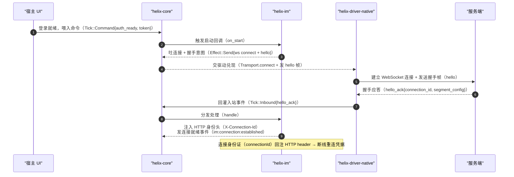

## 4.4 三端宿主接入（UI ↔ core 边界）

三端只是「喂命令（Command 进）/ 送事件（Emit 回）」这层薄桥不同——Tauri 用 invoke/emit、WASM 用 postMessage、FFI 用 ffi-call/SendPort；**core + Rust-im 一字不差**。

### 4.4.1 PC / Tauri 接入：融入现网 cses-client（message-v3 + src-tauri/im）

融入原则一句话：**IPC 契约面冻结，只换 Rust 侧内部引擎——Angular message-v3 一行不改。**

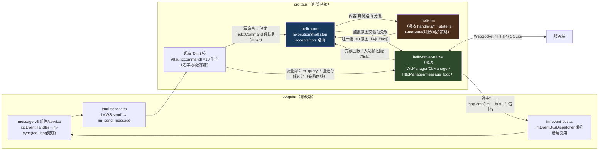


**读旁路一致性**：查询只见**已落库**状态；UI 实时性靠 Emit 乐观上屏，从不依赖「写后立读」；cursor scan 读到旧值最多多发一次 sync（benign over-sync，单调 + 幂等兜住）。旁路是 native 形态，wasm 读同经 Worker 单连接（§3.2）。

**现网组件搬迁映射（谁去哪）：**

| 现网（src-tauri/features/im） | 归宿 | 说明 |
|---|---|---|
| handlers/{hello,post,sync,channel}.rs + state.rs GateState | **Rust-im**（`handle` + owned 状态） | 业务状态机一份三端、可回放（§4.5–4.8） |
| WsManager / DbManager / HttpManager | **driver-native** 的 Transport / Storage / Http 实现 | 平台胶水，所有模块共享 |
| message_loop dispatcher + 4-worker hash 分片 + 200ms flush | **driver-native** 按 channel 并发兑现 Persist | 并发出内核进 driver（§3.2），性能形态不变 |
| event_bus::emit_im 单点 | **NativeEventSink** | 同 envelope、同 `im:__bus__` |
| repo/ batch_upsert ON CONFLICT | Storage driver 内部 SQL | O(1) 热路径不变 |
| commands.rs ×12 | 原文件保留，内部改喂 Tick / 直连读池 | 前端契约冻结 |

> Angular 唯一保留职责：too_long 兜底（清**内存** buffer + 重拉首屏；SQLite 不清、upsert 覆盖——已知 trade-off），零改动。**交付物是「换引擎」，不是「重写客户端」。**

### 4.4.2 Web 浏览器 / WASM 接入

> **已暂停维护（2026-06-15 / ADR-006）**：网页端当前不做，以下方案仅作历史归档。不要把本节内容转成实现任务、验收项或 CI 必跑项；未来若重启 Web，需要先新增 ADR 重新评估 IndexedDB/OPFS/Worker/cache 策略。

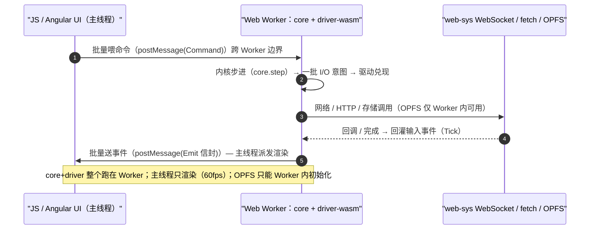

- **过边界的只有 Command（进）/ Emit（出）**，批量传输、批次 = 一次 step（§3.1）；Persist/Http/Send 及回报全在 Worker 内消化，零 postMessage 开销。
- **core+driver 整体进 Worker**：OPFS 仅 `DedicatedWorker` 可初始化，主线程零阻塞（wasm 编译必加 `getrandom js` feature，HX-C004）。
- **调度**：协作式单线程 `onmessage → step → spawn_local 兑现 → 回灌 → step`，无锁；读查询直连 Storage、带 request_id 回传，不进 step。可回放对象 = 线性化 Tick 序列，与各端调度时序无关。

### 4.4.3 Flutter 移动 / FFI 接入

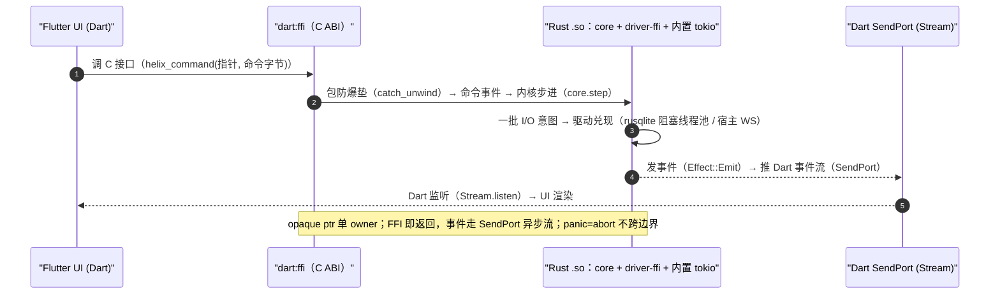

- **喂命令/业务查询** `helix_command` 调用即返回（不阻塞 UI isolate），结果通过批量 DomainEvent 返回；`helix_query` 只提供 capabilities/version 元信息，不直连 Storage。
- **送事件**：Emit 经 `SendPort` 异步流回，`Stream.listen` 渲染。
- **FFI 铁律**：opaque ptr 单 owner（`into_raw`/`from_raw` 各一次）；panic 策略**二选一不混用**——生产 cdylib `panic="abort"`（无 unwind 可跨边界，无需 catch_unwind）/ dev unwind 时每个 `extern "C"` 包 `catch_unwind` 转错误码。

## 4.5 满足用例1 的发送消息机制（乐观 → HTTP → echo 对账 → 双序收敛）

> ✅ **已真 Go 端到端验证（2026-06-17）**：本节链路（乐观落库 → HTTP post → WS `post` 帧回声 → tmp_id↔server_id 对账 → cursor 推进 → `im:post:received`）在真 Go :8065 上跑通。注意真帧 action 名是 **`post`**（非 `posted`），echo 经 `temporary_id` 匹配回正 `server post.id`。详见 [`helix-sync-v2-设计.md`](./helix-sync-v2-设计.md) §0/§2.5。

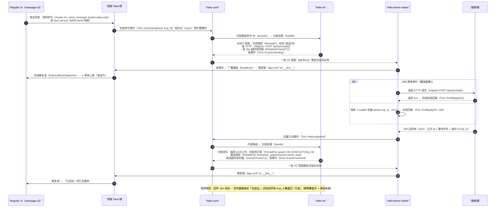

> **不变量（R4-echo-gate）：echo 对账与 channel gate 解耦。** echo 对账只读 `pending_sends`/`corr_map`（按 temporary_id 对号），**从不读 `channels`**，故 `reconcile` 必须无条件先做，**不**门控 channel 是否已注册；落库 / 推进游标（`ch.ingest`）才门控注册。否则冷启动 send-before-cursor-seed 乱序下（本端先 send、channel 尚未经 increment 种 cursor），本端回声会被整段跳过 → PendingSend 残留 → 15s 后误标 UnSend。回归锚见 `tests/post_action_inbound_test.rs::echo_reconciles_even_when_channel_unregistered`。

## 4.6 满足用例2-4 的增量同步机制（per-channel Gate 状态机）

> ✅ **sync-v2 数据路径已真 Go 验证（2026-06-17）**：在线 WS `post` 帧 gate apply、离线 `/sync/notify`（pull）补齐含 phantom/已读(type6)/编辑(type2)/撤回(type3)、message 内容落库 + read_bits 单调覆盖、cursor 跳号容忍 + 锚权威 `nextSeq`——核心数据路径真 Go 跑通。三 blocker（grpc-deviceId / sync 风暴-并发闸 / WS-post-action-parser）全清；fan-out 的 `/sync/notify` 走 `Effect::Http`（必达/Block，§3.5 BoundedSpawner），不再风暴。剩冷启动自愈 + golden fixtures，详见 [`helix-sync-v2-设计.md`](./helix-sync-v2-设计.md) §6/§7。

**ChannelGateState（Rust-im owned）：** `cursor`（已按序确认的 max event_seq） · `buffer: BTreeMap<i64,ImEvent>`（乱序缓冲） · `gate_armed`（1s gate）。
**两条 flush：** `flush_contiguous`（WS 路径，从 cursor+1 弹严格连续段） · `flush_up_to`（sync 权威路径，drain ≤ next_seq，跳合法稀疏空洞）。

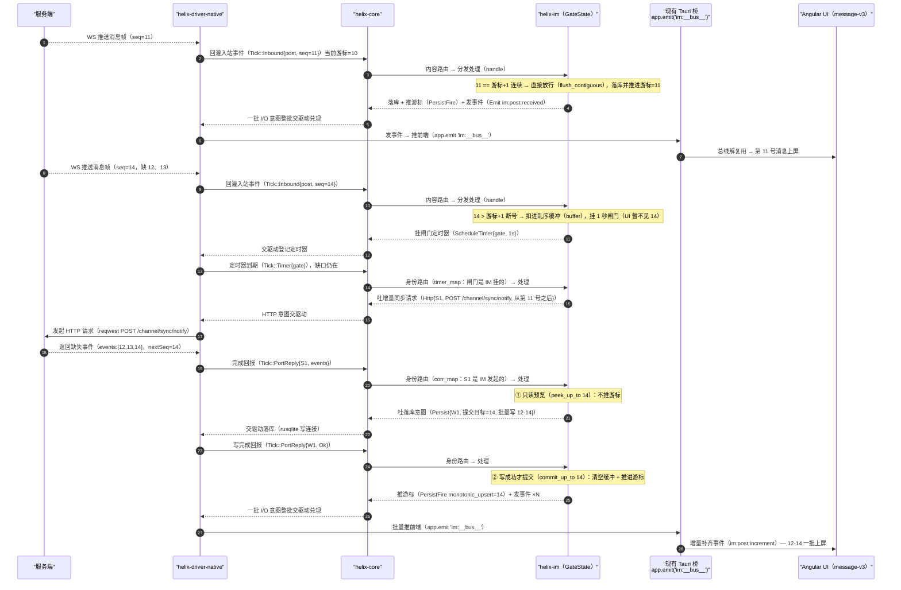

**peek/落库/commit 三阶段（不丢消息底线）**：sync 权威路径必须 ① `peek_up_to` 只读不推 cursor → ② 吐 `Persist{commit_target}` 落库 → ③ 仅 `PortReply{Ok}` 才 `commit_up_to` 推进 cursor；失败则 cursor 不动、下次重拉（幂等）。**直接落库就推 cursor 会在写失败时永久丢消息。**

**sync 响应分支（满足用例3-4 防守态）：**

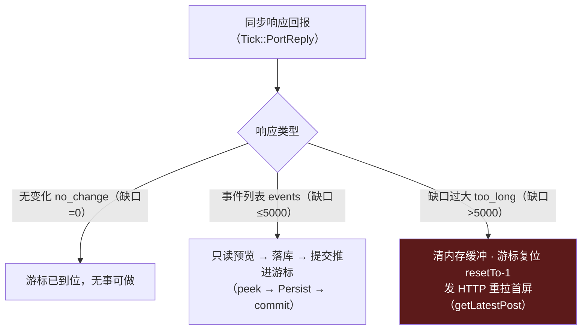

> 用例收敛：UC-1 走 `flush_contiguous`；UC-2 短缺口走 1s gate + sync `events`；UC-3 大缺口走 `too_long` 清内存 buffer + 首屏重拉 + 分段（SQLite 不清表，upsert 覆盖）；UC-4 = 多 channel 批量 sync + 优先级。**业务差异全在 Rust-im，内核不变。**

## 4.7 满足用例2 的短期续联机制（对齐现网 deadQueue）

服务端短期保留 deadQueue；客户端带 `connectionId + seq` 续联，命中则补发。**续联判定在 Rust-im。**

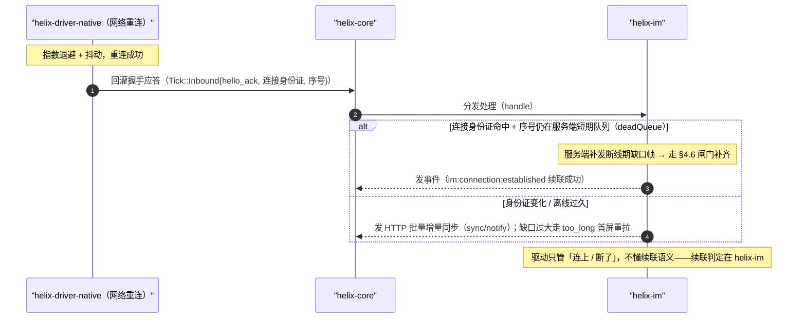

## 4.8 满足用例3-4 的主动补漏机制（hello 后 proactive resync）

关键是 **hello 后主动对所有 channel 从本地 cursor 批量 sync**（对齐现网 `proactive_resync_all_channels`），否则「没切到的频道不同步」。

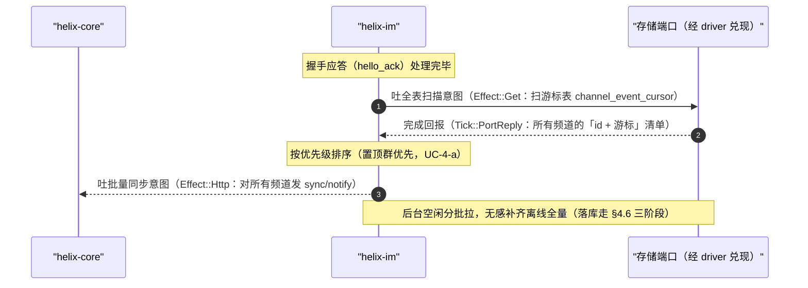

> 用到 `StorageOp::Scan`（返回 `Vec<Row>`，GetSpec 单行语义不动）——**已落地**（C3 销账 2026-06-11：core trait + `ScanSpec` + native 实现 + helix-im on_start 已调用；wasm/ffi scan 随各端 driver 落地）。

## 4.9 IM 存储 schema（业务表在 im，通过通用 spec 落库）

```sql
messages(temporary_id PK, id, channel_id, user_id, message, send_status, read_bits, props, create_at, update_at, ...)
channel_event_cursor(channel_id PK, last_event_seq, updated_at)   -- monotonic_upsert 落这
```

热路径写 = 单 `INSERT ON CONFLICT(PK)`（O(1)）；cursor 推进 = `monotonic_upsert`（MAX 单调不回退）。core 只见 `table:&'static str` + scope_key 字符串，不知道是「消息」「cursor」。

---

# 五、不变量

**机制**：① `handle` 签名无 port 句柄 → 模块物理上无法直接调 I/O；② 四 trait 互不 import → 可单独用；③ Cargo 依赖图单向强制。**诚实声明（纪要拍板 #3）**：四能力解耦是行为级、非编译级裁剪——Effect 单一 enum，IM 表名常量会编进 wasm binary（未来口子：wasm 包体积）。加第二模块零改内核 → 第六章。

---

# 六、通用核：第二个模块如何接入（不与 IM 耦合）

> 关键反问：如果 core 是 IM 框架，第二个**形状完全不同**的模块就插不进。它能插进、且 core 零改，才证明 core 是通用的运行时无关核，不是 IM 专用框架。

## 6.1 core 已经是通用的（grep 证明）

core 只认端口 + Tick/Effect + Module 契约——全是 I/O 形状；IM 的所有概念都在 Rust-im。


> 口径两条：① `monotonic_upsert` 是通用基建原语（类比 CAS）不是 IM 概念，0 的承诺对象只是三个纯 IM 语义词；② grep 是现场演示，正式 CI 闸门是 `cargo public-api` 冻结公开类型面（纪要拍板 #2）——grep 管语义词、public-api 管结构面。

## 6.2 接入第二个模块 = 实现 Module + register（一行）

```rust
shell.register(ImModule::new());
shell.register(PresenceModule::new());   // 第二个模块，core dispatch 一行不改
shell.register(AuditModule::new());      // 第三个，同理
```

**模块能用哪些能力，取决于它 push 哪些 Effect**。

## 6.3 多模块共存隔离（core 路由算法保证，不是约定）

路由算法图见 §2.4。要点：入站帧按 `accepts()` **排他内容路由**（first-match wins，debug 构建 assert 认领数 ≤ 1，注册顺序不影响语义、可回放不依赖注册顺序）；I/O 回报按 `corr_map` **身份路由**——模块 A 的回报绝不串给模块 B。**隔离是 core 算法，不是纪律。**

## 6.4 第二个模块示例：会议系统 ·「创建会议」（用全四能力，形状仍异于 IM）

`shell.register(MeetingModule::new())` 一行挂上，core 零改。以现网「创建会议」（`meeting-list.service.ts`：填表 → 建会议 → 后端自动建 IM channel → 刷列表 → 参会人收邀请）走全流程。

**完整调用链（创建者 · Tauri 形态，业务位由 helix-meeting 占——全程不涉及 helix-im）：**

```mermaid
sequenceDiagram
    autonumber
    participant UI as "Angular UI<br/>（meeting-list / brainstorm-drawer）"
    participant T as "现有 Tauri 桥<br/>#[tauri::command] · app.emit"
    participant C as "helix-core"
    participant M as "helix-meeting（业务位）"
    participant D as "helix-driver-native"
    participant SV as "服务端"
    UI->>T: 创建会议：调用命令（invoke 'meeting_create'，表单）
    T->>C: 包成命令事件（Tick::Command{create_meeting}）经队列喂引擎循环
    C->>M: 内容路由命中 meeting（helix-im 不认领此命令）→ 分发处理（handle）
    M-->>C: 吐三个意图：草稿落库（Persist）+ 发 HTTP（Http{M1, POST /meeting/create}）+ 发事件（meeting:creating）
    C-->>D: 一批 I/O 意图整批交驱动兑现
    D->>T: 发事件 → 推前端（app.emit 单总线信封{channel:'meeting:creating'}）
    T->>UI: 总线解复用 — UI 显示『创建中』
    D->>SV: 发起 HTTP 请求（reqwest POST /meeting/create）
    SV-->>D: 返回 { meetingId, roomId, imChannelId }（后端同时建好 IM 频道）
    D->>C: 完成回报（Tick::PortReply{M1, Ok}）
    C->>M: 身份路由（取件码 M1 是 meeting 登记的，绝不串给 helix-im）→ 处理
    M-->>C: 会议记录落库（Persist）+ 发事件（meeting:created 刷列表）+ 吐订阅意图（Send：ws 订阅 Meeting:on）
    C-->>D: 一批 I/O 意图整批交驱动兑现
    D->>T: 推前端（app.emit 信封{channel:'meeting:created'}）
    T->>UI: 会议列表刷新（对齐现网 Brainstorm:refreshList；跨窗口 window:sendToAllWindows）
    D->>SV: 发 WS 订阅帧（Meeting:on）
    Note over T: 换端只换这一列：WASM 用 postMessage、FFI 用 SendPort——内核 / 业务模块 / 驱动三列一字不差
```

参会人端一行：`Inbound{ws meetingCall}` → 落库邀请 + `Emit(meeting:invited)` 弹会议卡片。

> **证明点**：会议用全四能力但形状完全异于 IM——没有 temporaryId 对账、没有 cursor 增量同步；它复用 IM 后端建的 channel（imChannelId）却**不 import 任何 Rust-im 代码**，两模块经 core 路由隔离协作。`register` 一行挂上，core / driver / IM 都不改。

## 6.5 第三个模块示例：审计上报（证明能力可单独用，不碰 WS）

用例：攒用户行为事件，每 60s 批量 HTTP 上报。

```
on_start        → ScheduleTimer{flush, 60s}
Command{行为}    → Persist{append audit_buffer}
Timer{flush}    → Get{读 buffer} → Http{POST /audit/batch} → PortReply Ok → BatchUpdate{标记已报}
```

只用 Http + Storage + Timer，**完全不碰 WS 和 EventSink**——证明四能力真可单独用。

## 6.6 正交性与结论

加模块（横向）= 新 Module + `register` 一行；加端（纵向）= 新 driver 实现 ports——两维正交，core 在交叉点横纵都不改，**M×P 塌成 M+P**。

> **结论**：IM 只是 guest #1——会议（全四能力、形状异于 IM）和 audit（不碰 WS）都能零改 core 插进来；如果它是 IM 框架，这两个模块根本插不进。

---

# 七、core-view：ViewModel 投影机制（方向 A · 未来）

> 抽象往上一格：core 不止吐领域事件，还吐**给 UI 的只读投影 ViewModel**。**少字看图**。
> 完整设计 / 可行性 / cses 对照见 [`helix-core-view-方向A设计.md`](./helix-core-view-方向A设计.md)；边界见 [`../GOAL.md` §6](../GOAL.md)。
> 时序：**先 D（收发/同步进 core）后 A**，链路稳了再增量切。

## 7.0 参照：Crux 的设计理念与做法

本节的 core-view 直接**参照 Crux**（Red Badger，`/workspace/rustWorkspace/crux`）的设计思想——一句话：**「沙漏架构」+ 单向数据流（类 Elm/MVU）的 headless 内核**。

**设计理念（思想）：**
- **纯核 + 薄壳**：所有业务/展示决策收进一个 sans-IO 的 Rust 纯核（确定性、可回放、三端共享一份）；各端 shell 只做 I/O 与渲染，薄到没有业务逻辑。
- **core 不碰 I/O、不碰 UI**：时间/随机/网络/存储都不在核里执行，核只**描述**要做的副作用；UI 也不在核里画，核只**投影**出一个只读 `ViewModel`，怎么渲染是 shell 的事。
- **单向数据流（MVU）**：`Model` 是唯一真相，`update` 是唯一改它的入口，`view` 是 `Model` 的纯函数投影——同输入同输出。

**怎么做（机制）：** 一个 `App` trait + 四个关联类型 + 两个方法，外加一层序列化桥：

```mermaid
flowchart LR
  UIev["UI 事件"] -->|"序列化 Event"| UPD["update(event, &mut Model)"]
  UPD -->|"改 Model · 返回 Command⟨Effect⟩"| EFF{"Effect"}
  EFF -->|"Http/KV/Time…（值，不执行）"| SH["shell 执行副作用"]
  SH -->|"resolve(结果) 回喂"| UPD
  EFF -->|"Render（fire-and-forget）"| VIEW["shell 调 view(&Model) → ViewModel"]
  VIEW -->|"Bridge bincode 序列化过 FFI"| REND["各端原生渲染（typegen 出 Swift/Kotlin/TS 类型）"]
  classDef core fill:#d0ebff,stroke:#1c7ed6,color:#000
  classDef shell fill:#e9ecef,stroke:#868e96,color:#000
  class UPD,EFF,VIEW core
  class SH,REND,UIev shell
```

- `App{ type Model; type Event; type ViewModel; type Effect }`：`update(event,&mut model)->Command⟨Effect⟩` 改状态，`view(&model)->ViewModel` 投影展示态。
- **Render capability**：core 只发一个 `Render` 通知（fire-and-forget），shell 收到就去拉 `view()`——这就是「投影变了来取最新 ViewModel」。
- **Bridge + typegen**：事件/Effect/ViewModel 用 bincode `[u8]` 过 FFI，`crux_core::typegen` 从 Rust 类型生成 Swift/Kotlin/TS，三端编译期类型一致。
- **shell 三件事**：转发 Event → 执行 Effect → 渲染 ViewModel，没有业务逻辑。

> **helix 的取法**：§七 7.1–7.5 的 `Model / view() / ViewModel / Effect::Render` 正是照搬这套思想；唯一差别——helix 的 `Effect` 是**单一 enum**（过会纪要③拍板），Crux 是 capability 派生的 Effect。三端边界逐项映射见 [方向A设计 §1.1](./helix-core-view-方向A设计.md)。

## 7.1 现状 vs 方向 A（同一份 IM，展示逻辑搬家）

```mermaid
flowchart LR
  subgraph NOW["现状：展示在 Angular 算"]
    direction TB
    N1["Rust features/im"] -->|"18 个细粒度 im:* 事件"| N2["ipcEvent → ipcEventHandler"]
    N2 -->|"Angular 自己算"| N3["排序 + 未读聚合 + 分组 + 草稿 + 昵称"]
    N3 --> N4["组件渲染（虚拟滚动）"]
  end
  subgraph DIRA["方向 A：展示在 core view() 投影"]
    direction TB
    A1["helix-im（Model：频道/消息/未读/成员/草稿）"] -->|"update() 改状态"| A2["view() 纯函数投影"]
    A2 --> A3["ViewModel{ orderedDialogs, totalUnread,<br/>perChannelUnread, groupedMessages, mentionRanges, draft }"]
    A3 -->|"Effect::Render"| A4["host 拉 core.view() → im:viewmodel:patch"]
    A4 --> A5["Angular 绑模板（无排序/聚合/分组逻辑）"]
  end
  NOW -. 方向 A 接管 .-> DIRA
```

## 7.2 core 数据流扩展：`step(Tick) → Effect` 增 `Render`（对照 §2.2）

```mermaid
flowchart LR
  IN["Inbound / Timer / PortReply"] --> UPD["Module.update()"]
  UPD --> MOD["改 Model"]
  MOD --> EFF{"吐 Effect"}
  EFF --> E1["Persist / Send / ScheduleTimer / Emit（既有）"]
  EFF --> E2["★ Render（新增 · 通用 · fire-and-forget）"]
  E2 --> VW["host 收到 Render → Module.view()"]
  VW --> VB["ViewBytes（core 不解释内容）"]
  VB --> UIB["序列化过边界 → UI 绑定"]
  classDef hot fill:#fff3bf,stroke:#f08c00,color:#000
  class E2,VW hot
```

## 7.3 边界序列（host ↔ core ↔ UI，对照 Crux Core::process/view）

```mermaid
sequenceDiagram
  participant UI as UI（各端）
  participant H as host（driver）
  participant C as helix-core
  UI->>H: UI 事件 invoke
  H->>C: core.update(event)
  C-->>H: Vec⟨Effect⟩（含 Render ?）
  alt 含 Render
    H->>C: core.view()
    C-->>H: ViewModel（diff/patch 或 窗口切片，HX-C007）
    H->>UI: im:viewmodel:patch
    UI->>UI: setState 绑模板
  end
```

## 7.4 归属边界（搬进 view() / 留 Angular）

```mermaid
flowchart TB
  subgraph INN["搬进 helix-im view()"]
    direction LR
    G1["排序 pinned+updateAt"]
    G2["未读聚合 排除 type=T"]
    G3["消息分组"]
    G4["mention 区间"]
    G5["昵称合并"]
    G6["草稿存储"]
  end
  RED{{"红线：core 出 数字/区间/有序列表 = 方向A ✅<br/>出 view 树/控件/像素 = 方向B ❌（退化成 Dioxus）"}}
  subgraph KEEP["留 Angular（红线外）"]
    direction LR
    K1["虚拟滚动 windowing"]
    K2["ranges → span DOM"]
    K3["tab / 滚动位置 / 动画 / CSS"]
    K4["上传进度 / 通知弹窗"]
  end
  INN --- RED --- KEEP
  classDef ok fill:#c3fae8,stroke:#0ca678,color:#000
  classDef no fill:#ffe3e3,stroke:#e03131,color:#000
  class G1,G2,G3,G4,G5,G6 ok
  class K1,K2,K3,K4 no
```

## 7.5 归属：ViewModel 在 module，core 只给通用机制（守 §五不变量 + GOAL §1.6）

```mermaid
flowchart TB
  subgraph CORE["helix-core（通用机制 · 不认识业务）"]
    EE["enum Effect{ … , Render }"]
    MM["trait Module{ fn view(&self) -> Option⟨ViewBytes⟩ }"]
  end
  subgraph IMM["helix-im（ViewModel 住这）"]
    S1["struct ImModel{ … }"]
    S2["struct ImViewModel{ … }"]
    VF["fn view(&self) -> ImViewModel"]
  end
  CORE -->|"承载通用 view()/Render"| IMM
  JJ["判据：grep ViewModel crates/helix-core == 0（同 cursor/DomainEvent 隔离）<br/>typegen → ViewModel 的 TS interface"]
  IMM --> JJ
  classDef core fill:#d0ebff,stroke:#1c7ed6,color:#000
  classDef biz fill:#c3fae8,stroke:#0ca678,color:#000
  class EE,MM core
  class S1,S2,VF biz
```

---

**结语**：现在把业务状态机 + 平台胶水揉在 Tauri-Rust 里、只在桌面跑；我把**业务状态机抽进 Rust-im（一份、PC Tauri + Flutter 复用、可回放）**，把**平台胶水关进对应 driver（native + FFI）**——同一套现在验证过的 IM 机制，第一次具备写一次双端一致 + 可单测的形态。Web/WASM 方案按 ADR-006 归档暂停。（现网机制逐节对齐标注见各节正文.）
