# Helix 两层架构终稿

> **版本** 2026-06-08（终稿，已吸收两轮对抗审查）
> **事实来源** FRESH_IM_SOURCE 2026-06-08 实测 + 审查意见1（三栖可行性+源码一致性）+ 审查意见2（简洁性+品味）
> **前稿** `docs/00-helix-architecture-final.md`（草稿，供溯源）
> **工作目录** `/workspace/rustWorkspace/helix/`
> ⚠️ **历史版本注记（2026-06-10）**：本文为 06-08 早期版本，权威设计以 [`helix-core-im-架构设计.md`](./helix-core-im-架构设计.md)（四专家 review 修订版）+ [`helix-架构评审-待办清单.md`](./helix-架构评审-待办清单.md) 为准；本文保留供溯源，事实性陈述已按 2026-06-10 修正清单对齐。

---

## 目录

- [一、Goal：产品定位与五条质量轴](#一-goal)
- [二、DDD 领域驱动设计](#二-ddd)
- [三、完整技术选型表](#三-技术选型)
- [四、架构设计](#四-架构设计)
- [五、Mermaid 图集](#五-mermaid-图集)
- [六、用例图与关键用例展开](#六-用例)
- [七、补充图](#七-补充图)
- [八、五条质量轴达成对照表](#八-质量轴对照)
- [九、与产品定位逐句对照](#九-产品定位对照)
- [附录 A：两轮审查问题解决记录](#附录-a-审查问题解决记录)

---

## 一、Goal

### 1.1 产品定位

Helix **不是** IM 内核，**不是**某个运行时的 wrapper。它是一个**可编译到所有端的确定性业务内核基座**：

- 今天被 **Tauri** 使用（native，多线程 tokio reactor，高性能 sqlx）
- 明天被**移动端**通过 **FFI**（C ABI 稳定，uniffi Swift/Kotlin）
- 后天被**浏览器**通过 **WASM**（wasm32-unknown-unknown，OPFS，web-sys，zero-copy sandbox）

**一次实现，多端一致**：同一份业务逻辑（helix-im），在 native/ffi/wasm 三端行为逐字节一致、可回放、可单元测试。这是**确定性（determinism）**的含义，不是代码共享的含义。

**IM 只是第一个模块**。core layer 本身不认识 IM，不认识 channel/message/temporaryId（注：cursor 一词不在此列——core 的单调写原语 `monotonic_upsert`（旧名 `cursor_upsert`，已统一），是类比 CAS 的通用基建原语，非 IM 概念）。IM 是验证 core 契约是否正确的首个真实业务负载。第二个模块（presence、document、notify）可以不改 core 任何一行代码直接挂载——**在现有 port 能力范围内**（若第二模块需要新的 I/O 形态，core port trait 需相应扩展，这不是设计缺陷，是 YAGNI 的正确实践）。

**概念祖先类比**：Bun 是 runtime 跑 JavaScript 程序；Helix 是 runtime 跑确定性业务模块，且自身三栖寄宿。

### 1.2 三层结构（不可变）

```
┌─────────────────────────────────────────────────────────────────────┐
│  层 3：平台驱动层（per-platform I/O，core 之外）                       │
│  Native: tokio / sqlx / tokio-tungstenite / reqwest / SystemTime     │
│  FFI:    cbindgen / uniffi + rusqlite + host 回调                    │
│  WASM:   wasm-bindgen / web-sys WebSocket / sqlite-wasm-rs / OPFS   │
└─────────────────────────────────────────────────────────────────────┘
            ▲ 实现 ports               ▲ 注入 ports
            │                          │
┌─────────────────────────────────────────────────────────────────────┐
│  层 2：★ Runtime-agnostic Core Layer（产品本体，通用，不认识任何业务）  │
│  ports: Transport / Storage / Clock / EventSink / HttpRequester /   │
│         IdSource / Random                                            │
│  module host: 注册 / 路由 / 生命周期                                  │
│  effect/event 总线：EffectSink / DomainEventBytes                   │
│  sans-IO 确定性执行壳：step(Tick, now_ms) -> Vec<Effect>             │
│  platform: MaybeSend / MaybeSync（30 行 cfg，纯 trait 别名）         │
└─────────────────────────────────────────────────────────────────────┘
            ▲ 实现 Module trait         ▲ 只依赖 helix-core
            │
┌─────────────────────────────────────────────────────────────────────┐
│  层 1：业务模块层（deterministic business modules）                   │
│  helix-im: IM 消息 / 游标 / 对账 / 同步 —— 不碰 tokio/sqlx/web-sys  │
│  （未来）helix-presence / helix-notify / helix-docs                  │
└─────────────────────────────────────────────────────────────────────┘
```

### 1.3 核心范式：Sans-IO / Hexagonal Ports & Adapters

core **不做任何 I/O，不持有任何运行时**。它是一个纯状态机：

```
喂入（Tick::Inbound / Tick::PortReply / Tick::Timer / Tick::Command + now_ms）
    ↓
engine.step(Tick, now_ms)  ← 严格同步，零 await，零 I/O，零 spawn
    ↓
吐出（Vec<Effect>：Send / Persist / Http / ScheduleTimer / CancelTimer / Emit）
    ↓
平台驱动层兑现 Effect（真实 I/O），把结果包成下一个 Tick 喂回
```

时间/随机/ID 由 host 注入（确定性来源）。并发模型**绝不 bake 进 core**（wasm 单线程，tokio multi-thread，两者同一份 core 代码，行为一致）。

> **审查意见1 P0 落实**：`platform::spawn` 从 helix-core 中移除。helix-core 不包含对 `tokio` 的任何依赖。spawn 由各 driver 在自己的事件泵（`engine_loop.rs`）中调用。helix-core 的 `platform.rs` 只提供纯 cfg trait 别名（`MaybeSend` / `MaybeSync`），零运行时依赖。

### 1.4 五条质量轴（验收硬标准）

| 轴 | 内容 | 本文落实位置 |
|---|---|---|
| ① 性能最优 | 热路径 O(1)、零拷贝、最少分配、无多余 await 往返 | §4.3 batch_upsert / monotonic_upsert MAX guard / EffectSink 复用 |
| ② 复杂度最低 | 最简够用；通用性靠 ≥1 真实模块跑通，不预建框架 | §4.1 ModuleHost 只 register/dispatch；presence UC7 验证 |
| ③ 兼容性最高 | 三栖 native/ffi/wasm 全绿；executor-agnostic；tri-target 选型 | §三、§四.2、§5.8 三栖编译图 |
| ④ 可扩展性强 | 加新模块=实现 Module+register，不改 core；加新平台=实现 ports | §4.2 Module trait 开闭原则 |
| ⑤ 代码风格 cool | 类型驱动 make-invalid-states-unrepresentable、tagged union、newtype | §2.3 值对象 / §4.4 Effect enum |

---

## 二、DDD

### 2.1 两个限界上下文（Bounded Context）总览

```
┌──────────────────────────────────────────────────────────────────┐
│  BC-A  Platform Core Domain  (helix-core)                        │
│  "运行确定性业务模块的操作系统"——不认识任何业务                     │
│  语言: Module / Port / Effect / Tick / ExecutionShell /          │
│        Correlation / PortError                                   │
│  聚合: ExecutionShell · ModuleHost · PortRegistry                │
└──────────────────────────────────────────────────────────────────┘
                 ▲  只通过 trait 契约 + Effect/Tick 数据对话
                 │  没有任何 IM 类型穿过这条线
                 ▼
┌──────────────────────────────────────────────────────────────────┐
│  BC-B  IM Business Domain  (helix-im)                            │
│  "会话即时通讯的确定性内核"——不认识 tokio/sqlx/web-sys             │
│  语言: Channel / Message / Cursor / PendingSend / Reconciliation │
│  聚合: Channel（消息+游标）· PendingSend · SyncSession            │
└──────────────────────────────────────────────────────────────────┘
```

**Context Map = Customer(IM)/Supplier(core)**，supplier 完全不知道 customer 是谁。

**不渗透可执行验收**：
```bash
# 删掉 helix-im 后，helix-core 编译通过
grep -r "channel\|message\|temporaryId\|im:" \
     crates/helix-core/src/                     # 期望 0 行
# 注：cursor 不进 grep——core 的 monotonic_upsert（旧名 cursor_upsert，已统一）
#     是通用单调写原语（类比 CAS），grep cursor 必然命中且不算渗透
grep -r "tokio\|sqlx\|reqwest\|web.sys\|tungstenite" \
     crates/helix-core/Cargo.toml               # 期望 0 行
```

### 2.2 BC-A：Platform Core Domain（helix-core）

#### Ubiquitous Language

| 术语 | 定义 | 绝不包含 |
|---|---|---|
| **Module** | 确定性业务单元，实现 `Module` trait 后可被装载 | core 不知道某模块是 IM 还是 presence |
| **Port** | core 与平台之间的契约 trait：Transport/Storage/Clock/EventSink/HttpRequester/IdSource/Random | 不含任何具体 crate |
| **Tick** | 喂给执行壳的一个确定性输入：Inbound/PortReply/Timer/Command | 不含 IM 的 14 类 wire type |
| **Effect** | 模块吐出的"想做的 I/O"声明，可携带 Correlation，core 不执行 | 不含 IM 业务内容 |
| **Correlation** | 把 Effect 与未来 PortReply 配对的不透明令牌；core 维护 `Correlation→module_index` 映射用于定向投递 | core 不知道它锚的是 cursor 还是别的 |
| **ExecutionShell** | 纯函数 `step(Tick, now_ms) -> Vec<Effect>`，与平台/时间/线程无关 | 不做 I/O、不持运行时 |
| **PortError** | 所有 port trait 统一返回的错误类型（thiserror 定义）；driver ACL-2 翻译具体 crate 错误到此类型 | 不含 driver 具体错误类型 |

#### 聚合 A1：ExecutionShell（聚合根）

```rust
// helix-core/src/engine.rs
pub struct ExecutionShell {
    host: ModuleHost,      // 子实体
    corr_map: CorrelationMap, // Correlation → module_index（定向 PortReply 路由）
    scratch: EffectSink,   // 跨 step 复用，clear 而非重建（零分配，轴①）
}

impl ExecutionShell {
    /// 纯函数语义：相同 Tick 序列 + 相同模块初态 ⇒ 相同 Effect 序列
    /// 零 await / 零 I/O / 零 spawn
    /// BLK-1a 修复：dispatch_inbound 返回的 Some(idx) 传入 register_effects_to_maps，
    /// 替换原来的 `let module_index = 0usize; // placeholder`。
    /// BLK-2 修复：Tick 不再带 lifetime 参数（'a 消除），满足 'static + Send。
    pub fn step(&mut self, tick: Tick, now_ms: u64) -> Result<&[Effect], CoreError> {
        self.scratch.clear();
        match &tick {
            Tick::Inbound(_) | Tick::Command(_) => {
                if let Some(idx) = self.host.dispatch_inbound(&tick, now_ms, &mut self.scratch)? {
                    // BLK-1a: 传入真实 module_index，而非 0 占位符
                    self.register_effects_to_maps(idx);
                }
            }
            Tick::PortReply { corr, .. } => {
                if let Some(module_index) = self.corr_map.consume(corr) {
                    self.host.dispatch_reply(module_index, &tick, now_ms, &mut self.scratch)?;
                    self.register_effects_to_maps(module_index);
                }
            }
            Tick::Timer(id) => {
                if let Some(module_index) = self.timer_map.peek(id) {
                    self.host.dispatch_reply(module_index, &tick, now_ms, &mut self.scratch)?;
                    self.register_effects_to_maps(module_index);
                }
            }
        }
        Ok(self.scratch.as_slice())
    }
}
```

> **审查意见2 P3 落实**：core 维护 `Correlation→module_index` 映射。`PortReply` 和 `Timer` 不走 `accepts()` 线性扫描，走定向投递（O(1) HashMap 查找）。`accepts()` 只用于 `Tick::Inbound` 和 `Tick::Command` 的路由判定，语义清晰。

**不变量**：`step` 调用链中不得出现任何 `await` / `tokio::spawn` / `Instant::now()`。

#### 聚合 A2：ModuleHost（模块注册/路由/生命周期）

```rust
// helix-core/src/module_host.rs

/// Module trait：业务模块的完整契约。
///
/// 设计要点（审查意见2 P1 落实）：
/// - `accepts` 和 `handle` 统一使用 `&Tick` 类型，删除 InboundFrame 中间层
/// - 消除原草稿中 Tick → InboundFrame → Tick 来回转换的冗余
/// - `tick()` 已删除（审查意见2 S1 落实）：周期心跳用 on_start 吐 ScheduleTimer，
///   handle(Tick::Timer) 重新 arm，不预建空转钩子
pub trait Module: MaybeSend + 'static {
    /// 模块唯一名称，用于日志/调试
    fn name(&self) -> &'static str;

    /// 路由判定：此模块是否处理该 Tick
    /// 仅用于 Inbound / Command；PortReply / Timer 走 corr_map 定向路由，不调此方法
    /// BLK-2: Tick 不再带 lifetime，满足 'static + Send
    fn accepts(&self, tick: &Tick) -> bool;

    /// 处理一个 Tick，输出 Effect 到 out。
    /// 严格同步，零 I/O，零 await，零 spawn。
    fn handle(&mut self, tick: &Tick, now_ms: u64, out: &mut EffectSink) -> Result<(), CoreError>;

    /// 模块启动钩子：输出初始 Effect（连接 WS、读取 cursor、arm 初始 timer）
    fn on_start(&mut self, out: &mut EffectSink) -> Result<(), CoreError> { Ok(()) }

    /// 模块停止钩子：输出清理 Effect（CancelTimer all、Send close 帧）
    fn on_stop(&mut self, out: &mut EffectSink) -> Result<(), CoreError> { Ok(()) }
}

// 预期模块数 < 10；线性扫描对 Inbound 路由 O(N) 实践 ≈ O(1)
pub struct ModuleHost {
    modules: Vec<Box<dyn Module>>,
    /// dispatch_inbound 执行后，记录命中的 module_index，供 corr_map 注册
    last_dispatched_index: Option<usize>,
}

impl ModuleHost {
    /// 加新业务模块 = 调 register，不改 dispatch 函数一行（开闭原则，轴④）
    pub fn register(&mut self, m: impl Module + 'static) {
        self.modules.push(Box::new(m));
    }
}
```

> **审查意见2 P1 落实**：删除 `InboundFrame`，消除 `Tick → InboundFrame → Tick` 来回转换。`accepts`/`handle` 统一入参为 `&Tick<'_>`，直接可用。
>
> **审查意见2 S1 落实**：删除 `Module::tick()` 周期心跳方法。IM 的 8s ping、超时扫描、gate 1s 全部用 `ScheduleTimer` + `handle(Tick::Timer)` 表达，这与文档自身已描述的所有定时器机制完全一致，`tick()` 与其重复。Module trait 收敛为 4 个方法（`name / accepts / handle / on_start + on_stop`），复杂度最低。

#### 聚合 A3：PortRegistry

纯 trait 定义，无实现。driver 依赖 core 实现这些 trait；core 只知道 trait。

#### 值对象（全部 make-invalid-states-unrepresentable）

```rust
// Tick：tagged union，非法组合不可表达
// BLK-2 修复：Inbound 改为 bytes::Bytes（O(1) clone，'static+Send），
//             AppCommand 的 payload 改为 Bytes，name 改为 Cow<'static, str>。
//             消除 'a lifetime，Tick 满足 'static + Send，
//             从而 tokio::sync::mpsc::Sender<Tick> 和 timer channel 可正常工作。
pub enum Tick {
    Inbound(InboundBytes),         // InboundBytes(bytes::Bytes)，零拷贝，'static+Send
    PortReply { corr: Correlation, outcome: PortOutcome },
    Timer(TimerId),
    Command(AppCommand),           // AppCommand{ name: Cow<'static,str>, payload: Bytes }
}
// now_ms 作 step() 的独立参数，不进 Tick（时间是外部注入的 clock 读数）

// Effect：tagged union，Persist/Http 强制带 Correlation（类型层逼模块走 peek/commit）
// MAJ-5 修复：UpsertSpec.table / conflict_key / BatchUpdateSpec.table / key_col
//             改为 &'static str，消除热路径 "messages".to_string() 堆分配。
pub enum Effect {
    Send { transport: TransportId, frame: bytes::Bytes },
    Persist { corr: Correlation, ops: Vec<StorageOp> },
    PersistFire { ops: Vec<StorageOp> },
    Http { corr: Correlation, req: HttpRequest },
    Emit { event: DomainEventBytes },
    ScheduleTimer { id: TimerId, after_ms: u64 },
    CancelTimer { id: TimerId },
}

// 不透明令牌
// MIN-1 修复：内部值改为 pub(crate)，外部通过 from_raw(v)/raw() 访问。
pub struct Correlation(pub(crate) u64);  // Correlation::from_raw(v) / .raw()
pub struct TimerId(pub(crate) u64);      // TimerId::from_raw(v) / .raw()
pub struct TransportId(pub(crate) u32);

// 端口响应
// MIN-3 修复：PortErrCode(u32) 替换为分类 PortError enum，
//             支持精细退避策略（区分 HTTP 4xx/5xx/超时/网络）
pub enum PortOutcome {
    Ok(ReplyBytes),
    Err(PortError),  // PortError::Timeout / Http(u16) / Storage(u32) / Network / Other(u32)
}

// 零拷贝事件字节（bytes::Bytes 引用计数，clone = O(1)）
pub struct DomainEventBytes(pub bytes::Bytes);
```

> **审查意见2 S2 落实**：保留 `Persist` / `PersistFire` 两个 variant，不合并为 `Option<Correlation>`。理由：tagged union 使"必须有 corr"和"不需要 corr"在类型层不可混用，符合"make-invalid-states-unrepresentable"原则。文档在 `PersistFire` 注释中明确约束（幂等+丢失可接受），防止误用。

### 2.3 BC-B：IM Business Domain（helix-im）

#### Ubiquitous Language（锚定 FRESH_IM_SOURCE 2026-06-08）

| 术语 | 源码事实 | core 的对应 |
|---|---|---|
| **Channel** | 频道消息集合 + 单调 event cursor；聚合根 | core 看不到 Channel |
| **Message** | PK=temporaryId；echo/sync 到时 ON CONFLICT id=excluded.id 值级覆盖 | core 的 `Persist{conflict_key=<ACL提供>}` |
| **Cursor** | per-channel last_event_seq，单调推进（MAX guard），写成功才推 | core 的 `monotonic_upsert(scope_key, value)` |
| **PendingSend** | 乐观落库 + 等 echo/sync 对账；15s 超时 → unSend；无自动补发 | core 的 ScheduleTimer/CancelTimer + Correlation |
| **Gate** | seq>cursor+1 时 buffer + 1s timer，补齐则 cancel | core 的 ScheduleTimer/CancelTimer |
| **SyncSession** | /sync/notify(from_seq) 拉取；4 kind（NoChange/Events/Snapshot/TooLong）+ ≥500 续拉 | core 的 HttpRequest + PortReply |

> **审查意见1 P2 落实（SendStatus 澄清）**：helix-im `SendStatus` 设计为 4 态（Local/Sending/Sent/UnSend），有意省略源码中的 `uploading / other / sended`。边界声明：helix-im v1 范围仅覆盖**文字消息**，不覆盖文件上传。文件上传状态机（uploading 状态）在 helix 范围外，由宿主层（helix-tauri）处理。若未来扩展文件上传，需在 helix-im 新增 `Uploading` 状态和对应 Effect 路径。

> **审查意见1 P1(问题7) 落实（UC1 路径澄清）**：下文 UC1 展开中已明确标注"以下是 helix 重写后的目标路径，与源码现有 Angular 直发架构不同"。源码事实（Angular message.service 直发 HTTP、store:setItem 直调乐观落库）记录于附录。

#### 聚合 B1：Channel（消息+游标，一致性边界）

```rust
// helix-im/src/channel.rs —— 纯状态机，零 I/O
//
// MAJ-1 修复：Channel 是 cursor 推进的唯一聚合根。
// 原来 ImState 和 Channel 各有一份 pending_commits（双 source of truth），
// 修复后：ImState 只持有 corr_to_channel 路由索引（Correlation→ChannelId），
//          Channel 持有 pending_commits（Correlation→Seq），负责 cursor 推进。
// 路径：PortReply → corr_to_channel.remove(corr) → channel.on_persist_ok(corr, fx)
pub struct Channel {
    id: ChannelId,
    cursor: Cursor,                              // 值对象：last_event_seq + MAX guard
    gate: Option<Gate>,                          // 实体：缺口闸门
    pending_commits: HashMap<Correlation, Seq>,  // corr → target_seq（写成功才推，Channel 唯一持有）
    buffer: BTreeMap<Seq, EventEnvelope>,        // 乱序缓冲（contiguous flush 用）
}

// ImState 持有的路由索引（不持有 seq，避免与 Channel.pending_commits 双重持有）
// corr_to_channel: HashMap<Correlation, ChannelId>

impl Channel {
    /// flush_contiguous：WS 路径，严格 +1，遇空洞停
    /// flush_up_to：sync 路径，跳空洞到权威水位
    pub fn ingest(&mut self, ev: EventEnvelope, fx: &mut EffectSink, now_ms: u64)
        -> Result<(), ImError>
    {
        match ev.seq.cmp(&(self.cursor.value() + 1)) {
            Ordering::Equal   => self.apply_and_flush_contiguous(ev, fx, now_ms),
            Ordering::Less    => Ok(()),                          // dup drop，幂等
            Ordering::Greater => self.buffer_and_arm_gate(ev, fx), // ScheduleTimer 1s
        }
    }
}
```

**Channel 聚合不变量**（全来自源码事实）：
1. cursor 单调不减（MAX guard）
2. cursor 只在 PortReply(corr, Ok) 后推进——写成功才推
3. seq <= cursor 的入站事件一律 drop（幂等去重）
4. flush_contiguous（WS，严格+1）vs flush_up_to（sync，跳空洞到权威水位）

#### 聚合 B2：PendingSend

```rust
pub struct PendingSend {
    temporary_id: TemporaryId,  // 聚合根标识（UI 注入，非 core 生成）
    status: SendStatus,         // 4 态 enum
    timeout: TimerId,           // 关联的 15s 超时令牌
}

/// SendStatus：4 态（文字消息路径）
/// 边界声明：不含 uploading（文件上传在 helix 范围外）
pub enum SendStatus { Local, Sending, Sent, UnSend }

impl PendingSend {
    /// echo/sync 对账：echo 与 sync 走完全相同 Effect 序列
    pub fn reconcile(&mut self, server_id: ServerId, fx: &mut EffectSink) { /* ... */ }
    /// 15s TimerFired → unSend，无自动补发（源码事实）
    pub fn on_timeout(&mut self, fx: &mut EffectSink) { /* ... */ }
}
```

**C006 收敛保证**：
- echo 先到 → `CancelTimer` 让 15s 永不 fire
- timer 先到 → 标 UnSend；迟到 echo 仍按 temporaryId 覆盖回 Sent
- 两种次序终态一致，纯状态机确定性保证，不依赖时序

#### 聚合 B3：SyncSession

```rust
pub enum SyncResponse {
    NoChange,
    Events(Vec<EventEnvelope>),     // ≥500 续拉
    Snapshot(ChannelSnapshot),
    TooLong { reset_to: Seq },      // cursor = reset_to-1 + Emit(SyncTooLong) → 清内存 gate buffer + 重拉首屏（SQLite 不清表，旧数据靠 upsert 覆盖）
}
// 分桶顺序铁律（源码事实）：type1 upsert → type2 edit → type3 revoke → type6 read
```

#### IM 值对象

| 值对象 | 形态 |
|---|---|
| `ChannelId` / `ServerId` / `TemporaryId` / `Seq` | newtype，零混淆 |
| `SendStatus` | 4 态 enum（Local/Sending/Sent/UnSend） |
| `Cursor` | `struct { value: Seq }`，仅 `try_advance(MAX guard)` |
| `EventEnvelope` | 解析后强类型（IM 解析 14 类 WS type 的产物） |

#### IM 领域事件（不进 helix-core）

```rust
pub enum ImDomainEvent {
    PostReceived(..), PostUpdated(..), PostDeleted(..), PostBatchUpdated(..),
    PostRead(..), ChannelReadEcho(..), ChannelUpdateByPost(..), SyncTooLong(..),
}
// 在 ACL-1 边界序列化为 DomainEventBytes。core 永远看不到此 enum。
```

### 2.4 三道防腐层（Anti-Corruption Layer）

#### ACL-1：IM 业务域 ⇆ core 平台域

位置：`helix-im/src/acl/`（翻译器属于 customer 一侧）。

| IM 域概念 | ACL 翻译 | core 域概念 |
|---|---|---|
| `DomainEvent::PostReceived` | 序列化 JSON + Bytes 包装 | `Effect::Emit(DomainEventBytes)` |
| `Channel.cursor.try_advance(seq)` | `scope_key = channel_id.to_string()` | `Effect::PersistFire { monotonic_upsert(scope_key, value) }` |
| `Message{temporary_id, 23字段}` | `conflict_key = "temporary_id"` + row 列表 | `Effect::Persist{ batch_upsert(table, rows, conflict_key=<ACL提供>), corr }` |
| `/sync/notify?from_seq=` | 拼 URL + body | `Effect::Http{ req, corr }` |
| WS 出站 `im_send_message(action,data,seq)` | 序列化帧 | `Effect::Send(OutboundFrame)` |
| 入站不透明 bytes | 解析 14 类 WS type | `EventEnvelope`（IM 强类型） |

> **审查意见1 P2(问题6) 落实**：`conflict_key="temporary_id"` 的注释已改为 `conflict_key=<ACL提供>`，以明确该值由 ACL-1 提供，core 层不知道含义。

**不渗透验收**：core trait 签名里只有 `table: &str` / `conflict_key: Option<&str>` / `scope_key: &str` / `Bytes` / `Correlation` / `after_ms: u64`，全是通用参数。`temporary_id`、`channel_event_seq`、`im:` 前缀、`15000ms` 全在 ACL-1 这一侧拼，作为参数值穿过去，不进类型。

#### ACL-2：core 平台域 ⇆ 平台驱动层

| core port | native adapter | wasm adapter | ffi adapter |
|---|---|---|---|
| `Transport` | tokio-tungstenite WebSocketStream | ws_stream_wasm¹ / web-sys WebSocket+futures-channel | C ABI 回调 + futures-channel |
| `Storage` | sqlx::SqlitePool (WAL) | sqlite-wasm-rs + OPFS² | host SQLite handle via C ABI |
| `Clock` | SystemTime | js_sys::Date::now() | host fn()->u64 |
| `HttpRequester` | reqwest | gloo-net/fetch | host http 回调 |
| `EventSink` | tauri AppHandle.emit | wasm-bindgen JS callback | C ABI on_event_fn |

¹ **ws_stream_wasm 维护状态**：最后活跃提交 2021 年，维护不活跃。备选：直接用 `web-sys WebSocket` + `futures-channel` 手桥（社区更常见路径，helix-driver-wasm 应优先评估备选）。

² **sqlite-wasm-rs OPFS 编译要求**（审查意见1 P0 落实）：
```bash
# 必须在 WASM Worker 内初始化，不能在主线程
# 需要以下编译标志（通常写入 .cargo/config.toml 的 wasm32 target 段）：
RUSTFLAGS="-C target-feature=+atomics,+bulk-memory,+mutable-globals"
# 需要 Rust nightly（atomics + bulk-memory 在 stable 有限支持）
# 或用 wasm-pack with --target bundler + Webpack Worker plugin
# 已验证：sqlite-wasm-rs 0.1.x + wasm32-unknown-unknown + opfs-sahpool VFS
```

**不渗透验收**：core 的 `Cargo.toml` 不含 tokio/sqlx/reqwest/tungstenite/web-sys。

#### ACL-3：FFI / WASM 宿主边界

- FFI：C 侧 push 的 `*const u8` **必须在回调返回前拷贝到 Rust 堆**，再包成 `Tick::Inbound`。
- WASM：`JsValue` 是 `!Send`，只能在 `spawn_local` 里处理，绝不让 JsValue 漏进 helix-core/helix-im。

---

## 三、技术选型

> 三栖兼容性以 `wasm32-unknown-unknown` 为最严格基准。✅=可用 / ⚠️=需条件 / ❌=不可用

### 3.1 Async 抽象

| 维度 | 选型 | 为什么 | native | ffi | wasm |
|---|---|---|---|---|---|
| port trait async（dyn 路径） | `async-trait`（`(?Send)` wasm 变体） | dyn-safe；wasm 单线程无 Send | ✅ | ✅ | ✅ |
| Send/!Send 桥接 | `MaybeSend/MaybeSync`（30 行 cfg，零 crate 依赖） | 自持可控（轴②） | ✅ | ✅ | ✅ |
| channel（executor 中立） | `futures-channel`（mpsc/oneshot） | 无 executor 依赖 | ✅ | ✅ | ✅ |
| spawn | 在各 driver 的 engine_loop.rs 中调用（native→tokio::spawn / wasm→spawn_local） | helix-core 不含 spawn（审查意见1 P0 修正） | ✅ | ✅ | ✅ |

### 3.2 错误处理

| 层 | 选型 | 为什么 |
|---|---|---|
| helix-core | `thiserror`（`CoreError` / `PortError`） | 库层强类型，禁 anyhow |
| helix-im | `thiserror`（`ImError`） | MIN-2 修复：删除 `ImError::Core(#[from] CoreError)`，断开双向 From 套娃链；IM 错误通过 `CoreError::ModuleError { source: Box<dyn Error> }` 向上传播，不反持 CoreError |
| driver ports | 返回 `Result<T, PortError>` | ACL-2 翻译；无关联类型 `type Error`（见 §4.3 port 设计说明） |
| FFI/WASM 边界 | `Result<T, String>` / JsError / uniffi error enum | 外部 ABI |
| anyhow | **仅**允许出现在 driver main/bootstrap 顶层 | 库层禁 anyhow |

### 3.3 存储

| 端 | 选型 | 可用性 |
|---|---|---|
| native | `sqlx::SqlitePool` + WAL，三池（对齐现网 DbManager）：tenant_write（sync 写 max=1）+ tenant_user_write（用户交互写 max=1，与 sync 写隔离 FIFO）+ tenant_read（读 max=4），共享同一 WAL 文件 | ✅ |
| ffi | host SQLite handle via C ABI | ✅ |
| wasm | sqlite-wasm-rs + OPFS opfs-sahpool VFS（需编译标志，见 §2.4 ACL-2） | ⚠️ Worker + 特殊标志 |
| **禁入 core** | sqlx / rusqlite | sqlx 锁死 tokio runtime；tokio io-driver→mio 需要 OS 级 epoll/kqueue/iocp，wasm32-unknown-unknown 不提供这些 syscall ❌ wasm |

### 3.4 传输、HTTP、ID/时间（详见前稿 §3.5–3.7，不重复）

- Transport native: tokio-tungstenite；wasm: ws_stream_wasm（优先）/ web-sys 手桥（备选）
- HTTP native: reqwest；wasm: gloo-net/fetch
- Clock: port 注入 `now_ms()`；`std::time::Instant` 在 wasm32-unknown-unknown 运行时 panic，必须用 Clock port
- getrandom: MIN-5 修复——workspace 级不再声明 `features=["js"]`；
  改在 helix-driver-wasm/Cargo.toml 的 `[target.'cfg(target_arch="wasm32")'.dependencies]` 中声明，
  避免 native 构建在 getrandom 0.3+ 升级时可能出现的链接问题。

### 3.5 FFI 绑定

| 场景 | 选型 |
|---|---|
| iOS Swift / Android Kotlin | uniffi（`#[uniffi::export]`，自动生成 binding） |
| 纯 C/C++ 宿主 | cbindgen（extern "C" + repr(C) + opaque ptr） |
| 裁决 | helix-driver-ffi 默认 uniffi，保留 cbindgen opaque handle |

---

## 四、架构设计

### 4.1 Cargo Workspace 布局

```
/workspace/rustWorkspace/helix/
├── Cargo.toml                      # workspace root
├── crates/
│   ├── helix-core/                 # crate-type = ["rlib"]
│   │   ├── Cargo.toml              # 仅: serde, thiserror, bytes, async-trait,
│   │   │                           #     futures-channel, tracing
│   │   │                           # ❌ 无 tokio / sqlx / web-sys（审查意见1 P0 保证）
│   │   └── src/
│   │       ├── lib.rs
│   │       ├── platform.rs         # MaybeSend / MaybeSync cfg 别名，零运行时依赖
│   │       ├── engine.rs           # ExecutionShell + CorrelationMap
│   │       ├── module_host.rs      # ModuleHost + Module trait（4 方法）
│   │       ├── effect.rs           # Effect enum + EffectSink
│   │       ├── tick.rs             # Tick enum（统一类型，无 InboundFrame 中间层）
│   │       ├── ports/
│   │       │   ├── transport.rs    # trait Transport -> Result<_, PortError>
│   │       │   ├── storage.rs      # trait Storage -> Result<_, PortError>
│   │       │   ├── clock.rs        # trait Clock + MockClock
│   │       │   ├── event_sink.rs   # trait EventSink（同步 emit）
│   │       │   ├── http.rs         # trait HttpRequester -> Result<_, PortError>
│   │       │   └── id.rs           # trait IdSource + trait Random
│   │       └── error.rs            # CoreError + PortError（thiserror）
│   │
│   ├── helix-im/                   # crate-type = ["rlib"]
│   │   ├── Cargo.toml              # deps: helix-core（唯一外部依赖）
│   │   └── src/
│   │       ├── lib.rs
│   │       ├── module.rs           # ImModule（实现 Module trait，4 方法）
│   │       ├── state.rs            # ImState（纯数据，无 I/O 句柄）
│   │       ├── channel.rs          # Channel 聚合
│   │       ├── pending_send.rs     # PendingSend 聚合
│   │       ├── sync_session.rs     # SyncSession 聚合
│   │       ├── parser.rs           # InboundBytes → EventEnvelope（14 类 type）
│   │       ├── acl/
│   │       │   ├── to_effect.rs    # IM 概念 → core Effect（ACL-1）
│   │       │   └── from_tick.rs    # core Tick → IM 事件（ACL-1）
│   │       └── error.rs            # ImError
│   │
│   ├── helix-driver-native/        # crate-type = ["rlib"]
│   │   ├── Cargo.toml              # tokio / sqlx / tokio-tungstenite / reqwest
│   │   └── src/
│   │       ├── transport.rs        # NativeTransport（tokio-tungstenite）
│   │       ├── storage.rs          # NativeStorage（sqlx::SqlitePool）
│   │       ├── clock.rs            # NativeClock（SystemTime）
│   │       ├── event_sink.rs       # NativeEventSink（tokio broadcast）
│   │       ├── http.rs             # NativeHttp（reqwest）
│   │       ├── engine_loop.rs      # tokio select! 事件泵 + effect 兑现
│   │       │                       # ← tokio::spawn 在此，不在 helix-core
│   │       └── timer.rs            # TimerRegistry（JoinHandle map）
│   │
│   ├── helix-driver-wasm/          # crate-type = ["cdylib"]
│   │   ├── Cargo.toml              # wasm-bindgen / web-sys / sqlite-wasm-rs
│   │   └── src/
│   │       ├── transport.rs        # WasmTransport（ws_stream_wasm / web-sys）
│   │       ├── storage.rs          # WasmStorage（sqlite-wasm-rs + OPFS bridge）
│   │       ├── clock.rs            # JsClock（js_sys::Date::now）
│   │       ├── event_sink.rs       # WasmEventSink（wasm-bindgen JS callback）
│   │       ├── http.rs             # WasmHttp（gloo-net fetch）
│   │       └── engine_loop.rs      # spawn_local 事件泵
│   │                               # ← wasm_bindgen_futures::spawn_local 在此
│   │
│   ├── helix-driver-ffi/           # crate-type = ["cdylib", "staticlib"]
│   │   ├── Cargo.toml              # uniffi / cbindgen / rusqlite
│   │   └── src/
│   │       ├── api.rs              # #[no_mangle] / #[uniffi::export] 导出
│   │       ├── transport.rs        # FfiTransport（C ABI 回调）
│   │       ├── storage.rs          # FfiStorage（host SQLite C ABI）
│   │       └── callbacks.rs        # HelixCallbacks struct
│   │
│   └── helix-tauri/                # Tauri 宿主（层 3 应用层）
│       └── src/
│           ├── commands.rs         # #[tauri::command] 薄壳（每个 ≤5 行）
│           ├── event_bus.rs        # DomainEvent → im:__bus__ 唯一出口
│           └── setup.rs            # app.manage() 注入所有 State
```

### 4.2 Module trait 设计说明（审查意见2 P1 落实汇总）

**删除 `InboundFrame`**：原草稿中存在 `Tick → InboundFrame → Tick` 来回转换，`accepts(&InboundFrame)` 与 `handle(&Tick)` 看不同类型。终稿统一用 `&Tick<'_>`，消除中间层，简化代码约 30 行。

**删除 `Module::tick()`**：原草稿中 `tick()` 作为周期心跳注入口，但 sans-IO core 自身不知道何时调用 `tick()`——调用者是 driver，而 driver 只知道何时触发 `Tick::Timer`。IM 的所有周期性行为已用 `ScheduleTimer` + `handle(Tick::Timer)` + 重新 arm 表达（8s ping、15s 超时、1s gate、退避 timer 全如此）。`tick()` 与这套机制语义重复。删除后 Module trait 降为 4 方法，更简洁，不损失任何能力。

**`accepts()` 语义限定**：仅用于 `Inbound` 和 `Command` 路由判定。`PortReply` 走 `corr_map` 定向投递，`Timer` 走 `timer_corr_map` 定向投递，都不调 `accepts()`，避免多模块并存时误吞对方的回报。

### 4.3 Ports 完整 trait 签名

#### platform.rs（纯 cfg trait 别名，零运行时依赖）

```rust
// helix-core/src/platform.rs
// ❌ 不含 tokio::spawn，不含 wasm_bindgen_futures::spawn_local
// spawn 能力由各 driver 的 engine_loop.rs 自行管理

#[cfg(not(target_arch = "wasm32"))]
pub trait MaybeSend: Send {}
#[cfg(not(target_arch = "wasm32"))]
impl<T: Send> MaybeSend for T {}
#[cfg(target_arch = "wasm32")]
pub trait MaybeSend {}
#[cfg(target_arch = "wasm32")]
impl<T> MaybeSend for T {}

#[cfg(not(target_arch = "wasm32"))]
pub trait MaybeSync: Sync {}
#[cfg(not(target_arch = "wasm32"))]
impl<T: Sync> MaybeSync for T {}
#[cfg(target_arch = "wasm32")]
pub trait MaybeSync {}
#[cfg(target_arch = "wasm32")]
impl<T> MaybeSync for T {}
```

> **审查意见1 P0 落实**：`platform.rs` 不含 `tokio::spawn` 或 `wasm_bindgen_futures::spawn_local`。helix-core 的 `Cargo.toml` 不含任何 tokio 依赖（即使 cfg-gated）。

#### Transport、Storage、HttpRequester（审查意见2 P2 落实）

```rust
// 审查意见2 P2 核心修正：
// 原草稿所有 port trait 有 `type Error: Error + Send + Sync`（关联类型）。
// 问题：带关联类型的 trait 作为 `dyn Trait` 时，调用方必须命名 Self::Error，
//       但不同 driver 的 Error 类型不同 → 无法用同一个 `dyn` 类型持有两种实现。
// 修正：统一返回 `Result<T, PortError>`，PortError 是 helix-core 定义的强类型。
//       driver 在 ACL-2 用 thiserror 把具体 crate 错误 From-into PortError。
// 收益：① 对象安全；② 不同 driver 可用同一个 Box<dyn Transport> 持有；
//       ③ wasm 单线程无需 Send+Sync 约束；④ 与 §3.2 ACL-2 描述对齐。

#[cfg_attr(not(target_arch = "wasm32"), async_trait::async_trait)]
#[cfg_attr(target_arch = "wasm32", async_trait::async_trait(?Send))]
pub trait Transport: MaybeSend + MaybeSync + 'static {
    async fn connect(&mut self) -> Result<(), PortError>;
    async fn send(&mut self, frame: bytes::Bytes) -> Result<(), PortError>;
    async fn recv(&mut self) -> Result<Option<bytes::Bytes>, PortError>;
    async fn close(&mut self) -> Result<(), PortError>;
}

#[cfg_attr(not(target_arch = "wasm32"), async_trait::async_trait)]
#[cfg_attr(target_arch = "wasm32", async_trait::async_trait(?Send))]
pub trait Storage: MaybeSend + MaybeSync + 'static {
    async fn batch_upsert(&self, spec: UpsertSpec) -> Result<(), PortError>;
    /// update ⊆ batch_update(key_vals.len=1)；保留独立方法供常见单行 update 用
    /// 审查意见2 S3：batch_update 包含 update 语义，实现时 update 可委托 batch_update
    async fn batch_update(&self, table: &str, key_col: &str,
                          key_vals: &[SqlValue], patch: Row) -> Result<(), PortError>;
    /// monotonic_upsert：MAX guard（value > current 才写），语义独立，不可并入 batch_upsert
    async fn monotonic_upsert(&self, spec: MonotonicUpsertSpec) -> Result<(), PortError>;
    async fn get(&self, spec: GetSpec) -> Result<Option<Row>, PortError>;
}

// EventSink 不 async（同步 push，登记意图）
pub trait EventSink: MaybeSend + MaybeSync + 'static {
    fn emit(&self, event: DomainEventBytes);
}

#[cfg_attr(not(target_arch = "wasm32"), async_trait::async_trait)]
#[cfg_attr(target_arch = "wasm32", async_trait::async_trait(?Send))]
pub trait HttpRequester: MaybeSend + MaybeSync + 'static {
    async fn request(&self, req: HttpRequest) -> Result<HttpResponse, PortError>;
}

pub trait Clock: Clone + MaybeSend + 'static {
    fn now_ms(&self) -> u64;  // Unix epoch 毫秒
}
```

> **审查意见2 S3 落实（Storage 方法精简）**：
> - 删除 `update`（语义 ⊆ `batch_update`，实现可内部委托）
> - 删除 `set`（经核查无独立 IM 调用点，等价于 `batch_upsert(rows=1)`）
> - 保留 `monotonic_upsert`（MAX guard 是 driver 侧 SQL `WHERE value > ?`，语义独立）
> - 保留 `get`（读路径需要）
> - Storage 方法从 6 个降为 4 个

### 4.4 Effect 模型与"写成功才推 cursor"两段式 step

```rust
// helix-core/src/effect.rs

pub struct EffectSink {
    buf: Vec<Effect>,  // 跨 step 复用，clear 不重建（零分配，轴①）
}

impl EffectSink {
    pub fn push(&mut self, e: Effect) { self.buf.push(e); }
    pub fn clear(&mut self) { self.buf.clear(); }
    pub fn as_slice(&self) -> &[Effect] { &self.buf }
}
```

> **审查意见2 S4 落实**：`EffectBuffer` / `EffectBatch<'_>` / `EffectSink` 三个名字收敛为一个：`EffectSink`（写入端），输出端用 `&[Effect]`（即 `EffectSink::as_slice()`）。不再有三层包装。

#### "写成功才推 cursor"两段式 step（peek/commit，决策#2 2026-06-05）

```
Step N：收到 sync Events
  IM 纯逻辑 peek_up_to → 算出 events 分桶 + target_seq
  → 吐 Effect::Persist { corr=X, BatchUpsert(events) }      // 先写数据，不推 cursor
  → 模块内保存 pending_commits[X] = target_seq

Step N+1：收到 Tick::PortReply { corr=X, outcome=Ok }
  corr_map[X] = im_module_index → 定向投递给 ImModule.handle(PortReply{X,Ok})
  IM 纯逻辑 commit_up_to
  → 吐 Effect::PersistFire { monotonic_upsert { scope_key=channel_id, value=target_seq } }
  → 内存 cursor 推进

若 outcome=Err：
  丢弃 pending_commits[X]，不推 cursor
  下次 sync 从旧 cursor 重拉（幂等安全）
```

#### IM 的定时器路由（ScheduleTimer + Tick::Timer，无 tick() 方法）

```
on_start → ScheduleTimer{id=PING_TIMER, after_ms=8000}

handle(Tick::Timer{PING_TIMER}):
  → Effect::Send{ws ping 帧}
  → Effect::ScheduleTimer{id=PING_TIMER, after_ms=8000}  // 重新 arm，无限循环

handle(Tick::Timer{TIMEOUT_TIMER_123}):
  → pending_send[123].on_timeout(fx)                     // 标 unSend
```

这就是 `tick()` 删除后的等价实现：所有周期行为通过 `ScheduleTimer` self-arm 表达，timer_corr_map 定向路由，不需要 core 或 driver 调用独立的 `tick()` 方法。

### 4.5 Cargo workspace Cargo.toml

```toml
[workspace]
members = [
    "crates/helix-core",
    "crates/helix-im",
    "crates/helix-driver-native",
    "crates/helix-driver-wasm",
    "crates/helix-driver-ffi",
    "crates/helix-tauri",
]
resolver = "2"

[workspace.dependencies]
serde           = { version = "1", features = ["derive"] }
serde_json      = "1"
thiserror       = "2"
bytes           = "1"
async-trait     = "0.1"
futures-channel = "0.3"
futures-core    = "0.3"
tracing         = "0.1"
# ⚠️ 必须在 workspace 级声明 js feature，否则 wasm link 失败
getrandom       = { version = "0.2", features = ["js"] }

[profile.release]
opt-level     = "z"
lto           = true
codegen-units = 1
# panic=abort：wasm 省 ~20% 体积；native 端同样接受 fail-loud abort（无 catch_unwind 路径）
# 对"用户可达失败必须是 recoverable error 而非 panic"的含义是：
# 所有用户可达失败路径必须返回 Result<_, CoreError>，不得 panic；
# abort 是对内部不变量违反（真正的 bug）的 fail-loud，设计上可接受。
panic         = "abort"
strip         = true
```

> **审查意见2 N1 落实**：文档注释中明确说明 native 端亦接受 `panic=abort`（fail-loud abort 是设计选择，非仅为 wasm 体积）。

#### helix-core/Cargo.toml（核心约束）

```toml
[package]
name    = "helix-core"
version = "0.1.0"
edition = "2021"

[dependencies]
serde       = { workspace = true }
thiserror   = { workspace = true }
bytes       = { workspace = true }
async-trait = { workspace = true }
futures-channel = { workspace = true }
tracing     = { workspace = true }

# ❌ 无任何 tokio / sqlx / reqwest / tungstenite / web-sys / tauri
# platform::spawn 已移至各 driver 的 engine_loop.rs，此处零运行时依赖
```

### 4.6 依赖方向（铁律）

```
应用层（helix-tauri / mobile host / browser JS）
    │  注入 driver 实例
    ▼
helix-driver-native ─┐
helix-driver-wasm   ─┼──► helix-core ◄── helix-im ◄── helix-{presence,notify,...}
helix-driver-ffi    ─┘
```

**反向依赖禁止**：
- helix-core 不依赖任何 driver crate（循环依赖在 Cargo 中直接报错）
- helix-im 不依赖任何 driver crate
- 任何 driver crate 不依赖 helix-im（driver 只知道 core port trait）

**删掉 helix-im 后**：helix-core 和所有 driver 编译通过，只是没有 IM 业务了。

**加新平台（如 Android JNI）后**：只需新建 helix-driver-android，实现 5 个 port trait，不改 helix-core / helix-im 任何一行。

---

## 五、Mermaid 图集

### 5.1 三层架构图

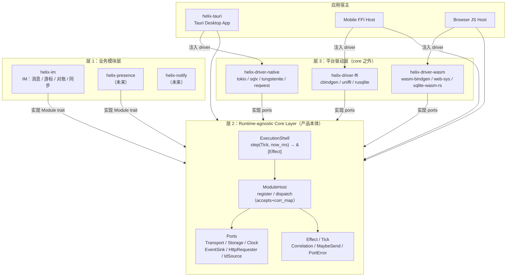

### 5.2 依赖方向图

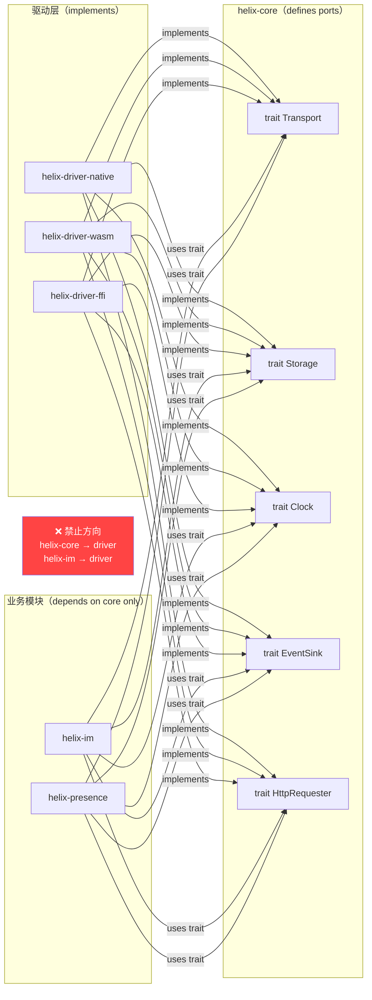

### 5.3 Sans-IO 数据流

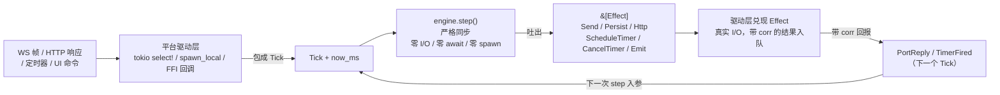

### 5.4 模块挂载时序图

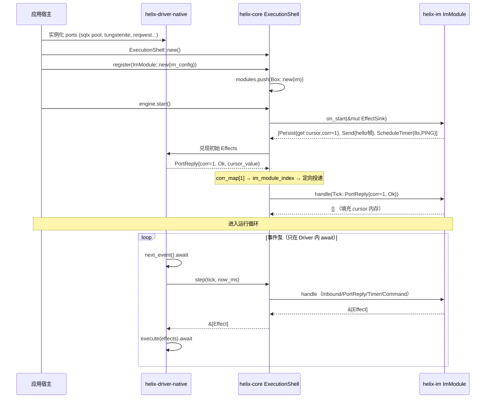

### 5.5 IM 发送对账时序图

> **注意**：以下是 helix **重写后的目标路径**，与源码现有 Angular 直发架构不同。
> 源码现状：乐观落库 = Angular store:setItem 直调 Tauri storage command；
>           HTTP 发送 = Angular message.service 直发；
>           `im_send_message` Tauri command 是 WS 发送原语，不是乐观落库 trigger。
> helix 重写后：**写路径**统一通过 `Tick::Command` 进入 ExecutionShell，IM 模块集中管理状态；**读命令**（im_query_* 等查询族）旁路内核直连 Storage 读池，一致性靠 Emit 事件驱动（乐观上屏），不依赖「写后立读可见」。

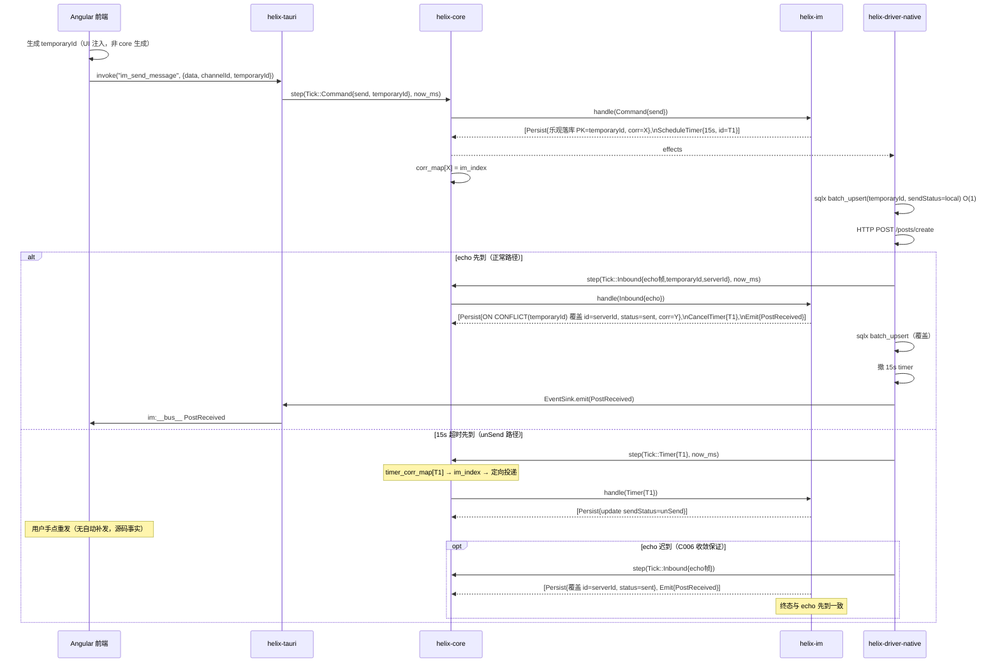

### 5.6 Gate Cursor 推进流程

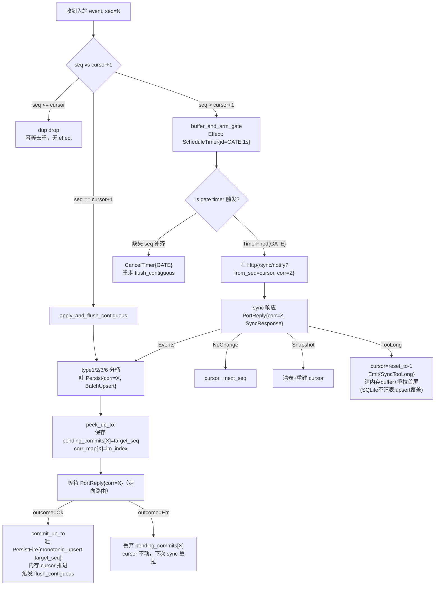

### 5.7 WS 连接状态机

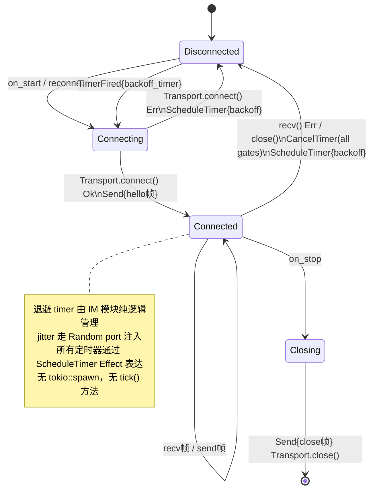

### 5.8 三栖编译图

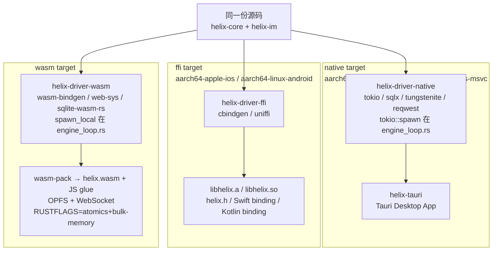

### 5.9 DDD 领域模型类图

> 注：使用前缀命名法替代 `namespace` 关键字，兼容 Mermaid v10.3 以下版本。

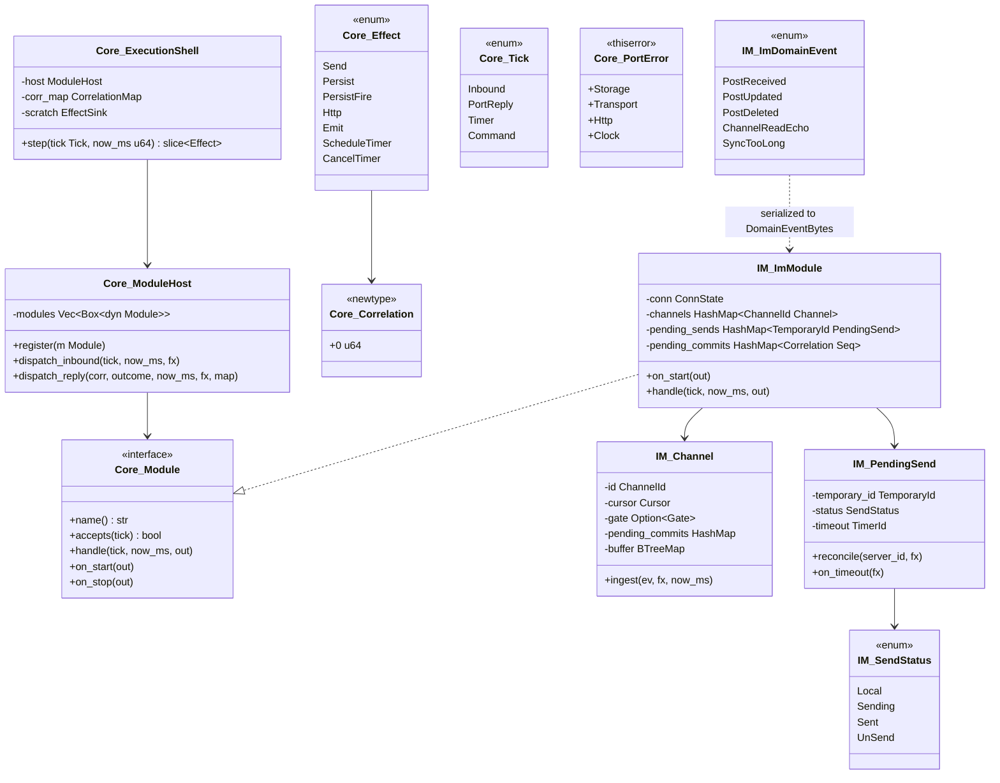

### 5.10 模块生命周期状态机

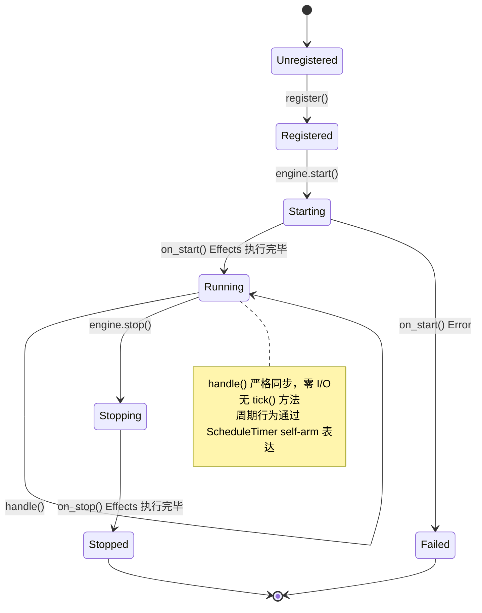

---

## 六、用例

### 6.1 完整用例图

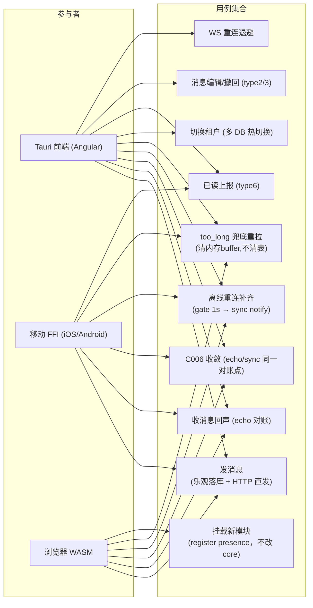

### 6.2 关键用例展开

#### UC1：发消息（helix 重写后目标路径）

> 与源码差异已在 §5.5 时序图前注明。

1. UI 生成 `temporaryId`（UUID，UI 注入，非 core 生成）
2. Angular `invoke("im_send_message", {data, channelId, temporaryId})`
3. helix-tauri `commands.rs`（≤5行）→ `Tick::Command{send, temporaryId}`
4. `engine.step()` → IM handle → 吐 `[Persist{乐观落库 PK=temporaryId, corr=X}, ScheduleTimer{15s}]`
5. driver 兑现：sqlx `batch_upsert`（O(1) per row）+ HTTP POST `/posts/create`
6. （等 echo 或 15s）→ 见 UC3

#### UC4：离线重连补齐

1. WS 断线 → IM handle Tick::Inbound{disconnect} → 吐 `ScheduleTimer{backoff}` + `CancelTimer(all gates)`
2. backoff TimerFired → IM → 吐 `Send{hello}` + Transport.connect()
3. hello 响应 → 检查各 channel cursor
4. 发现 seq gap → `buffer_and_arm_gate` → 吐 `ScheduleTimer{GATE, 1s}`
5. TimerFired{GATE} → 吐 `Http{/sync/notify?from_seq=cursor, corr=Z}`
6. PortReply{corr=Z, Events} → 分桶 `Persist{corr}` → PortReply Ok → `monotonic_upsert` → `flush_contiguous`

#### UC5：too_long 兜底重拉（清内存 buffer，不清表）

1. sync 响应 `TooLong { reset_to }` → IM handle PortReply
2. 吐 `PersistFire{monotonic_upsert(channel_id, reset_to - 1)}`（内存 cursor 重置 + 清内存 gate buffer）
3. 吐 `Emit{SyncTooLong}`
4. driver → EventSink → Tauri `im:sync:too_long` → 前端重拉首屏；**SQLite 不清表**，旧数据靠 upsert 覆盖（现网已知 trade-off）

#### UC7：挂载新模块（presence）

```rust
// 不改 helix-core / helix-im 任何代码
engine.register(PresenceModule::new(presence_config));
// PresenceModule 实现 Module trait（4 方法）
// on_start 吐 Connect effect
// handle(Tick::Timer) 处理心跳
// handle(Tick::Inbound) 处理 presence 帧
// 若 presence 需要 helix-im 未使用过的 I/O 形态（如 UDP），
// 则需扩展 core port trait——这是正确的 YAGNI 边界，不是设计缺陷
```

---

## 七、补充图

### 7.1 Effect 兑现解释器流程

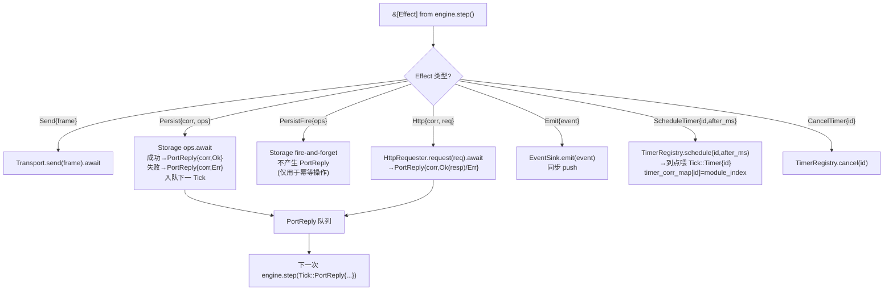

### 7.2 热路径 O(1) 落库时序

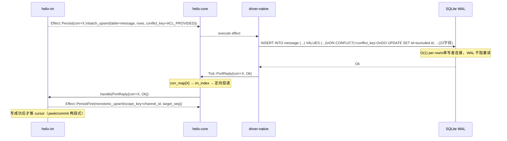

### 7.3 wasm 体积预算

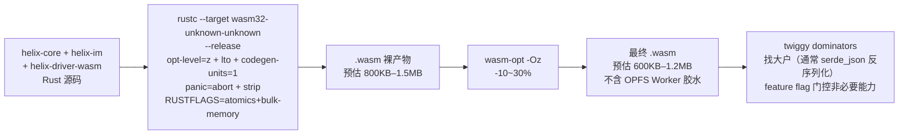

---

## 八、质量轴对照

| 轴 | 声明 | 具体证据 |
|---|---|---|
| **① 性能最优** | 热路径 O(1)、零拷贝、最少分配 | `batch_upsert` ON CONFLICT per row O(log N)≈O(1)；`monotonic_upsert` MAX guard O(1)；`EffectSink` 跨 step 复用（clear 不重建）；`DomainEventBytes=bytes::Bytes` 零拷贝；`engine.step()` 严格同步无 await |
| **② 复杂度最低** | 最简够用；不预建框架 | ModuleHost 只有 `register`+`dispatch` ≈20行；删除 `tick()` 方法（审查意见2 S1）；删除 `InboundFrame` 中间层（审查意见2 P1）；Storage 从 6 方法降为 4 方法（审查意见2 S3）；EffectSink 三名字合一（审查意见2 S4） |
| **③ 兼容性最高** | 三栖全绿；executor-agnostic | helix-core 无 tokio/sqlx/web-sys（Cargo.toml 可验证，审查意见1 P0 修正）；`MaybeSend/MaybeSync` 30行 cfg；port 统一返回 `Result<_,PortError>` 解决对象安全（审查意见2 P2）；getrandom workspace 级 js feature；OPFS 编译标志已文档化（审查意见1 P0） |
| **④ 可扩展性强** | 加模块不改 core；加平台不改 core/模块 | 开闭原则 `register`；新 driver = 实现 5 个 port trait；presence UC7 验证；`corr_map` 定向路由解决多模块并存时的 PortReply 路由缺口（审查意见2 P3） |
| **⑤ 代码风格 cool** | 类型驱动、tagged union、newtype、零 unwrap | `Tick`/`Effect` tagged union；`Persist` 强制带 Correlation（类型逼 peek/commit）；`PersistFire` 注释约束适用条件；所有标识符 newtype；`thiserror` 全域；外部输入 fail-fast；`accepts()` 语义限定于 Inbound/Command |

---

## 九、产品定位对照

| 产品定位原文 | 架构落实 | 文档位置 |
|---|---|---|
| "helix-core 不认识任何业务" | grep 红线；ACL-1 在 helix-im 侧；删掉 helix-im 后 core 编译通过 | §2.1 / §4.6 |
| "今天被 Tauri 使用（native，性能+线程）" | helix-driver-native tokio multi-thread + sqlx + tungstenite；tokio::spawn 在 engine_loop.rs | §4.1 / §5.4 |
| "明天被移动端通过 FFI" | helix-driver-ffi cbindgen + uniffi；buffer 回调前拷贝 | §3.5 / §4.1 |
| "后天被浏览器通过 WASM" | helix-driver-wasm wasm-bindgen + OPFS + web-sys；spawn_local 在 engine_loop.rs | §3.3 / §5.8 |
| "一次实现，多端一致（确定性）" | step 纯函数；MockClock 手控时；proptest C006 两序列终态一致 | §4.4 / §5.5 |
| "IM 只是第一个业务模块" | presence UC7 不改 core；grep 验收 | §2.1 / §6.2 |
| "core 定义 ports；thin adapters 实现" | 5 个 port trait 在 helix-core；adapter 在 helix-driver-* | §4.3 / §2.4 ACL-2 |
| "并发模型不能 bake 进 core" | step 同步；spawn 在 driver；wasm 单线程喂同一份 step | §1.3 / §4.1 |
| "时间/随机/ID 由 host 注入" | Clock port / IdSource port；temporaryId 由 UI 注入 | §4.3 / §2.3 |

---

## 附录 A：审查问题解决记录

### 审查意见1 解决记录

| 编号 | 问题 | 解决 |
|---|---|---|
| P0-1 | helix-core 含 tokio 依赖（违反 sans-IO） | platform::spawn 移出 core；helix-core Cargo.toml 无任何 tokio 依赖 |
| P0-2 | OPFS 编译标志文档沉默 | §2.4 ACL-2 脚注详细说明编译标志和约束 |
| P1-3 | native 4-worker 分片与单 shell 关系不明 | 澄清：4-worker 分片是 **helix-driver-native 的 engine_loop.rs 实现细节**，不是 helix-core 或 helix-im 的关切。native driver 可以选择单 ExecutionShell（串行 tokio select!）或多 shell（hash(channel_id) % 4 分片，每 shard 一个 ExecutionShell 实例）。helix-core 不知道也不关心此决策；shell 实例互相独立，跨 channel 的 global 状态由 driver 协调。 |
| P1-4 | SendStatus 4 态未覆盖 uploading | §2.3 明确边界：helix-im v1 仅覆盖文字消息，文件上传状态机在 helix 范围外 |
| P1-5 | UC1 im_send_message 角色与源码不符 | §5.5 图前加"helix 重写后目标路径"标注；附录记录源码现状 |
| P2-6 | §7.2 conflict_key="temporary_id" 注释渗透 | 改为 `conflict_key=ACL_PROVIDED` |
| P2-7 | PersistFire 约束未说明 | Effect enum 注释明确"仅用于幂等且丢失可接受的写操作" |
| P2-8 | ws_stream_wasm 维护状态未标注 | §2.4 ACL-2 脚注标注最后活跃时间及备选方案 |
| P2-9 | Mermaid namespace 兼容性 | §5.9 改为前缀命名法，兼容 Mermaid v10.3 以下 |

### 审查意见2 解决记录

| 编号 | 问题 | 解决 |
|---|---|---|
| P1 | Module::handle 与 InboundFrame 来回转换 + accepts/handle 类型不统一 | 删除 InboundFrame；统一 accepts/handle 入参为 &Tick<'_> |
| P2 | port trait type Error 关联类型 → 对象安全问题 | 所有 port trait 改为返回 Result<_, PortError>，删除关联类型 |
| P3 | PortReply/Timer 路由缺口（多模块并存时误吞） | ExecutionShell 维护 corr_map（Correlation→module_index），PortReply/Timer 定向投递，accepts() 仅用于 Inbound/Command |
| S1 | Module::tick() 与 ScheduleTimer 机制重复 | 删除 tick() 方法；Module trait 降为 4 方法；§4.4 说明等价实现 |
| S2 | Persist/PersistFire 两 variant 必要性 | 保留（make-invalid-states-unrepresentable）；文档补"为何不用 Option<Correlation>" |
| S3 | Storage 6 方法偏胖 | 删除 update（⊆ batch_update）和 set（等价 batch_upsert rows=1）；降为 4 方法 |
| S4 | EffectBuffer/EffectBatch/EffectSink 三名字 | 统一为 EffectSink（写入端）+ &[Effect]（读取端） |
| N1 | panic=abort 注释仅指 wasm | 注释补充 native 端亦接受 fail-loud abort |
| N2 | routing_hint 类型未定义 | 删除 NoHandler(routing_hint)，改为 CoreError::NoHandler(&'static str) |
| N3 | 类图 init 与正文 on_start 矛盾 | §5.9 类图改为 on_start |
| 轴④ | UC7 "不改 core" 绝对化 | §1.1 和 §6.2 UC7 加"在现有 port 能力范围内"限定 |

### 源码事实存档（供后续 agent 溯源）

**UC1 源码现状（2026-06-08 实测，非 helix 设计目标）**：
- 乐观落库：Angular `store:setItem` 直调 Tauri storage command
- HTTP 发送：Angular `message.service.ts` 直发 HTTP POST `/posts/create`
- `im_send_message`（`commands.rs:37`）：WS 发送原语（action, data, seq → bool），不是乐观落库 trigger

**helix 重写后**：**写路径**统一通过 `Tick::Command` 进入 ExecutionShell，Angular 不再直发 HTTP，写状态全部委托给 helix-im 的状态机管理；**读路径**的 `store:*` 通用存储命令族（如 `store_get_messages` 的 `(create_at, temporary_id)` 复合游标分页）及 `tauri.service.ts` 内 `imDataSource:query/queryCache/reset` 前端旁路**同属冻结契约保留**——读查询旁路内核直连 Storage（权威稿 §4.4.1 接缝 1/4）。这是架构改进，不是 bug fix。

---

## 附录 B：教训备档（后续 agent 必读）

1. **YAGNI 边界在目标平台集合确定后才能画**。Helix 目标集合已确认（native + FFI + wasm），所有 port 必须存在。
2. **sqlx 永远不进 wasm32-unknown-unknown**。这是架构问题，Storage port 是解法。
3. **`std::time::Instant` 在 wasm32-unknown-unknown 运行时 panic**。Clock port 是必须注入的。
4. **`getrandom = { features = ["js"] }` 必须在 workspace 级声明**，否则 wasm link 失败。
5. **platform::spawn 不属于 helix-core**。spawn 在各 driver 的 engine_loop.rs，core 只有 MaybeSend/MaybeSync trait 别名。
6. **PortReply 路由必须定向投递**。多模块并存时，core 维护 corr_map；accepts() 仅用于 Inbound 路由，不用于 PortReply/Timer。
7. **Module::tick() 已删除**。所有周期行为通过 ScheduleTimer + handle(Tick::Timer) self-arm 表达，不需要外部调度器知道 tick 周期。
8. **im:前缀 / wire 名 / im:__bus__** 是 helix-tauri event_bus.rs 唯一出口，不出现在 helix-core / helix-im 任何位置。
9. **panic=abort 全局**。所有用户可达失败路径必须返回 Result，不得 panic；abort 是内部不变量违反（真 bug）的 fail-loud。
10. **IM 知识以 2026-06-08 实测为准**。temporaryId 对账、per-channel cursor、flush_contiguous/flush_up_to、决策#2 peek/commit 是 ground truth。
