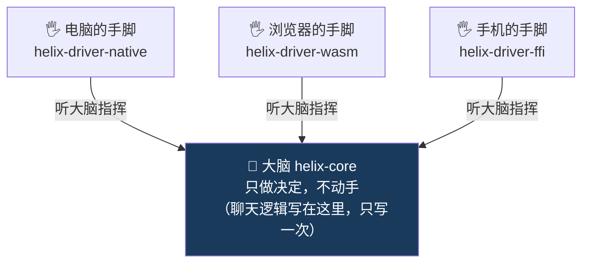

# Helix 技术方案 · 大白话解读

> 这篇不是给评审会用的，是给你看的——把 `helix-Rust-Core-技术过会方案.md` 里的黑话翻译成人话。
> 看完这篇，再回去读那份正式方案，每个术语你都知道在说啥。
>
> 📚 **文档关联**（完整阅读顺序见 [`README.md`](./README.md)）：**本篇·大白话解读** → [技术过会方案](./helix-Rust-Core-技术过会方案.md) → [完美过会指南](./helix-Rust-Core-完美过会指南.md) → [评审纪要](./helix-技术评审纪要.md)。

---

## 一、我们到底要解决什么问题？（一道菜做三遍的痛）

我们的聊天功能（IM）现在要在**三个地方**跑：

- **电脑桌面**（Tauri 桌面应用）
- **手机**（iOS / 安卓）
- **浏览器**（网页版）

问题是：**同一套聊天逻辑（怎么发消息、怎么确认送达、怎么补漏掉的消息），现在在这三个地方各写了一遍。**

打个比方：这就像**同一道菜，让三个厨房各自做一遍**。结果是：

- 写三份代码，维护三份（费人）
- 一个厨房改了配方（修了 bug），另外两个厨房没跟着改 → **真实发生过：电脑端修好了一个 bug，手机和浏览器端 4 个月后才补上**
- 三家味道慢慢就不一样了（行为分叉）
- 想测试某个逻辑对不对，得把整个厨房（真实网络、真实数据库、真实界面）都开起来才能测，很麻烦

**Helix 想干的事，一句话：把这道菜的"配方"只写一次，三个厨房照着同一份配方做，味道完全一样。**

正式方案里的说法：
> **Helix = 运行时无关的确定性业务内核，业务逻辑写一次，编译到三端，行为一致。**

翻译：
- **业务内核** = 那份"配方"（聊天逻辑）
- **运行时无关** = 配方不挑厨房，电脑/手机/浏览器都能用
- **确定性** = 同样的输入，永远得到同样的结果（味道稳定，可复现，好测试）
- **编译到三端** = 一份配方，自动变成三个厨房能用的版本

---

## 二、核心思路：一个"只动脑、不动手"的大脑 + 三套手脚

Helix 最核心的设计，是把系统拆成**两种角色**：

### 大脑（叫 `helix-core`）—— 只思考，绝不亲自干活

这个"大脑"只做一件事：**做决定**。它会说：

> "把这条消息记到账本上、给服务器发一封信、15 秒后提醒我一下、告诉界面消息正在发送中。"

但它**自己从不动手**——不亲自记账本、不亲自寄信、不亲自看表。它只是**下指令**。

为什么要这么设计？因为**一个不动手的大脑，可以坐在任何地方指挥**。同一个大脑，放电脑里能用、放手机里能用、放浏览器里也能用——因为它从头到尾只是动嘴皮子下指令，不依赖任何具体的"手"。

正式方案叫这个 **sans-IO（自己不做输入输出）**、**纯状态机**。它对外只有一个动作：

> `喂给它一个事件（Tick）→ 它吐出一串指令（Effect）`

### 手脚（叫 `driver`，三套）—— 真正干活的

真正去记账本、寄信、看表的，是"手脚"。我们准备了**三套手脚**：

- 电脑那套：用电脑上最强的工具干活
- 手机那套：用手机上的工具
- 浏览器那套：用浏览器里的工具

**大脑只有一个（写一次），手脚有三套（每个平台一套）。** 大脑下的指令三端完全一样，只是三套手脚用各自的工具去执行。这就是"配方写一次，三个厨房照做"的技术实现。

### 一张图看懂



**关键规矩：手脚听大脑的，大脑绝不反过来依赖某只手。** 因为大脑一旦绑死了"电脑的手"，就没法搬到浏览器里了。正式方案里这叫"**依赖单向**"，而且这个规矩是**编译器强制**的——大脑代码里只要敢提到任何一只具体的手，立刻编译报错。

---

## 三、四个"工具人"：EventBus / Storage / HTTP / WS 说人话

大脑下指令时，会用到四种"工具人"。这四个就是方案里反复说的**四大能力**。它们的设计精髓是：**大脑只说"我要用账本"，但账本具体长啥样、谁来记，是三套手脚各自的事。**

| 黑话名字 | 说人话 | 它干嘛 | 三端各自怎么实现 |
|---|---|---|---|
| **EventBus**（`EventSink`）| **广播喇叭** | 大脑喊一嗓子"消息发出去了/收到了"，界面就更新 | 电脑用系统广播、浏览器用网页消息、手机用数据流 |
| **Storage**（`Storage`）| **账本** | 把消息、状态记下来，存起来 | 电脑/手机用 SQLite 数据库，浏览器用浏览器自带的存储 |
| **HTTP**（`HttpRequester`）| **寄信** | 给服务器发一次性的请求（发一条、问一句）| 电脑用专业寄信工具，浏览器用网页自带的 fetch |
| **WS**（WebSocket，`Transport`）| **电话热线** | 和服务器保持一条长期通话，随时收推送 | 各端用各自的长连接库 |

**为什么这四个要拆开、还能单独用？**

因为它们互相不认识。"账本"不知道"广播喇叭"存在，"寄信"不依赖"电话热线"。你想只用账本、不用电话热线，完全可以——就像你买冰箱不一定要连洗衣机。正式方案叫这个 **headless（无头）、可插拔、互不强依赖**。

每个工具人，大脑都只认一个"标准接口"（正式叫 **port / trait**，就是一张"工作说明书"）：大脑照说明书提要求，三套手脚照说明书各自实现。**换工具不影响大脑**——比如浏览器那套账本以后换个库，大脑一行都不用改。

---

## 四、发一条消息，到底发生了什么？（一步步白话）

这是方案里的"IM 发送消息真实链路"。我用大白话走一遍。假设你点了"发送"：

**第 1 步：你点发送**
界面告诉大脑："用户要发这条消息（先给它个临时编号 tmp_9）。"

**第 2 步：大脑一口气下 4 条指令**（注意，大脑自己啥也没干，只是下令）：

1. 📒 **记账本**："先把这条消息记下来，状态=发送中"（这样界面能立刻显示）
2. ✉️ **寄信**："给服务器发一封信，把这条消息送上去"
3. ⏰ **设闹钟**："15 秒后提醒我一下"（万一服务器没回应，好知道发失败了）
4. 📢 **广播**："告诉界面——消息正在发送中"

**第 3 步：界面立刻显示"发送中"**
因为第 4 条广播是马上回的，你**点完发送的一瞬间**就看到气泡冒出来了，**不卡**。而记账本、寄信这些慢活，在后台默默并行干，不挡着界面。

**第 4 步：服务器处理完，回了个"收条"（echo）**
服务器存好消息，分配一个正式编号（server_id），通过"电话热线"推回来一个收条，里面带着当初那个临时编号 tmp_9。

**第 5 步：大脑收到收条，又下指令**：

1. 📒 **更新账本**："把 tmp_9 这条的状态改成已送达，正式编号换成 server_id"（**还是同一行，所以界面上气泡不会跳来跳去**）
2. ⏰ **撤闹钟**："收到了，把那个 15 秒闹钟取消"
3. 📢 **广播**："告诉界面——消息已送达"

**第 6 步：界面把"发送中"变成"已送达"** ✅ 完成。

**万一服务器一直没回呢？**
15 秒闹钟响了 → 大脑说"标记成发送失败"。但如果收条**迟到**了（比如第 16 秒才来），大脑还是会按 tmp_9 把它改回"已送达"——**不管收条和闹钟谁先到，最后结果都一样**。

> 正式方案管这个叫"**双序收敛**"——两件事（收条、闹钟）不管谁先谁后，结果都收敛到一致。靠的是"记账本"的两个小规矩：① 同一个临时编号永远改的是同一行（不会重复记）② 进度只能往前不能倒退。所以**不需要加锁、不需要排队**，天然就对。

**最妙的地方**：上面这套"发送→记账→确认→超时→对账"的逻辑，**三端一字不差，因为它只写在大脑里一份**。电脑、手机、浏览器的区别，只是"手脚用什么工具记账、用什么工具寄信"，决策逻辑完全共享。

**一个容易误会的点：大脑只管"写"，不管"查"。** 发消息、收消息、改状态——这些"发生了事、要改账本"的活，全部经过大脑。但你往上翻历史消息、打开会话列表——这种"问一句答一句"的查询，**不经过大脑**，界面直接去问账本（手脚那边的"查件窗口"）。为什么？因为大脑是专门处理"事件流"的机器，把查询也塞进去只会排队添堵。那查到的会不会是还没记完的旧账？会有一瞬间的旧——但界面的实时刷新从来不靠"刚写完马上去读"，靠的是广播喇叭：账本一记完，喇叭立刻喊一声，界面就跟着更新了。

**离线太久怎么兜底？** 比如出差一周回来，漏的消息多到一条条补不现实（方案里叫 `too_long`）。这时的做法是：把大脑里那个"等着排队补齐的**临时缓冲**"清空、进度书签拨到最新位置、直接重新拉最新一屏消息。注意一个关键细节：**本地账本（数据库）不撕掉**——旧账留着，后面新数据来了直接盖在旧账上（同一条消息永远写同一行，盖写是安全的）。这是个明知道的取舍：不撕账本省事、回退安全，代价是很旧的本地数据要等被盖写才更新。所以"清掉重拉"清的是**脑子里的缓冲**，不是账本——这两个别搞混。

---

## 五、深入：`port / trait` 和 `Tick / Effect` 到底是什么？

> 这四个词是整套设计的"语法核心"。看懂这一节，正式方案里任何一段你都能对上号。
> 接着前面的比喻：**大脑下指令、手脚干活、军师只处理送到案头的战报。**

### 5.1 `port / trait` —— 其实是一回事，两个角度

**`trait` 是 Rust 语言里的"岗位说明书"**：只规定"必须会做哪些事"，**不规定"怎么做"**。
**`port` 是架构里的叫法**——指那些当作"大脑对外插座"的 trait。

> 所以：`port` = 这个东西扮演的**角色**；`trait` = 实现它用的**语言工具**。同一个东西，两个角度。

**比喻：招聘"会计"这个岗位。** 岗位说明书（就是一个 port / trait）写着：

```
「账本管理员」岗位说明书（这就是 Storage port）：
   · 会记账               （batch_upsert）
   · 会查账               （get）
   · 会记"只许变大的数"    （monotonic_upsert）
```

- 谁来当会计**无所谓**，只要能干这三件事。
- 顺带说清第三件事：它是个**通用本事**——账本管理员只保证"这个数只能往大改、不许倒退"，至于这个数是聊天的同步进度、还是别的什么计数，**它根本不知道也不关心**（"进度书签"是聊天模块自己的叫法）。
- 电脑端来个 **sqlx 会计**、浏览器端来个 **OPFS 会计**、手机端来个 **rusqlite 会计**——三个不同的人，都照**同一份说明书**干活。
- **大脑只对"说明书"喊话**："记一下账"，根本不关心背后站的是哪个会计。

这就是"换工具不影响大脑"的原理：换掉浏览器那个会计，只要新人也照这份说明书干活，大脑一个字都不用改。四大能力就是四份岗位说明书：广播喇叭(`EventSink`)、账本(`Storage`)、寄信(`HttpRequester`)、电话热线(`Transport`)。

### 5.2 `Tick` —— 喂给大脑的"一件事"（送到案头的战报）

**`Tick` = 发生的一件事，递到大脑面前让它处理。** 大脑像军师，**不主动出门打探，只处理送到案头的战报**。战报就六种（四类核心 + 两类连接通断）：

| Tick 种类 | 人话 | 例子 |
|---|---|---|
| `Command` | 用户下了个命令 | 你点了「发送」 |
| `Inbound` | 电话热线推来一帧 | 收到消息收条 |
| `PortReply` | 之前派出去的活有回音了 | 「账记好了」/「信寄到了」 |
| `Timer` | 闹钟响了 | 那个 15 秒超时到了 |
| `Connected` | 线接通了 | WS 重连成功 |
| `Disconnected` | 线断了 | 网络掉线 |

### 5.3 `Effect` —— 大脑吐出的"一条指令"（军令工单）

**`Effect` = 大脑下的一条指令 / 一张工单。** 大脑**自己不执行**，写完交给传令兵（手脚 driver）去干。

| Effect 种类 | 人话 |
|---|---|
| `Persist` | 记账本（要回执的）|
| `Http` | 寄信 |
| `Send` | 往电话热线发一帧 |
| `ScheduleTimer` | 设个闹钟 |
| `Emit` | 广播给界面 |

### 5.4 串起来：大脑 = 一台"战报进 → 工单出"的机器

```
喂一件事(Tick)  →   大脑思考   →   吐一串指令(Effect)
   战报进                            工单出
```

正式写法就是方案里反复出现的那行：**`step(Tick) -> [Effect]`**。

你点发送那一刻：

```
战报进：  Tick::Command{发送, tmp_9}            （你点了发送）
             ↓ 大脑思考
工单出：  [ Persist  记账本=发送中,
           Http     寄信给服务器,
           ScheduleTimer  设15秒闹钟,
           Emit     广播"发送中" ]              （4 张工单，自己一张都不执行）
```

### 5.5 为什么非要搞这套？（精髓）

普通写法里，"做什么决定"和"实际去干"是**搅在一起、藏在代码里的**，看不见抓不住。Helix 把它们拆开，让**"事"和"指令"都变成能写在纸上的东西（数据）**，好处立刻就来：

- **能记录、能回放**：把战报序列录下来重放，大脑吐的工单一模一样 → 好测试
- **所有顺序都能测**：收条先到？闹钟先到？把战报顺序排列组合喂进去，验证结果都对
- **三端通用**：大脑只是"战报进工单出"的纯逻辑，不碰任何平台，三端共享一份

> 一句话：**`port/trait` 让大脑和手脚解耦（换手脚不动大脑）；`Tick/Effect` 让大脑的思考过程变成可见、可测、可回放的数据（而不是藏在代码里的黑盒）。** 这两样合起来，就是"一份逻辑三端通吃 + 好测试"的根。

---

## 六、为什么有些技术只能"换着用"？（白话版第一性原理）

方案里有一大堆"为什么电脑用 A、浏览器用 B"。核心原因就一句：**有些工具天生只能在某个平台用，硬塞会直接坏。**

| 黑话 | 说人话 |
|---|---|
| **sqlx 编不过 wasm** | 电脑上最好用的数据库工具（sqlx），骨子里依赖操作系统的底层功能，**浏览器里根本没有这些底层功能，硬装就报错**。所以浏览器只能换一个专门为浏览器做的数据库工具。但"账本"这个概念三端通用，换的只是具体工具。|
| **`Instant::now()` 在浏览器会崩** | "看表读时间"这个最普通的操作，在浏览器环境里直接崩溃。所以我们的大脑**从不自己看表**——需要时间时，让手脚把时间"喂"进来。顺带好处：测试时能假装"现在是任意时刻"，方便测超时逻辑。|
| **Send / 多线程** | 电脑可以多个工人同时干活（多线程），浏览器只能一个工人（单线程）。所以大脑**不假设有几个工人**——它单线程也能跑，要不要多线程是手脚自己的事。|
| **panic 跨 FFI 是 UB** | 手机端，Rust 代码和手机系统代码交界处，如果程序"崩溃"的方式没处理好，会引发玄学问题。所以交界处要特殊保护。|

一句话总结这一节：**大脑被设计成"什么平台特定的东西都不碰"，所以它能在三端通吃；平台差异全部关在三套手脚里各自消化。**

---

## 七、这套设计到底好在哪？（回到最初的三个痛）

| 最初的痛 | Helix 怎么治 |
|---|---|
| **写三份**（一道菜做三遍）| 聊天逻辑只写在大脑里**一份**，三套手脚共享 |
| **改一个 bug 三处修、还会漏**（4 个月才同步）| 只有一份逻辑，改一处三端同时生效，**不可能再出现"修了电脑忘了手机"** |
| **测试麻烦**（要开整个厨房才能测）| 大脑不碰任何真实设备，**喂假数据就能测**，连界面都不用开，还能把"收条和闹钟谁先到"所有顺序都自动测一遍 |

还有一个长远好处：以后要加新功能模块（比如"在线状态"presence），只要写个新模块**挂上去一行**，大脑一个字都不用改。这就是判断"我们在搭框架，还是在打补丁"的终极标准——**能一行挂上去，就是框架；要动大脑，就是补丁。**

---

## 八、现在做到哪了？要批准什么？

**已完成**：骨架搭好了，三端都能编译通过，大脑确认是"干净的"（不碰任何平台工具，实测验证过）。

**现状的诚实话**：三套手脚现在还是"空壳"（方案里叫 `todo!()`，意思是"待填"）——架子和接口都定好了、编译都过了，但真正干活的代码（怎么连数据库、怎么连网络）还没填。**这是下一步 M2 要做的事，不是设计问题，是工程量问题。**

**这次想批准的**：让 1 个工程师，花 3-4 周，把"电脑端"那套手脚填满，跑通一条完整的真实聊天链路（发送→确认→同步→心跳）。做完就能在电脑桌面演示一个能用的聊天功能。

**再往后，怎么装进现在的桌面端产品？答案是"换引擎，不是换车"。** 现在的桌面聊天（Angular 界面 + Rust 后座）**不重写**：界面那层一行不改，把界面和引擎之间的**四个接口面全部钉死**，只换引擎舱里的机器——

1. **命令面**：界面调用的那 **10 个生产命令**，名字、参数原样不动；
2. **事件面**：广播给界面的事件格式（信封长什么样、有哪些频道），原样不动；
3. **账本面**：本地数据库还是**同一个文件、同一套表**，新旧引擎都认——所以装个开关就能随时切回旧引擎，**秒级回退、数据零迁移**；
4. **一条最容易漏的暗门**：界面读历史消息，其实走的不是聊天模块自己的命令，而是另一族**通用"查件窗口"命令**（`store_get_messages` 那一族，住在公共仓库区、不在聊天模块院子里），而且界面代码里还有几处直接绕到这个窗口问话的小路。这族命令的问法、答法（怎么分页、字段怎么对）**也得原样保留**——漏了这条，界面会"悄悄"读不到数据，还查不出错在哪。

四个面都钉死之后，交付物就是"换了台引擎"，用户和界面工程师都感觉不到——这比"重写一个客户端"靠谱得多。

---

## 附：黑话 ↔ 人话 对照表（读正式方案时随时查）

| 正式方案的词 | 人话 |
|---|---|
| `helix-core` / 内核 | 只动脑不动手的**大脑**（聊天逻辑写在这，只写一次）|
| `driver` / 驱动 | 真正干活的**手脚**（每个平台一套）|
| 三端 / 三栖 | 电脑、手机、浏览器 |
| runtime-agnostic / 运行时无关 | 不挑平台，哪都能跑 |
| sans-IO / 纯状态机 | 大脑只下指令、自己不干活 |
| `Tick`（喂进去的）| 发生的一件**事**（你点了发送 / 服务器回了收条 / 闹钟响了）|
| `Effect`（吐出来的）| 大脑下的一条**指令**（记账本 / 寄信 / 设闹钟 / 广播）|
| port / trait | 一张**工作说明书**（大脑提要求，手脚照着实现）|
| EventBus / `EventSink` | **广播喇叭**（通知界面更新）|
| Storage | **账本**（存消息和状态）|
| HTTP / `HttpRequester` | **寄信**（给服务器发一次性请求）|
| WebSocket / `Transport` | **电话热线**（和服务器的长连接，收实时推送）|
| 确定性 | 同样的输入永远同样的结果（稳定、可复现、好测）|
| headless / 无头 | 大脑不带界面、不带任何具体实现，纯逻辑 |
| 可插拔 / additive | 四个工具能单独用、随意搭配，不互相绑死 |
| cursor / 游标 | 同步进度的**书签**（记到哪了，下次从这接着补；这是聊天模块的叫法，账本只管"数只许变大"）|
| `monotonic_upsert` | 账本的通用本事：记一个**只许变大、不许倒退**的数 |
| `too_long` 兜底 | 离线太久补不过来：清掉脑子里的临时缓冲、重拉最新一屏；**本地账本不撕**，旧账等着被盖写 |
| 双序收敛 | 收条和闹钟不管谁先到，结果都一样 |
| 热路径 O(1) | 高频操作每次都很快、不拖慢 |
| `todo!()` | **待填的空壳**（接口定好了，干活代码还没写）|
| M2 | 下一阶段：把电脑端手脚填满，跑通真实聊天 |

> 看完这篇，再去读 `helix-Rust-Core-技术过会方案.md`，每段你都能对上号了。
