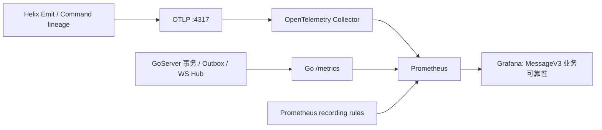

# MessageV3 十二项业务指标交接

更新时间：2026-08-26

## AGENT_HANDOFF/v1

```text
AGENT_HANDOFF/v1
state: dev_runtime_green_with_coverage_debt
repository: helix + cses-im-server
helix_commit: 本文件所在提交
goserver_commit: 9b6f153 + 4b08bf4
grafana_uid: messagev3-business-reliability
runtime_atomic_metrics: 12/12
planned_without_samples: none_in_dev_view
real_evidence: DEV_NATIVE_AND_GOSERVER_PASS_2026-08-26
next_owner: local GoLand runtime upgrader -> recovery/correctness/command coverage owner -> GitOps owner
stop: 不得把 Socket 写成功、ping/pong、单侧未读、面板存在或 HTTP 200 冒充业务终态
```

## 1. 当前交付物

| 资产 | 路径 / 入口 | 用途 |
|---|---|---|
| 规格真源 | [`spec.md`](spec.md) | 十二项指标的 Owner、终态、标签和证据边界 |
| Helix 指标分类 | [`business.rs`](../../crates/helix-driver-host/src/metrics/business.rs) | 在稳定 `OwnedEffect::Emit` 边界记录投影、同步、恢复和正确性 |
| Helix Command lineage | [`perf_metrics.rs`](../../crates/helix-driver-host/src/engine/perf_metrics.rs) | 只有本地 `Tick::Command`/PortReply lineage 才记录 Command 终态 |
| Helix 指标注册表 | [`registry.rs`](../../crates/helix-driver-host/src/metrics/registry.rs) | 七个 MessageV3 指标名称与 Runtime/Planned 状态 |
| Go 指标注册表 | `/System/Volumes/Data/workspace/golang/cses-im-server/internal/app/send_metrics.go` | 远端落库、Outbox、ACK 合同、Command 和阶段延迟 |
| Prometheus 规则 | [`recording-rules.yaml`](../../perf/grafana/recording-rules.yaml) | 比率与 P50/P95/P99 的统一计算口径 |
| Kubernetes 规则 | `/System/Volumes/Data/workspace/golang/cses-im-server/deploy/k8s/cses-im-v2/messagev3-business-recording-rules.yaml` | 可加载到 Prometheus Operator 的 `PrometheusRule` |
| Grafana Dashboard | [`messagev3-business-reliability.json`](../../perf/grafana/messagev3-business-reliability.json) | 12 个中文业务面板 |
| Dashboard 生成器 | [`generate-business-dashboard.mjs`](../../perf/grafana/generate-business-dashboard.mjs) | 修改看板后重新生成 JSON |
| Dashboard 合同检查 | [`business-dashboard-check.mjs`](../../perf/grafana/business-dashboard-check.mjs) | 校验面板数、规则引用、数据源与禁止伪造 100% |

观测链路如下。GoServer 直接暴露 `/metrics`；Helix 不直接监听 Prometheus 端口，而是经
`AsyncMetricSink → OTLP Collector → Prometheus` 暴露。



## 2. 十二项指标完成度总览

| # | 业务指标 | 当前状态 | 当前原子指标 / 数据源 | Grafana 面板 |
|---:|---|---|---|---|
| 1 | 消息远端落库成功率 | Runtime，已接入 | `im_message_persist_terminal_total` | 消息远端落库成功率 |
| 2 | Outbox 最终投递成功率 | Runtime，窗口近似 | `im_delivery_outbox_lifecycle_total` | Outbox 最终投递成功率 |
| 3 | 服务端每接收人入队成功率 | Runtime，已复用 | `im_ws_hub_delivery_events_total` | 每接收人入队成功率 |
| 4 | 客户端真实 ACK 送达率 | Runtime，dev/native 已产生真样本 | Helix `otel_helix_im_client_ack_terminal_total` + Go `im_message_client_ack_total` | 客户端真实 ACK 送达率 / Go ACK 接收成功率 |
| 5 | Helix 本地权威投影成功率 | Runtime，已接入 | `otel_helix_im_projection_terminal_total` | Helix 本地权威投影成功率 |
| 6 | 消息端到端延迟 P50/P95/P99 | Partial，当前是两段延迟 | Go lifecycle histogram + Helix command→projection histogram | 消息关键阶段延迟 P50/P95/P99 |
| 7 | 同步会话成功率 | Runtime，已接入稳定事件 | `otel_helix_im_sync_session_total` | 同步会话成功率 |
| 8 | 同步异常会话率 | Runtime，当前覆盖 TooLong/increment failure | `otel_helix_im_sync_anomaly_total` | 同步异常会话率 |
| 9 | 离线/断线恢复成功率 | Partial，成功终态已接入，失败分母待补 | `otel_helix_im_recovery_session_total` | 离线 / 断线恢复成功率 |
| 10 | 未读对账不一致率 | Runtime，dev/native 已产生同 scope 真对账 | `otel_helix_im_unread_reconcile_total` | 未读对账不一致率 |
| 11 | 消息丢失、重复、乱序率 | Runtime 基线已接入，完整三类检测覆盖仍 Partial | `otel_helix_im_message_correctness_total` | 消息丢失 / 重复 / 乱序率 |
| 12 | 所有业务 Command 终态成功率 | Runtime，当前面板以 Go `send_message` 真终态为准；全 Command 覆盖仍 Partial | `im_business_command_terminal_total` | 业务 Command 终态成功率 |

“面板已存在”只表示展示合同已冻结，不表示生产分子、分母和真实链证据都已闭合。Planned 指标在
Grafana 中必须显示“待接入 / 无真实终态数据”，不得使用 `or vector(1)` 伪造 100%。

## 3. 每项指标如何产生、计算和展示

### 3.1 消息远端落库成功率

Owner：GoServer。

真实采集点位于 `commitDurableMessage` 完整事务返回之后。fast path 与普通 path 最终都收敛到
同一个终态记录点：

- 成功：`result="success", error_kind="none"`；
- 超时：`result="error", error_kind="timeout"`；
- 取消：`result="error", error_kind="cancelled"`；
- 其他事务/存储失败：`result="error", error_kind="store"`；
- deduplicated 请求仍记录远端事务成功，但不会重复记录 Outbox created。

原子指标：

```promql
im_message_persist_terminal_total{result,error_kind}
```

当前 recording rule：

```promql
sum by (job) (
  rate(im_message_persist_terminal_total{result="success"}[5m])
)
/
sum by (job) (
  rate(im_message_persist_terminal_total[5m])
)
```

Grafana 查询 `im:message_persist_success_ratio{job=~"$go_job"}`。零事务窗口返回无数据。

### 3.2 Outbox 最终投递成功率

Owner：GoServer。

原子生命周期：

- 事务 commit 且非 deduplicated：`stage="created", result="success"`；
- 正常主链或恢复 dispatcher 标记成功：`stage="mark_delivered", result="success"`；
- 标记失败：`stage="mark_delivered", result="retryable_error", error_kind="store"`；
- pending 加载/解码失败：`load_pending` 或 `decode` 的 `retryable_error`；
- 恢复延迟另看 `im_delivery_outbox_lag_seconds`。

当前一小时窗口近似最终成功率：

```promql
sum by (job) (
  increase(im_delivery_outbox_lifecycle_total{
    stage="mark_delivered",result="success"
  }[1h])
)
/
sum by (job) (
  increase(im_delivery_outbox_lifecycle_total{
    stage="created",result="success"
  }[1h])
)
```

Grafana 查询 `im:delivery_outbox_success_ratio{job=~"$go_job"}`。

注意：created 与 delivered 可能跨窗口，因此短窗口可能明显低估最终成功率，也可能暂时大于 1，当前
Dashboard 已明确要求结合 backlog、lag 与 retry 解读。真正 cohort-based 最终成功率需要按稳定
identity 在日志/离线分析中关联，不能把 post ID 放进 Prometheus label。

### 3.3 服务端每接收人入队成功率

Owner：GoServer WS Hub。复用现有
`im_ws_hub_delivery_events_total{event_type,result}`，每个通过订阅过滤的目标连接记录一次结果。

- 成功：`result="enqueued"`；
- 失败：`result="slow_consumer"`；
- `connection_missing` 与 `delivery_probe_rejected` 发生在合资格目标连接形成之前，当前不进入该
  面板分母，应在独立 Hub 健康面板观察。

```promql
sum by (job) (
  rate(im_ws_hub_delivery_events_total{result="enqueued"}[5m])
)
/
sum by (job) (
  rate(im_ws_hub_delivery_events_total{result=~"enqueued|slow_consumer"}[5m])
)
```

Grafana 查询 `im:recipient_enqueue_success_ratio{job=~"$go_job"}`。这个指标证明“进入服务端连接
发送队列”，不证明 Socket 写成功、客户端收到或客户端完成本地投影。

### 3.4 客户端真实 ACK 送达率

Owner：客户端 + Helix + GoServer。当前状态为 Runtime。

Helix 只在消息权威投影持久成功后调用 ACK HTTP；Go 校验会话、消息可见性和 Redis 幂等身份后记录
终态。ACK identity 为 `postId:eventSeq`，非法探针不进入真实 ACK 分母：

```promql
sum by (job, platform) (
  rate(im_message_client_ack_total{result="success"}[5m])
)
/
sum by (job, platform) (
  rate(im_message_client_ack_total[5m])
)
```

当前真实 ACK Gate：

1. Helix 只在消息权威投影持久成功后产生 ACK action；
2. ACK 携带稳定 message identity、幂等 ack identity、platform 和必要 audience 信息；
3. Go 校验 ACK 归属与幂等性；
4. 收到合法 ACK 记录 `result="success"`；
5. HTTP 或 Go 业务失败在 Helix 闭合失败终态；服务端主动截止超时分母仍是后续覆盖债务；
6. 重复和迟到 ACK 不重复增加分母或成功分子；
7. Native、FFI、Web 分别验证断线重放和进程重启场景。

Socket write、WebSocket ping/pong、deadQueue seq 和接收 probe 都不能调用
`ObserveMessageClientAck`。

### 3.5 Helix 本地权威投影成功率

Owner：Helix host。

host 在 `OwnedEffect::Emit` 处读取 canonical `{"event":"..."}` 的有界前缀，不解析 data、不分配
动态 label。稳定投影事件产生：

```promql
otel_helix_im_projection_terminal_total{operation,status,error_kind}
```

当前成功覆盖 `im:post:received`、post update/revoke/delete/read、channel created/closed、schedule、
member/settings、todo 和 post-chain 稳定事件；`im:post:increment-failed` 记录失败。

```promql
sum by (job, platform) (
  rate(otel_helix_im_projection_terminal_total{status="success"}[5m])
)
/
sum by (job, platform) (
  rate(otel_helix_im_projection_terminal_total[5m])
)
```

Grafana 查询 `helix:im_projection_success_ratio{job=~"$helix_job"}`。中间态、未知事件和非 IM
信封不产生样本；EventSink 仍收到未修改的原始 bytes。

### 3.6 消息端到端延迟 P50/P95/P99

当前状态为 Partial：Dashboard 展示两个可以诚实闭合的阶段，不把它们相加后冒充逐消息端到端。

Go 远端事务阶段：

```promql
histogram_quantile(
  0.95,
  sum by (job, le) (
    rate(im_message_lifecycle_duration_seconds_bucket{
      stage="remote_persist",result="success"
    }[5m])
  )
)
```

Helix 本地 Command 到权威 projection emit 阶段：

```promql
histogram_quantile(
  0.95,
  sum by (job, platform, le) (
    rate(otel_helix_command_to_projection_emit_seconds_bucket[5m])
  )
)
```

recording rules 已分别生成 P50、P95、P99。Grafana 的“消息关键阶段延迟”面板同时展示六条曲线：
Go 落库三条和 Helix 投影三条。

要完成真正端到端延迟，需要在同一消息生命周期中保留可验证起点，并以 ACK/权威消费终态闭合；
逐消息 identity 应进入 Trace/exemplar 或离线证据，不能进入 Prometheus label。ACK Gate 落地前不得把
两段 histogram 的分位数相加，因为“P95(A)+P95(B)”不是端到端 P95。

### 3.7 同步会话成功率

Owner：Helix host。

当前稳定成功事件映射：

- `im:channel-sync-complete` → `operation="channel_sync"`；
- `im:sync:loaded` → `operation="startup_sync"`；
- `im:sync:recovered` → `operation="offline_recovery"`；
- `im:sync:too_long` → `channel_sync/error/too_long`。

```promql
sum by (job, platform) (
  rate(otel_helix_im_sync_session_total{status="success"}[5m])
)
/
sum by (job, platform) (
  rate(otel_helix_im_sync_session_total[5m])
)
```

Grafana 查询 `helix:im_sync_session_success_ratio{job=~"$helix_job"}`。ready/page 等中间事件不进入
分母；后续增加同步模式时必须保证一轮 session 只闭合一次终态。

### 3.8 同步异常会话率

Owner：Helix host。

当前异常检测点包括 `im:sync:too_long` 和 `im:post:increment-failed`：

```promql
sum by (job, platform) (
  rate(otel_helix_im_sync_anomaly_total{status="error"}[5m])
)
/
sum by (job, platform) (
  rate(otel_helix_im_sync_session_total[5m])
)
```

Grafana 查询 `helix:im_sync_anomaly_ratio{job=~"$helix_job"}`。需要继续核对 increment failure 是否
始终能归属一个已计入分母的 sync session；否则异常率可能超过 100%，应在 session owner 处补唯一
epoch 终态，而不是在 PromQL 中 clamp 掩盖问题。

### 3.9 离线 / 断线恢复成功率

Owner：Helix host。

当前成功终态：

- `im:sync:recovered` → `offline_recovery`；
- `im:sync:gap-repaired` → `gap_repair`；
- `im:sync:channel-hydrated` → `channel_hydration`。

```promql
sum by (job, platform) (
  rate(otel_helix_im_recovery_session_total{status="success"}[5m])
)
/
sum by (job, platform) (
  rate(otel_helix_im_recovery_session_total[5m])
)
```

Grafana 查询 `helix:im_recovery_success_ratio{job=~"$helix_job"}`。当前失败终态尚未完整映射，因此
该面板只能证明成功恢复数量，不应作为完整恢复 SLO。下一步必须为 timeout、cancel、retry exhausted、
transport unavailable、persist error 各增加唯一恢复失败终态与资源清理测试。

### 3.10 未读对账不一致率

Owner：Helix authority reconciliation。当前状态为 Runtime。

原子指标：

```promql
otel_helix_im_unread_reconcile_total{status="match|mismatch",error_kind}
```

当前计算（零 mismatch 时用真实全量分母生成零值，不用常量补绿）：

```promql
sum by (job, platform) (
  rate(otel_helix_im_unread_reconcile_total{status="mismatch"}[5m])
)
/
sum by (job, platform) (
  rate(otel_helix_im_unread_reconcile_total[5m])
)
```

实现点位于单频道 hydration 的最终 durable cursor read-back：先保存 Go 返回的 `unreadCount`，再读取
同一 channel/member 的本地 `unread_count`，把 `{authority,local,status}` 写入
`im:read:result.data.body.unreadReconcile`，host 只在这个显式终态记录一次 match/mismatch。单侧 unread
增减事件、UI badge 或 readBits 局部 patch 均不进入该指标。

### 3.11 消息丢失、重复、乱序率

Owner：Helix sync/cursor/projection。

当前常驻指标：

```promql
otel_helix_im_message_correctness_total{operation,status,error_kind}
```

当前映射包括：

- `im:sync:too_long` → `status="error", error_kind="gap"`；
- `im:sync:gap-repaired` → `status="success", error_kind="gap_repaired"`。
- `im:post:received` → `operation="message_projection", status="success"`，作为真实权威投影分母。

当前面板计算：

```promql
sum by (job, platform) (
  rate(otel_helix_im_message_correctness_total{status="error"}[5m])
)
/
sum by (job, platform) (
  rate(otel_helix_im_message_correctness_total[5m])
)
```

Grafana 查询 `helix:im_message_correctness_error_ratio{job=~"$helix_job"}`。它当前是 gap/repair
错误比例，不是完整的 lost/duplicate/out-of-order 率。已有 `helix_lost_total`、
`helix_duplicate_total`、order violation 等压测指标仍是 HarnessOnly，不能直接改名为 Runtime。

完成本项需要在生产状态机的真实检测点为 lost、duplicate、out_of_order 各定义稳定分母和唯一终态，
并覆盖重复/迟到/重放幂等；不得按 message ID 建 Prometheus label。

### 3.12 所有业务 Command 终态成功率

Owner：Helix host + GoServer。

Helix 只有在 Engine 已证明当前 `OwnedEffect::Emit` 来自本地 `Tick::Command` 或其 PortReply lineage
时，才记录：

```promql
otel_helix_im_command_terminal_total{operation,status,error_kind}
```

远端同名 WS push 只算 projection，不算本地 Command 成功；同一 Tick 内多个 terminal emit 只记录
首个终态。当前 operation 覆盖 send/update/revoke/delete/read、channel、schedule、member、settings、
todo 和 post-chain stable events。

Go 当前在消息事务终态记录：

```promql
im_business_command_terminal_total{
  operation="send_message",result,error_kind
}
```

Grafana 当前采用 Go 的业务终态原子指标，并只统计当前 `up == 1` 的实例：

```promql
sum by (job, environment, operation) (
  increase(im_business_command_terminal_total{result="success"}[1h])
)
/
sum by (job, environment, operation) (
  increase(im_business_command_terminal_total[1h])
)
```

当前 dev 面板真实覆盖 `operation="send_message"`，不代表所有历史 Go API；下一 owner 应按
Spec 047 Gate registry 逐个登记 command → success event → failure event → timeout/cancel/cleanup，只有
分母齐全的 operation 才能进入 SLO。

## 4. Grafana 面板部署与使用

Dashboard 固定合同：

- title：`MessageV3 业务可靠性`；
- uid：`messagev3-business-reliability`；
- datasource uid：`prometheus`；
- 时间范围：最近 6 小时；
- 自动刷新：30 秒；
- 变量：`$go_job`、`$go_environment`、`$helix_job`、`$helix_environment`；
- 默认环境：Go=`dev`、Helix=`dev`，避免把仍运行旧二进制的 local GoLand 目标混入 dev 验收；
- 12 个核心 Stat 面板 + 远端落库吞吐和关键阶段延迟面板。

### 4.1 本地生成和合同检查

```bash
cd /System/Volumes/Data/workspace/angular/visual/helix
node perf/grafana/generate-business-dashboard.mjs
node perf/grafana/business-dashboard-check.mjs
```

### 4.2 加载 Prometheus recording rules

Prometheus Operator 环境可只应用本次规则对象：

```bash
cd /System/Volumes/Data/workspace/golang/cses-im-server
kubectl apply -f deploy/k8s/cses-im-v2/messagev3-business-recording-rules.yaml
```

应用前应先执行：

```bash
promtool check rules \
  /System/Volumes/Data/workspace/angular/visual/helix/perf/grafana/recording-rules.yaml
kubectl diff -f deploy/k8s/cses-im-v2/messagev3-business-recording-rules.yaml
```

2026-08-26 已实际 apply 到 dev 集群 `monitoring/messagev3-business-reliability`，对象 generation=4，
release label 为 `prometheus-stack-dev`。Go recording rule 均通过 `up == 1` 过滤当前存活实例，避免旧 Pod
历史 series 污染当前比例。

### 4.3 导入 Grafana

可以在 Grafana Import 页面导入 JSON；导入前确认 Prometheus datasource uid 为 `prometheus`。
若使用 API，使用现有安全凭据注入，不把 token 写入仓库：

```bash
jq -n --slurpfile dashboard \
  perf/grafana/messagev3-business-reliability.json \
  '{dashboard:$dashboard[0],overwrite:true,folderUid:"helix"}' \
| curl --fail --silent --show-error \
    -H "Authorization: Bearer $GRAFANA_API_TOKEN" \
    -H 'Content-Type: application/json' \
    --data-binary @- \
    "$HELIX_GRAFANA_URL/api/dashboards/db"
```

2026-08-26 已通过已登录 Grafana Import 页面执行 Overwrite，并在浏览器逐卡回读。

dev 真链入口：

`http://193.168.2.155:30300/d/messagev3-business-reliability/messagev3-e4b89a-e58aa1-e58faf-e99da0-e680a7?orgId=1&from=now-6h&to=now&timezone=browser&var-go_job=$__all&var-go_environment=dev&var-helix_job=$__all&var-helix_environment=dev&refresh=30s`

## 5. 无数据与异常值排查

按以下顺序排查，不要从 Dashboard 直接跳到业务结论：

1. Go `/metrics` 是否出现 `im_message_persist_terminal_total`；
2. Helix metrics worker 是否启用且没有持续增加 `helix_metrics_dropped_total`；
3. Collector 是否收到 OTLP，并确认 Prometheus 实际名称是否带 `otel_` 前缀；
4. Prometheus `/api/v1/rules` 是否加载 `messagev3-business-reliability`；
5. `/api/v1/query` 直接执行原子指标与 recording rule；
6. Grafana datasource uid、`$go_job`、`$helix_job` 是否匹配真实 label；
7. 最后才判断业务路径是否没有产生终态。

解释规则：

- 无样本：可能是 Planned、零流量、exporter/Collector/rule 未接通；
- 0%：必须同时存在真实分母和失败终态；
- 100%：必须确认失败路径也能进入相同分母；
- 大于 100%：优先检查 Outbox 跨窗口或同步异常分子/分母不是同一 session；
- 面板 200/加载成功：只证明 Grafana 可访问，不证明业务指标正确。

## 6. 真实链验收清单

下一轮必须使用同一 run-owned 消息与 correlation 依次证明：

1. Go 收到发送 Command；
2. PostgreSQL 消息事务 commit，并增加 persist success；
3. Outbox created，随后 mark_delivered 或进入 retry；
4. 每个合资格接收连接得到 enqueued/slow_consumer 终态；
5. 客户端收到 WS frame；
6. Helix PersistOk/read-back 后产生权威 projection 指标；
7. EventSink 原样交付 MessageV3 bytes；
8. ACK Gate 落地后，Go 收到幂等 ACK 或闭合 timeout；
9. Prometheus 原子指标、recording rule 与 Grafana 同一时间窗一致；
10. 清理本轮消息、订阅和本地状态，只清理 run-owned 资源。

证据必须区分 HTTP/WS、远端 PostgreSQL、Outbox、Helix SQLite、EventSink、Prometheus 与 Grafana；
任何单点 PASS 都不能替代完整链。

## 7. 已完成验证与当前停止条件

已完成：

- Go：`go test ./internal/app ./internal/ws`；
- Helix：89 个 host lib 单测、5 个 business metrics 测试；
- Command lineage 防远端推送误计测试；
- Dashboard 合同检查、YAML 解析、Helix/Go recording rule 一致性；
- `kubectl kustomize deploy/k8s/cses-im-v2`；
- 两仓 `git diff --check`。

未完成：

- 真实 Go/PostgreSQL/Pulsar/双用户 WS 链；
- Native/FFI/Web 三端真实 ACK；
- 同 scope 未读权威对账；
- 完整恢复失败终态；
- Runtime lost/duplicate/out-of-order 三类完整分母；
- 所有 Spec 047 Command 的 success/error/timeout/cancel 覆盖；
- 真实 PrometheusRule apply、Collector 查询和 Grafana API 回读。

以上为 2026-08-24 的历史停止状态；当前运行态结论以紧随其后的 2026-08-26 验收为准。

## 8. 2026-08-26 dev 真实运行态验收

本节替代上方 2026-08-24 的历史停止状态。当前结论是：**dev 面板运行态全绿，指标覆盖仍有明确债务**。
“全绿”表示当前已接入检测点的真实分子/分母健康，不表示尚未纳入分母的故障类型已经被证明不存在。

### 8.1 GoServer 当前实例

- namespace / Pod：`cses-dev/cses-im-server-85bd4d9db-nqxr5`；
- image：`harbor.jinqidongli.com/ci/cses-im-server:dev-business-metrics-4b08bf4`；
- Prometheus target：`job="cses-im-server", environment="dev", instance="10.233.69.10:8066", up=1`；
- 真链累计：`im_business_command_terminal_total{operation="send_message",result="success"}=8`；
- recording rule：`im:message_persist_success_ratio=1`；
- recording rule：`im:message_remote_persist_inserted_per_second≈0.0070`；Grafana 最近 6 小时当前观测为
  `0.0105 ops/s`，随 5 分钟滑窗实时变化；
- 当前 deployment 的 Secret mount 和 Argo ignore-difference 是运行态 overlay，尚未回写部署 Git 真源，
  后续发布 owner 必须消除这项 GitOps 债务。

### 8.2 Helix dev/native 当前实例

同一 dev channel 执行三次 hydration 和三次真实发送后，Prometheus 原始样本为：

```text
otel_helix_im_unread_reconcile_total{status="match"} = 3
otel_helix_im_message_correctness_total{operation="message_projection",status="success"} = 3
helix:im_client_ack_success_ratio = 1
helix:im_projection_success_ratio = 1
helix:im_unread_mismatch_ratio = 0
helix:im_message_correctness_error_ratio = 0
```

Helix 日志同时出现 `unread reconcile terminal recorded status="match"`、`im:post:received` 和
`im:post:client-ack-succeeded`。因此未读 0% 和正确性 0% 都来自真实增长的全量分母，不是
`vector(0)`、面板 no-value 或静态常量。

### 8.3 Grafana 浏览器逐卡结果

默认 `go_environment=dev`、`helix_environment=dev` 后，浏览器 DOM 回读的十二项核心值为：

```text
100%  消息远端落库成功率 / Outbox 最终投递成功率 / 每接收人入队成功率
100%  客户端真实 ACK 送达率 / Go ACK 接收成功率 / Helix 本地权威投影成功率
100%  同步会话成功率 / 离线或断线恢复成功率 / 业务 Command 终态成功率
0%    同步异常会话率 / 未读对账不一致率 / 消息丢失重复乱序率
```

十二项均有真实终态样本；错误率为 0% 时绿色是正确语义。吞吐面板同时展示“真实新增消息/秒”和
“成功事务/秒”，不再用 `noValue=0` 冒充零流量。

### 8.4 仍未伪装为完成的覆盖债务

- local Prometheus target 仍连接用户 GoLand 启动的旧 GoServer，`up=1` 但不含本轮新指标；本轮没有
  越权停止或替换用户进程，因此 dev 是默认验收环境，local 不是当前全绿证据；
- recovery 的 timeout/cancel/retry-exhausted 失败终态尚未覆盖完整；
- correctness 已有权威 projection 正常分母和 gap 错误检测，但 lost/duplicate/out-of-order 三类生产
  检测点仍需继续补齐；
- Command 面板当前真实覆盖 Go `send_message`，不是 89 个 Helix Command 的全量 SLO；
- 真正逐消息端到端 P50/P95/P99 仍需 trace/exemplar 贯穿 ACK，当前面板诚实展示远端落库与 Helix
  投影两个可闭合阶段。
